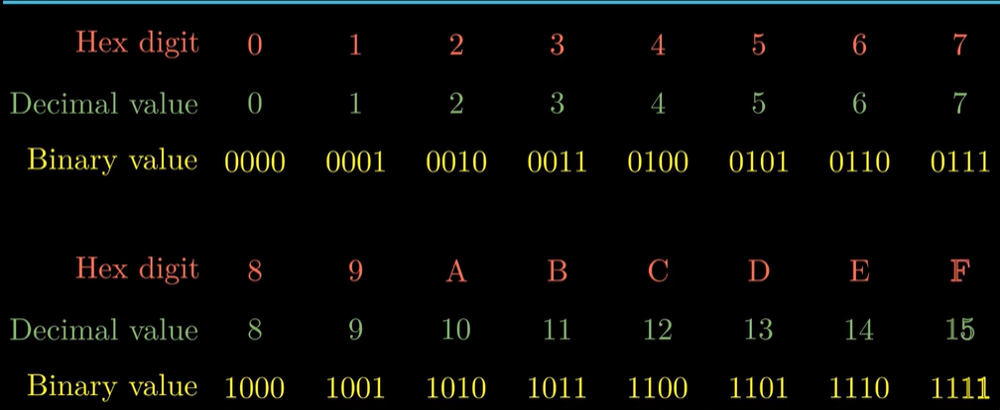
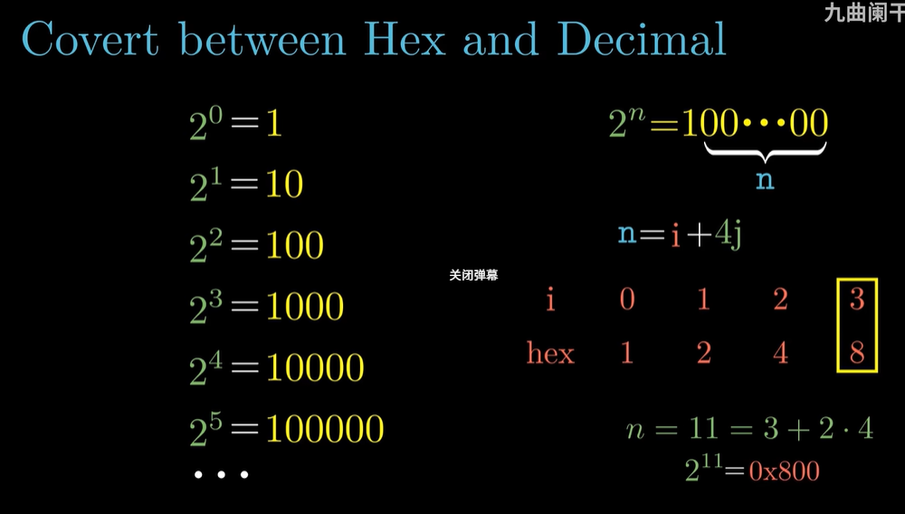
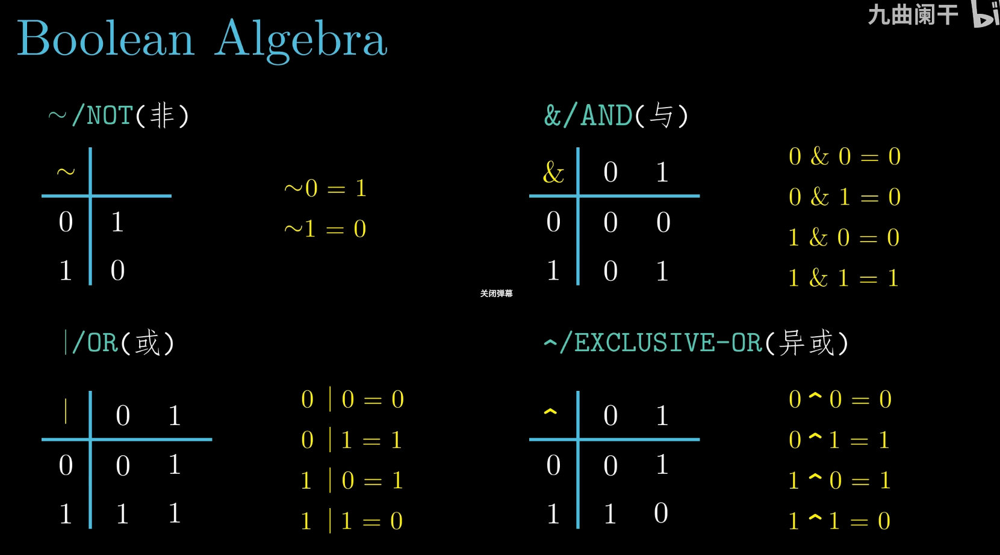
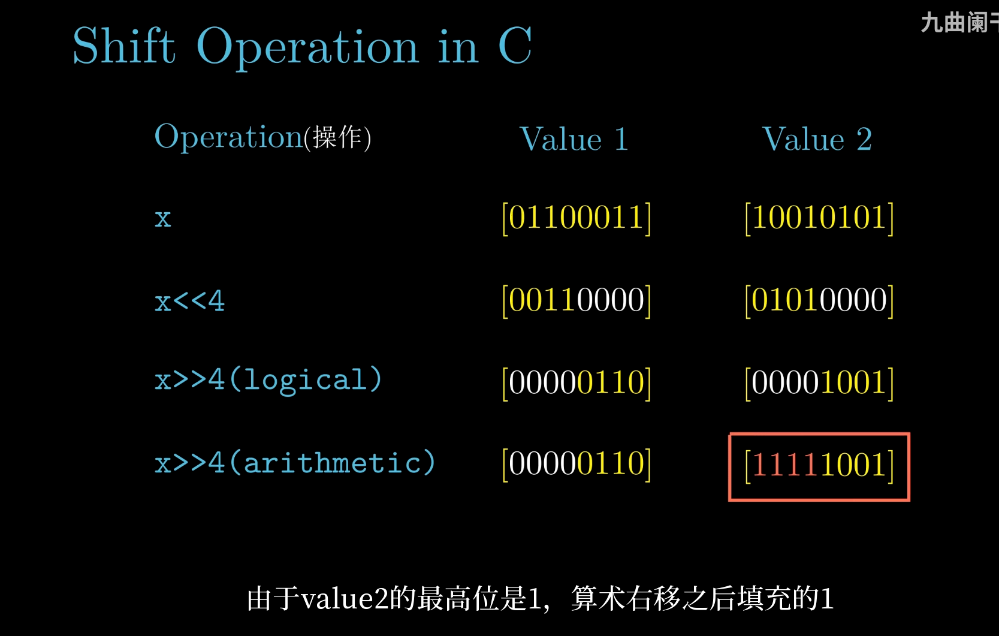

# 2.1 信息存储

> **📖 本节定位**　第 2 章「信息的表示和处理」· 教材 P24–P40
> **一句话**：机器级程序把内存看成一个**巨大的一维字节数组**，每个字节一个地址；本节先讲清"字节怎么编号、怎么读写"，再讲"位上的四种运算"。

> [!IMPORTANT] 本节要回答的三个问题
> 1. 内存那么大，机器凭什么"按地址"一下就摸到某个字节？地址到底是什么？
> 2. 为什么程序员满嘴十六进制？给你 `0x01234567`，你能立刻说出它在内存里的 4 个字节吗？
> 3. 同一段字节，为什么按 `int` 读是 19088743、按 `float` 读却是一个极小的数？

**读之前你需要会**：二进制与十进制的互转、`sizeof` 的用法（见 [1.1 信息就是位＋上下文](../第01章%20计算机系统漫游/1.1%20信息就是位＋上下文.md) 的"位 + 上下文"）。忘了也没关系——本节会把"1 位十六进制 = 4 位二进制"重新推一遍。

[← 本章导读](00%20本章导览.md)　｜　[下一节：2.2 整数表示 →](2.2%20整数表示.md)

---

## 🎯 核心结论

| # | 结论 |
| :-: | :--- |
| 1 | 内存 = 字节数组；地址 = 数组下标 |
| 2 | 十六进制是"给程序员看的二进制"，1 位十六进制 = 4 位二进制 |
| 3 | **字长（word size）决定指针宽度**；32 位 vs 64 位程序的区别就在这里 |
| 4 | 多字节对象在内存中的排列有**小端 / 大端**两种约定 |
| 5 | 字符串 = 以 `\0` 结尾的字符数组；**代码不可移植，文本可移植** |
| 6 | 位运算（`& \| ~ ^`）按位做逻辑；逻辑运算（`&& \|\| !`）只产出 0/1 且**短路** |
| 7 | 右移分**逻辑右移**（补 0）与**算术右移**（补符号位），取决于操作数类型 |

---

## 2.1.1 虚拟内存与地址

**机器级程序（汇编 / C）看到的内存模型**：

```text
        虚拟内存（virtual memory）
  ┌──────┬──────┬──────┬──────┬─────┬──────┐
  │ 字节 │ 字节 │ 字节 │ 字节 │ ... │ 字节 │   ← 每个格子 1 字节 = 8 位
  └──────┴──────┴──────┴──────┴─────┴──────┘
   0x00   0x01   0x02   0x03   ...   0xFF...
     ↑
   地址（address）= 这个数组的下标
```

- 一个程序把内存视为一个非常大的字节数组，称为**虚拟内存**；
- 内存的每个字节都由一个唯一的数字标识，称为它的**地址**；
- 所有可能地址的集合称为**虚拟地址空间**。

> [!NOTE]
> 这个"平坦的一维数组"模型是**抽象**——真实硬件里内存可能是多级的、可能分页、可能不在同一块芯片上（第 6、9 章展开）。但对写 C / 汇编的人来说，它就是一条直线。

---

## 2.1.2 十六进制表示法

**为什么用十六进制？** 二进制太长、十进制与位对不齐；而 1 位十六进制恰好等于 **4 位二进制**，一眼就能对应。

**先说它想解决什么问题**：内存地址、机器指令、位模式，在机器里全是二进制。人读 32 位就是 32 个字符，抄错一位整条指令就废了；写成十进制又看不出"这是哪几位"。

```text
二进制   1011 1100 0011 0111     ← 16 个字符，眼睛分组都困难
十进制   48183                   ← 短了，但和"第几位"完全对不上
十六进制 BC37                    ← 4 位一组，一眼看出是哪 4 位
```

**形式化定义**：把位串从**右往左**每 4 位切一段，每段换成一个 0–F 的符号；最左不足 4 位就在左边补 0。反过来，每个十六进制符号展开成固定 4 位。因为 $16=2^4$，切分**永远不会跨段借位**——这是唯一"无损且对齐"的紧凑写法。

### （1）基本对照表



*▲ 图 2-1-1：0–F 共 16 个十六进制数字的十进制值与 4 位二进制值。A–F 对应 10–15，是需要背下来的部分。*

| 十六进制 | 0 | 1 | … | 9 | A | B | C | D | E | F |
| :--- | :-: | :-: | :-: | :-: | :-: | :-: | :-: | :-: | :-: | :-: |
| 十进制 | 0 | 1 | … | 9 | 10 | 11 | 12 | 13 | 14 | 15 |
| 二进制 | 0000 | 0001 | … | 1001 | 1010 | 1011 | 1100 | 1101 | 1110 | 1111 |

**书写约定**：C 里用 `0x` 前缀（如 `0x1A2B`）；教材正文里常用下标 `1A2B₁₆`。二者等价。

### （2）二进制 ↔ 十六进制：四位一组

```text
二进制: 1011 1100 0011 0111
         │    │    │    │
十六进制:  B    C    3    7      →  0xBC37
```

反过来，十六进制转二进制只需把每位展开成 4 位。**这是唯一需要熟练的双向转换**。

### （3）十进制 → 十六进制：反复除 16 取余

```text
314156 ÷ 16 = 19634 余 12  → C
 19634 ÷ 16 =  1227 余  2  → 2
  1227 ÷ 16 =    76 余 11  → B
    76 ÷ 16 =     4 余 12  → C
     4 ÷ 16 =     0 余  4  → 4
                       ↑ 从下往上读
314156 = 0x4CB2C
```

### （4）2 的幂与十六进制的快速换算



*▲ 图 2-1-2：2ⁿ 的二进制是"1 后面跟 n 个 0"；把 n 拆成 `n = i + 4j`（i∈{0,1,2,3}，j 为十六进制位数）就能秒算。例：n = 11 = 3 + 2×4 → 2¹¹ = 0x800。*

**速算表**：

| n | 2ⁿ | n | 2ⁿ |
| :-: | :--- | :-: | :--- |
| 8 | 0x100 | 32 | 0x1 0000 0000 |
| 10 | 0x400 | 40 | 0x100 0000 0000 |
| 16 | 0x1 0000 | 48 | 0x1 0000 0000 0000 |
| 20 | 0x10 0000 | 60 | 0x1000 0000 0000 0000 |
| 24 | 0x100 0000 | 63 | 0x8000 0000 0000 0000 |

> [!TIP]
> 记住 2¹⁰ ≈ 10³ 这条近似，估算内存/文件大小时非常好用：2³² 字节 = 4 GB，2⁶⁴ 字节 ≈ 16 EB。

### （5）心算：不查表也能换

**十进制 → 十六进制：按 256 分段，别反复除 16。** 两个 hex 位正好是 256 的倍数，人脑更擅长"先减大块"：

```text
314156 的十六进制
  314156 ÷ 256 = 1227 余 44    → 末两位 44 = 0x2C
    1227 ÷ 256 =    4 余 203   → 再往前两位 203 = 0xCB
       4                        → 最高位 0x4
  拼起来 0x4CB2C  ✓（与"除 16 取余"的结果一致）
```

**十六进制 → 二进制：背"8 4 2 1"。** 每位 hex 只对应 4 个权值：看到 `B` 想 $8+2+1$ → `1011`，看到 `7` 想 $4+2+1$ → `0111`。**不要**先转十进制再转二进制。

**$2^n$ 的十六进制：拆 $n=i+4j$。** 从右数第 $j+1$ 个 hex 位写 $2^i$ 对应的数字（$i=0,1,2,3$ 对应 $1,2,4,8$），其余位补 0：

| $n$ | 拆分 | $2^n$ | 说明 |
| :-: | :--- | :--- | :--- |
| 21 | $1+4\times5$ | `0x200000` | 第 6 个 hex 位是 2 |
| 31 | $3+4\times7$ | `0x80000000` | 正是 $TMax+1$ |

<details>
<summary>✅ 检查点 1：不查表，把 `0x2A` 写成二进制，并说出 $2^{21}$ 的十六进制。</summary>

`0x2A` → `0010 1010`。$21=1+4\times5$，第 6 个 hex 位写 2 → `0x200000`（$=2097152$）。
</details>

---

## 2.1.3 字数据大小

### （1）字长 = 指针宽度

每台计算机都有一个**字长（word size）**，指明**指针数据的标称大小**。因为虚拟地址由一个字来编码，所以**字长决定了虚拟地址空间的最大值**：

| 字长 | 地址范围 | 地址空间上限 |
| :--- | :--- | :--- |
| 32 位 | 0 ~ 2³²−1 | 4 GB |
| 64 位 | 0 ~ 2⁶⁴−1 | 16 EB |

```text
        32 位机器                          64 位机器
  ┌────────────────┐               ┌────────────────────────────────┐
  │ 指针占 4 字节  │               │ 指针占 8 字节                  │
  └────────────────┘               └────────────────────────────────┘
   地址: 0x00000000 ~ 0xFFFFFFFF     地址: 0x0 ~ 0xFFFFFFFFFFFFFFFF
```

> [!IMPORTANT]
> 判断"一个程序是 32 位还是 64 位"，看的是**编译选项**（`-m32` / `-m64`），不是机器本身。64 位机器上完全可以跑 32 位程序，此时它只用 4 字节地址，因此最多只能访问 4 GB。

### （2）C 语言基本类型的大小（64 位 Linux / x86-64）

| C 声明 | 32 位 | 64 位（x86-64） | 说明 |
| :--- | :-: | :-: | :--- |
| `char` | 1 | 1 | 也用于存字节 |
| `short` | 2 | 2 | |
| `int` | 4 | 4 | 注意：**64 位下 `int` 仍是 4 字节** |
| `long` | 4 | **8** | 唯一"随字长变"的整型 |
| `long long` | 8 | 8 | |
| `char *` | 4 | **8** | 指针随字长变 |
| `float` | 4 | 4 | |
| `double` | 8 | 8 | |

```c
// 一段经典的"64 位移植陷阱"
int *p = ...;
long n = (long)p;   // 32 位上会截断指针！正确写法应显式用 intptr_t
```

> [!WARNING]
> `long` 与 `int` 在 64 位下**不一样大**，`long` 与指针**一样大**。凡是"把指针塞进整型"的代码，都应该用 `intptr_t` / `uintptr_t`。

### （3）C 语言的声明没有固定大小

教材特别强调：C 只规定了下界（如 `int` 至少 2 字节），具体大小由**编译器 + 机器**决定。可移植代码应使用 `<stdint.h>` 的 `int32_t`、`uint64_t` 等固定宽度类型。

---

## 2.1.4 寻址和字节顺序

### （1）小端 vs 大端

对于一个跨多个字节的对象（如 `int`），必须建立两条规则：

1. 这个对象的**地址**是什么？（通常取所用字节中**最小的**那个地址）
2. 这些字节在内存里**按什么顺序**排？

**先说它想解决什么问题**：`int` 是 4 个字节，可内存只按字节编号。于是必须回答：4 个字节里拿哪个当地址？剩下 3 个按什么顺序摆？

**类比：写数字的习惯差异**。中国人写 `1234` 是**从左往右**写，先写最高位 1、最后写最低位 4；阿拉伯语、希伯来语却从右往左。数字还是那个数，只是"从哪头开始念"不同。字节序也是同一件事：**值的书写方向**和**内存地址的增长方向**，谁跟谁对齐？

```text
人读数字：  1     2     3     4       高位在左，低位在右（"大端"直觉）
内存地址： 0x100 0x101 0x102 0x103    地址从左往右增长
              ↑
   "值的最低位" 放在 "地址的低端" 还是 "地址的高端"？ —— 全部争议就在此
```

**形式化定义**：设对象占 $w/8$ 个字节，其**地址**取这些字节中最小的那个。若最低有效字节放在最小地址，称**小端（little-endian）**；若最高有效字节放在最小地址，称**大端（big-endian）**。

| 约定 | 低位字节放在 | 典型用户 |
| :--- | :--- | :--- |
| **小端（little-endian）** | **低地址** | x86、Android/iOS(ARM 默认) |
| **大端（big-endian）** | **高地址** | 部分 IBM/Motorola、网络字节序 |

**例**：`int x = 0x01234567`，起始地址 `0x100`：

```text
 地址:      0x100  0x101  0x102  0x103
 小端:       67     45     23     01     ← 最低有效字节在最小地址
 大端:       01     23     45     67     ← 最高有效字节在最小地址
```

#### 一起算一遍

把 `int x = 0x01234567` 放在从 `0x100` 开始的内存里，逐格填出两种字节序：

| 地址 | 小端 | 这一格装的是 | 大端 | 这一格装的是 |
| :--- | :-: | :--- | :-: | :--- |
| `0x100` | `67` | 最低有效字节（bit 7–0） | `01` | 最高有效字节（bit 31–24） |
| `0x101` | `45` | bit 15–8 | `23` | bit 23–16 |
| `0x102` | `23` | bit 23–16 | `45` | bit 15–8 |
| `0x103` | `01` | 最高有效字节（bit 31–24） | `67` | 最低有效字节（bit 7–0） |

一句话记：**小端 = 低地址放低字节**，大端正好反过来。两种机器上 `x` 的**值**都是 `0x01234567`，变的只是它在内存里的摆法。

再用三种方式读同一块 4 字节（`unsigned char *p = (unsigned char *)&x`）：

| 读法 | 机器做的事 | 小端机器上的结果 |
| :--- | :--- | :--- |
| `int` | 按本机约定把 4 字节拼回一个数 | `0x01234567` = 19088743 |
| `float` | **位不动**，按 IEEE 754 重新解释：符号 0、阶码字段 2（实际指数 $-125$）、尾数 `0x234567` | 约 $3.0\times10^{-38}$，一个极小正数 |
| `char *` | 按地址顺序逐字节取 | `0x67 0x45 0x23 0x01`，即 `'g' 'E' '#'` 加一个不可见控制符 |

**最容易踩的一格**：若用 `printf("%s", p)` 打印，程序不会在 `0x01` 处停——字符串只认 `0x00`（`'\0'`）。这 4 个字节里一个 0 都没有，`printf` 会继续往后读。**错的不是字节序，是读法。**

```c
// 观察字节顺序的最小实验
#include <stdio.h>
int main() {
    int x = 0x01234567;
    unsigned char *p = (unsigned char *)&x;   // 用 char* 逐字节看
    for (int i = 0; i < 4; i++)
        printf("%.2x ", p[i]);
    printf("\n");     // x86-64 上输出: 67 45 23 01
    return 0;
}
```

### （2）为什么"字节顺序"会成为麻烦

```text
  机器 A（小端）                        机器 B（大端）
  ┌──────────────────┐                 ┌──────────────────┐
  │ 直接把 int 写文件 │  ── 网络/磁盘 ──▶│ 直接按 int 读     │
  └──────────────────┘                 └──────────────────┘
           0x01234567   →  字节流 67 45 23 01  →  读成 0x67452301  ✗
```

> [!WARNING]
> 三类经典事故：
> 1. **网络通信**：规定统一用大端（网络字节序，`htonl` / `ntohl`）；
> 2. **二进制文件交换**：读写时必须规定字节序；
> 3. **反汇编 / 调试**：看到的机器码字节顺序与直觉相反。

### （3）强制类型转换不会改变位

```c
int  x  = 12345;
float f = (float)x;     // 值相同，但位模式完全不同
```

- `(float)x` 是把整数 **12345** 重新编码成 IEEE 754 单精度（见 2.4）；
- `(int &)x` 之类的"位重解释"（C 里用指针/`union`）则是保持位不变、换解释方式。

这两件事经常被混为一谈，务必分清：**值转换 ≠ 位重解释**。

### （4）为什么 x86 选小端

大端更符合人的书写习惯，为什么反着来？三个硬件理由：

1. **类型转换不改地址**：`int *` 转成 `short *` 后，小端下原地址正好指向最低有效字节，直接读 2 字节即可；大端得先加偏移。
2. **加法从低位算起**：进位先出现在低地址，早期硬件可以边算边把结果写回内存。
3. **变长数据同向增长**：多字节整数和字符串都从低地址往高地址长，指针递增逻辑可以通用。

代价是人读 hex dump 时要倒着看，所以**网络协议统一规定用大端**（`htonl` / `ntohl`）。这不是谁对谁错，而是**两端约定必须一致**——最怕一端写小端、另一端按大端读。

<details>
<summary>✅ 检查点 2：大端机器上 `int x = 1;`，`0x100` 处的字节是什么？小端呢？</summary>

大端是 `0x00`（`00 00 00 01`，最高有效字节在最小地址）；小端是 `0x01`。一行判断法：`int x=1; printf("%d", *(char*)&x);` 输出 1 是小端，输出 0 是大端。
</details>

---

## 2.1.5 表示字符串

C 中的字符串被编码为一个**以 `null`（值为 0）字符结尾的字符数组**：

```c
char s[6] = "12345";
```

```text
 地址:  0x00 0x01 0x02 0x03 0x04 0x05
 字符:  '1'  '2'  '3'  '4'  '5'  '\0'
 ASCII: 0x31 0x32 0x33 0x34 0x35 0x00
```

- 每个字符用 ASCII 编码，占 1 字节；
- 结尾的 `'\0'` 必须占 1 字节——所以 `"12345"` 需要 **6 字节**，不是 5 字节；
- `strlen(s)` 返回 5（不含 `\0`），`sizeof(s)` 返回 6。

> [!TIP]
> **文本数据比二进制数据更具平台独立性**：只要对方也认 ASCII/UTF-8，就能正确读；而二进制整数要担心字节序、字长、对齐。

---

## 2.1.6 表示代码

同一个 C 函数，在不同机器上编译出的机器码**完全不同**：

```text
        add.c 中的  int sum(int x, int y) { return x + y; }
                                                      │
     ┌──────────────┼───────────────┬─────────────────┐
     ▼              ▼               ▼                 ▼
  x86-64         ARM64           RISC-V            （其他 ISA）
  lea (%rdi,%rsi),%rax   add w0,w0,w1 ...      add a0,a0,a1
```

教材的结论很硬：

> **二进制代码是不兼容的。** 一台机器上编译的可执行文件，不能拿到另一台机器上运行（除非那台机器能模拟/兼容同一 ISA）。

这也解释了为什么"同一个 `.c` 文件"要在不同平台各自编译一次，以及为什么 Python/Java 需要"解释器 / 虚拟机"这层中间抽象。

---

## 2.1.7 布尔代数简介

### （1）四种基本运算



*▲ 图 2-1-3：NOT（~）、AND（&）、OR（|）、XOR（^）四种运算的真值表与等式。*

| 运算 | 符号 | 真值表 | 记忆 |
| :--- | :-: | :--- | :--- |
| 非 NOT | `~` | `~0=1`, `~1=0` | 取反 |
| 与 AND | `&` | 全 1 才得 1 | 有 0 出 0 |
| 或 OR | `\|` | 有 1 就得 1 | 有 1 出 1 |
| 异或 XOR | `^` | 不同得 1，相同得 0 | **"不进位加法"** |

> [!WARNING]
> 这张课件截图里有一处笔误：OR 的最后一条等式印成了 `1 | 1 = 0`，但同图真值表中该格是 `1`，按定义也应为 `1`。**以真值表为准。**

### （2）布尔环的性质（后面优化代码会用到）

| 性质 | 表达式 |
| :--- | :--- |
| 交换律 | `a & b = b & a`，`a \| b = b \| a` |
| 结合律 | `(a & b) & c = a & (b & c)` |
| 分配律 | `a & (b \| c) = (a & b) \| (a & c)` |
| 自反 | `a ^ a = 0`，`a ^ 0 = a` |
| 德摩根 | `~(a & b) = ~a \| ~b` |

`a ^ a = 0` 推出著名的**异或交换**（不用临时变量）：

```c
a ^= b;   // a = a ^ b
b ^= a;   // b = b ^ (a^b) = a
a ^= b;   // a = (a^b) ^ a = b
```

**补充一句**：这招只是"炫技"，实际代码里用临时变量更快更清晰——编译器本来就懂。教材用它说明 XOR 的性质。

---

## 2.1.8 C 语言中的位级运算

C 的 `|`、`&`、`~`、`^` 是**按位**作用于整型（包括 `char`、`int`、`long`）。

```c
// 教材的经典例子
0x69 & 0x55   →  0x41
0x69 | 0x55   →  0x7D
```

```text
    0x69 = 0110 1001
  & 0x55 = 0101 0101
  ───────────────────
    0x41 = 0100 0001
```

**常见用途**：

| 目的 | 写法 |
| :--- | :--- |
| 取某一位（掩码） | `x & (1 << k)` |
| 置 1 | `x \|= (1 << k)` |
| 清 0 | `x &= ~(1 << k)` |
| 翻转 | `x ^= (1 << k)` |
| 判断奇偶 | `x & 1` |
| 快速乘除 2 的幂（无符号） | `x << k` / `x >> k` |

---

## 2.1.9 C 语言中的逻辑运算

| 运算符 | 名称 | 结果 |
| :--- | :--- | :--- |
| `&&` | 逻辑与 | 只有 0 或 1 |
| `\|\|` | 逻辑或 | 只有 0 或 1 |
| `!` | 逻辑非 | 只有 0 或 1 |

**两个关键差异**：

1. **结果只有 0/1**，而位运算的结果是"按位算出来的数"；
2. **短路求值**：`a && b` 中若 `a` 为假，`b` 根本不求值。

```c
// ① 用短路避免除零
int safe_div(int a, int b) {
    return b && (a / b);       // b==0 时直接返回 0，不会执行 a/b
}

// ② 用短路避免空指针解引用
int check(char *p) {
    return p && *p;            // p==NULL 时不会读 *p
}

// ③ 位运算 vs 逻辑运算的差别
0x69 && 0x55   →  1            // 两个非零 → 真
0x69 &  0x55   →  0x41         // 按位与
```

> [!WARNING]
> 把 `&&` 写成 `&`（或反之）是极常见的 bug，编译器通常**不报错**，因为两边都是整型。

<details>
<summary>✅ 检查点 3：`0x69 && 0x55` 与 `0x69 & 0x55` 分别得什么？为什么？</summary>

`&&` 得 `1`：两边都非零，逻辑与只吐"真"；`&` 得 `0x41`：按位与，`0110 1001 & 0101 0101 = 0100 0001`。一个产出"判断"，一个产出"数"。
</details>

---

## 2.1.10 C 语言中的移位运算

| 运算 | 符号 | 语义 |
| :--- | :-: | :--- |
| 左移 | `x << k` | 丢弃最高 k 位，低位补 k 个 0 |
| 逻辑右移 | `x >> k`（无符号） | 丢弃最低 k 位，高位补 k 个 0 |
| 算术右移 | `x >> k`（有符号） | 丢弃最低 k 位，高位补 k 个**符号位** |

**教材的经典例子**（8 位）：



*▲ 图 2-1-4：对 `01100011` 与 `10010101` 分别做左移 4 位、逻辑右移 4 位、算术右移 4 位的结果对比。注意第二列最高位为 1，算术右移补的是 1。*

| 运算 | 值 1（最高位 0） | 值 2（最高位 1） |
| :--- | :--- | :--- |
| `x` | `0110 0011` | `1001 0101` |
| `x << 4` | `0011 0000` | `0101 0000` |
| `x >> 4`（逻辑） | `0000 0110` | `0000 1001` |
| `x >> 4`（算术） | `0000 0110` | `1111 1001` |

**规则细节**：

- 移位量 `k` 应满足 `0 ≤ k < w`（w 为数据位宽）；超出时行为由实现定义；
- 对负数**左移**在 C 中是未定义行为（UB），要小心；
- 编译器可能把 `x * 4` 优化成 `x << 2`，把 `x / 8` 优化成"算术右移 + 修正"（见 2.3.7）。

---

## 📌 重点速记

```text
内存模型   : 虚拟内存 = 大字节数组，地址 = 下标
十六进制   : 1 位 hex = 4 位二进制；0x 前缀
字长       : 指针宽度；32位→4GB，64位→16EB
C 类型大小 : long 和指针随字长变；int 恒 4 字节
字节序     : 小端=低位字节放低地址（x86）；大端=网络字节序
字符串     : 以 '\0' 结尾，"12345" 占 6 字节
代码       : 二进制不可移植，文本可移植
位运算     : & | ~ ^   按位算
逻辑运算   : && || !   只出 0/1，且短路
移位       : << 补0；>> 看符号（逻辑补0 / 算术补符号位）
```

---

## ⚠️ 易错点

1. **`int` 在 64 位下还是 4 字节**——变的是 `long` 和指针。
2. **`0x69 && 0x55` 得 1，不是 0x41**——逻辑运算与位运算别混。
3. **字符串长度 ≠ 字符个数**：`sizeof("12345")` 是 6。
4. **算术右移补符号位**，所以 `-8 >> 1` 是 `-4`，但 `(unsigned)-8 >> 1` 是一个巨大的正数。
5. **移位量超过位宽是 UB**，不要写 `x << 32`（`int` 只有 32 位）。
6. **字节序问题只在"跨机器传二进制"时暴露**，本机自测永远发现不了。

---

## ❓ 常见困惑

**Q：十六进制只是"看着方便"，为什么不能全用十进制？**
A：十进制和二进制**不对齐**——1 位十进制不等于固定的几位二进制（10 不是 2 的幂），互转必须做除法，人几乎无法心算。十六进制 1 位恰好 4 位二进制，切段即转，这才是它能统治底层调试的原因。

**Q：小端这么反人类，为什么还没被淘汰？**
A：因为**兼容性**。x86 从 1978 年的 8086 起就是小端，改一次要让所有已编译的程序、文件格式、协议全部重来。工程上"统一"比"顺眼"重要；真需要跨机器交换时，协议层会规定用大端（`htonl`）。

**Q：`int` 和 `float` 都是 4 字节，为什么 `(float)x` 与 `*(float*)&x` 结果不同？**
A：前者是**值转换**：把 12345 这个数重新编码成浮点格式，值仍是 12345。后者是**位重解释**：4 个字节一位不动，只换解读规则，所以得到完全不同的数。后者在 C 里要靠 `union`/`memcpy`，直接 `*(float*)&x` 还违反严格别名规则。

**Q：`"12345"` 到底几个字节？`strlen` 和 `sizeof` 为什么差 1？**
A：6 个字节：5 个 ASCII 字符 + 1 个 `'\0'`。`strlen` 数"到 `\0` 为止有几个字符"，是 5；`sizeof` 数"整个数组占多少字节"，是 6。前者运行期数，后者编译期定。

---

## 🛠 动手试试

1. 让 Python 替你"看内存"：

   ```python
   import struct
   print(struct.pack('<I', 0x01234567).hex())   # 小端
   print(struct.pack('>I', 0x01234567).hex())   # 大端
   ```

   预期输出 `67452301` 和 `01234567`——正是上面表格里那 4 个字节。

2. 在自己机器上确认字节序：

   ```bash
   printf '#include <stdio.h>\nint main(){int x=1;printf("%%d\\n",*(char*)&x);}' > e.c
   gcc e.c -o e && ./e
   ```

   预期：x86-64 输出 `1`（小端）；大端机器会输出 `0`。

---

## ✅ 自测

1. 把 `0x1A2B3C` 写成二进制。
2. `15213` 的十六进制是多少？
3. `int x = 0x0000000A` 在小端机器上，`0x100` 处的字节依次是什么？
4. `"hello"` 在内存中占几个字节？`strlen("hello")` 与 `sizeof("hello")` 分别是什么？
5. `0x69 & 0x55`、`0x69 | 0x55`、`0x69 ^ 0x55` 分别是多少？
6. 8 位有符号数 `0xF3` 逻辑右移 2 位和算术右移 2 位的结果分别是多少？

<details>
<summary>参考答案</summary>

1. `0001 1010 0010 1011 0011 1100`
2. `15213 = 0x3B6D`
3. `0A 00 00 00`（最低有效字节 `0x0A` 在最低地址）
4. 6 字节；`strlen` = 5，`sizeof` = 6（含 `'\0'`）
5. `0x41`、`0x7D`、`0x3C`
6. 逻辑右移得 `0x3C`；算术右移得 `0xFC`（补两个 1）

</details>

---

## 🔗 与其他章节的联系

| 本节内容 | 后续用在哪 |
| :--- | :--- |
| 字长 / 指针宽度 | 3.4 寄存器与操作数、3.8 数组寻址 |
| 字节序 | 7 章链接、9 章虚拟内存、11 章网络编程 |
| 布尔代数 | 4.2 HCL 组合逻辑、3.6 条件码 |
| 位运算 | 2.3 乘常数优化、3.6 条件码合成、9 章内存对齐 |

---

[← 本章导读](00%20本章导览.md)　｜　[下一节：2.2 整数表示 →](2.2%20整数表示.md)
