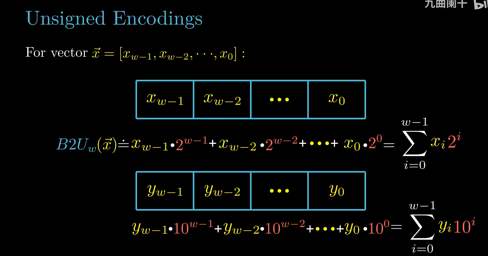
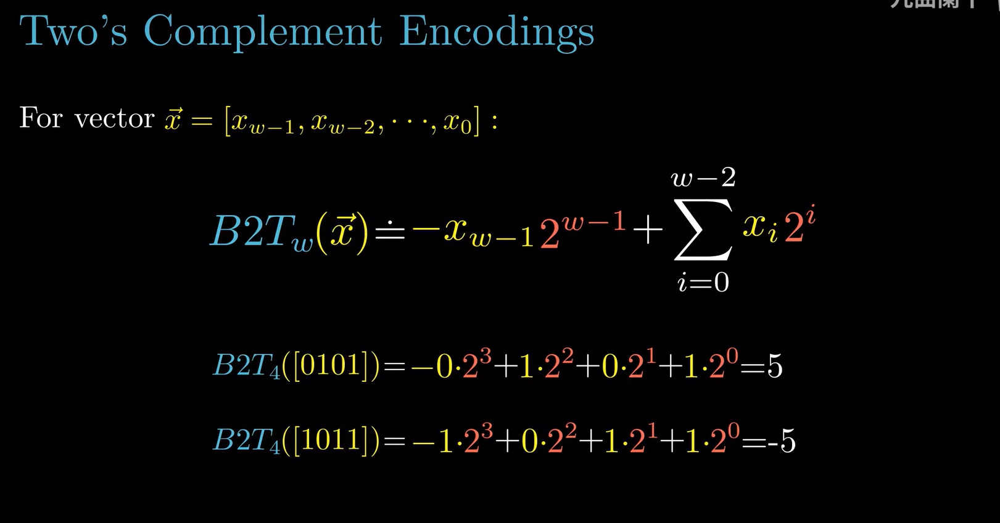
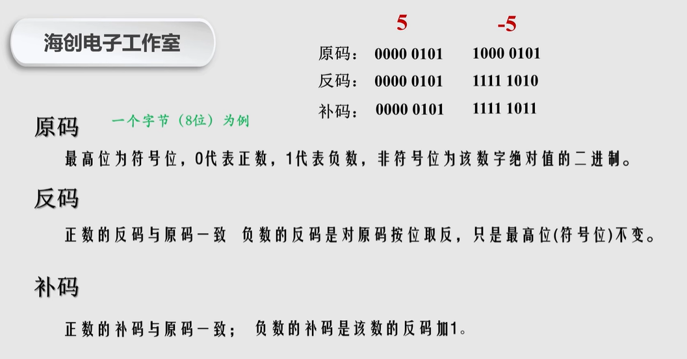
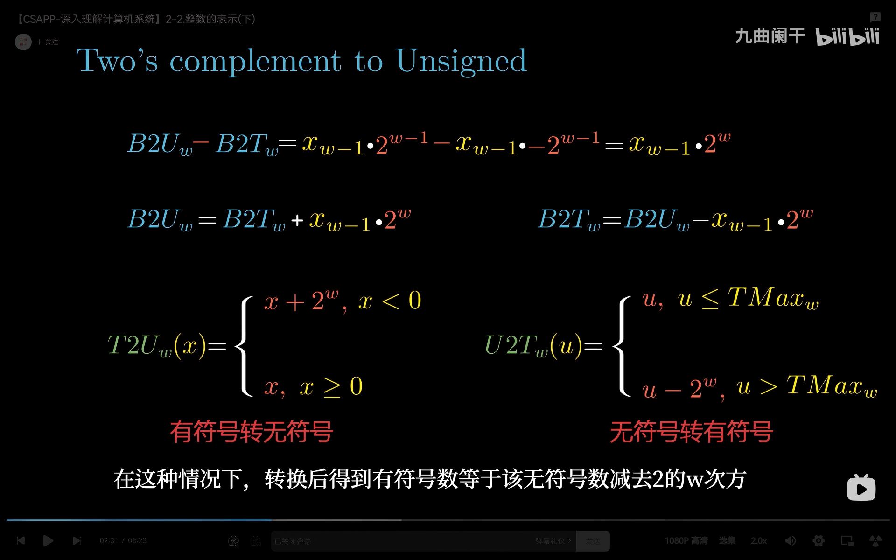
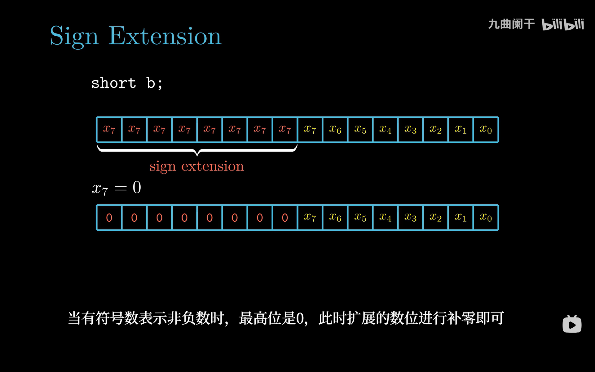
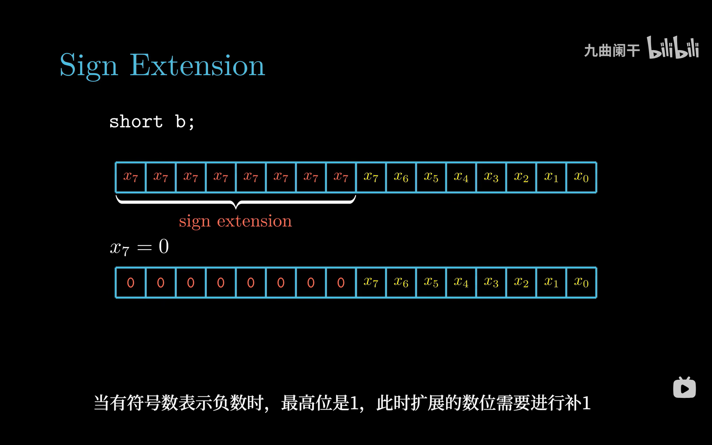
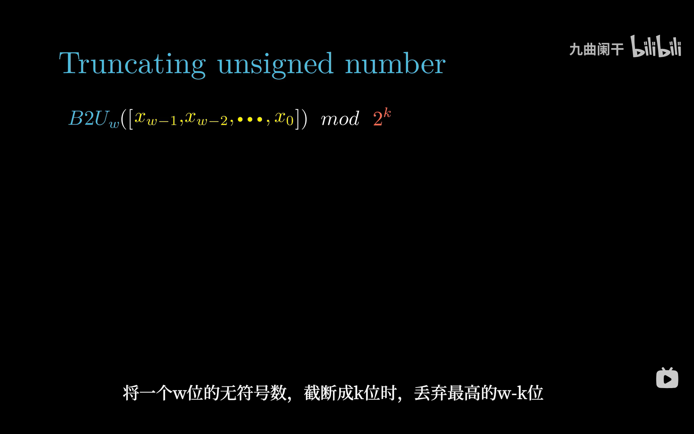

# 2.2 整数表示

> **📖 本节定位**　第 2 章「信息的表示和处理」· 教材 P41–P60
> **一句话**：同一串位，按"无符号"读和按"补码"读得到完全不同的数；本节把这两套解释写成 $B2U$ / $B2T$ 两个函数，再讲清它们之间怎么转换、怎么扩展、怎么截断。

[← 上一节：2.1 信息存储](2.1%20信息存储.md)　｜　[下一节：2.3 整数运算 →](2.3%20整数运算.md)

---

## 🎯 核心结论

| # | 结论 |
| :-: | :--- |
| 1 | 一个 $w$ 位位向量只有**两套整数解释**：无符号 $B2U_w$（$0 \sim 2^w-1$）与补码 $B2T_w$（$-2^{w-1} \sim 2^{w-1}-1$） |
| 2 | 补码与无符号的**唯一差别**在最高位的权值：无符号是 $+2^{w-1}$，补码是 $-2^{w-1}$ |
| 3 | 补码范围**不对称**：$TMin = -2^{w-1}$，$TMax = 2^{w-1}-1$，故 $\lvert TMin \rvert = TMax + 1$ |
| 4 | 有符号 ↔ 无符号转换**位不变**，只换解释：$T2U(x)=x+2^w\ (x<0)$，$U2T(u)=u-2^w\ (u>TMax)$ |
| 5 | C 里混合有符号与无符号时**有符号被静默转成无符号**——`-1 < 0U` 为假就是这么来的 |
| 6 | 扩展看符号（零扩展 / 符号扩展），截断取模（$\bmod\ 2^k$）；两者都不报错，静默改值 |

---

## 2.2.1 整型数据类型

C 的整型家族由"**宽度 + 是否有符号**"两个维度组成。以 x86-64 Linux 为例：

| C 类型 | 字节 | 有符号范围 | 无符号范围 |
| :--- | :-: | ---: | ---: |
| `char` | 1 | −128 ~ 127 | 0 ~ 255 |
| `short` | 2 | −32 768 ~ 32 767 | 0 ~ 65 535 |
| `int` | 4 | −2 147 483 648 ~ 2 147 483 647 | 0 ~ 4 294 967 295 |
| `long`（64 位） | 8 | $-2^{63}$ ~ $2^{63}-1$ | 0 ~ $2^{64}-1$ |
| `long long` | 8 | $-2^{63}$ ~ $2^{63}-1$ | 0 ~ $2^{64}-1$ |
| `char *` | 8 | — | 0 ~ $2^{64}-1$（指针按无符号地址理解） |

统一写成公式（$w$ 为位宽）：

```text
        有符号（补码）                     无符号
  ┌──────────────────────────┐   ┌──────────────────────────┐
  │  TMin = -2^(w-1)         │   │  UMin = 0                │
  │  TMax =  2^(w-1) - 1     │   │  UMax = 2^w - 1          │
  └──────────────────────────┘   └──────────────────────────┘
        ↑ 负数比正数多一个              ↑ 从 0 开始
```

**头文件 `<limits.h>`** 给出这些边界（编译期常量，可安全用于 `#if`）：

```c
#include <limits.h>
#include <stdio.h>

int main(void) {
    printf("CHAR_MIN  = %d\n",  CHAR_MIN);    // -128
    printf("INT_MAX   = %d\n",  INT_MAX);     // 2147483647
    printf("INT_MIN   = %d\n",  INT_MIN);     // -2147483648
    printf("UINT_MAX  = %u\n",  UINT_MAX);    // 4294967295
    printf("LONG_MAX  = %ld\n", LONG_MAX);    // 9223372036854775807
    printf("ULLONG_MAX= %llu\n", ULLONG_MAX); // 18446744073709551615
    return 0;
}
```

> [!IMPORTANT]
> **C 标准只给"下界"，不给精确宽度。** 标准保证的是 `char` 至少 8 位、`short` 至少 16 位、`int` 至少 16 位、`long` 至少 32 位，并且有符号类型的范围**至少**是对称的 $[-(2^{w-1}-1),\ 2^{w-1}-1]$。换句话说：教材里那张"`int` = 4 字节、范围 $[-2^{31}, 2^{31}-1]$"的表，是 **x86-64 上的事实**，不是 C 语言的承诺。要写可移植代码就用 `<stdint.h>` 的 `int32_t` / `uint64_t`，或者用 `<limits.h>` 的宏做判断，别硬编码 2147483647。

历史上 C 允许用原码或反码实现有符号整数，那时 $TMin$ 只能是 $-(2^{w-1}-1)$，会白白浪费一个编码。**C23 已明确要求补码**，现代编译器（gcc/clang/msvc）也全都是补码，所以本节的 $B2T$ 就是你在真实机器上看到的行为。

---

## 2.2.2 无符号数的编码

**定义**：对位向量 $\vec{x} = [x_{w-1}, x_{w-2}, \dots, x_0]$，

$B2U_w(\vec{x}) = \sum_{i=0}^{w-1} x_i \cdot 2^i$

就是把每一位乘上它的位权再求和，和十进制"按位展开"完全一样。



*▲ 图 2-2-1：$B2U$ 把位向量按 $2^i$ 加权求和，最高位权值是 $2^{w-1}$。看的时候盯住"某一位是 0 就整项消失"这一点——这是后面对比补码的关键。*

**例**（4 位与 8 位）：

```text
 位向量   1   0   1   1
 位权    2³  2²  2¹  2⁰
 贡献     8   0   2   1   →  B2U₄(1011) = 11

 0xED = 1110 1101 → 128 + 64 + 32 + 8 + 4 + 1 = 237
```

**性质（双射）**：$B2U_w$ 是一个**双射**——每个 $w$ 位向量唯一对应 $[0, 2^w-1]$ 中的一个整数，反之亦然。所以 4 位恰好能表示 16 个数，8 位 256 个，一点都不浪费。

---

## 2.2.3 补码编码

**定义**：把最高位的权值从 $+2^{w-1}$ 改成 $-2^{w-1}$，其余不变：

$B2T_w(\vec{x}) = -x_{w-1}\cdot 2^{w-1} + \sum_{i=0}^{w-2} x_i \cdot 2^i$

这一项改动带来了"负数"，也让"符号位"这个概念自动出现：最高位为 1 时贡献 $-2^{w-1}$，足以压过后面所有正项。



*▲ 图 2-2-2：同一个 4 位格式下，`0101` 按补码读是 5，`1011` 按补码读是 $-8+2+1=-5$。注意最高位的权值是 $-8$ 而不是 $+8$。*

```text
 1011:  -1×8 + 0×4 + 1×2 + 1×1 = -5
 1000:  -1×8 + 0    + 0   + 0   = -8   ← TMin（只有这一位是 1）
 0111:   0×8 + 4 + 2 + 1       =  7   ← TMax（后面全 1）
```

### 为什么补码优于原码 / 反码

这是本节最该"讲道理"的地方。三种编码都是"用最高位表示符号"，差别在负数的构造方式：



*▲ 图 2-2-3：以 8 位为例的三种编码。+5 在三套编码里都是 `0000 0101`，差别全在 −5：原码只翻符号位，反码按位取反（符号位不动），补码是反码再加 1。*

| 编码 | −5 的 8 位表示 | 零的表示 | 8 位可表示范围 | 加法器实现 |
| :--- | :--- | :--- | :--- | :--- |
| 原码（sign-magnitude） | `1000 0101` | **两个**（`0000 0000` / `1000 0000`） | −127 ~ 127 | 要先比绝对值、再定符号和运算 |
| 反码（ones' complement） | `1111 1010` | **两个**（`0000 0000` / `1111 1111`） | −127 ~ 127 | 需要"循环进位"（把溢出的进位加回最低位） |
| 补码（two's complement） | `1111 1011` | **唯一**（`0000 0000`） | −128 ~ 127 | **直接相加，丢弃进位** |

三条硬理由：

1. **零唯一**。两个零会让"$x=0$"的判断、比较、`memset` 全部变复杂；补码只有一个零，硬件只判"全 0"。
2. **加减法统一**。补码下 $5+(-5)$ 直接按无符号加：`0101 + 1011 = 1 0000`，丢掉最高进位恰好是 `0000`。减法变成"加负数"，**不需要单独的减法器**，这就是 ALU 只做加法的根本原因（第 3、4 章反复用到）。
3. **多表示一个数**。原码/反码的 256 个位模式里有 2 个都表示零，只装得下 255 个不同的数；补码的零唯一，256 个模式全用上，多出来的那个就是 $TMin=-128$。代价是范围不对称：$-(-128)$ 溢出。

**名字的来历**："补码（two's complement）"指的是 $-x$ 的位模式等于 $2^w - x$，也就是 $x$ 相对于 $2^w$ 的**补数**。所以"取负"在硬件上就是"用 $2^w$ 减一次"，即 `~x + 1`（见 2.3.3）。

**几个必须记住的位模式**（32 位）：

```text
 -1        = 0xFFFFFFFF   （全 1）
 0         = 0x00000000
 TMax      = 0x7FFFFFFF   （除了最高位全 1）
 TMin      = 0x80000000   （只有最高位是 1）
```

---

## 2.2.4 有符号数与无符号数之间的转换

**关键恒等式**：同一组位，两种解释只差最高位那一次的"权值差"：

$B2U_w(\vec{x}) - B2T_w(\vec{x}) = x_{w-1}\cdot 2^{w-1} - \left(-x_{w-1}\cdot 2^{w-1}\right) = x_{w-1}\cdot 2^w$

于是立刻得到两个转换公式（$x$ 为有符号值，$u$ 为无符号值）：

$T2U_w(x) = \begin{cases} x + 2^w, & x < 0 \\ x, & x \ge 0 \end{cases} \qquad U2T_w(u) = \begin{cases} u, & u \le TMax_w \\ u - 2^w, & u > TMax_w \end{cases}$



*▲ 图 2-2-4：整页只做了一件事——用 $B2U-B2T=x_{w-1}\cdot 2^w$ 推出两个分段函数。看下面那两行：$T2U$ 对负数**加** $2^w$，$U2T$ 对超过 $TMax$ 的数**减** $2^w$，方向相反是因为一个从负数"绕回"高位、一个从高位"绕回"负数。*

**4 位完整对照表**（把 $2^4=16$ 个位向量一次看全）：

| 位向量 | $B2U_4$ | $B2T_4$ | 位向量 | $B2U_4$ | $B2T_4$ |
| :--- | ---: | ---: | :--- | ---: | ---: |
| `0000` | 0 | 0 | `1000` | 8 | **−8** |
| `0001` | 1 | 1 | `1001` | 9 | −7 |
| `0010` | 2 | 2 | `1010` | 10 | −6 |
| `0011` | 3 | 3 | `1011` | 11 | −5 |
| `0100` | 4 | 4 | `1100` | 12 | −4 |
| `0101` | 5 | 5 | `1101` | 13 | −3 |
| `0110` | 6 | 6 | `1110` | 14 | −2 |
| `0111` | 7 | 7 | `1111` | 15 | −1 |

看图规律：**前 8 行两列相同**，**后 8 行相差正好 16**（$=2^4$）。这就是 $x_{w-1}\cdot2^w$。

**三个反直觉但常考的映射**：

```text
 (unsigned)-1      = 4294967295      // 全 1 解释成最大值
 (int)2147483648U  = -2147483648     // TMin，U2T 的边界
 (int)4294967295U  = -1
```

> [!WARNING]
> 转换**不改位**。在汇编层面，`(unsigned)x` 与 `(int)u` 往往**一条指令都不生成**——`movl` 搬过去就完事，因为位的解释是"人给的"，机器只搬字节。真正的坑在于：接下来参与运算的指令是按有符号还是无符号语义写的（`sar` vs `shr`、`setl` vs `setb`、`imul` vs `mul`）。

---

## 2.2.5 C 语言中的有符号数与无符号数

- 不加修饰的 `int`、`short`、`long` 默认**有符号**；
- 加 `unsigned` 或字面量后缀 `U`（如 `42U`）得到无符号；
- **C 的隐式转换规则（教材简化版）**：当一个运算同时出现有符号与无符号操作数，**有符号那个被转成无符号**，然后按无符号规则算。这就是本节所有怪现象的源头。

| 表达式 | 你以为 | 实际 | 原因 |
| :--- | :--- | :--- | :--- |
| `-1 < 0` | 真 | 真 | 纯有符号比较 |
| `-1 < 0U` | 真 | **假** | $-1 \to 4294967295$，大于 0 |
| `-1 < 1U` | 真 | **假** | 同上 |
| `2147483647 > -2147483647-1` | 真 | 真 | 都是 `int`，右式即 $TMin$ |
| `-2147483647-1 < 0U` | 真 | **假** | $TMin \to 2147483648$，仍大于 0 |
| `sizeof(int) > -1` | 真 | **假** | `sizeof` 是 `size_t`（无符号） |

```c
int a = -1;
unsigned b = 0;
if (a < b)  printf("yes\n");     // 什么也不打印！a 被转成 4294967295
if (a < 0)  printf("yes\n");     // 打印 yes
```

**经典死循环 ①**（教材 2.2.8 的 `sum_elements`）：数组长度为 0 时直接越界——

```c
float sum_elements(float a[], unsigned length) {
    int i;
    float result = 0;
    for (i = 0; i <= length - 1; i++)   // length == 0 → length-1 == 4294967295
        result += a[i];                 // 条件恒真，读到数组之外
    return result;
}
```

**经典死循环 ②**：循环变量写成 `unsigned`，判断条件却写 `>= 0`——

```c
for (unsigned u = 10; u >= 0; u++)   // 条件恒真；u++ 一路增长直到回绕成 0，再继续
    ...;

for (unsigned u = 10; u >= 0; u--)   // 同样恒真；u 到 0 后减 1 回绕成 4294967295
    ...;
```

> [!WARNING]
> `u >= 0` 对无符号数**永远是真理**，编译器甚至会因此把整个判断优化掉并给出警告（`-Wtype-limits`）。正确的倒序写法是 `for (unsigned u = n; u-- > 0; )`——先比较再自减，循环体执行 $n$ 次后条件自然为假。

---

## 2.2.6 扩展一个数字的位表示

把一个 $w$ 位的数放到 $w' > w$ 位的类型里，要决定**新增的高位填什么**：

| 场景 | 规则 | 名称 | 结果 |
| :--- | :--- | :--- | :--- |
| 无符号 → 更宽无符号 | 高位补 **0** | 零扩展（zero extension） | 值不变 |
| 补码 → 更宽补码 | 高位复制**符号位** | 符号扩展（sign extension） | 值不变 |



*▲ 图 2-2-5：`short b` 从 16 位扩到 32 位时，新增的高 16 位全部填 $x_7$。图里先演示 $x_7=0$（正数）的情形——高位补 0；若 $x_7=1$（负数），那 8 个格子就全填 1，位模式变成 `0xFFFF....`。*



*▲ 图 2-2-6：同一页的下一帧。画面仍是 $x_7=0$、高位补 0 的例子，字幕却已经转到**负数**情形——$x_7=1$ 时扩展出来的高位要全部补 1。两帧合起来才完整：**扩展方式由源操作数的符号位决定**，与目的宽度无关。*

**为什么符号扩展"值不变"**：只需证从 $w$ 位扩到 $w+1$ 位时值不变。新增位的权值是 $2^w$，原符号位在新格式里权值从 $-2^{w-1}$ 变成 $-2^w$，但新格式的最高位（复制的那一位）又贡献一个 $+2^w$，两项抵消：$-2^w + 2^w = 0$。归纳即可扩到任意宽度。

**C 里什么时候发生扩展**（同一段代码，四个结果）：

```c
short sx  = -12345;          // 0xCFC7
unsigned short usx = sx;     // 53191       = 0xCFC7（位不变，换解释）
int  x  = sx;                // -12345      符号扩展 → 0xFFFFCFC7
unsigned ux = usx;           // 53191       零扩展   → 0x0000CFC7
unsigned uy = sx;            // 4294954951  先符号扩展成 int，再转无符号！
```

> [!TIP]
> 最后一行是教材最爱的考点：`unsigned uy = sx;` **不是**先转 `unsigned short` 再零扩展，而是"先把 `short` 提升到 `int`（符号扩展），再按无符号解释"。$4294954951 = 2^{32} - 12345$。记住顺序：**先扩展到自己所在的类型，再做转换**。

**汇编里的对应指令**（AT&T）：

```asm
movswl  %ax, %eax    # 16→32 位符号扩展（word → long）
movzwl  %ax, %eax    # 16→32 位零扩展
movslq  %eax, %rax   # 32→64 位符号扩展（long → quad）
cltq                 # 等价于 movslq %eax, %rax 的专用短指令
```

---

## 2.2.7 截断数字

把 $w$ 位的数放进 $k < w$ 位的类型，动作是**丢掉高 $w-k$ 位**：

- 无符号截断：$B2U_k([x_{k-1},\dots,x_0]) = B2U_w(\vec{x}) \bmod 2^k$；
- 补码截断：先把位模式当无符号截断，再按补码解释，即 $B2T_k$ 作用于低 $k$ 位。



*▲ 图 2-2-7：$w$ 位无符号数截成 $k$ 位，数学上就是 $\bmod\ 2^k$。下面那行字幕点明了操作：丢弃最高的 $w-k$ 位。位数越少，能表示的范围越小，但低位的"精细度"完全保留。*

```text
 0x1A2B = 0001 1010 0010 1011   (6699)
  截成 8 位 →        0010 1011 = 0x2B = 43
  验证：6699 mod 256 = 6699 - 26×256 = 43  ✓
```

**有符号截断的经典例子**（教材原例）：

```c
int   x  = 53191;         // 0x0000CFC7
short sx = (short)x;      // 截断到 16 位 → 0xCFC7 → -12345
int   y  = sx;            // 再符号扩展回来 → -12345（已经不是 53191 了！）
```

截断**不报错、不警告、不四舍五入**，就是安静地把高位扔掉。`(short)70000`、`(char)300`、把 `size_t` 塞进 `int`，全是同一类事故。凡是"大类型赋给小类型"的地方都该问一句：这个值真的放得下吗？

---

## 2.2.8 关于有符号数与无符号数的建议

教材在这一节给了一句非常实用的话：**无符号只用于"位集合 / 模运算"场景，其余一律用有符号。**

**（1）`size_t` 是隐藏的无符号陷阱**

```c
size_t n = strlen(s);
for (int i = 0; i <= (int)n - 1; i++)   // 当 n == 0 时 (int)n-1 == -1，循环直接不执行 ✓
    ...;
```

`strlen`、`sizeof`、`malloc` 的参数、`memcpy` 的第三个参数全是 `size_t`。一旦把它们和 `int` 混着减，负数就会变成天文数字。

**（2）`printf` / `scanf` 的格式必须匹配**

| 类型 | 正确格式 | 错误示范与后果 |
| :--- | :--- | :--- |
| `int` | `%d` | 用 `%u` 打印 `-1` → 4294967295 |
| `unsigned` | `%u` | 用 `%d` 打印 `4294967295U` → −1 |
| `long` | `%ld` / `%lu` | 用 `%d` 在 64 位上只读低 4 字节 |
| `size_t` | `%zu` | 用 `%d` 会截断 |
| `int64_t` | `%" PRId64 "` | 跨平台最稳 |

**（3）溢出必须心里有数**

```c
// 有符号溢出是 UB（编译器可以假设它不发生），无符号溢出是明确定义的 mod 2^w
int      a = INT_MAX;  a + 1;   // UB，可能被优化掉
unsigned b = UINT_MAX; b + 1;   // 一定等于 0
```

**（4）真正需要"回绕"时，显式写出来**

```c
unsigned hash = (unsigned)x * 2654435761u;   // 这里就是要 mod 2^32，用无符号是对的
unsigned mask = (1u << 5) - 1;               // 位掩码，用无符号是对的
int      cnt  = 0;  cnt--;                   // 普通计数，用有符号是对的
```

> [!TIP]
> 一句话决策：**问"这个数会不会做减法/比较、会不会为负"**。会 → 有符号；只做位运算和模运算 → 无符号。数组下标、循环变量、长度差值，全部属于前者。

---

## 📌 重点速记

```text
B2U_w(x)  = Σ xᵢ·2ⁱ                    i = 0 … w-1
B2T_w(x)  = -x_{w-1}·2^{w-1} + Σ xᵢ·2ⁱ  i = 0 … w-2
范围      : 无符号 [0, 2^w-1]   补码 [-2^(w-1), 2^(w-1)-1]
不对称    : |TMin| = TMax + 1 = 2^(w-1)
核心恒等  : B2U - B2T = x_{w-1} · 2^w
T2U(x)    : x < 0 → x + 2^w ；x ≥ 0 → x
U2T(u)    : u ≤ TMax → u ；u > TMax → u - 2^w
扩展      : 无符号补 0 ；补码补符号位
截断      : mod 2^k（丢弃高 w-k 位）
C 隐式转  : 有符号 + 无符号 → 有符号变无符号（-1 < 0U 为假）
printf    : %d 有符号 / %u 无符号 / %ld / %zu（size_t）
```

---

## ⚠️ 易错点

1. **把补码的最高位权值当成 $+2^{w-1}$**——那是无符号。补码是 $-2^{w-1}$，`1000 0000` 是 $-128$ 不是 $+128$。
2. **以为 `(unsigned)-1` 会得到 1**——它得到 `4294967295`（全 1 位模式换解释）。
3. **写 `if (a < 0U)`**——只要 `a` 是 `int`，这个条件恒假，编译器的 `-Wtype-limits` 会给警告。
4. **以为符号扩展对无符号也适用**——无符号必须零扩展；把 `unsigned short 0xFFFF` 符号扩展成 `int` 会得到 $-1$，而正确值是 65535。
5. **把"扩展"和"转换"的顺序搞反**：`unsigned uy = sx;` 是"先符号扩展到 32 位、再转无符号"，结果是 4294954951，不是 53191。
6. **以为 `sizeof` 返回 `int`**——它是 `size_t`，所以 `sizeof(int) - 5 > 0` 这种写法在 32 位下会得到巨大的正数。
7. **以为有符号溢出会回绕**——C 标准里是 UB。要回绕就用无符号，要检测就用 `__builtin_add_overflow`。

---

## ✅ 自测

1. 写出 8 位位向量 `1011 0110` 的无符号值与补码值。
2. 32 位下 `(unsigned)-2` 等于多少？`(int)4294967294U` 又等于多少？
3. `short x = -1; unsigned u = x;` 的结果是多少？如果写成 `unsigned u = (unsigned short)x;` 呢？
4. 为什么说"补码的加法器不需要区分符号"？用 `0101 + 1011` 演示。
5. 把 32 位 `0x12345678` 截断成 `short`，结果是多少（十进制）？

<details>
<summary>参考答案</summary>

1. 无符号：$128+32+16+4+2=182$；补码：$-128+32+16+4+2=-74$。
2. `(unsigned)-2 = 4294967294`；`(int)4294967294U = -2`。
3. 前者：先符号扩展成 `int`（`0xFFFFFFFF`）再转无符号，得 `4294967295`；后者：先转 `unsigned short` 得 `65535`，再零扩展，得 `65535`。
4. 因为 $-x$ 的位模式就是 $2^w-x$，加法溢出时丢弃进位恰好等于"减去 $2^w$"。`0101(5) + 1011(-5) = 1 0000`，丢进位得 `0000 = 0` ✓。
5. 低 16 位 `0x5678 = 22136`，按补码解释仍是正数 22136；若原值是 `0x1234F678`，低 16 位按补码就是负数了。

</details>

<sub>本节 6 张课堂截图均来自第 2 章课件；配图顺序与教材小节顺序一致。</sub>

---

## 🔗 与其他章节的联系

| 本节内容 | 后续用在哪 |
| :--- | :--- |
| 补码定义 $B2T$ | 3.5 算术指令（`addq`/`subq`/`imulq`）、3.6 条件码（`SF`/`OF`） |
| $T2U$ / $U2T$ | 3.6 比较指令 `setl` 与 `setb` 的差别、2.2.5 的隐式转换 |
| 符号扩展 / 截断 | 3.4 `movs`/`movz` 系列、3.7 函数调用的参数传递 |
| `TMin` 的特殊性 | 2.3.3 取负、3.5 除法溢出（`idiv` 触发 `#DE`） |
| `<limits.h>` 与 UB | 5 章性能优化（假设无别名/无溢出）、9 章内存分配大小计算 |

---

[← 上一节：2.1 信息存储](2.1%20信息存储.md)　｜　[下一节：2.3 整数运算 →](2.3%20整数运算.md)
