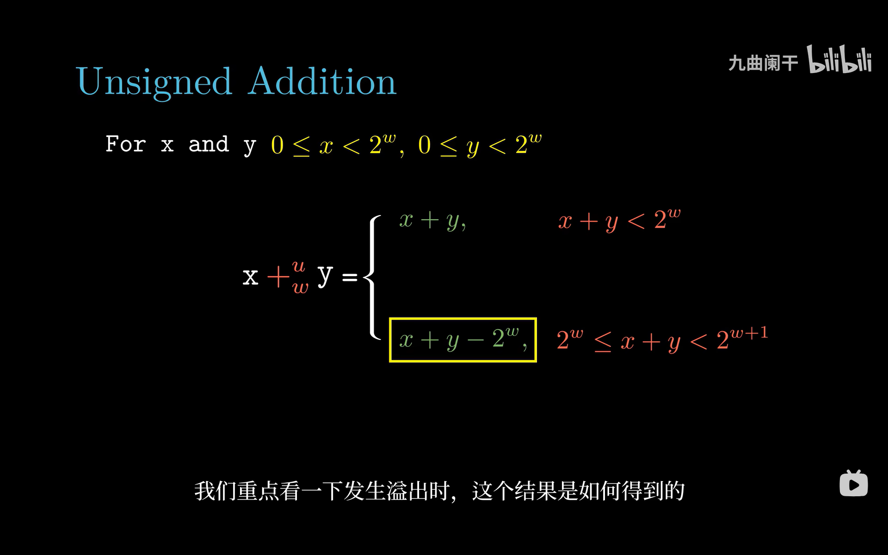
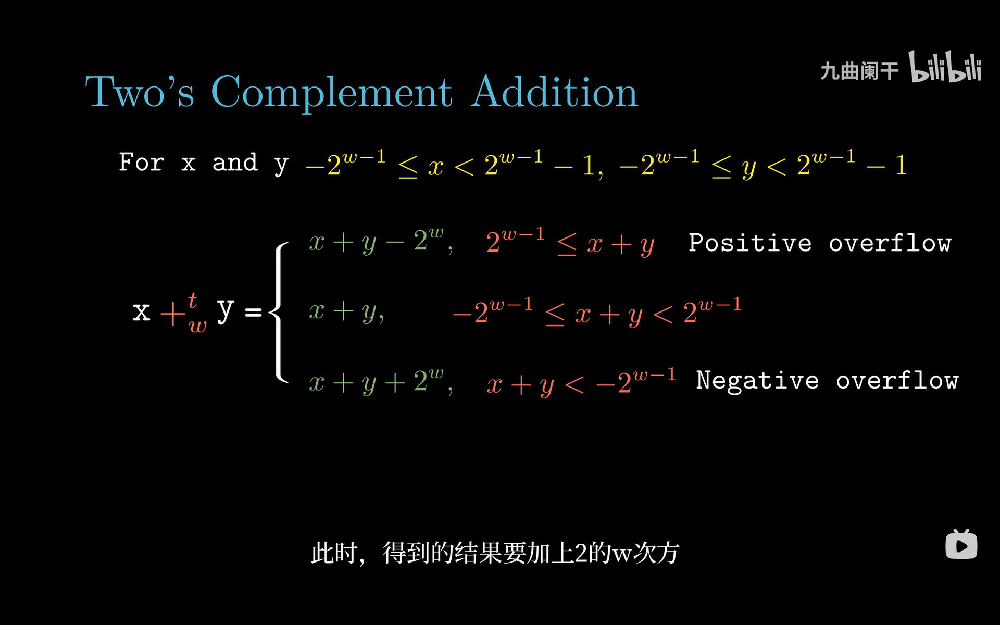

# 2.3 整数运算

> **📖 本节定位**　第 2 章「信息的表示和处理」· 教材 P60–P75
> **一句话**：补码的加减乘在**固定位宽**下等价于"先按数学算，再对 $2^w$ 取模"；于是硬件可以只做加法、用移位代替乘除，代价是溢出必须由程序员自己判断。

[← 上一节：2.2 整数表示](2.2%20整数表示.md)　｜　[下一节：2.4 浮点数 →](2.4%20浮点数.md)

---

## 🎯 核心结论

| # | 结论 |
| :-: | :--- |
| 1 | 补码加减乘在 $w$ 位下**都等于"数学结果 $\bmod\ 2^w$ 再按补码解释"**，这就是"环"的行为 |
| 2 | 无符号加法溢出判据：`s < x`（结果比任一操作数小）；补码正溢出：$x>0 \wedge y>0 \wedge s<0$ |
| 3 | 取负：$-x = \sim x + 1$；唯一失效的是 $TMin$，$-TMin = TMin$ |
| 4 | 乘法的**低 $w$ 位与有无符号无关**，所以一条 `imulq` 能同时服务两种类型 |
| 5 | 乘常数被编译成移位 + 加/减（LEA 组合）；除 2 的幂被编译成算术右移 + 偏置修正 |
| 6 | 右移是"向下取整"，C 的 `/` 是"向零取整"，二者对负数差 1，必须加 $2^k-1$ 修正 |

---

## 2.3.1 无符号加法

$w$ 位无符号加法 $\underset{w}{+^{u}}$ 的定义：

$x \underset{w}{+^{u}} y = \begin{cases} x + y, & x+y < 2^w \\ x + y - 2^w, & 2^w \le x+y < 2^{w+1} \end{cases}$



*▲ 图 2-3-1：上半支是"没溢出"，下半支（被框住的那个）是"溢出后减 $2^w$"。因为两个 $w$ 位数相加最多是 $2^{w+1}-2$，所以**最多只会溢出一次**，减一次 $2^w$ 就够。*

硬件上就是"加法器输出 $w+1$ 位，丢掉最高进位"。这个被丢掉的进位就是**进位标志 CF**。

**溢出判据**：设 $s = x \underset{w}{+^{u}} y$。若溢出，则 $s = x+y-2^w < x$（因为 $y < 2^w$）。所以：

```text
 溢出  ⟺  s < x   （也等价于 s < y）
```

```text
 16 位例子:  40000 + 50000 = 90000 ≥ 65536  → 溢出
             90000 − 65536 = 24464
             24464 < 40000 ✓ 判据成立
```

---

## 2.3.2 补码加法

补码加法 $\underset{w}{+^{t}}$ 有**两处**溢出（正溢出与负溢出），因此是三段定义：

$x \underset{w}{+^{t}} y = \begin{cases} x+y-2^w, & 2^{w-1} \le x+y \quad (\text{正溢出}) \\ x+y, & -2^{w-1} \le x+y < 2^{w-1} \\ x+y+2^w, & x+y < -2^{w-1} \quad (\text{负溢出}) \end{cases}$



*▲ 图 2-3-2：中间那支是正常区间；上面 `Positive overflow` 要减 $2^w$，下面 `Negative overflow` 要加 $2^w$。两次修正的方向相反，但本质相同：都是"把越过边界的结果折回 $[-2^{w-1}, 2^{w-1}-1]$"。*

**关键事实**：补码加法的**位级行为与无符号加法完全一样**——同样的加法器、同样的丢弃进位，只是最后的解释不同。所以 CPU 不需要两套加法电路（这正是 2.2.3 里"补码优于原码"的兑现）。

**溢出判据**（教材原式）：

```c
int s = x + y;                       // 注意: 在 C 里这行本身可能是 UB
int pos_ovf = (x > 0 && y > 0 && s < 0);    // 正溢出: 两个正数加出负数
int neg_ovf = (x < 0 && y < 0 && s >= 0);   // 负溢出: 两个负数加出非负数
```

```text
 8 位例子:   127 + 1     = 128 → 折回 -128   （正溢出）
            -128 + (-1)  = -129 → 折回 127   （负溢出）
             100 + (-30) =  70                 （正常）
```

> [!IMPORTANT]
> "两个正数相加得负数"这件事**只可能由溢出造成**，所以这个判据既充分又必要。反过来，`x > 0 && y < 0` 时永远不可能溢出（结果必然在两者之间），不必判断。

---

## 2.3.3 补码的非

补码的"取负"（加法逆元）$\underset{w}{-^{t}}$：

$\underset{w}{-^{t}}x = \begin{cases} -2^{w-1}, & x = -2^{w-1}\ (TMin) \\ -x, & x > -2^{w-1} \end{cases}$

**位级技巧**：$-x = \sim x + 1$（按位取反再加 1）。验证：$\sim x + x = \underbrace{11\cdots1}_{w} = -1$，所以 $\sim x + 1 = -x$。

| $x$（4 位补码） | $-x$ 的位模式 | 值 |
| :--- | :--- | ---: |
| `0000` (0) | `0000` | 0 |
| `0001` (1) | `1111` | −1 |
| `0010` (2) | `1110` | −2 |
| `0111` (7) | `1001` | −7 |
| `1000` (−8) | `1000` | **−8**（自己） |

> [!WARNING]
> $TMin$ 是唯一的例外：$-(-2^{w-1}) = 2^{w-1}$ 超出范围，折回仍是 $-2^{w-1}$。这直接导致两个经典 bug：`abs(INT_MIN)` 返回 `INT_MIN`（还是负数）；`-INT_MIN` 在 C 里是 UB，在 x86 上得 `0x80000000`。

---

## 2.3.4 无符号乘法

$x \underset{w}{*^{u}} y = (x \cdot y) \bmod 2^w$

两个 $w$ 位数相乘最多需要 $2w$ 位，硬件产生完整的 $2w$ 位乘积（x86 的 `mulq` 把结果放在 `rdx:rax`），但 C 只保留低 $w$ 位。

```text
 4 位例子:  13 × 3 = 39 = 0b10 0111
            低 4 位 0111 = 7      （39 mod 16 = 7 ✓）
```

---

## 2.3.5 补码乘法

$x \underset{w}{*^{t}} y = U2T_w\big((x \cdot y) \bmod 2^w\big)$

**核心定理**：补码乘法的**位级结果与无符号乘法相同**。证明思路：设 $x' = x + x_{w-1}2^w$、$y' = y + y_{w-1}2^w$ 是同样的位模式按无符号读出的值，展开乘积：

$x' \cdot y' = x\cdot y + (x_{w-1}y + y_{w-1}x)\,2^w + x_{w-1}y_{w-1}2^{2w}$

后两项在 $\bmod\ 2^w$ 下全部消失，于是 $(x'\cdot y') \bmod 2^w = (x\cdot y) \bmod 2^w$。

```text
 4 位例子: 1101 × 1101
   按无符号: 13 × 13 = 169 = 0b1010 1001 → 低 4 位 1001 → 9
   按补码:   (-3) × (-3) = 9 → mod 16 = 9 → 低 4 位 1001 → B2T = -7
   位完全相同，解释不同
```

**指令层面**（AT&T）：

```asm
imulq %rsi, %rax        # 单操作数形式: rdx:rax = rax * rsi（128 位，要求 rax 已被占用）
imulq %rsi, %rdi        # 双操作数形式: rdi = rdi * rsi（只保留低 64 位）
imulq $3, %rdi, %rax    # 三操作数形式: rax = rdi * 3
mulq  %rsi              # 无符号: rdx:rax = rax * rsi
```

> [!TIP]
> 编译器几乎总是用双/三操作数 `imulq`，因为它不改 `rdx`、延迟低。看到"需要 `clto` 把 `rax` 符号扩展到 `rdx:rax`"的代码，才说明真用了 128 位乘积（第 3 章会见到）。

---

## 2.3.6 乘以常数

乘以 $2^k$ 就是左移 $k$ 位；乘以任意常数则拆成"几个移位再相加/相减"。教材的核心例子：

$x \times 14 = (x \ll 3) + (x \ll 2) + (x \ll 1) \quad\text{或}\quad (x \ll 4) - (x \ll 1)$

后一种只要 2 次移位 + 1 次减法（3 条操作），比前一种的 3 次移位 + 2 次加法（5 条）少两条。一般规律：把常数写成 2 的幂的**和或差**，取操作数最少的那种。

| 表达式 | 等价形式 | 运算次数 | 说明 |
| :--- | :--- | :-: | :--- |
| `x * 4` | `x << 2` | 1 | 纯 2 的幂 |
| `x * 5` | `(x << 2) + x` | 2 | $5=4+1$ |
| `x * 6` | `(x << 2) + (x << 1)` | 3 | $6=4+2$，也可先算 3x 再乘 2 |
| `x * 7` | `(x << 3) - x` | 2 | $7=8-1$ |
| `x * 9` | `(x << 3) + x` | 2 | $9=8+1$ |
| `x * 14` | `(x << 4) - (x << 1)` | 3 | $14=16-2$，比"三移位 + 两加法"的 5 条少 |
| `x * 15` | `(x << 4) - x` | 2 | $15=16-1$ |
| `x * 17` | `(x << 4) + x` | 2 | $17=16+1$ |
| `x * 31` | `(x << 5) - x` | 2 | $31=32-1$ |

**x86 的 LEA 让它更省**：`lea` 能在一条指令里算 `base + index*scale`（scale ∈ {1,2,4,8}）且**不影响标志位**，所以"移位+加"常常合成一条 LEA：

```asm
leaq (%rdi,%rdi,2), %rax    # rax = 3x
leaq (%rdi,%rdi,4), %rax    # rax = 5x
leaq (%rdi,%rdi,8), %rax    # rax = 9x

# long mul14(long x) 的一种编译结果: 14x = (8x - x) * 2
leaq (,%rdi,8), %rax        # rax = 8x      （无 base 的 LEA）
subq %rdi, %rax             # rax = 7x
salq $1, %rax               # rax = 14x
```

**现实提醒**：现代 gcc `-O2` 对 `x*14` 往往直接生成一条 `imulq $14, %rdi, %rax`（3 周期、1 条指令），比三条 LEA 更短。教材讲移位优化是为了让你**看懂编译器**，而不是让你手写移位——把 `x*14` 写成移位反而会干扰编译器判断。

---

## 2.3.7 除以 2 的幂

除法**不能**用"乘以 $2^{-k}$"实现，只能用右移。但右移的舍入方向与 C 的 `/` **不一致**：

| 运算 | 舍入方向 |
| :--- | :--- |
| 算术右移 `x >> k` | 向 $-\infty$（向下取整，floor） |
| C 的 `/`（C99 起） | 向 0（截断，truncate） |

- **无符号**：`x >> k` 就是 $\lfloor x/2^k \rfloor$，而 $x \ge 0$ 时两者相同 → `shrq $k` 一条搞定；
- **有符号**：$x < 0$ 时需要**先加偏置**再右移：

$x / 2^k = \begin{cases} x \gg k, & x \ge 0 \\ (x + 2^k - 1) \gg k, & x < 0 \end{cases}$

**为什么偏置是 $2^k-1$**：若 $x = -q\cdot2^k - r$（$0<r<2^k$，即不能整除），加 $2^k-1$ 后变成 $-q\cdot2^k + (2^k-1-r)$，其中 $0 \le 2^k-1-r < 2^k$，右移得 $-q$ —— 正好是"向零"。若 $r=0$（能整除），加 $2^k-1$ 不跨过整数边界，结果仍是 $-q$，不受影响。

| $x$ | `x >> 2` | `x / 4` | 加偏置后 `(x+3) >> 2` |
| ---: | ---: | ---: | ---: |
| 33 | 8 | 8 | 9（正数不加，用不到） |
| −31 | −8 | **−7** | −7 ✓ |
| −32 | −8 | −8 | −8 ✓（整除时偏置无影响） |
| −33 | −9 | **−8** | −8 ✓ |

```asm
# long div8(long x) { return x / 8; }   —— 教材的经典序列
leaq 7(%rdi), %rax      # rax = x + 7      （2^3 - 1）
testq %rdi, %rdi        # 测试 x 的符号
cmovns %rdi, %rax       # x >= 0 时把 rax 换回 x（不加偏置）
sarq $3, %rax           # 算术右移 3 位 = 除以 8

# unsigned long udiv8(unsigned long x) { return x / 8; }
shrq $3, %rdi           # 一条逻辑右移即可
```

> [!WARNING]
> 三处必须记住：① 位移量 $k$ 必须满足 $0 \le k < w$，`x >> 32` 对 `int` 是 UB；② 除以 $2^k$ 的优化**只对无符号或已知非负**的数直接成立，负数一定要偏置；③ 除以非 2 的幂（如 `/3`）**没有**这种廉价优化，只能用 `idiv`（很慢，约 20–40 周期），所以热点代码里常用"乘以魔数再右移"。

---

## 2.3.8 关于整数运算的最后思考

**（1）补码运算构成一个"环"**

$w$ 位补码的所有运算都在 $\mathbb{Z}_{2^w}$ 上封闭：加法有单位元 0、每个元素有逆元、加法与乘法都满足**交换律、结合律、分配律**。所以下面这些等式在溢出时**依然成立**：

```text
 (x + y) + z  ==  x + (y + z)        // 结合律: 都等于 mod 2^w 的结果
 x * (y + z)  ==  x*y + x*z          // 分配律
 x + y        ==  y + x              // 交换律
```

丢掉的不是"运算律"，而是**与数学整数的对应关系**。一旦溢出，等式两边虽然相等，但都不再等于真实的数学结果。

**（2）除法破坏了这一切**

`/` 不是环运算，结合律、分配律全都不成立（`(x/y)*y != x`，`x/(y*z) != (x/y)/z`），而且它依赖"向零舍入"这个人为约定。**这就是除法慢、且不能被随意重排的根本原因。**

**（3）未定义行为（UB）是另一层陷阱**

```c
int a = INT_MAX;
a = a + 1;                    // UB: 有符号溢出。gcc 可能直接删掉这行，或假设 a > INT_MAX 恒假
unsigned b = UINT_MAX;
b = b + 1;                    // 明确定义: b == 0
```

编译器会利用"有符号不会溢出"做优化，例如把 `if (x + 1 > x)` 优化成恒真、把 `for (i = 0; i <= n; i++)` 中的 `i <= n` 当成 `i < n+1`。所以要检测溢出，用编译器内建函数而不是事后判断：

```c
#include <limits.h>

int overflow_add(int a, int b, int *out) {
    if (__builtin_add_overflow(a, b, out)) return -1;   // gcc/clang，无 UB
    return 0;
}
// C23 可移植写法: #include <stdckdint.h>  →  ckd_add(&r, a, b)
```

**（4）$INT\_MIN$ 的两个死结**

```text
 INT_MIN 取负 → 仍是 INT_MIN（位模式 0x80000000 取反加一还是它）
 |INT_MIN|    → 仍是 INT_MIN，于是 abs(INT_MIN) < 0
```

> [!IMPORTANT]
> 教材这一节的落点是：**计算机的整数运算是一个"取模的环"，不是数学整数**。写代码时要么保证不溢出（用更宽的类型、先判断再算），要么明确依赖回绕（那就用无符号）。处在中间地带——"有符号溢出了还以为会回绕"——是最危险的。

---

## 📌 重点速记

```text
无符号加 : (x+y) mod 2^w         溢出判据 s < x
补码加   : U2T[(x+y) mod 2^w]    正溢出 x>0,y>0,s<0 ；负溢出 x<0,y<0,s>=0
取负     : -x = ~x + 1           TMin 取负仍是 TMin
无符号乘 : (x*y) mod 2^w
补码乘   : 低 w 位与无符号相同    imulq 一条通吃
乘常数   : x*14 = (x<<4)-(x<<1)  LEA: 3x/5x/9x 一条指令
除 2^k   : 无符号 shr ；有符号 (x + (1<<k) - 1) >> k （x<0 时）
舍入     : 右移→向下取整 ；C 的 / →向零取整
环性质   : 加/乘满足结合律、交换律、分配律（mod 2^w）
UB       : 有符号溢出、-INT_MIN、abs(INT_MIN)
```

---

## ⚠️ 易错点

1. **用 `x + y > x` 判断无符号溢出**——只要 $y>0$ 它就恒真，哪怕发生了回绕（回绕后的 $s$ 反而更小），根本没在检测溢出。正确判据是 `s < x`。
2. **补码溢出判据写成 `x > 0 && y > 0 && s <= 0`**——`s == 0` 不可能由两个正数相加产生（除非溢出到 0，那也不可能，因为 0 在范围内），多写一个等号虽不出错但说明没理解。
3. **以为 `x >> k` 就是 `x / 2^k`**——对负数，`-31 >> 2` 是 −8，`-31 / 4` 是 −7，差 1。编译器对负数会自动插入 `leaq 3(%rdi)` + `cmovns`，手写优化时别漏。
4. **对 `unsigned` 做 `x - y` 并判断 `< 0`**——永远为假；正确做法是判断 `x < y` 或先转成有符号（若范围允许）。
5. **以为 `imulq` 是有符号、`mulq` 是无符号，所以低 64 位结果不同**——低 $w$ 位完全相同，只是高位（`rdx`）不同。
6. **对负数做左移**：C 里 `x << k`（$x<0$）是 UB，编译器可能假设结果非负。
7. **以为 `abs(INT_MIN)` 会返回一个很大的正数**——它返回 `INT_MIN`，因为 $2^{31}$ 无法用 `int` 表示。

---

## ✅ 自测

1. 8 位无符号数 `200 + 100` 的结果是多少？如何用一条判据说明它溢出了？
2. 8 位补码 `100 + 100` 的结果是多少？属于哪种溢出？
3. 用位运算写出 32 位 `x` 的相反数，并说明 `x = 0x80000000` 时会发生什么。
4. `x * 15` 最少用几条移位/加减指令？写出两种形式。
5. `-33 / 4` 与 `-33 >> 2` 分别是多少？编译器为了得到前者会插入什么？

<details>
<summary>参考答案</summary>

1. $300 \bmod 256 = 44$；因为 $44 < 200$，满足溢出判据 `s < x`。
2. $200$ 超出 $[-128,127]$，折回 $200-256=-56$；这是**正溢出**（两个正数加出负数）。
3. `~x + 1`。当 `x = 0x80000000`（$TMin$）时，取反得 `0x7FFFFFFF`，加 1 又回到 `0x80000000`，即 $-TMin = TMin$。
4. 一次移位 + 一次减法：`(x << 4) - x`；也可写 `(x << 3) + (x << 2) + (x << 1) + x`（4 次操作，更差）。
5. `-33 / 4 = -8`（向零），`-33 >> 2 = -9`（向下取整）。编译器插入偏置 3：`(-33 + 3) >> 2 = -30 >> 2 = -8`。

</details>

---

## 🔗 与其他章节的联系

| 本节内容 | 后续用在哪 |
| :--- | :--- |
| 加法器 / 进位丢弃 | 3.5 `addq`/`leaq`、3.6 条件码 `CF`/`OF`/`ZF`/`SF` |
| 溢出判据 | 3.6 `seto`、5 章编译器优化（溢出假设） |
| 补码取负 | 3.5 `negq`、3.10 缓冲区溢出攻击（构造返回地址） |
| 乘常数优化 | 3.5 LEA 指令、5 章指令级并行（LEA 不占 ALU） |
| 除 2 的幂 | 3.5 `sarq` + `cmovns` 序列、5.11 性能调优 |
| 环性质与 UB | 4 章 ALU 设计、9 章 `size_t` 乘法溢出导致堆溢出 |

---

[← 上一节：2.2 整数表示](2.2%20整数表示.md)　｜　[下一节：2.4 浮点数 →](2.4%20浮点数.md)
