# 2.4 浮点数

> **📖 本节定位**　第 2 章「信息的表示和处理」· 教材 P75–P87
> **一句话**：整数要把"范围"和"精度"绑死，浮点数则用 $V=(-1)^s \times M \times 2^E$ 把两者拆开；代价是**表示不精确、运算不满足结合律**。

> [!IMPORTANT] 本节要回答的三个问题
> 1. 整数已经能表示 $0\sim2^{32}-1$ 了，为什么还非要另造一套"浮点"？
> 2. 同样是 32 位，凭什么浮点既装得下 $10^{38}$ 又装得下 $10^{-38}$，还说它只有 7 位有效数字？
> 3. 为什么 `0.1 + 0.2 != 0.3`，甚至连加法结合律都不成立？

**读之前你需要会**：二进制与十六进制互转、二进制小数的位权 $0.b_1b_2\cdots$（见 [2.1 信息存储](2.1%20信息存储.md)）、补码"最高位当负权"的思路（见 [2.2 整数表示](2.2%20整数表示.md)）。都不会也没关系——本节会把用到的部分重讲一遍。

[← 上一节：2.3 整数运算](2.3%20整数运算.md)　｜　[下一节：2.5 小结 →](2.5%20小结.md)

---

## 🎯 核心结论

| # | 结论 |
| :-: | :--- |
| 1 | 二进制小数 $0.b_1b_2\cdots b_n$ 的值是 $\sum b_i 2^{-i}$；$1/3$、$1/5$ 这类分数**永远写不完** |
| 2 | IEEE 754 统一形式：$V = (-1)^s \times M \times 2^E$，$s$ 1 位、$e$ 编码阶码、$f$ 编码尾数 |
| 3 | 编码分四类：规格化（$e\neq0,255$）、非规格化（$e=0$）、无穷（$e=255, f=0$）、NaN（$e=255, f\neq0$） |
| 4 | 规格化隐含 1（$M=1+f$），白赚一位精度；$E=e-\text{bias}$，float 的 bias = 127 |
| 5 | 非规格化取 $E=1-\text{bias}$、$M=f$，使最小规格化数与最大非规格化数**间距相同**，平滑过渡到 0 |
| 6 | 默认**向偶数舍入**，因为它无偏；浮点加减乘**不满足结合律与分配律**，$\infty-\infty=\text{NaN}$ |

---

## 为什么要有浮点：把"精度"和"范围"分成两笔钱

**先说它想解决什么问题**：只约定"小数点钉死在某一位"（定点数），两件事会同时撞墙。

```text
  定点：小数点钉死                 浮点：小数点搬家
  [  整数部分 |  小数部分 ]        [ s | exp（搬到第几位）| frac（有效数字）]
   10^20 装不下、0.1 也写不完       范围与精度各用一段位，互不挤占
```

生活里你天天在用后一种办法——**科学计数法**：$1.2345\times10^{7}$ 把一个数拆成两段，`1.2345` 是**有效数字**（管精度），$10^{7}$ 是**指数**（管范围）。正因如此，$10^{-20}$ 与 $10^{20}$ 才能挤在同一套格式里。浮点就是把这份合同原样搬到二进制：`frac` 存有效数字、`exp` 存指数、`s` 存正负，**形式化定义**即 $V=(-1)^s\times M\times 2^E$——`frac` 决定"能有多准"，`exp` 决定"能有多大"。代价也很清楚：有效数字只有固定那么多位，**超出的位只能舍掉**，这就是 2.4.4 的舍入和 2.4.5 的结合律失效。

---

## 2.4.1 二进制小数

小数点左边的位权是 $2^0,2^1,2^2,\dots$，右边是 $2^{-1},2^{-2},2^{-3},\dots$：

| 位置 | $2^{-1}$ | $2^{-2}$ | $2^{-3}$ | $2^{-4}$ | $2^{-5}$ |
| :--- | ---: | ---: | ---: | ---: | ---: |
| 十进制 | 0.5 | 0.25 | 0.125 | 0.0625 | 0.03125 |

```text
 0.111₂ = 0.5 + 0.25 + 0.125 = 7/8 = 0.875
 0.1011₂ = 0.5 + 0.125 + 0.0625 = 11/16 = 0.6875
```

**从十进制转二进制**：小数部分反复乘 2，取整数位：

```text
 0.6875 × 2 = 1.375  → 取 1
 0.375  × 2 = 0.75   → 取 0
 0.75   × 2 = 1.5    → 取 1
 0.5    × 2 = 1.0    → 取 1   （余 0，停止）
 从上往下读：0.1011
```

**写不完的分数**——这是浮点数一切麻烦的根源：

```text
 1/3 = 0.0101 0101 0101 …  (01 循环)
 1/5 = 0.0011 0011 0011 …  (0011 循环)
 0.1 = 0.0001 1001 1001 …  (与 1/5 同构，只是移位)
```

**为什么需要浮点**：定点表示（固定小数点位置）有两个死结——想表示极大的数就得把小数点右移，于是小数精度全丢；想表示极小的数又装不下大数。**浮点数 = 让小数点"浮动"**，用阶码记录它移到哪儿了，从而在同一个 32 位里既覆盖 $10^{-38}$ 也覆盖 $10^{38}$。

---

## 2.4.2 IEEE 浮点表示

$V = (-1)^s \times M \times 2^E$

- $s$：符号位，0 为正、1 为负（注意有 $+0$ 和 $-0$）；
- $M$：尾数（significand），一个范围在 $1 \le M < 2$ 或 $0 \le M < 1$ 的二进制小数；
- $E$：阶码（exponent），**带权**的 2 的幂，可以为负。

**把三块读成三件事**（这张表比公式好记）：

| 字段 | 管什么 | 一句话 | 没有它会怎样 |
| :--- | :--- | :--- | :--- |
| $s$（1 位） | **符号** | 单独一位定正负 | 浮点不用补码，负数就没地方放 |
| `exp`（$k$ 位） | **缩放** | 小数点搬到了第几位 | 退回定点，范围被位宽锁死 |
| `frac`（$n$ 位） | **精度** | 有效数字还剩几位 | 刻度很粗，小数一律被抹平 |

三块的宽度**此消彼长**：`exp` 多一位，范围翻倍；`frac` 少一位，精度减半。IEEE 754 只是把 32 位按 $1/8/23$ 分了账，并非唯一分法（half、quad 是另外两本账）。

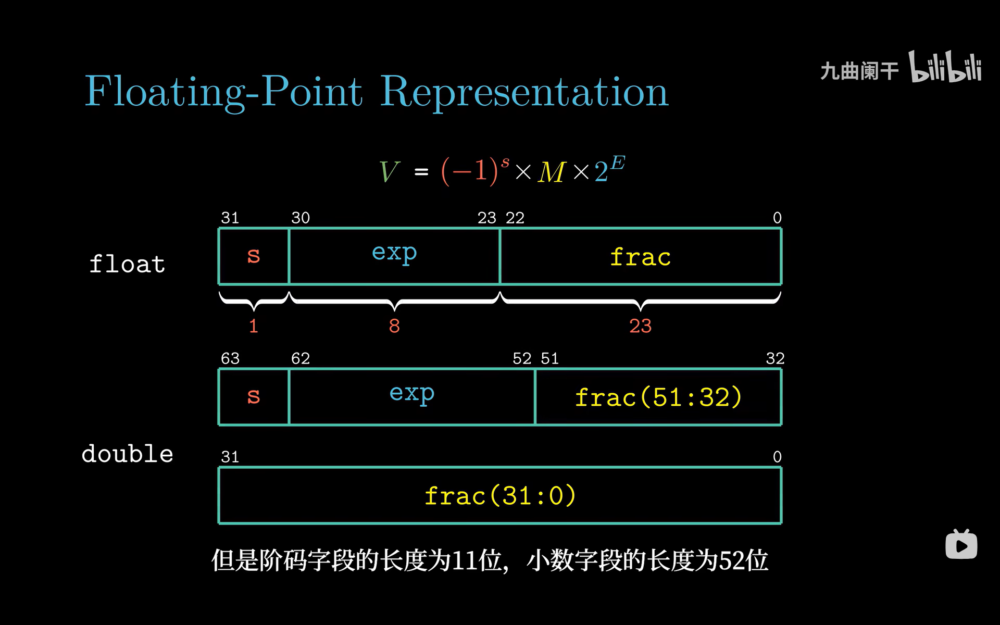

*▲ 图 2-4-1：左边是 $V$ 的三要素公式，右边是 float / double 的字段切分。看位宽：float 的 `exp` 8 位、`frac` 23 位；double 的 `exp` 11 位、`frac` 52 位。**符号位永远在最左边（最高位）**，这和整数的补码表示完全不同——浮点不是补码。*

| 格式 | 总位数 | $s$ | $e$ 位数 $k$ | $f$ 位数 $n$ | bias $=2^{k-1}-1$ |
| :--- | :-: | :-: | :-: | :-: | :-: |
| 单精度 `float` | 32 | 1 | 8 | 23 | 127 |
| 双精度 `double` | 64 | 1 | 11 | 52 | 1023 |

### （1）规格化数（最常见的一类）

条件：$e \neq 0$ 且 $e \neq 255$（double 是 $\neq 2047$）。此时

$E = e - \text{bias}, \qquad M = 1 + f$

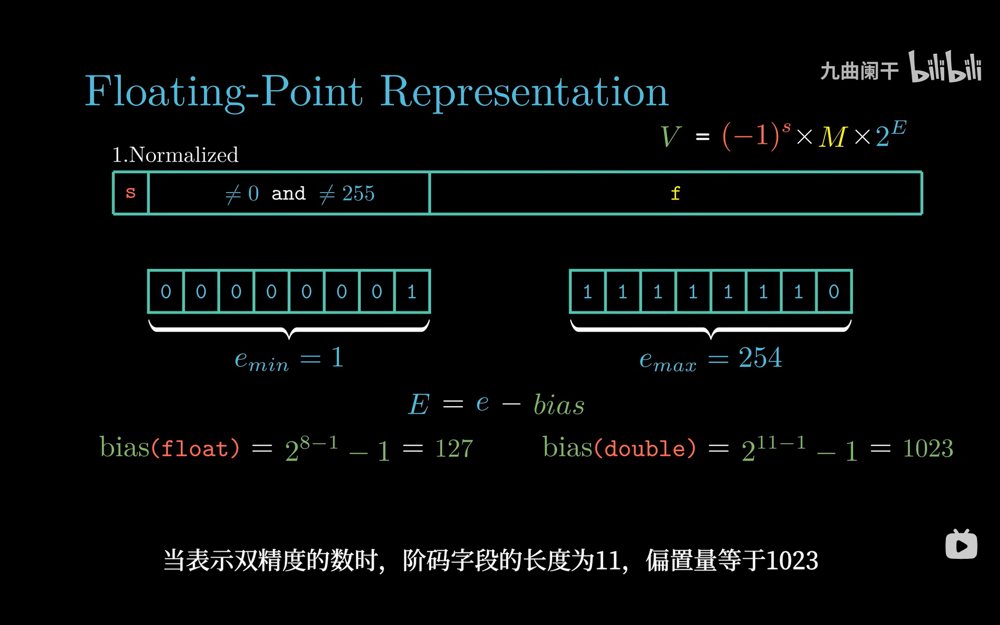

*▲ 图 2-4-2：重点看两个刻度——`e_min = 1`（`0000 0001`）与 `e_max = 254`（`1111 1110`），以及下面两行 bias 公式。float 的 bias 是 $2^{8-1}-1=127$，double 是 $2^{11-1}-1=1023$。为什么 $e$ 只能用 $1\sim254$？因为 $e=0$ 这一整段要留给非规格化数，$e=255$（全 1）要留给无穷与 NaN。*

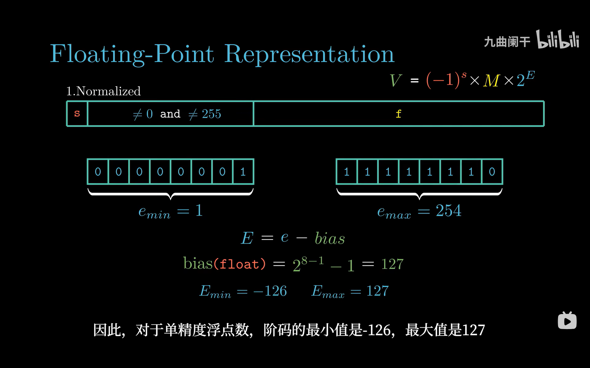

*▲ 图 2-4-3：同一张版式的下半部分，把 $E$ 的区间算了出来：$E_{min}=-126$、$E_{max}=127$。这才是"float 能表示 $2^{-126}$ 到约 $2^{128}$"的来源。注意 $E$ 的范围**不对称**：负数只能到 $-126$ 而正数能到 $127$，因为 $e=0$ 这一格被非规格化数占用了，$E=-127$ 永远取不到。*

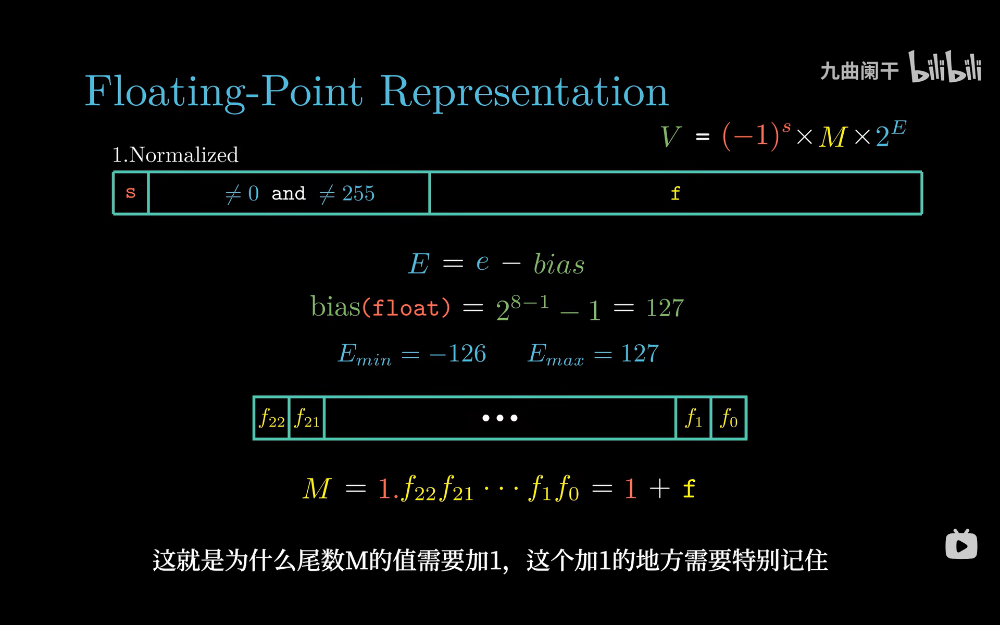

*▲ 图 2-4-4：同一页的另一帧，撤掉阶码端点、把镜头推近小数字段：$f_{22}f_{21}\dots f_0$ 共 23 位，而 $M = 1.f_{22}f_{21}\dots f_0 = 1 + f$。**那个 1 不在存储里**，却白送一位精度——IEEE 754 最划算的一笔买卖。*

**为什么隐含 1（$M = 1+f$）**：规格化数的尾数总可以写成 $1.xxxx$ 的形式，首位恒为 1，存它纯属浪费。省掉这一位，23 位 `frac` 就等效于 **24 位有效精度**（double 是 53 位）。这也解释了 $M$ 的取值范围是 $1 \le M < 2$ 而不是 $0 \le M < 1$。

**为什么 bias 取 $2^{k-1}-1$**：这样一来，$E = e - \text{bias}$ 的范围大致关于 0 对称（float 是 $[-126,127]$），而且**无符号比较 $e$ 的大小等价于有符号比较 $E$ 的大小**——硬件比较两个浮点数大小，只需把位模式当无符号整数比（$e$ 在高位），省掉一次减法。

**把 bias 的账摊开看**（float，$k=8$）：$e=1,2,\dots,254$ 依次对应 $E=-126,-125,\dots,127$，**$e$ 单调增、$E$ 也单调增**——这就是"无符号比较等价于有符号比较"的全部内容。为什么取 $2^{7}-1=127$ 而不是 $2^{7}=128$：$e=1\sim127$ 覆盖 $E=-126\sim0$（127 格），$e=128\sim254$ 覆盖 $E=1\sim127$（127 格），正负格数相等，零正好落在分界上。

> [!NOTE] 换个角度想
> 硬件为什么在乎这个等价？因为整数比较器是现成的——把两个浮点的**阶码字段**当无符号整数比一遍就有大小关系，不必拆字段、减 bias、再比 $E$。**一个 bias 的取值，替 CPU 省掉一次减法**。反过来看：假如阶码改用补码，负数的高位全是 1，无符号比较会把它判成最大值，这套"免费比较"立刻失效。

#### 一起算一遍（一）：把 $-12.75$ 写成 float 的 32 位

| 步骤 | 动作 | 结果 |
| :-: | :--- | :--- |
| ① | 拆开：$12=8+4$，$0.75=0.5+0.25$ | $12.75=1100.11_2$ |
| ② | 规格化：小数点左移 3 位，读出 $M$ 与 $E$ | $1.10011_2\times2^{3}$，$M=1.10011$，$E=3$ |
| ③ | 求阶码字段 $e=E+\text{bias}=3+127$ | $130=1000\,0010_2$ |
| ④ | 取小数点后的 `10011` 当 `frac`，补 0 到 23 位 | `1001 1000 0000 0000 0000 000` |
| ⑤ | 符号位 $s=1$（负数），按 $s\mid e\mid f$ 拼起来 | `1 10000010 10011000000000000000000` |
| ⑥ | 每 4 位一组转十六进制 | `0xC14C0000` |

验算：$1.10011_2\times2^{3}=1100.11_2=12.75$，再加负号得 $-12.75$ ✅。用 C 打印出来正是 `C14C0000`（见本节"动手试试"第 1 题）。注意第 ④ 步：`frac` 里**没有**那个前导的 1，它被隐含规则吃掉了。

### （2）非规格化数

条件：$e = 0$。此时

$E = 1 - \text{bias}, \qquad M = f$

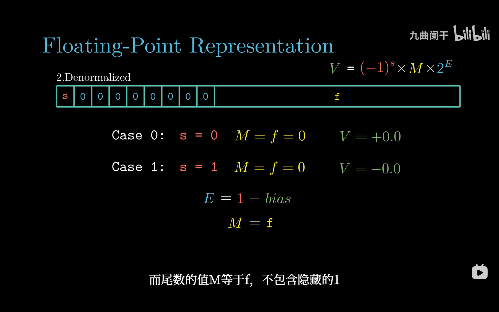

*▲ 图 2-4-5：与非规格化对应的两个改动——`exp` 全 0，且尾数**不再加 1**（$M=f$，所以 $0 \le M < 1$）。它的作用是表示"比最小规格化数还小"的那些数，以及精确的 0。*

**为什么 $E$ 取 $1-\text{bias}$ 而不是 $-\text{bias}$**：为了让两段**无缝衔接**。取 $E=1-\text{bias}$ 时，

```text
 最大非规格化数 = 0.111…1 × 2^(1-bias) = (1 - 2^-n) × 2^(1-bias)
 最小规格化数   = 1.000…0 × 2^(1-bias) =        1 × 2^(1-bias)
 两者间距 = 2^-n × 2^(1-bias)  ←→  相邻两个非规格化数的间距也正好是这个值
```

也就是说，从 0 到最小规格化数之间，**步长恒为 $2^{-149}$（float）**，一路均匀地"爬"到 0。如果取 $E=-\text{bias}$，最大非规格化数只有 $2^{-127}$ 量级，与最小规格化数 $2^{-126}$ 之间会出现一个**跳变的空洞**，浮点数在 0 附近就不再连续了。

### （3）特殊值：无穷与 NaN

条件：$e$ 全 1（float 是 255）。

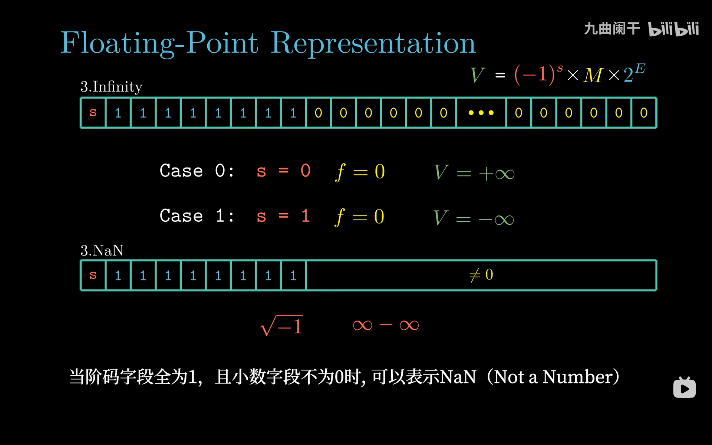

*▲ 图 2-4-6：`exp` 全 1 时只有两种可能——`frac == 0` 是 $\pm\infty$（符号位决定正负），`frac != 0` 是 NaN。图下方给了 NaN 的两个典型来源：$\sqrt{-1}$ 与 $\infty-\infty$。*

| 类别 | $e$ | $f$ | $E$ 与 $M$ | 含义 |
| :--- | :--- | :--- | :--- | :--- |
| 规格化 | $1 \sim 254$ | 任意 | $E=e-127$，$M=1+f$ | 常规数值 |
| 非规格化 | 0 | 任意 | $E=-126$，$M=f$ | 接近 0 的数、$\pm0$ |
| 无穷 | 255 | 0 | — | $\pm\infty$，溢出或除以 0 得到 |
| NaN | 255 | $\neq 0$ | — | 不是一个数，$0/0$、$\infty-\infty$、$\sqrt{-1}$ |

**判类别只要两步**，画成流程图：

```text
   位模式 ─┬─ exp 全 0 ─────────────▶ 非规格化数（含 ±0）
           ├─ exp 全 1 ┬─ frac = 0 ──▶ ±∞
           │           └─ frac ≠ 0 ──▶ NaN
           └─ 其余 ──────────────────▶ 规格化数
```

一句口诀：**看到 `exp` 全 0 或全 1 就警觉**——这两个端点不是普通数值，而是"贴近 0"和"超出范围"两套特殊语义；中间的 $e=1\sim254$ 才是常规数。判断顺序也不能反：先问"是不是全 0"，再问"是不是全 1"，最后才轮到规格化。

> [!IMPORTANT]
> 同一个 `exp` 字段承载了三种语义（规格化 / 非规格化 / 无穷+NaN），这是 IEEE 754 最"省位"也最容易考的设计。判类别的顺序必须是：先看 $e$ 是否为 0，再看是否为全 1，最后才是规格化。

<details>
<summary>✅ 检查点 1：`0x80000000` 按 float 读是 `-0.0`，那它和 `+0.0` 相等吗？</summary>

相等。按 IEEE 754，`+0.0 == -0.0` 为**真**：两者位模式不同（符号位相反），数值却相同。想看区别只能做除法——`1.0/+0.0` 得 $+\infty$，`1.0/-0.0` 得 $-\infty$。这也是"浮点不是补码"的直接证据：补码里 0 只有一种写法。
</details>

---

## 2.4.3 数字示例

为了手算方便，教材构造了一个 **8 位玩具格式**：$s$ 1 位、$e$ 4 位、$f$ 3 位，bias $=2^{4-1}-1=7$。

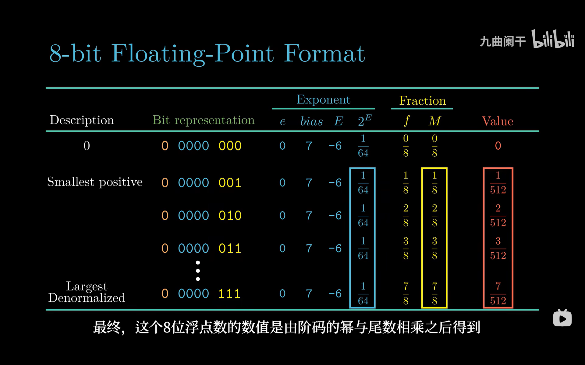

*▲ 图 2-4-7：`e = 0000` 时 $E=1-7=-6$、$2^E=1/64$、$M=f/8$，于是值是 $f/512$。注意最右一列 $1/512,2/512,\dots,7/512$ 是**等差数列**——这就是非规格化数"等间距"的直观证据。*

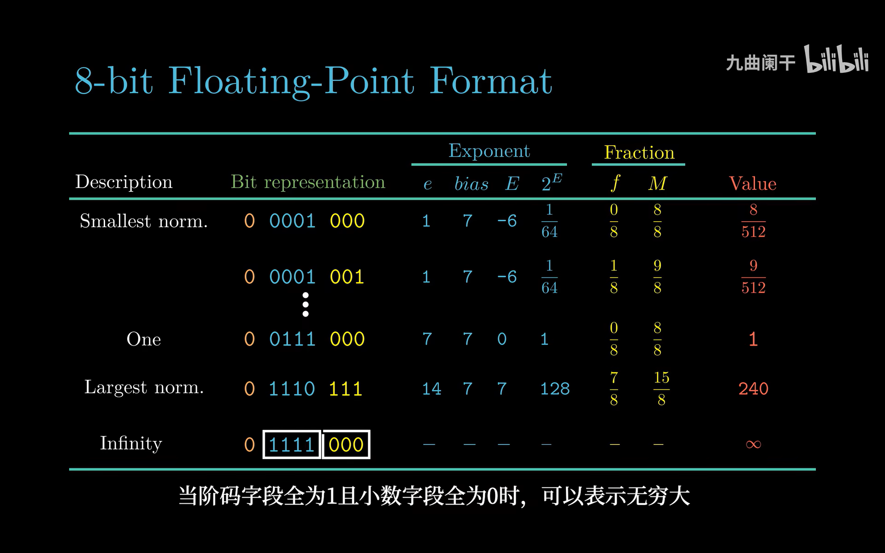

*▲ 图 2-4-8：`e = 0001` 时 $E=1-7=-6$，但尾数变成 $M=1+f/8=9/8$，值跳到 $9/512$。和上一张图对比：`0000 111` 是 $7/512$，`0001 000` 是 $8/512$，步长仍然是 $1/512$，**接缝处没有跳变**。*

| 位模式 | 描述 | $e$ | $E$ | $f$ | $M$ | 值 |
| :--- | :--- | :-: | :-: | :-: | :-: | ---: |
| `0 0000 000` | 零 | 0 | −6 | 0/8 | 0/8 | 0 |
| `0 0000 001` | 最小非规格化 | 0 | −6 | 1/8 | 1/8 | 1/512 |
| `0 0000 010` | | 0 | −6 | 2/8 | 2/8 | 2/512 |
| `0 0000 111` | 最大非规格化 | 0 | −6 | 7/8 | 7/8 | 7/512 |
| `0 0001 000` | 最小规格化 | 1 | −6 | 0/8 | 8/8 | 8/512 |
| `0 0001 001` | | 1 | −6 | 1/8 | 9/8 | 9/512 |
| `0 0110 111` | | 13 | 6 | 7/8 | 15/8 | 120 |
| `0 0111 000` | 一 | 7 | 0 | 0/8 | 8/8 | 1 |
| `0 1110 111` | 最大规格化 | 14 | 7 | 7/8 | 15/8 | 240 |
| `0 1111 000` | 无穷 | — | — | — | — | $\infty$ |

**把 12345 转成 float**（教材的经典推导，务必会手算）：

```text
 12345 = 11 0000 0011 1001₂            （14 位，最高位的 1 在 2^13）
 规格化: 12345 = 1.1 0000 0011 1001 × 2^13
         M = 1.1000 0000 1110 01      E = 13
         e = E + bias = 13 + 127 = 140 = 1000 1100₂
         f = 1000 0000 1110 0100 0000 000   （23 位，后补 0）
 位模式: 0 | 1000 1100 | 1000 0000 1110 0100 0000 000
         = 0x4640E400
```

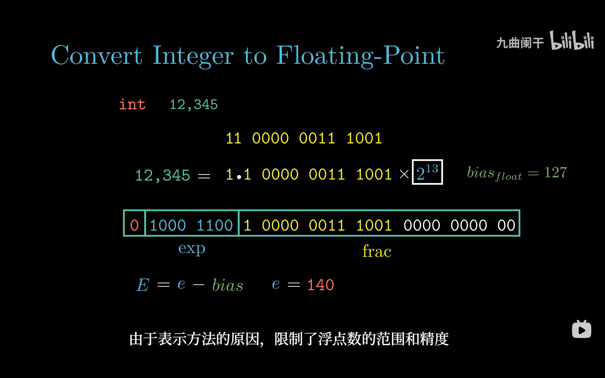

*▲ 图 2-4-9：三步走——①二进制展开；②写成 $1.xxx \times 2^{13}$ 找到 $E$；③`e = E + 127 = 140`，`frac` 取小数点后的位并补零到 23 位。注意图中 `exp` 字段宽 8 位，`frac` 宽 23 位，写出来刚好 32 位。*

> [!WARNING]
> 12345 只有 14 位有效数字，24 位尾数装得下，所以**转换是精确的**。但 `int` 有 31 位有效位，一旦超过 $2^{24}$，`int → float` 就要舍入：`16777217`（$2^{24}+1$）转成 float 变成 `16777216.0`，`2147483647` 转成 float 变成 `2147483648.0f`。这就是 2.4.6 里"int 转 float 可能丢精度"的量化解释。

#### 一起算一遍（二）：把 `0x40490FDB` 拆回十进制

反方向走一遍：题目只给十六进制，先展开成 32 位，再按 $1+8+23$ 切开。

| 步骤 | 动作 | 结果 |
| :-: | :--- | :--- |
| ① | 十六进制逐位展开 | `0100 0000 0100 1001 0000 1111 1101 1011` |
| ② | 切出 $s$（最高 1 位） | `0`，正数 |
| ③ | 切出 `exp`（接着 8 位） | `1000 0000` $=128$ |
| ④ | 切出 `frac`（剩下的 23 位） | `100 1001 0000 1111 1101 1011` |
| ⑤ | 判类别：$e=128\in[1,254]$ 是规格化，$E=e-127=1$；补回隐含的 1 | $M=1.10010010000111111011011_2$ |
| ⑥ | $V=M\times2^{E}$：小数点右移 1 位 | $11.0010010000111111011011_2$ |
| ⑦ | 整数部分 $11_2=3$，小数部分逐项累加（$2^{-3}+2^{-6}+2^{-11}+\cdots$） | $3+0.14159274=3.14159274$ |

小数部分的前几项是 $0.125+0.015625+0.00048828125$，加起来已经 $0.1411$，后面的位继续补齐到 $0.14159274$——**这就是 float 版的 $\pi$**。用 Python 打印会得到 `3.1415927410125732`，与真值差 $3.4\times10^{-8}$，正好落在 7 位有效数字的"毛边"上。

---

## 2.4.4 舍入

浮点运算的结果往往落在两个可表示值之间，必须选一个——这就是舍入。IEEE 754 定义了四种模式：

| 模式 | 1.40 | 1.60 | 1.50 | 2.50 | −1.50 | 规则 |
| :--- | :-: | :-: | :-: | :-: | :-: | :--- |
| **向偶数舍入**（默认） | 1 | 2 | **2** | **2** | **−2** | 恰在中点时取末位为偶数者 |
| 向零舍入 | 1 | 1 | 1 | 2 | −1 | 直接截断 |
| 向下舍入（$-\infty$） | 1 | 1 | 1 | 2 | −2 | floor |
| 向上舍入（$+\infty$） | 2 | 2 | 2 | 3 | −1 | ceil |

下面四张图是**同一页 PPT 逐行累加**得到的，正好当作"四种模式逐行揭示"来看：

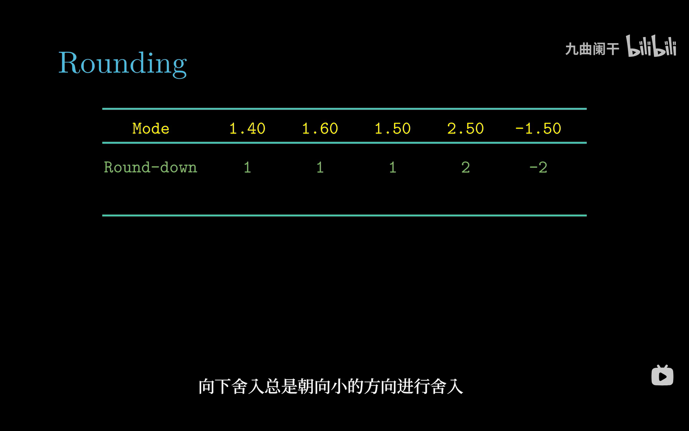

*▲ 图 2-4-10：只有 Round-down 一行。`1.50 → 1`、`-1.50 → -2`——负数"向下"是往更小的方向（更负），所以不是"把小数扔掉"，而是 floor。*

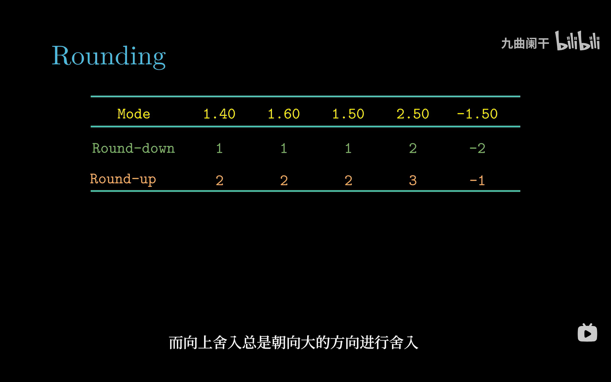

*▲ 图 2-4-11：多出 Round-up 一行，与上一行逐格对照：`1.40` 从 1 变 2、`-1.50` 从 −2 变 −1。可见 up 与 down 在负数上是**镜像**的。*

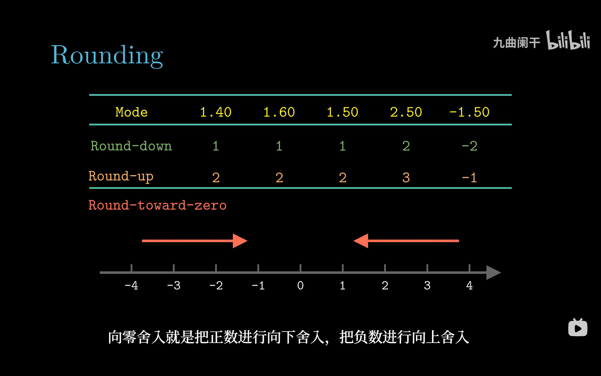

*▲ 图 2-4-12：这一行（Round-toward-zero）的数值格在截图里**留空**，下方改用数轴箭头说明——正数向左（朝 0）舍，负数向右（朝 0）舍，合起来就是"截断"。补全后应为 `1, 1, 1, 2, -1`。*

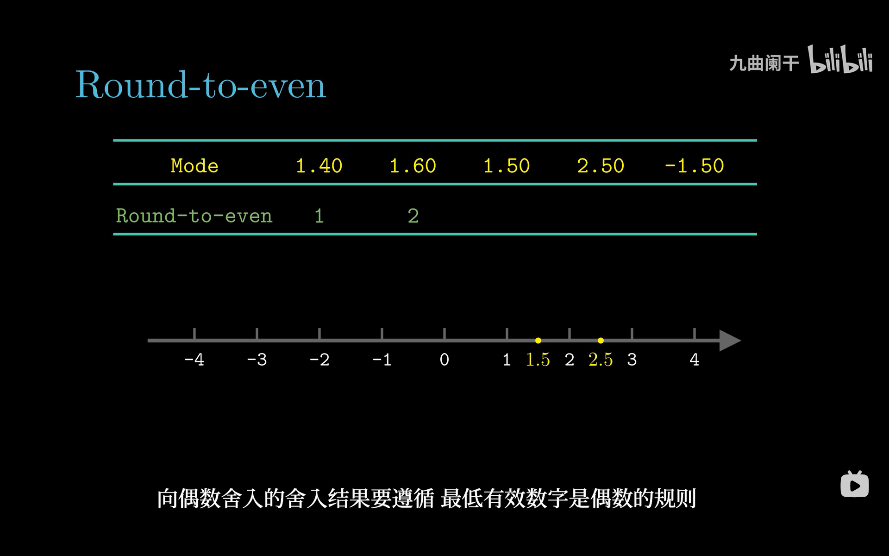

*▲ 图 2-4-13：最后一行 To-even，图中同样只画了数轴上的 1.5 与 2.5 两个点，数值格留空。补全后应为 `1, 2, 2, 2, -2`：1.5 的候选是 1 与 2，取偶得 2；2.5 的候选是 2 与 3，取偶同样得 2——所以它和"四舍五入"在 2.5 这一格上结果不同。*

**为什么默认用向偶数舍入**：如果中点一律进位（即"四舍五入"），在一大堆随机数据上每次中点都偏大一点点，误差会**系统性累积**。向偶数舍入在恰好中点时"一半进位、一半舍去"（取决于哪边末位是偶数），长期看**期望偏差为 0**；对 `1.5 / 2.5 / 3.5` 这类连续中点，结果分别是 2 / 2 / 4，最低位总是 0，也避免了"舍入后再舍入"带来的抖动。

**二进制里的中点怎么判断**：要保留到小数点后 $k$ 位时，"中点"就是第 $k+1$ 位为 1、其后全 0。例如把 `10.111`（2.875）舍到 2 位小数：候选是 `10.11`（2.75，末位 1，奇）和 `11.00`（3.0，末位 0，偶），恰好中点 → 取偶 → `11.00`。

#### 一起算一遍：`1.5 → 2`、`2.5 → 2`

把"向偶数"落到两行算术上，看它到底偏不偏：

| 数 | 左右候选 | 取偶 | 结果 | 偏差 |
| :-: | :--- | :--- | :-: | :-: |
| $1.5$ | $1$、$2$ | $2$ | $2$ | $+0.5$ |
| $2.5$ | $2$、$3$ | $2$ | $2$ | $-0.5$ |

同样的道理，$3.5\to4$、$4.5\to4$（候选 $3|4$ 取 4，$4|5$ 取 4）。规律：**中点一个进、一个舍**，$+0.5$ 与 $-0.5$ 成对出现，总偏差的期望是 0。换成"四舍五入"（`.5` 一律进），每一行都是 $+0.5$，舍一万次就系统性偏大 5000 个最小单位——这就是"统计上无偏"的实际含义。也正因为它是**确定性**的无偏方案，才比"随机舍入"更适合硬件：后者虽也无偏，却让同一个程序跑两次结果不同。

> [!TIP]
> 考试常见问法："`x = 1.5, 2.5, -1.5` 在默认模式下舍入到整数分别是多少？"答案 $2, 2, -2$。注意 `-1.5` 舍到 $-2$ 而不是 $-1$，因为 $-2$ 的末位是偶数。

---

## 2.4.5 浮点运算

浮点加减乘的本质是"**精确算完，再舍入**"：$x +_f y = \text{Round}(x + y)$。由于舍入，很多在实数上成立的性质**不再成立**。

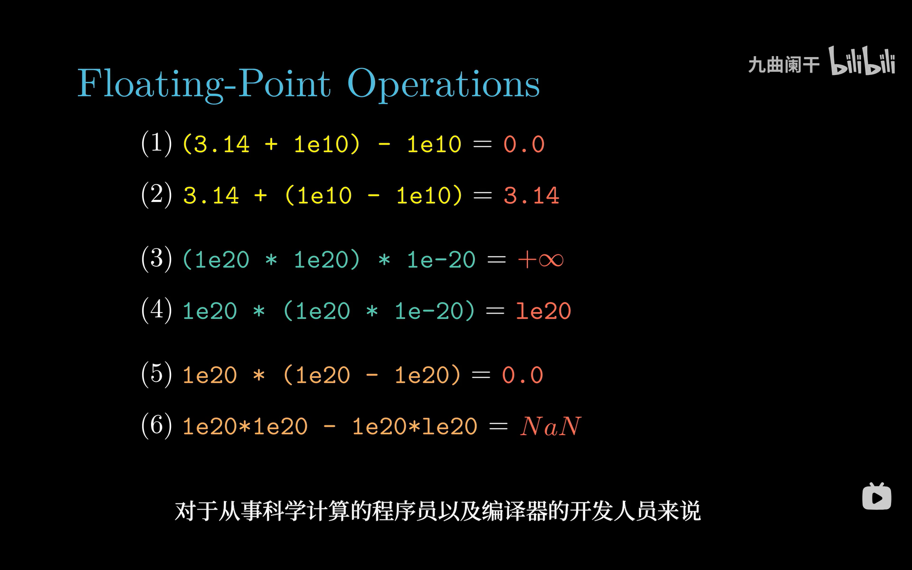

*▲ 图 2-4-14：(1)(2) 是加法结合律的反例，(3)(4) 是乘法结合律的反例，(5)(6) 是分配律的反例。看 (1)：`3.14 + 1e10` 先把 3.14 舍掉（1e10 的有效位把它"吞"了），再减 1e10 得 0；(2) 换个顺序就保住了 3.14。(6) 里两个 $\infty$ 相减直接变 NaN。*

| 性质 | 是否成立 | 反例（float） |
| :--- | :--- | :--- |
| 加法交换律 $a+b=b+a$ | ✅ 成立 | — |
| 加法结合律 $(a+b)+c=a+(b+c)$ | ❌ 不成立 | `(3.14+1e10)-1e10 = 0`，而 `3.14+(1e10-1e10) = 3.14` |
| 乘法结合律 $(a*b)*c=a*(b*c)$ | ❌ 不成立 | `(1e20*1e20)*1e-20 = +∞`，而 `1e20*(1e20*1e-20) = 1e20` |
| 分配律 $a*(b+c)=a*b+a*c$ | ❌ 不成立 | `1e20*(1e20-1e20) = 0`，而 `1e20*1e20 - 1e20*1e20 = NaN` |
| 单调性 $a \ge b \Rightarrow a+c \ge b+c$ | ✅ 成立（无 NaN 时） | — |

**这些反例跑一遍就信了**（`gcc -O0 t.c` 编译，别开 `-ffast-math`）：

```c
#include <stdio.h>

int main(void)
{
    float a = 3.14f, b = 1e10f;

    printf("(3.14f + 1e10f) - 1e10f = %f\n", (a + b) - b);   /* 0.000000 */
    printf("3.14f + (1e10f - 1e10f) = %f\n", a + (b - b));   /* 3.140000 */
    printf("0.1 + 0.2 == 0.3        ? %d\n", 0.1 + 0.2 == 0.3);  /* 0，假 */
    return 0;
}
```

第一行为什么是 `0.000000`：$3.14+10^{10}$ 的精确和是 $10000000003.14$，而 float 在 $10^{10}$ 附近的**相邻可表示数间距**是 $2^{33-23}=2^{10}=1024$。3.14 连半个间距（512）都够不上，和直接被舍成 `1e10f` 本身；再减 `1e10f`，归零。第二行先算括号里的 `1e10f - 1e10f = 0`，没有"大数吃小数"，3.14 完好无损。顺带验一下误差累积：把 `float s = 0;` 循环 `s += 0.1f` 一千次，得到的是 `99.9990463257`，而不是 100。

<details>
<summary>✅ 检查点 2：把 `3.14f` 换成 `600.0f`，`(a+b)-b` 还是 0 吗？</summary>

不是，会得到 `1024.000000`。$10^{10}$ 附近的可表示数间距是 1024，`1e10f + 600` 的两个邻居是 $10^{10}$（差 600）与 $10^{10}+1024$（差 424），后者更近，于是和先被舍成 $10^{10}+1024$，再减 $10^{10}$ 就剩 1024。**判据始终是"够不够半个 ulp"**：$600>512$ 就够，$3.14<512$ 就不够。
</details>

**无穷与 NaN 的算术规则**：

```text
 ∞ + ∞ = ∞        ∞ × 0 = NaN        ∞ - ∞ = NaN
 1.0 / 0.0 = +∞   0.0 / 0.0 = NaN    √(-1) = NaN
 任何数与 NaN 运算 = NaN            NaN != NaN（唯一不等于自己的值）
```

**误差累积**：把 0.1 累加 1000 次不会得到 100，因为 0.1 本身就不能精确表示（二进制是无限循环），每次加法又各舍入一次。同理，`(a+b)+c` 与 `a+(b+c)` 在大数吃小数时会差出可观的量——这就是为什么数值计算里要先排序（小数先加）、用 Kahan 求和、或改用 `long double`。

> [!WARNING]
> 所以编译器**不能**随意把 `a + b + c` 重排成 `a + (b + c)`（除非开了 `-ffast-math`）。这也是"浮点运算不可交换顺序"这条优化禁令的来源（第 5 章）。

---

## 2.4.6 C 语言中的浮点数

C 的 `float` 对应 IEEE 单精度，`double` 对应双精度，转换规则共四条：

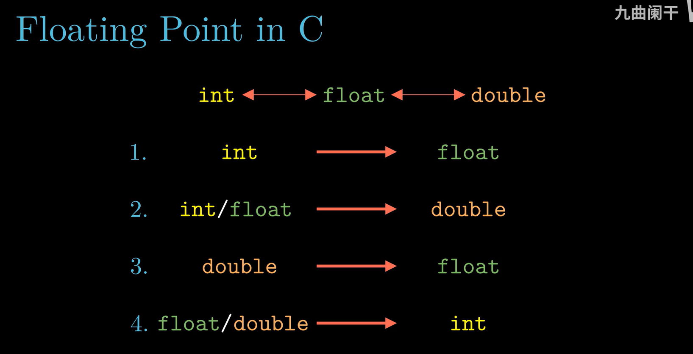

*▲ 图 2-4-15：四种转换方向。注意 `int ↔ float` 是双向的，但两条路的"安全性"完全不同——`int → float` 不会溢出只会丢精度，`float → int` 既可能截断也可能越界。*

| # | 转换 | 是否精确 | 风险 |
| :-: | :--- | :--- | :--- |
| 1 | `int` → `float` | **可能丢精度** | 尾数只有 24 位，$>2^{24}$ 的奇数被舍入；不会溢出 |
| 2 | `int`/`float` → `double` | **精确** | `double` 尾数 53 位，装 32 位整数绰绰有余 |
| 3 | `double` → `float` | 可能舍入 / 溢出 | 大到超出 float 范围 → $\pm\infty$；小数位被舍入 |
| 4 | `float`/`double` → `int` | **向零截断** | 越界或 NaN 是 **UB**（x86 上 `cvttsd2si` 返回 `0x80000000`） |

```c
int    i  = 16777217;      // 2^24 + 1
float  f  = i;             // 16777216.0f   ← 丢掉了 1（规则 1）
double d  = i;             // 16777217.0    ← 精确（规则 2）
float  g  = 1e40;          // +∞           ← 超出 float 范围（规则 3）
int    j  = (int)12345.99; // 12345        ← 向零截断（规则 4）
int    k  = (int)1e20;     // UB！x86 上得 -2147483648
```

**隐式转换与显式转换**：赋值、传参、返回值都会触发隐式转换；混用 `float` 与 `double` 的表达式会先把 `float` 提升为 `double` 再算（这也意味着 `float a; a = a + 0.1;` 其实是按 double 算完再舍回 float）。

> [!NOTE]
> 三个工程建议：① **比较浮点不要用 `==`**，用 `fabs(a-b) < 1e-6`；② 默认用 `double`，`float` 只在内存/带宽吃紧（图形、大规模数组）时用；③ 需要"整数↔浮点"精确互转时，先确认值域在 $2^{24}$（float）或 $2^{53}$（double）以内。

---

## 📌 重点速记

```text
形式     : V = (-1)^s × M × 2^E
float    : 1 / 8 / 23   bias = 127
double   : 1 / 11 / 52  bias = 1023
规格化   : e≠0,255  → E = e - bias, M = 1 + f     E ∈ [-126, 127]
非规格化 : e = 0     → E = 1 - bias, M = f
无穷/NaN : e = 255   → f=0 为 ±∞，f≠0 为 NaN
最小正数 : 2^-149（float）    最大有限: (2-2^-23)×2^127
舍入     : 默认向偶数（无偏）；精确算完再舍入
不成立   : 结合律、分配律；∞-∞=NaN、∞×0=NaN、NaN≠NaN
类型转换 : int→float 丢精度；float→int 截断且越界 UB
```

---

## ⚠️ 易错点

1. **把浮点当补码**——浮点不是补码：符号位单独一位，`-0.0` 与 `+0.0` 位模式不同但比较相等。
2. **以为非规格化数的 $E=-\text{bias}$**——是 $1-\text{bias}$（float 为 $-126$）。写成 $-127$ 会导致 0 附近出现一段无法表示的空洞。
3. **忘记隐含的 1**——规格化数 $M=1+f$，`frac` 不是完整的尾数；算 `0 0111 000` 时若只取 $f=0$ 会错误地得到 0，正确值是 1。
4. **以为 `1.50` 在默认模式下舍成 1**——向偶数舍入会给 2（2 是偶数）；只有向零/向下才得 1。
5. **用 `==` 比较浮点**——`0.1 + 0.2 != 0.3` 恒真；要用误差范围。
6. **以为 `(int)` 转换是"四舍五入"**——是向零截断，`(int)2.9 = 2`、`(int)-2.9 = -2`。
7. **以为 `float` 能装下所有 `int`**——超过 $2^{24}$ 就开始丢位，`16777217` 是最经典的测试值。

---

## ❓ 常见困惑

**Q：为什么 `0.1 + 0.2 != 0.3`？**
A：因为 `0.1`、`0.2`、`0.3` 在二进制里都是**无限循环小数**（`0.1` = `0.0001 1001 1001…`，循环节 `0011`），存进 float/double 时各自被舍入一次；三个"近似值"相加的误差，恰好不等于 `0.3` 那份近似值。这不是编译器的 bug，而是二进制浮点的定义使然：分母含质因子 5 的分数，二进制永远写不完。

**Q：为什么说 `float` 只有 7 位有效数字？**
A：$2^{23}\approx8.4\times10^{6}$，加上隐含的 1 共 24 位二进制有效位，$24\times\log_{10}2\approx7.22$，所以能**保证**的十进制有效位是 7 位（第 8 位起不可信）。double 的 53 位对应 $53\times\log_{10}2\approx15.95$，即 15–16 位。注意"7 位"说的是**有效数字**，不是"小数点后 7 位"。

**Q：NaN 为什么不等于自己？**
A：因为 NaN 不是"某个值"，而是"结果未知"这个状态的占位符。若允许 `NaN == NaN` 为真，`if (x != x)` 这个经典的 NaN 检测写法就失效了。IEEE 754 规定所有与 NaN 的比较（除 `!=`）都为假、`!=` 为真，于是 `x != x` 恰好成为 NaN 的判据。

---

## 🛠 动手试试

1. 亲手把 $-12.75$ 的位模式打出来（GCC / Clang）：

   ```bash
   printf '#include <stdio.h>\nint main(){float x=-12.75f;unsigned u;\n__builtin_memcpy(&u,&x,4);printf("%%08X\\n",u);}\n' > t.c && gcc t.c -o t && ./t
   ```

   应输出 `C14C0000`，与"一起算一遍（一）"第 ⑥ 步完全一致。把 `-12.75f` 改成 `0.1f` 再跑，得到 `3DCCCCCD`——末尾那个 `D` 就是被舍入的证据。

2. 用 Python 交叉验证反向拆解（无需装包）：`struct.unpack('>f', struct.pack('>I', 0x40490FDB))[0]` 得 `3.1415927410125732`；把参数换成 `0xC14C0000` 得 `-12.75`。第二个精确、第一个带毛边，差别就在于 $\pi$ 的小数部分写不完。

3. 找出"大数吃小数"的临界点：把 2.4.5 那段 C 程序里的 `1e10f` 依次换成 `1e7f`、`1e8f`，观察 `(a+b)-b`。

   预期：`1e7f` 时得 `3.000000`（间距为 1，3.14 被舍成 3），`1e8f` 时得 `0.000000`（间距为 8，半个间距 4 已大于 3.14）。**从"还能剩一点"到"彻底消失"，只差指数的一格。**

---

## ✅ 自测

1. `0.1011₂` 是多少？`1/5` 的二进制展开是什么形式？
2. 用 8 位玩具格式（1/4/3，bias = 7）写出位模式 `0 0000 101` 与 `0 0110 000` 的值。
3. 为什么规格化数要隐含 1？为什么非规格化数不隐含？
4. 按默认舍入模式，`1.5`、`2.5`、`3.5`、`-2.5` 舍到整数分别是多少？
5. `16777217` 赋给 `float` 会得到什么？为什么？

<details>
<summary>参考答案</summary>

1. $0.5+0.125+0.0625 = 0.6875 = 11/16$；$1/5 = 0.0011\,0011\,0011\cdots$（`0011` 循环，永不终止）。
2. `0 0000 101`：$e=0$ 非规格化，$E=-6$，$M=5/8$，值 $=5/512$；`0 0110 000`：$e=6$，$E=-1$，$M=1$，值 $=2^{-1}=0.5$。
3. 规格化尾数总在 $1 \le M < 2$，首位恒 1，省掉可白赚一位精度（23→24 位）；非规格化尾数在 $0 \le M < 1$，首位可能是 0，无法隐含，只能用 $M=f$。
4. $2, 2, 4, -2$（都取末位为偶数的一侧；3.5 的两个候选是 3 与 4，4 为偶）。
5. `16777216.0f`。因为 float 尾数只有 24 位有效精度，$2^{24}+1$ 需要 25 位才能区分，最低位的 1 被舍入掉。

</details>

---

## 🔗 与其他章节的联系

| 本节内容 | 后续用在哪 |
| :--- | :--- |
| IEEE 754 位布局 | 3.9 数据格式与 `movss`/`movsd`、3.10 SSE 浮点指令 |
| 舍入规则 | 3.10 浮点运算指令、5 章编译器不得重排浮点表达式 |
| 非规格化 / NaN | 4 章浮点运算部件设计、数值稳定性分析 |
| int ↔ float 转换 | 3.10 `cvtsi2ss`/`cvttss2si`、性能优化（类型转换的开销） |
| 结合律失效 | 5.11 程序优化（并行归约需要重排）、科学计算库设计 |

---

[← 上一节：2.3 整数运算](2.3%20整数运算.md)　｜　[下一节：2.5 小结 →](2.5%20小结.md)
