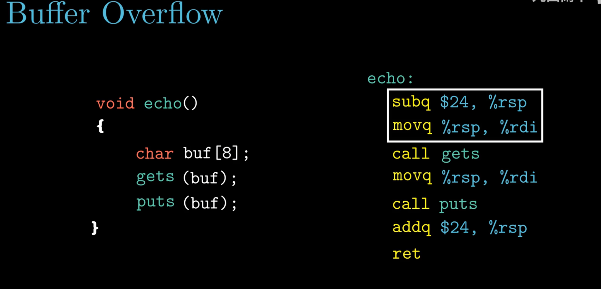
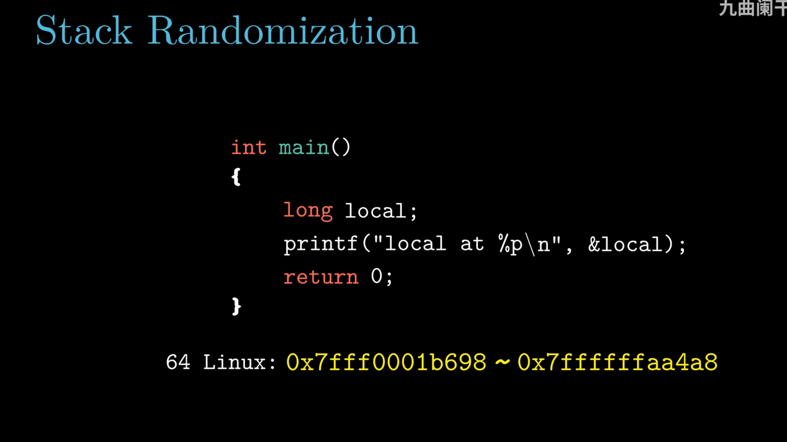
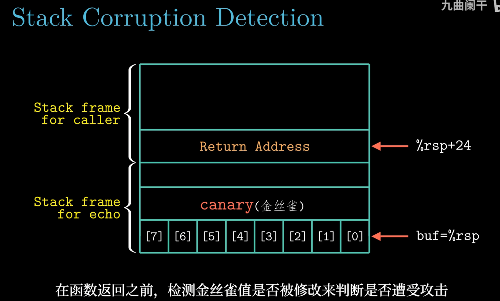
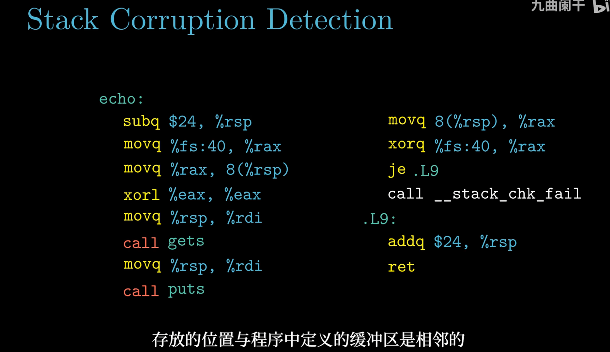

# 3.10 在机器级程序中将控制与数据结合起来

> **📖 本节定位**　第 3 章「程序的机器级表示」· 教材 P192–P204
> **一句话**：把"控制"（跳转、过程）与"数据"（数组、结构）合起来看真实程序——指针怎么落到地址、GDB 怎么读机器状态、缓冲区溢出怎么发生与怎么防、变长栈帧怎么保住返回地址。

> [!IMPORTANT] 本节要回答的三个问题
> 1. `char buf[8]` 只有 8 个字节，为什么多输入几个字符程序照常跑，再多一个就 `Segmentation fault`？多写的字节到底落到哪儿去了？
> 2. 编译器明明知道 `buf` 只有 8 字节，为什么运行时没人拦一下？四道防线（栈随机化、canary、NX、ASLR）各自拦住了哪一步、又漏了哪一步？
> 3. 平时根本用不到的 `%rbp`，为什么一遇到 `long *p[n]` 就必须请回来？

**读之前你需要会**：栈向**低地址**增长、`call` 会把返回地址压栈（见 [3.7 过程](3.7%20过程.md)）；`char` 占 1 字节、指针占 8 字节（见 [3.3 数据格式](3.3%20数据格式.md)）。记不清也没关系——本节会把栈帧重新画一遍。

[← 上一节：3.9 异质的数据结构](3.9%20异质的数据结构.md)　｜　[下一节：3.11 浮点代码 →](3.11%20浮点代码.md)

---

## 🎯 核心结论

| # | 结论 |
| :-: | :--- |
| 1 | 指针 = **类型 + 地址**；类型决定读几字节、算术步长、如何解释位；`&` 与 `*` 互逆 |
| 2 | 数组名在表达式中退化为首元素地址，`a[i]` 与 `*(a+i)` 同义，`(char*)p-(char*)a` 是字节差 |
| 3 | GDB 只需三类操作：**设断点、`stepi` 单步看 `%rip`、查寄存器/内存** |
| 4 | `gets`/`strcpy` 不检查长度 → 写超 `char buf[8]` 会覆盖**返回地址**，`ret` 即被劫持 |
| 5 | 四道防线：**栈随机化、栈保护、NX、ASLR**；单独任何一道都能被绕过 |
| 6 | 变长栈帧（VLA/`alloca`）用 `%rbp` 钉住帧顶；`leave` = `movq %rbp,%rsp` + `popq %rbp` |
| 7 | 源码层换掉 `gets`/`strcpy`/`sprintf`/`scanf("%s")` 才是治本；栈随机化、canary、NX、ASLR 都只是抬高攻击成本 |

---

## 3.10.1 理解指针

| C 概念 | 机器级含义 |
| :--- | :--- |
| 每个指针都有**类型** | 决定用 `movb/movl/movq/movsd` 哪条、比例因子多大 |
| 指针的**值**是一个地址 | 一个 64 位无符号整数 |
| `&` 取地址、`*` 解引用 | `leaq` 算地址、`mov` 顺着地址存取，二者互逆 |
| 数组名 | 退化为 `&a[0]`，本身不占存储 |
| 函数指针 | 值是**代码段地址**，`call *%rax` 间接调用 |
| 强制转换 | **只改变解释方式，不改变一个位** |

```c
int *ip;  char *cp;  double *dp;
ip + 1;      /* 地址 +4 */        *ip;   /* movl  (%rdi), %eax   */
cp + 1;      /* 地址 +1 */        *cp;   /* movb  (%rdi), %al    */
dp + 1;      /* 地址 +8 */        *dp;   /* movsd (%rdi), %xmm0  */
int a[4];  int *p = a;      /* 数组名退化为 &a[0]；p[2] ≡ *(p+2) ≡ a[2]；&a[2]-a = 2 */
```

数组名与指针**并不完全等价**：`sizeof(a)` 是 16（整个数组），`sizeof(p)` 是 8；`a` 不是左值、不能被赋值。只有"表达式求值"这一层，`a` 才退化成 `&a[0]`。

**函数指针。** 函数名就是代码段里的地址，可以像普通数据一样存进结构体、数组、`void *`——"回调函数""虚函数表""跳转表"都是这么实现的：

```c
int add(int x, int y) { return x + y; }
int (*f)(int, int) = add;      /* f 里存 add 的代码地址；f(3,4) 与 (*f)(3,4) 等价 */
```

```asm
    leaq    add(%rip), %rax    # 取函数入口地址（RIP 相对寻址）
    call    *%rax              # 间接调用：跳到自己算出来的地址
```

**强制转换**只改变解释方式，不产生任何指令：`char *p = (char *)&x;` 之后 `p[0]` 读的是 `x` 的最低字节（小端）。真正决定行为的是随后那条 `movb` 而不是 `movl`。

<details>
<summary>✅ 检查点 1：`char *p = (char *)&x;` 里 `p[0]` 读的是 `x` 的哪几个字节？这条强转本身生成指令了吗？</summary>

`p[0]` 读 `x` 的**最低字节**（小端机器上就是 `x & 0xFF` 那一位），`p[1]` 才是次低字节。强转本身**不生成任何指令**——它只改变后面用 `movb` 还是 `movl`，地址一个位都没动。
</details>

---

## 3.10.2 应用：GDB 调试器

| 命令 | 作用 |
| :--- | :--- |
| `gdb prog` / `gdb prog core` | 加载程序 / 加载 core dump |
| `break *0x400540`、`break echo` | 在地址 / 函数入口下断点 |
| `run [args]`、`continue`、`kill` | 运行、继续、终止 |
| `stepi [n]`（`si`）/ `nexti [n]`（`ni`） | 执行 n 条机器指令（遇 `call` 进入 / 越过） |
| `info registers`、`info registers rip` | 全部 / 单个寄存器 |
| `x/2gx &src`、`x/4wb 0x…`、`x/s 0x…` | 按 8 字节 / 单字节 / 字符串看内存 |
| `x/i $rip`、`disas [func]` | 反汇编当前指令 / 整个函数 |
| `print` / `p/x $rax`、`bt`、`frame n` | 求值（`/x` 十六进制）、调用栈、切栈帧 |
| `set var n = 5`、`set $rax = 0` | 改变量 / 改寄存器（"假设这里是对的"继续往下调试） |

**单步观察 `%rip`。** `stepi` 执行一条机器指令，`%rip` 前进的字节数就是上一条指令的编码长度：

```text
(gdb) disas main
   0x400540 <+0>:  sub   $0x8,%rsp
   0x400544 <+4>:  mov   $0x2,%esi
   0x400549 <+9>:  mov   $0x1,%edi
   0x40054e <+14>: call  0x400520 <add>
   0x400553 <+19>: add   $0x8,%rsp
   0x400557 <+23>: ret
(gdb) break *0x400540
(gdb) run
Breakpoint 1, 0x0000000000400540 in main ()
(gdb) info registers rip
rip    0x400540   0x400540 <main>
(gdb) stepi                    ← 执行 sub $0x8,%rsp（编码 4 字节）
(gdb) info registers rip
rip    0x400544   0x400544 <main+4>     ← 前进 4 字节，正好一条指令长
(gdb) x/6bx $rip
0x400544 <main+4>:  0xbe 0x02 0x00 0x00 0x00 0xbf   ← 0xbe 即 mov $imm32,%esi
```

*▲ 图 3-10-1：对照 `x/6bx` 看到的机器码，能把"汇编 ↔ 机器码"真正对上。*

> [!TIP]
> 调试优化过的代码要用 `stepi` 而不是 `step`（按源码行）——`-O2` 会重排、合并语句，源码行与指令不再一一对应。用 `layout regs` 打开 TUI 后，被改动的寄存器会高亮。

---

## 3.10.3 内存越界引用和缓冲区溢出

### 先说它想解决什么问题

C 的数组**不带长度**。`char buf[8]` 在机器级只是"从某个地址开始的 8 个字节"，这个 8 只活在编译器的类型里；运行时没有任何人拿它去核对"你到底写了几个字节"。所以 `gets` 写第 9 个字节时不会停下，它会继续往下一格灌——**写超了别人的格子**。

把栈帧想成一排**编号的储物格**：

```text
   偏移  +0   +1   +2   +3   +4   +5   +6   +7 │ +8 … +15 │ +16 … +23 │ +24 … +31
       ┌────┬────┬────┬────┬────┬────┬────┬────┼──────────┼───────────┼───────────┐
       │ 0  │ 1  │ 2  │ 3  │ 4  │ 5  │ 6  │ 7  │  填充     │ canary*   │ 返回地址   │
       └────┴────┴────┴────┴────┴────┴────┴────┼──────────┼───────────┼───────────┘
        ↑ buf[0]（%rsp）                          ↑ 越界从这里开始   ↑ 最后一格：ret 要读它

   正常写入：只占 +0…+7，8 个格子刚好用完
   溢出写入：+8、+9、… 一路往高地址写 → 先糟蹋填充，再踩 canary，最后改掉返回地址
```

<sub>* 开了 `-fstack-protector` 时 +16 这一带放 canary（见 3.10.4），否则仍是填充。</sub>

**形式化定义**：设缓冲区首址为 `buf`、容量 `n`（即 `sizeof(buf)`），一次写入 $k$ 个字节（**含** `gets` 补的 `\0`）。当 $k>n$ 时发生**缓冲区溢出（buffer overflow）**，被改写的最高地址是 $buf + k - 1$。若这个地址落到或越过返回地址所在的那一格，`ret` 弹出的就不再是原来的地址——**控制流被劫持**。定义里并没有"攻击"二字：溢出本身只是一个越界写，被谁利用才是安全问题。

先看课堂原图：`echo` 的 C 源码与 gcc 生成的汇编并排，两条建帧指令被方框框了出来。



*▲ 图 3-10-2：左边只声明了 `char buf[8]`，右边的序言却是 `subq $24,%rsp`——多出来的 16 字节是 16 字节对齐的余量；紧接着 `movq %rsp,%rdi` 把 `%rsp` 直接当作 `buf` 的首址交给 `gets`。记住这两条，「为什么第 24 个字符才覆盖返回地址」全靠它。*

C 对数组引用**不做边界检查**，部分库函数也不检查目标大小。两者一叠加，就是软件史上最著名的漏洞类别。

```c
void echo(void)
{
    char buf[8];        /* 只有 8 字节 */
    gets(buf);          /* 读一行，读多少写多少，完全不管 buf 多大 */
    puts(buf);
}
```

```asm
echo:
    subq    $24, %rsp        # 分配 24 字节：8 给 buf，16 给对齐余量
    movq    %rsp, %rdi       # 第 1 个参数 = buf 的地址
    call    gets             # ← 溢出就发生在这个调用内部
    movq    %rsp, %rdi
    call    puts
    addq    $24, %rsp
    ret                      # 从栈上弹出返回地址 → 跳回去
```

**栈上到底发生了什么？** `gets` 从 `%rsp` 开始往后写，撞到哪儿算哪儿：

```text
      高地址
   ┌────────────────────────┐
   │  …调用者的栈帧…        │
   ├────────────────────────┤
   │ 返回地址（8 字节）      │ ← buf+24：第 24 个字符起被改写
   ├────────────────────────┤
   │ [8..23] 填充（16 字节） │ ← 先被糟蹋，看不出症状
   ├────────────────────────┤
   │ [0..7]  buf             │ ← %rsp 指向这里
   └────────────────────────┘
      低地址        ▲
                    └── gets 从这里往后写，一直写到你回车
```

*▲ 图 3-10-3：`subq $24,%rsp` 让 `%rsp` 落在 `buf` 上；返回地址在 `buf+24`，所以前 23 个字符"看起来没事"。*

课堂原图把同一份布局画得更完整，还标出了偏移量：

![图 3-10-4 echo 的栈帧：调用者帧在上，返回地址在 %rsp+24，buf[0]–buf[7] 从 %rsp 起](images/3-10_echo-stack-frame.png)

*▲ 图 3-10-4：与上图逐块对应——上方是调用者（caller）的帧，`Return Address` 落在 `%rsp+24`，echo 帧里 `buf[0]`–`buf[7]` 从 `%rsp` 起逐字节排列，两者之间是 16 字节余量。字幕那句"输入不超过 23 字节时不会造成严重后果"说穿了危险之处：余量被写坏时程序照常运行，第 24 个字节才动到返回地址。*

#### 一起算一遍

`char buf[8]`、序言是 `subq $24, %rsp`。跟着算清楚"第几个字节落到哪一格"：

| 步骤 | 动作 | 结果 |
| :-: | :--- | :--- |
| ① | `call echo` 先把返回地址压栈，`%rsp` 减 8 | 返回地址写在调用前的 `%rsp - 8` |
| ② | `subq $24, %rsp` 之后，`%rsp` 正好落在 `buf` 的首字节 | `buf = %rsp` |
| ③ | 返回地址相对 `buf` 的偏移 = `%rsp` 跨过的 24 字节 | `&ret_addr = buf + 24` |
| ④ | `buf` 自己占 `buf+0 … buf+7` | 8 字节 |
| ⑤ | 余下 `24 - 8 = 16` 字节是 16 字节对齐的填充 | `buf+8 … buf+23` |
| ⑥ | 输入 24 个可见字符 `0…9`：`'0'` 落 `buf+0`，第 24 个 `'3'` 落 `buf+23` | 填充写满，返回地址还没动 |
| ⑦ | `gets` 再补一个 `\0` | 它落在 **`buf+24`**，即返回地址的最低字节 |
| ⑧ | 第 25 个**可见**字符若真出现，它落 `buf+24`，`\0` 落 `buf+25` | 返回地址最低两字节被改 |

**所以答案是**：`buf` 到返回地址差 **24 字节**（8 字节 `buf` + 16 字节填充）。输入 24 个字符时，第 25 个**字节**是 `gets` 补的 `\0`，它落在 `buf+24`；若输入 25 个可见字符，第 25 个字符才落到 `buf+24`、`\0` 落到 `buf+25`。被改的总是**最低字节**，因为 x86-64 按小端存放——这就是下面 `0x4006c3` 变成 `0x400600` 的那一步。

| 输入字节数 | 后果 |
| :--- | :--- |
| 0 – 7 | 正常，刚好填满 `buf`；8 – 23 破坏填充区，**看不出问题**（最危险，掩盖 bug） |
| 24 – 31 | **覆盖返回地址**，`ret` 跳到攻击者给的地址 |
| 32 以上 | 继续破坏调用者栈帧，通常直接段错误 |

> [!NOTE] 换个角度想
> 如果 C 像 Java 那样每次写数组都查边界会怎样？每次访存前要多一条"比较 + 条件跳转"，循环体开销可能直接翻倍，还会挡住编译器把 `a[i]` 合成一条带比例因子的 `movl`。C 的选择是**把检查交给程序员**：平时零开销，需要时再用 `-fsanitize=address`（ASan）插桩。代价就是本节这一堆漏洞——**"没崩"从来不等于"没溢出"**：填充区被写坏时程序照常运行，这正是 bug 能潜伏几个月的原因。

课件把同一个 `echo` 推到临界点（源码里写的是 `char buf[4]`——本笔记前面按 `buf[8]` 讲、余量 16 字节，课件这版余量 20 字节，返回地址同样在 `buf+24`；汇编仍是 `subq $0x18,%rsp`），两次运行只差一个字符：

| 输入 | 实际写入字节 | 结果 |
| :--- | :--- | :--- |
| 23 个字符 `01234567890123456789012` | 24（含 `gets` 补的 `\0`） | 原样回显，**不崩** |
| 24 个字符 `012345678901234567890123` | 25（含 `\0`） | `Segmentation fault` |

返回地址是 `call_echo` 里 `callq 40069c <echo>` 的下一条，值为 `0x4006c3`：

```asm
00000000004006b5 <call_echo>:
  4006b5:  48 83 ec 08          sub    $0x8,%rsp
  4006b9:  b8 00 00 00 00       mov    $0x0,%eax
  4006be:  e8 d9 ff ff ff       callq  40069c <echo>   # 返回地址 = 0x4006c3
  4006c3:  48 83 c4 08          add    $0x8,%rsp
  4006c7:  c3                   retq
```

真正写到 `buf+24` 的**不是第 24 个输入字符**，而是 `gets` 自动补的那个 `\0`：`'3'`（0x33）落在 `buf+23`，还在填充区；`\0` 才踩到返回地址。返回地址在栈上按小端存放，最低字节恰好是 `0xc3`：

```text
 写入前： c3 06 40 00 00 00 00 00   →  0x00000000004006c3（call_echo 里 call 的下一条）
 写入后： 00 06 40 00 00 00 00 00   →  0x0000000000400600（call_echo 中间，解码出一堆垃圾）

 echo 的 ret 弹出 0x400600 → 程序打印 "returned to 0x400600" 之后立刻崩溃
```

*▲ 返回地址被 `\0` 抹掉最低字节：一个字节就够——`ret` 不必跳到合法函数入口，跳到半条指令中间同样致命。*

**够不到返回地址时，溢出就换成"悄悄改数据"。** 课件用 C++11 演示：结构体里 `int a[2]` 紧挨着 `double d`，再往后还有别的字段与一个标着 Critical State 的成员；依次把 `0x40000000`（即 `2.0f` 的位模式）写进 `a[i]`（i = 0…6，从 2 起就已经越界）：

| 调用 | 实际被写的 4 字节槽 | 返回的 `d` | 说明 |
| :--- | :--- | :--- | :--- |
| `fn_mem(0)` / `fn_mem(1)` | `a[0]` / `a[1]` | 3.14 | 合法下标，什么也没发生 |
| `fn_mem(2)` | `d` 的低 32 位（`d3…d0`） | 3.1399998664856 | 低半 `51eb851f` → `40000000` |
| `fn_mem(3)` | `d` 的高 32 位（`d7…d4`） | 2.00000061035156 | 高半 `40091eb8` → `40000000` |
| `fn_mem(4)` / `fn_mem(5)` | `d` 之后的其它字段 | 3.14 | 改坏了别的成员，`d` 没被碰 |
| `fn_mem(6)` | Critical State | **Segmentation fault** | 动到关键状态，进程直接死 |

3.14 的位模式是 `0x40091eb851eb851f`：低半 `51eb851f`、高半 `40091eb8`。把低半改成 `0x40000000` 得 `0x40091eb840000000` = 3.1399998664856；把高半改成 `0x40000000` 得 `0x4000000051eb851f` = 2.00000061035156——和课件打印的结果逐位对得上。**一个下标越界，就能把浮点数改成任意值，而程序一声不响。**

**`war` 攻击示例。** 攻击者不必写一行机器码，只要让返回地址指向**程序里已有的** `war`：

```c
void war(void)      /* 正常流程永远不会调用它 */
{   printf("You have been attacked!\n");  exit(0);  }
/* main 里只有一句 echo(); —— 若 echo 不溢出，war 永远没机会运行 */
```

```text
 输入串 = [ 24 字节填充 ][ 8 字节 = &war ]
  栈上：
  ┌──────────────────┬────────────────────┐
  │ 填充 24 字节      │ 返回地址            │  上层栈帧…
  │ （随便什么字符）  │ 0x00000000004005c0│
  └──────────────────┴────────────────────┘
                            ▲  被改写成 war 的入口
  echo 执行 ret → 直接跳进 war → 打印 "You have been attacked!"
```

*▲ 图 3-10-5：这种"跳回已有代码"的攻击叫 return-to-text。若要执行自己的代码，得把 shellcode 写进 `buf`、再让返回地址指向 `buf`——那才是完整版缓冲区溢出。*

课件把攻击串做成了一个十六进制文本文件，再用 `hexify` 转成真正的字节喂给 `gets`：

```text
 30 31 32 33 34 35 36 37 38 39 30 31 32 33 34 35 36 37 38 39 30 31 32 33   ← "0123…0123" 共 24 字节
 c8 06 40 00 00 00 00 00                                                    ← 0x4006c8，smash 的入口

linux> cat smash-hex.txt | ./hexify | ./bufdemo-nsp
Type a string:012345678901234567890123?@
I've been smashed!
```

**代码注入（shellcode）。** return-to-text 只是借用程序里现成的函数；再进一步，把机器码本身写进 `buf`，让返回地址指回 `buf`：

```text
 高地址
 ┌──────────────────────────────┐
 │ …调用者的栈帧…                │
 ├──────────────────────────────┤
 │ 新的返回地址 = &buf           │  ← 覆盖原来的返回地址
 ├──────────────────────────────┤
 │ 填充（补到偏移 24）            │
 ├──────────────────────────────┤
 │ shellcode（execve "/bin/sh"）  │  ← 真正的代码，就摆在栈上
 └──────────────────────────────┘ ← %rsp（buf）
```

*▲ 代码注入的栈布局：`ret` 把 `&buf` 弹进 `%rip`、`%rsp` 再加 8，CPU 从此刻起在**栈**上取指——`Text` 段里的机器码和 `Stack` 段里的字节，在 CPU 眼里没有区别，区别只在页表权限。*

三件事必须同时成立，缺一不可：

1. 返回地址要**精确等于 `buf` 的地址**——攻击者得先知道栈在哪儿（栈随机化就打这里）；
2. 栈必须**可执行**——这正是 NX 要管的事；
3. shellcode 里**不能出现 `\0`**（`gets` 读到就停），所以真正的 shellcode 全用 `xor %eax,%eax`、`push`/`pop` 这类"零字节无关"的写法，看起来才那么绕。

这不是玩具：1988 年的 Morris 蠕虫靠 `gets` 溢出在网络上自我复制，2021 年的 DNSpooq 漏洞（dnsmasq）同样是缓冲区溢出——"远程执行任意代码"从来不是夸张说法。

**根源：`gets` 的签名里根本没有"长度"这个参数。** Unix 的实现是读一个字符写一个字符：

```c
/* Get string from stdin */
char *gets(char *dest) {
    int c = getchar();
    char *p = dest;
    while (c != EOF && c != '\n') {
        *p++ = c;          /* 读一个写一个，不问 dest 还剩多少空间 */
        c = getchar();
    }
    *p = '\0';             /* 再补一个终结符——第 N+1 个字节也是白送的 */
    return dest;
}
```

调用者没法告诉它"最多写 4 个字节"。同类问题还有 `strcpy`/`strcat`（复制到 `\0` 为止，长度由源串决定）和 `scanf`/`fscanf`/`sscanf` 的 `%s`（不写宽度就等于不限长）。

> [!WARNING]
> `gets` 已在 C11 中被**从标准删除**，glibc 也不再提供。但同类的 `strcpy`、`strcat`、`sprintf`、`scanf("%s")` 依然常见。安全替代是 `fgets`、`strncpy`/`strlcpy`、`snprintf`，并且**永远检查返回值与边界**。

**格式化串漏洞。** `printf(buf)` 把数据当格式串用，`%n` 能把"已输出字符数"写进参数给出的地址（`printf("AAAA%n", &t)` 即把 4 写进 `t`）。配合 `%hhn` 与宽度控制可逐字节改写返回地址——**不需要写超任何缓冲区**，栈保护也拦不住。正确写法永远是 `printf("%s", buf)`。

它还能**两用**：`%p`/`%s` 先把栈上的 canary、返回地址、libc 地址**读**出来（信息泄露，正好破掉"猜不准"），再用 `%n` 把算好的值**写**回去。所以格式化串漏洞常常是"先泄后打"链条的第一环；而 `printf("%s", buf)` 一句就能让它彻底消失。

**最后，把前面所有地址放回它们该在的位置。** 课件在讲溢出之前先摆了 x86-64 Linux 的地址空间全图——缓冲区溢出之所以能改到"别人的东西"，就是因为这几个区挨得太近：

| 区段 | 放什么 | 位置 / 上限 | 权限 | 每次运行 |
| :--- | :--- | :--- | :--- | :--- |
| 栈 stack | 局部变量、返回地址、保存的寄存器 | 顶部 `0x0000_7fff_ffff_ffff`，**8 MB** 上限，向低地址增长 | 可读写 | 随机 |
| 共享库 | `libc.so` 等 | 栈的正下方，约 128 MB 窗口 | 可读可执行 | 随机 |
| 堆 heap | `malloc`/`calloc`/`new` | 数据段之上，向高地址增长 | 可读写 | 随机 |
| 数据 `.data`/`.bss` | 全局变量、`static`、字符串常量 | 约从 `0x601060` 起 | 可读写（字符串常量在只读页） | 非 PIE 时固定 |
| 文本 `.text` | 机器指令 | 从 `0x400000` 起（课件写作 `40 0000`） | 只读、可执行 | 非 PIE 时固定 |

课件给了一次真实运行的地址（每次执行都不同），正好把每个区都点了一个名：

```c
char big_array[1L<<24];   /* 16 MB → .bss */
char huge_array[1L<<31];  /*  2 GB → .bss */
int global = 0;
int useless() { return 0; }
int main() {
    void *phuge1, *psmall2, *phuge3, *psmall4;
    int local = 0;
    phuge1  = malloc(1L << 28);  /* 256 MB → mmap 区 */
    psmall2 = malloc(1L << 8);   /*  256 B  → 堆 */
    phuge3  = malloc(1L << 32);  /*   4 GB  → mmap 区 */
    psmall4 = malloc(1L << 8);   /*  256 B  → 堆 */
    /* ... */
}
```

| 对象 | 地址 | 落在哪个区 |
| :--- | :--- | :--- |
| `main` 里的 `int local` | `0x00007ffe4d3be87c` | 栈 |
| `phuge1`（256 MB） | `0x00007f7262a1e010` | mmap 区（共享库下方） |
| `phuge3`（4 GB） | `0x00007f7162a1d010` | mmap 区，比上一块低约 4 GB |
| `psmall2`（256 B） | `0x000000008359d010` | 堆 |
| `psmall4`（256 B） | `0x000000008359d120` | 堆，比上一块高 `0x110`（256 B + 堆头/对齐） |
| `big_array`（16 MB） | `0x0000000080601060` | `.bss`，恰好 `0x601060 + 2 GB` |
| `huge_array`（2 GB） | `0x0000000000601060` | `.bss` 起点 |
| `useless()` | `0x0000000000400590` | `.text` |
| `main()` | `0x000000000040060c` | `.text` |

从这两张表能直接读出几件事：**代码段从 `0x400000` 起步**，`useless` 与 `main` 只差 `0x7c`；**全局数组在 `.bss` 里连续排**，2 GB 的 `huge_array` 把下一个数组顶到 `0x80601060`；**两次 256 B 的 `malloc` 相差 `0x110`**，因为每块前面还有堆头、并按 16 字节对齐；**两个巨型 `malloc` 落在 `0x7f7…`**，那是 `mmap` 区而不是堆。栈与共享库的位置每次运行都变——这正是 3.10.4 要讲的随机化。

**栈只有 8 MB，压穿它不必写超任何缓冲区。** 课件用递归演示这条上限：

```c
int recurse(int x) {
    int a[1<<15];                    /* 4 * 2^15 = 128 KiB：一帧就吃掉 128 KiB */
    printf("x = %d.  a at %p\n", x, a);
    a[0] = (1<<14)-1;
    a[a[0]] = x-1;
    if (a[a[0]] == 0) return -1;
    return recurse(a[a[0]]) - 1;
}
```

```text
 x = 67.  a at 0x7ffd18aba930
 x = 66.  a at 0x7ffd18a9a920     ← 每层差 0x20010 = 128 KiB + 16 B（返回地址与对齐）
 x = 65.  a at 0x7ffd18a7a910
   …
 x = 3.   a at 0x7ffd182ba530
 x = 2.   a at 0x7ffd1829a520
 Segmentation fault (core dumped)
```

从 `x=67` 到 `x=2` 一共 66 层，每层 `0x20010`（128 KiB + 16 B），累加约 8.2 MB，正好把 8 MB 的栈吃到头——`x=1` 那一层还没分到空间就 `Segmentation fault (core dumped)`。**"栈溢出"这个词有两层意思**：写超缓冲区，和把栈空间用尽；结局都是同一个 `Segmentation fault (core dumped)`。

---

## 3.10.4 对抗缓冲区溢出攻击

课件把防御分成三层：**从源码上消灭漏洞**（换掉不检查长度的库函数）→ **系统级保护**（栈随机化、不可执行栈）→ **栈破坏检测**（金丝雀）。下面按「栈随机化 / canary / NX / ASLR」四道防线展开，编号不同，覆盖面一致。

课件还插了一页"安全单一化"（security monoculture），用银杏的分类（门、纲、目、科、属）打比方：全世界的服务器跑同一份 `libc`、同一个 Web 服务器，就像一片只种一个品种的林子——一个病害就能横扫全部。这正是系统级保护存在的理由：不能指望每个程序都写得安全。

**第 0 道：换掉不安全函数。** 这是唯一"治本"的一条，其余几道都只是提高攻击成本：

| 不安全 | 危险点 | 安全替代 | 容易踩的坑 |
| :--- | :--- | :--- | :--- |
| `gets(buf)` | 没有长度参数，读到换行/EOF 才停 | `fgets(buf, n, stdin)` | 最多读 **n−1** 个字符，`\n` 会一起读进来 |
| `strcpy(dst, src)` | 复制到 `\0` 为止 | `strncpy(dst, src, n)` / `strlcpy` | 源串 ≥ n 时**不补** `\0`，要手动 `dst[n-1] = '\0'` |
| `strcat(dst, src)` | 同上，追加时更隐蔽 | `strncat(dst, src, n)` | `n` 是"最多再追加几个字符"，不是 `dst` 的总容量 |
| `sprintf(buf, fmt, …)` | 输出长度完全由数据决定 | `snprintf(buf, n, fmt, …)` | 返回值是"本该写多少"（不含 `\0`），≥ n 说明被截断 |
| `scanf("%s", buf)` | 宽度不限 | `scanf("%ns", buf)` 或 `fgets` | 宽度必须是字面量，且比 `buf` 小 1 |
| `printf(buf)` | 把数据当格式串（见 3.10.3） | `printf("%s", buf)` | 格式化串漏洞不写超缓冲区也能改内存 |

课件的例子把 `gets(buf)` 换成 `fgets(buf, 4, stdin)`：`buf[4]` 最多装 3 个字符加 `\0`，输入再长也不会越界——代价是 `n` 里必须给 `\0` 留位置。

**① 栈随机化。** 每次运行栈基址都不同，攻击者猜不准地址（Linux x86-64 的栈随机范围约 2^23，即 8 MB、约 800 万种可能）：

```text
  第 1 次: buf @ 0x7ffd3f2a1c40    第 2 次: buf @ 0x7ffc91b84e30
  第 3 次: buf @ 0x7ffd0c7a5d90    ← 每次运行都不一样，攻击者只能靠猜
```

课堂上的最小实验更直观：只声明一个 `long local`，把它打印出来，反复运行同一个可执行文件。



*▲ 图 3-10-6：`printf("local at %p\n", &local)` 循环跑几十次，64 位 Linux 上 `&local` 落在 `0x7fff0001b698` ~ `0x7ffffffaa4a8` 这段范围内随机跳动。同一个栈变量、同一段代码，位置却没有一次相同——攻击者写进返回地址的那个常量地址，命中的概率因此被压到百万分之一量级。*

> [!NOTE]
> 绕过手段是 **NOP sled**（雪橇）：在 shellcode 前塞一大段 `nop`，返回地址只要落进这片 `nop` 的任意一处，就会一路滑到 shellcode。所以随机范围越大越安全（2^23 被认为偏小）。

课件把这叫"随机堆栈偏移"：程序启动时先在栈上**预留随机字节数**，整个帧图跟着平移，攻击者写死的 `&buf` 每次都不对。这也解释了 **NOP sled 为什么不再好用**：sled 只能吃掉"落点差几十、几百字节"的误差，而要覆盖 2^23 ≈ 8 MB 的随机窗口，sled 自己得先猜中整段范围；且每猜错一次进程就崩，攻击者只能反复重连碰运气。

**② 栈破坏检测（canary）。** 编译器在返回地址旁放一个随机值，函数返回前检查：



*▲ 图 3-10-7：与图 3-10-4 是同一张栈帧图，只多了一块——`buf[7..0]` 与 `Return Address` 之间插入的 `canary（金丝雀）`。它比返回地址更靠近缓冲区，所以任何从 `buf` 往后写的越界都会先踩到它；函数返回前只要发现它被改过，就说明栈已经被人动过（字幕：在函数返回之前，检测金丝雀值是否被修改来判断是否遭受攻击）。这正是 canary 能"最早发现越界写"的原因——不等你够到返回地址，它先叫。*

```asm
# —— 序言 ——
    movq    %fs:40, %rax            # 从 fs:0x28 读 canary（40 = 0x28）
    movq    %rax, 16(%rsp)          # 存到栈上，紧邻返回地址（buf+16）
    ...                             # 函数体：gets 可能在这里写超
# —— 收尾 ——
    movq    16(%rsp), %rax
    xorq    %fs:40, %rax            # 与当前 canary 比较，相同则为 0
    je      .L9
    call    __stack_chk_fail        # 不等 → 立刻 abort，绝不执行 ret
.L9:
    addq    $24, %rsp
    ret
```

课堂上的这页把序言与收尾摆在一起对照，可以逐条对上：



*▲ 图 3-10-8：左列序言——`movq %fs:40,%rax` 读出哨兵，`movq %rax,8(%rsp)` 把它存到缓冲区正上方（字幕：存放的位置与程序中定义的缓冲区是相邻的）；右列收尾——`movq 8(%rsp),%rax` 取回、`xorq %fs:40,%rax` 与当前哨兵比对，异或为 0 才 `je .L9` 放行，否则 `call __stack_chk_fail` 当场 abort，`ret` 根本执行不到。存回的偏移随帧布局而变（这一页是 `8(%rsp)`，上面清单是 `16(%rsp)`），但位置总在 `buf` 与返回地址之间。*

> [!TIP]
> `%fs:40` 与 `%fs:0x28` 是**同一个位置**：GNU 汇编器按十进制写，`objdump` 按十六进制显示。canary 的最低字节规定为 `0`，字符串函数写到这里就会停——等于给复制类攻击多加了一道坎。

课件把编译开关与实测都摆了出来：`-fstack-protector` 打开金丝雀（GCC 现在默认开，复现实验时可用 `-fno-stack-protector` 关掉）。`./bufdemo-sp` 输入 8 个字符 `01234567` 正常回显；输入 9 个字符 `012345678` 立刻打印 `*** stack smashing detected ***`——因为 `mov %rax, 0x8(%rsp)` 把 canary 放在 `buf+8`，第 9 个字符正好写进它最低的那一字节（规定为 0），比较当场失败。

<details>
<summary>✅ 检查点 2：本节清单里的 canary 存在 `16(%rsp)`（即 `buf+16`），那输入 17 个字符为什么就会被打下？</summary>

第 17 个字符正好落在 `buf+16`，也就是 canary 的**最低字节**；而 canary 的最低字节规定为 `0`，只要被写过就必然非 0。收尾时 `xorq %fs:40, %rax` 的结果不为 0，`je` 不成立，直接 `call __stack_chk_fail`，`ret` 根本执行不到。注意 canary 在 `buf+16`、返回地址在 `buf+24`——**不等你够到返回地址，它先叫**。
</details>

读这段汇编时还有三处容易漏：

- `xor %eax,%eax` 不是比较，而是**擦掉 `%rax` 里那份 canary 副本**（顺带把 `%rax` 清零）；
- 检查点在 `puts` 之后、`add $0x18,%rsp` 与 `retq` 之前——不匹配就 `call __stack_chk_fail`，进程 abort，`ret` 根本执行不到；
- 它保护的不止返回地址：`Saved %ebx`、`Saved %ebp` 排在 canary 之后，想改它们同样得先穿过金丝雀。

**③ 限制可执行代码区域（NX）。** 页表项里加一位"可执行"标志（AMD 叫 **NX**，Intel 叫 **XD**），把栈和堆标记为**不可执行**：写进 `buf` 的机器码再也执行不了。但"跳回已有代码"（`war` 那种）不受影响，所以绕过方式是 **ROP（return-oriented programming）**——用返回地址把已有代码片段（gadget）串成图灵完备的程序。

补一个背景：传统 32 位 x86 的页表只有"只读 / 可写"标记，**任何可读页都能当代码执行**，所以写在栈上的 shellcode 天然能跑；x86-64 把"执行"位（NX/XD）变成页表的标配，栈被标成不可执行后，往栈上跳的尝试会直接触发异常。

**ret2libc 与 ROP。** NX 堵死了"执行我写进去的代码"，却堵不住"执行别人已经写好的代码"。最小的一步是 **return-to-libc**：把返回地址改成 `system` 的地址，再让它拿到 `"/bin/sh"` 的指针——32 位下参数直接摆在栈上，x86-64 下第一个参数走 `%rdi`，所以中间还得夹一个 `pop %rdi; ret` 的 gadget。一行 shellcode 都不用，就能拿到 shell。更一般地，**ROP（返回导向编程）** 把一堆以 `ret` 结尾的短指令序列（gadget）串起来，凑出任意计算。它的前提只有两条：**代码地址固定**（非 PIE 时从 run 到 run 不变）、**代码段可执行**。

课件用两个 gadget 算 `%rdi ← %rdi + %rdx`：

| # | gadget 地址 | 指令序列 | 效果 |
| :-: | :--- | :--- | :--- |
| 1 | `0x4004d4` | `lea (%rdi,%rdx,1),%rax` ; `ret` | `%rax ← %rdi + %rdx` |
| 2 | `0x4004dc` | `movq %rax,%rdi` ; `ret` | `%rdi ← %rax` |

```asm
00000000004004d0 <ab_plus_c>:        # long ab_plus_c(long a, long b, long c) { return a*b + c; }
  4004d0:  48 0f af fe          imul   %rsi,%rdi
  4004d4:  48 8d 04 17          lea    (%rdi,%rdx,1),%rax    ← gadget #1 从这里开始
  4004d8:  c3                   retq

00000000004004d9 <setval>:           # void setval(unsigned *p) { *p = 3347663060u; }
  4004d9:  c7 07 d4 48 89 c7    movl   $0xc78948d4,(%rdi)
  4004df:  c3                   retq
                                     # gadget #2 = 0x4004dc：从立即数中间开始解码
                                     # 立即数 d4 48 89 c7 里，从 48 89 c7 起就是 movq %rax,%rdi
```

两个地址都**不是函数入口**：`0x4004d4` 是 `ab_plus_c` 中间那条 `lea`；`0x4004dc` 更极端，它是 `movl $0xc78948d4,(%rdi)` 的立即数 `d4 48 89 c7` 里、从第二个字节 `48` 开始解码出来的——`48 89 c7` 恰好就是 `movq %rax,%rdi` 的编码。x86 指令变长、允许从任意字节开始解码，这是 ROP 能"就地取材"的根本原因。

```text
 echo 的栈帧：
 buf  [24 字节填充]  [d4 04 40 00 00 00 00 00]  [dc 04 40 00 00 00 00 00]  [下一格…]
                      ↑ 返回地址 → gadget #1        ↑ gadget #1 的 ret 弹出 → gadget #2

 echo 的 ret      → %rip = 0x4004d4，%rsp += 8
 gadget #1 的 ret → %rip = 0x4004dc，%rsp += 8
 gadget #2 的 ret → %rip = 栈上下一格的值 …
```

*▲ ROP 的"地址表"：每个 gadget 末尾的 `ret` 就是链条的"下一跳"；gadget 越多，栈就被一路向上"吃"得越多。*

和代码注入比，ROP 的优势是**不需要知道栈的地址**：地址表由溢出本身摆到栈上，第一条 `ret` 只需要一个固定的代码地址。代价是得先把 gadget 找齐——这正是 ROPgadget、ropper 这类工具干的事。PIE + ASLR 会把 gadget 地址也随机化，于是 ROP 又得先泄露一个代码地址，攻防就这样一级一级往上叠。

**④ 整体示意：ASLR。** **地址空间布局随机化**把栈、共享库、堆、代码段的位置全部随机化，让"猜地址"全面失效：

```text
 高地址 0x7fff_ffff_ffff ┌──────────────────────┐
                         │  栈 stack            │ 随机 ±8 MB
                         │  共享库 libc.so …    │ 随机 ±2 GB
                         │  堆 heap（mmap 区）  │ 随机
                         │  .bss/.data/.text    │ PIE 时随机
 低地址 0x0040_0000       └──────────────────────┘
```

*▲ 图 3-10-9：ASLR 让栈、共享库、堆、代码段的位置全部随机化。四道防线叠加后的能力边界如下表：*

| 防线 | 机制 | 单独使用时被什么绕过 |
| :--- | :--- | :--- |
| 栈随机化 | 栈基址每次不同 | NOP sled + 大范围爆破 |
| 栈保护 | canary 检测返回地址被改 | 先泄露 canary，再精确覆写 |
| NX | 栈/堆页不可执行 | ROP / ret2libc，复用已有代码 |
| ASLR | 代码、库、栈、堆全部随机 | 配合信息泄露（先泄一个地址，再算偏移） |

**结论**：安全靠纵深防御，任何单独一道都有绕过手段；最根本的一条仍是——**不要用不检查长度的函数**。

---

## 3.10.5 支持变长栈帧

前面的函数帧大小都是编译期常量，`%rsp` 一次调整到位即可。但 **VLA**（`long *p[n]`）与 **`alloca`**（栈上动态分配）让帧大小到运行时才确定：收尾时 `%rsp` 该恢复到哪？若只用 `%rsp` 记录位置，动态分配后就找不到帧顶了——办法是把 `%rbp` 当**帧指针**，在序言里钉住。

```c
long vframe(long n, long idx, long *q)
{
    long i;
    long *p[n];                 /* VLA：n 是参数 */
    p[0] = &i;
    for (i = 1; i < n; i++) p[i] = q;
    return *p[idx];
}
```

```asm
vframe:
    pushq   %rbp                    # 保存调用者的帧指针
    movq    %rsp, %rbp              # ★ 帧指针固定：此后 %rbp 指向帧顶
    subq    $32, %rsp               # 为 i 等局部变量与 16 字节对齐预留
    leaq    30(,%rdi,8), %rax       # 8n + 30：8n 数据 + 15 对齐余量 + 15 调整量
    andq    $-16, %rax              # 向上取整到 16 的倍数
    subq    %rax, %rsp              # ★ 动态分配：%rsp 运行时才移动
    leaq    15(%rsp), %r8
    andq    $-16, %r8               # p 的起点按 16 字节对齐
    ...                             # p[0] = &i，再循环填 p[1..n-1]
    leave                           # ★ = movq %rbp,%rsp ; popq %rbp
    ret
```

```text
   高地址
  ┌──────────────────┐
  │  调用者的栈帧    │
  ├──────────────────┤ ← %rbp（帧指针，函数内不变）
  │  保存的 %rbp     │
  │  局部变量/对齐余量 │
  ├──────────────────┤
  │  VLA p[n]        │ ← %rsp：随 n 浮动
  └──────────────────┘   低地址
```

*▲ 图 3-10-10：`%rbp` 钉住帧顶、`%rsp` 自由浮动；收尾时不管 `%rsp` 飘到哪儿，一条 `leave` 就能恢复。*

**`leave` 指令**（编码 1 字节 `0xC9`）就是"恢复栈帧"的专用指令：

```asm
leave
    ≡  movq    %rbp, %rsp   # ① 丢弃当前帧，%rsp 回到帧顶
       popq    %rbp         # ② 弹出旧 %rbp，恢复调用者帧指针
```

> [!IMPORTANT]
> 固定大小的栈帧里 gcc 默认**不用** `%rbp`（`-fomit-frame-pointer`），把它当普通寄存器以腾出资源。只有 VLA、`alloca`、或 `-fno-omit-frame-pointer`（便于 profiler 回溯）时，才会出现标准的 `push %rbp; mov %rsp,%rbp … leave`。

---

## 📌 重点速记

```text
指针     : 类型 + 地址；+1 前进 sizeof(*p)；强转不产生指令
数组     : a[i] ≡ *(a+i)；sizeof(a) 是整个数组，sizeof(p) 是指针
函数指针 : leaq add(%rip),%rax ; call *%rax
GDB      : b / run / stepi / info registers / x/2gx / disas / bt
溢出     : char buf[8]，第 24 字节起改写返回地址
不安全   : gets/strcpy/strcat/sprintf/scanf("%s") → fgets/strncpy/strncat/snprintf/%ns
canary   : movq %fs:40,%rax ; xorq %fs:40,%rax ; je ok ; call __stack_chk_fail
NX/ASLR  : 栈不可执行 / 所有区域随机 → 挡 shellcode 与"猜地址"，不挡 ROP
地址空间 : .text 0x400000 / .data 0x601060 / 栈 8 MB / 共享库 128 MB 窗口
ROP      : ret 结尾的 gadget 链；0x4004d4 leaq ; 0x4004dc movq %rax,%rdi
变长帧   : pushq %rbp; movq %rsp,%rbp … subq %rax,%rsp … leave = movq %rbp,%rsp + popq %rbp
```

---

## ⚠️ 易错点

1. **以为"写超几个字节没关系"**。填充区被破坏时程序照常运行，bug 被掩盖；输入一变长就崩溃或被执行任意代码。
2. **`strcpy(dst, src)` 不确认 `dst` 够大**。`strncpy` 也可能不补 `\0`，优先 `snprintf`/`strlcpy`。
3. **`printf(buf)` 当 `printf("%s", buf)`**。前者是格式化串漏洞，`%n` 能直接写内存。
4. **以为开了 canary 就安全**。它只保护返回地址；函数指针、`longjmp` 缓冲区、以及"先泄露再覆写"都能绕过。
5. **在没用 `%rbp` 的函数里手写 `leave`**。序言没有 `push %rbp; mov %rsp,%rbp`，`leave` 会弹出错误的值。
6. **把 `fgets(buf, n, stdin)` 的 `n` 当成"最多读 n 个字符"**。实际只读 `n−1` 个，最后一位永远留给 `\0`；`n` 传 `sizeof(指针)` 而不是 `sizeof(数组)` 是经典翻车。

---

## ❓ 常见困惑

**Q：输入 20 个字符程序照常回显，是不是说明没溢出？**
A：说明溢出了但没被发现。20 个字符只写坏到 `buf+19`，仍在那 16 字节填充区里，而填充区没人读。最危险的恰恰是这种"看不出症状"——等输入变成 24 个字符，`\0` 踩上返回地址，程序才突然崩溃或跳飞。

**Q：金丝雀不就是栈上一个普通变量吗，它凭什么能发现？**
A：因为它的值**随机**，位置又**卡在缓冲区与返回地址之间**。从 `buf` 往后写一定先经过它；返回前把栈上的副本与 `%fs:40` 里的原值异或，不等就说明有人从低地址写穿过来了。它不是墙，是一根**报警丝**：拦不住写，但一定叫得出来。

**Q：既然 ASLR 已经把地址随机化了，ROP 为什么还能用？**
A：ROP 不执行栈上的代码，只把一串**已有代码的地址**摆到栈上，靠每个 gadget 末尾的 `ret` 接力。它只需要知道"gadget 在代码段里的固定地址"和"返回地址距 `buf` 的偏移"——非 PIE 时前者从 run 到 run 都不变，后者由栈帧布局决定，都不需要知道栈的绝对地址。

---

## 🛠 动手试试

1. 亲眼看序言里多出来的 16 字节：

   ```bash
   printf 'void echo(char *s){char buf[8];gets(buf);puts(buf);}\n' > e.c && gcc -Og -fno-stack-protector -S e.c -o - | sed -n '/echo:/,/ret/p'
   ```

   预期：`subq $24, %rsp` 紧跟着 `movq %rsp, %rdi`。`%rsp` 减去 24 后正好指向 `buf`，多出的 16 字节全是 16 字节对齐的余量。

2. 只改一个字符，看结局怎么变：先跑 `python3 -c 'import sys;sys.stdout.write("01234567890123456789012")' | ./bufdemo-nsp`，再把串尾补成 `…0123`（多一个 `3`）跑第二次。预期第一条正常回显，第二条 `Segmentation fault`——多一个字符，`gets` 补的 `\0` 就从填充区落到了返回地址上。

3. 一分钟确认 canary 真的存在：`gcc -Og -fstack-protector -S e.c -o - | grep -E 'fs:40|stack_chk_fail'`。预期三行：`movq %fs:40, %rax`（取哨兵）、`xorq %fs:40, %rax`（比对）、`call __stack_chk_fail`（失败即 abort）。

---

## ✅ 自测

1. `int a[4]; int *p = a + 1;` 则 `(char *)p - (char *)a` 与 `p - a` 分别是多少？
2. 想在 GDB 里"执行一条机器指令后看 `%rip`"，该用哪两条命令？
3. `echo` 里 `subq $24, %rsp` 之后，输入多少个字符开始覆盖返回地址？为什么是 24 而不是 8？
4. canary 检查为什么用 `xorq %fs:40, %rax` + `je`，而不是 `cmpq`？`leave` 又展开成哪两条指令？
5. `char buf[8]; fgets(buf, 8, stdin);` 这一行最多把几个输入字符写进 `buf`？它挡住了 `gets` 的哪一类问题、又挡不住什么？
6. ROP 在"栈不可执行 + 栈地址随机化"之下为什么仍然有效？它必须知道什么、又不需要知道什么？

<details>
<summary>参考答案</summary>

1. `4` 与 `1`：前者是字节差，后者是元素差。
2. `stepi`（`si`）执行一条，`info registers rip`（或 `x/i $rip`）看新地址。
3. **24** 个。`call` 压入返回地址后，`subq $24` 才把 `%rsp` 移到 `buf`；`buf` 到返回地址之间正好 24 字节（8 字节 `buf` + 16 字节填充）。
4. 两者等价（相同则异或为 0，`ZF=1`），但 `xor` 不破坏任何寄存器、还少一条 `cmp`，这是 gcc 的默认选择。`leave` 展开为 `movq %rbp, %rsp` 与 `popq %rbp`。
5. 7 个（第 8 个字节留给 `\0`）。它挡住"输入比缓冲区长"这一类溢出；但挡不住边界算错（`n` 给大了），也挡不住随后用 `strcat`/`sprintf` 再拼接——安全函数只保证单次拷贝不越界。
6. 它不执行栈上的代码，只把**地址**摆在栈上，靠每条 gadget 末尾的 `ret` 接力。必须知道 gadget 的地址（非 PIE 时固定）和返回地址相对 `buf` 的偏移；**不需要**知道栈的绝对地址，也不需要栈可执行。PIE/ASLR 把代码地址也随机化之后，ROP 才需要先泄露一个代码地址。

</details>

---

## 🔗 与其他章节的联系

| 本节内容 | 后续用在哪 |
| :--- | :--- |
| 指针与数组换算 | 3.11 浮点数组、5.1 编译器优化、9.6 地址翻译 |
| 缓冲区溢出与 canary/NX/ASLR | 9.7 页表权限位、9.10 用户态与内核态、9.9 调试内存分配器 |
| 变长栈帧 | 3.8.5 VLA、4.3 Y86-64 顺序实现、8.4 `fork` 后的栈复制 |

---

[← 上一节：3.9 异质的数据结构](3.9%20异质的数据结构.md)　｜　[下一节：3.11 浮点代码 →](3.11%20浮点代码.md)
