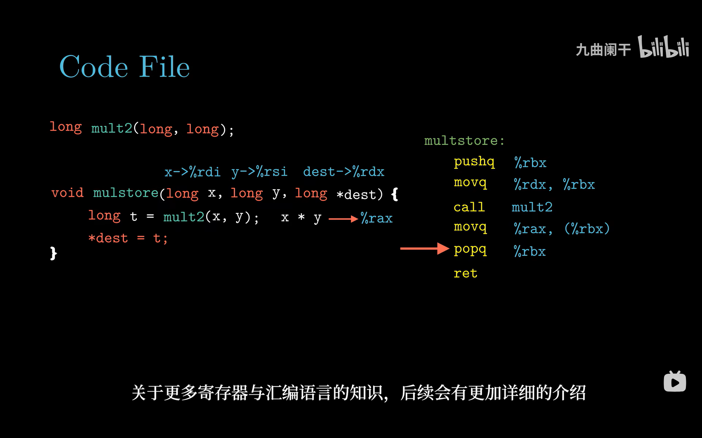
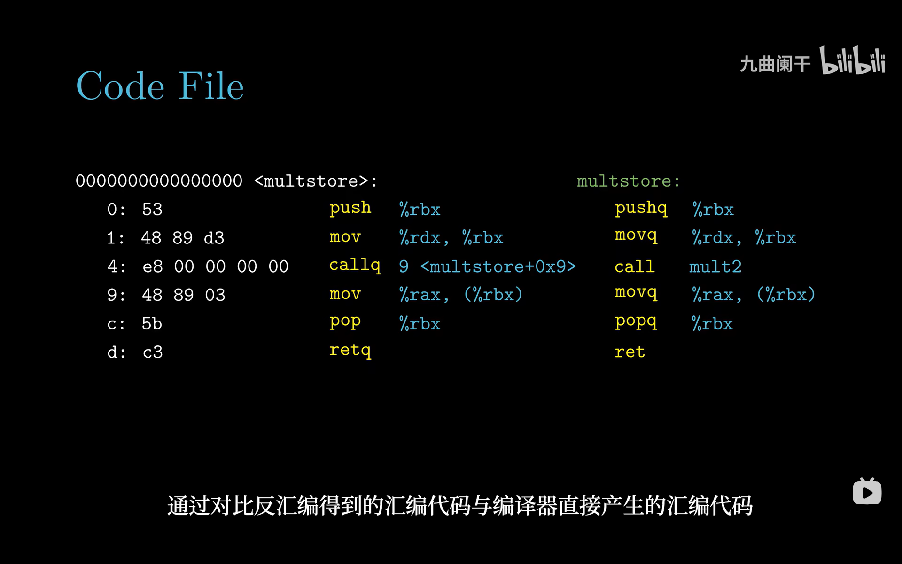

# 3.2 程序编码

> **📖 本节定位**　第 3 章「程序的机器级表示」· 教材 P113–119
> **一句话**：C 编译器只让你看见变量和函数，而机器级代码只让你看见**PC、寄存器、条件码和一片字节数组**——本节就是用 `gcc -Og -S` 把这两层对上号，并学会读 AT&T 汇编。

> [!IMPORTANT] 本节要回答的三个问题
> 1. 我写的 `long t = a + b;` 到机器这一层还剩下什么？为什么说"变量名全没了"？
> 2. 一条汇编指令到底由哪几块组成？`.s` 文件里那些以 `.` 开头的行也是指令吗？
> 3. 为什么教材的汇编要把源操作数写在**左边**、还要给寄存器加 `%`？和我在网上看到的写法为什么正好相反？

**读之前你需要会**：C 的指针与取地址 `&`/`*`（见 [2.1 信息存储](../第02章%20信息的表示和处理/2.1%20信息存储.md)）；`b/w/l/q` 与字节数的对应（见 [3.3 数据格式](3.3%20数据格式.md)，本节会先当成已知用一下）。Linux 命令行会用 `cd`、`cat` 就够了。

[← 上一节：3.1 历史观点](3.1%20历史观点.md)　｜　[下一节：3.3 数据格式 →](3.3%20数据格式.md)

---

## 🎯 核心结论

| # | 结论 |
| :-: | :--- |
| 1 | 机器级程序员可见的状态只有四样：**PC（`%rip`）、16 个整数寄存器、条件码、向量寄存器**，外加一片按虚拟地址寻址的内存 |
| 2 | 机器代码把内存看成**一个大字节数组**；一条指令就是一组连续字节，汇编只是它的**文本形式** |
| 3 | 从 `.c` 到可执行文件要过三关：**编译器（gcc -S）→ 汇编器（as）→ 链接器（ld）** |
| 4 | `gcc -Og -S mstore.c` 生成 `mstore.s`；`-c` 直接生成 `mstore.o`；`objdump -d` 把机器码反汇编回来 |
| 5 | AT&T 语法四条铁律：寄存器加 `%`、立即数加 `$`、**源在前目的在后**、指令后缀 `b/w/l/q` 标操作数大小 |
| 6 | 反汇编能把机器码还原成汇编，但**还原不出源码**——编译是有损的，变量名、类型、注释全部丢失 |

---

## 3.2.1 机器级代码

### （1）程序员可见的处理器状态

教材把"写汇编时必须心里有数"的状态列成四类，一张图就能记住：

```text
┌────────────────────────────────────────────────────────────────┐
│  PC（程序计数器）= %rip ：下一条要执行的指令在内存中的地址     │
├────────────────────────────────────────────────────────────────┤
│  整数寄存器堆：16 个 64 位寄存器                               │
│    %rax %rbx %rcx %rdx %rsi %rdi %rbp %rsp   %r8 … %r15        │
├────────────────────────────────────────────────────────────────┤
│  条件码（CC）：CF 进位 / ZF 零 / SF 符号 / OF 溢出             │
│    最近一次算术或逻辑运算"顺手"留下的痕迹，供条件跳转使用      │
├────────────────────────────────────────────────────────────────┤
│  向量寄存器：%xmm0–%xmm15（128 位），带 AVX 时 %ymm0–%ymm15    │
│    用来成批存放浮点数据                                        │
└────────────────────────────────────────────────────────────────┘
                              ▼ 再加上一片内存
┌────────────────────────────────────────────────────────────────┐
│  内存：一个巨大的字节数组，用虚拟地址寻址                      │
│    ├─ 程序的可执行机器代码                                     │
│    ├─ 操作系统需要的一些信息                                   │
│    ├─ 运行时栈（管理过程的调用与返回）                         │
│    └─ 用户分配的内存块（如 malloc 得到的）                     │
└────────────────────────────────────────────────────────────────┘
```

**C 程序员看不到这些。** 你写 `long t = a + b;`，编译器自己决定用 `%rax` 还是 `%r10`、要不要改条件码。汇编程序员则必须自己管：哪个值放哪个寄存器、什么时候压栈、标志位此刻是什么。

> [!NOTE]
> 这里说的"内存"是**虚拟内存**：程序看到的是一个连续、私有的地址空间，实际物理内存在哪、有没有换到磁盘，由操作系统 + MMU 在第 9 章才揭开。机器级程序只需要相信"地址是字节数组的下标"。

### （2）机器代码把内存看成字节数组

对机器来说，内存就是一个 **byte 数组**，程序、数据、栈混在一起放，靠**地址**区分。一条指令对应若干个连续字节：

```text
  地址      内容        解释
 0x401040   53          push %rbx        ← 1 字节
 0x401041   48 89 d3    mov %rdx,%rbx    ← 3 字节
 0x401044   e8 ...      call mult2       ← 5 字节
```

同一段字节，`%rip` 指向它就当**指令**执行，`movq` 取它就当**数据**用——这正是 1.1 节"位 + 上下文"在机器级的表现。

### （3）编译器 → 汇编器 → 链接器

```text
  mstore.c ──[gcc -Og -S]──▶ mstore.s ──[as]──▶ mstore.o ──[ld]──▶ prog
   C 源文件      编译器        汇编文件     汇编器   目标文件    链接器  可执行文件
                                  │                    │
                          机器代码的文本表示    尚未重定位的机器码
```

```bash
linux> gcc -Og -S mstore.c     # 只到汇编，产物 mstore.s
linux> gcc -Og -c mstore.c     # 编译 + 汇编，产物 mstore.o（可重定位目标文件）
linux> gcc -Og -o prog main.c mstore.c   # 编译 + 汇编 + 链接，一步到位
```

`.s` 文件里除了指令，还有很多以 `.` 开头的**汇编器伪指令**（`.file`、`.text`、`.globl`、`.size`…），它们是给汇编器和链接器看的，不是指令：

```asm
        .file   "010-store.c"
        .text
        .globl  multstore
        .type   multstore, @function
multstore:
        pushq   %rbx
        movq    %rdx, %rbx
        call    mult2
        movq    %rax, (%rbx)
        popq    %rbx
        ret
        .size   multstore, .-multstore
```

> [!IMPORTANT]
> 为什么非要用 `-Og` 而不是 `-O2`？`-Og` 是"为调试/教学优化"的等级，它生成的机器码**基本保持 C 代码的结构**，一条语句大致对应几条指令。`-O2` 会做大量重排、内联、向量化，汇编和源码就彻底对不上了。教材后续所有例子都用 `-Og` 或 `-O1`。

> [!TIP]
> 在 Linux 上 `gcc` 默认输出 **AT&T 语法**；本课程统一用 AT&T。如果你的环境（如 MinGW / WSL 的某些配置）默认是 Intel 语法，加 `-masm=att` 强制切回来，否则操作数顺序会正好反着，极易看错。

<details>
<summary>✅ 检查点 1：`gcc -Og -S` 与 `gcc -Og -c` 差在哪一步？想亲眼看到机器码**字节**，该用哪个？</summary>

`-S` 停在编译器输出，给你**文本**汇编 `mstore.s`；`-c` 多走一步汇编器 `as`，给你**二进制**目标文件 `mstore.o`。想看字节，得先 `-c` 再 `objdump -d`；只想读指令，`-S` 更省事。
</details>

---

## 3.2.2 代码示例

教材用一个 3 行的函数贯穿本节：

```c
long mult2(long, long);          /* 在别处定义 */

void multstore(long x, long y, long *dest) {
    long t = mult2(x, y);
    *dest = t;
}
```

用 `gcc -Og -S mstore.c` 得到下面 6 条指令。左边是 C，右边是汇编，箭头标出了参数与结果的"落点"：



*▲ 图 3-2-1：`x` 落在 `%rdi`、`y` 落在 `%rsi`、`dest` 落在 `%rdx`，`mult2` 的返回值落在 `%rax`。注意 `%rbx` 被"借"来暂存 `dest`，所以首尾多出 `pushq` / `popq`。*

### （1）参数与返回值落在哪

| C 里的东西 | 机器里的位置 | 规则出处 |
| :--- | :--- | :--- |
| 第 1 个参数 `x` | `%rdi` | 3.7 过程（参数寄存器） |
| 第 2 个参数 `y` | `%rsi` | 3.7 过程 |
| 第 3 个参数 `dest` | `%rdx` | 3.7 过程 |
| 返回值 `t` | `%rax` | 3.7 过程 |

这些寄存器不是编译器随便挑的，而是 **x86-64 调用约定（ABI）** 规定的——调用者和被调用者都遵守，才能互相传参。

### （2）逐条注释

| # | 指令 | 语义（RTL 写法） | 为什么是这条 |
| :-: | :--- | :--- | :--- |
| 1 | `pushq %rbx` | `R[%rsp] ← R[%rsp] − 8`；`M[R[%rsp]] ← R[%rbx]` | 先把调用者的 `%rbx` 存到栈上 |
| 2 | `movq %rdx, %rbx` | `R[%rbx] ← R[%rdx]` | 把 `dest` 指针挪进 `%rbx` 保管 |
| 3 | `call mult2` | 返回地址压栈；`%rip ← mult2` | 调用 `mult2(x, y)`，结果留在 `%rax` |
| 4 | `movq %rax, (%rbx)` | `M[R[%rbx]] ← R[%rax]` | `*dest = t`，把 8 字节写回指针所指位置 |
| 5 | `popq %rbx` | `R[%rbx] ← M[R[%rsp]]`；`R[%rsp] ← R[%rsp] + 8` | 恢复调用者的 `%rbx` |
| 6 | `ret` | 从栈顶弹出返回地址到 `%rip` | 返回调用者 |

其中 `(%rbx)` 是**内存引用**，读作 "M[%rbx]"，即"以 `%rbx` 的值为地址的那 8 个字节"，不是"`%rbx` 的内容"。

<details>
<summary>✅ 检查点 2：`movq %rax, (%rbx)` 与 `movq %rax, %rbx` 差在哪里？前者会让 `%rbx` 变吗？</summary>

差在**目的操作数是不是内存**。前者把 `%rax` 的 8 字节写进 `%rbx` **指向的地址**，`%rbx` 本身的值不变；后者是把 `%rax` 的值复制进 `%rbx`，`%rbx` 被覆盖。括号 = "去这个地址的内存"，没有括号 = "这个寄存器本身"。
</details>

### （3）`pushq %rbx` / `popq %rbx` 为什么会出现

这是初学者最迷惑的两行。逻辑链其实只有短短几步：

```text
 ① call mult2 之后，还要用 dest 指针          → dest 必须活过这次调用
 ② dest 原本在 %rdx，而 %rdx 是 caller-saved   → mult2 可以随便覆盖它
 ③ 于是挪进 %rbx —— %rbx 是 callee-saved       → mult2 保证返回时它还是原值
        │
        └─▶ 但"被别人保证不变"的代价是：我自己用了它，就得先存后还
                          │
                          ▼
                 pushq %rbx（函数开头） … popq %rbx（函数结尾）
```

> [!NOTE]
> 这里只需要记住结论：**跨过程调用还要用的值，必须放进 callee-saved 寄存器（如 `%rbx`）；而占用了它，就得在函数出入口自己保存和恢复。** 哪些寄存器是 callee-saved、`call`/`ret` 具体怎么动栈指针、栈帧长什么样，**3.7 节会完整解释**，本节不展开。

---

## 3.2.3 关于格式的注解

### （1）AT&T 语法的四条铁律

| # | 规则 | 例子 | 说明 |
| :-: | :--- | :--- | :--- |
| 1 | 寄存器名以 **`%`** 开头 | `%rax`、`%rsp`、`%xmm0` | 不加 `%` 就成了符号名 / 标号 |
| 2 | 立即数以 **`$`** 开头 | `$0x4050`、`$-17`、`$8` | 不加 `$` 表示"地址"或"内存引用" |
| 3 | **源操作数在前，目的操作数在后** | `movq %rdx, %rbx` | 含义是 `%rbx ← %rdx`，**从右往左读** |
| 4 | 指令后缀表示操作数大小 | `movb` / `movw` / `movl` / `movq` | 1 / 2 / 4 / 8 字节，详见 3.3 |

把四条规矩凑到一起，就是**同一个操作在三种写法下的对照表**（这张表值得抄在纸上，做题时逐行核对）：

| C 里想做的事 | AT&T（本课程） | Intel（MASM / NASM） | 真实语义 |
| :--- | :--- | :--- | :--- |
| `*dest = t;` | `movq %rax, (%rdx)` | `mov [rdx], rax` | `M[R[%rdx]] ← R[%rax]` |
| `x = 16;` | `movl $0x10, %eax` | `mov eax, 10h` | `R[%eax] ← 16` |
| `x = *p;` | `movq (%rdi), %rax` | `mov rax, [rdi]` | `R[%rax] ← M[R[%rdi]]` |
| `x = a + i*4 + 8;` | `leaq 8(%rdi,%rsi,4), %rax` | `lea rax, [rdi+rsi*4+8]` | `R[%rax] ← R[%rdi] + R[%rsi]×4 + 8` |
| `x = x + 1;` | `addq $1, %rax` | `add rax, 1` | `R[%rax] ← R[%rax] + 1` |

看这张表要抓两个"同时变了"的地方：**寄存器前缀**（AT&T 有 `%`、Intel 没有）和**操作数顺序**（AT&T 源在左、Intel 源在右）。所以读一份陌生汇编的第一件事，是看有没有 `%`——它一眼就能告诉你这是哪种语法。

第 3 条是最容易翻车的一条，把它和 Intel 语法摆在一起对比：

| AT&T（本课程） | Intel（MASM / NASM） | 真实语义 |
| :--- | :--- | :--- |
| `movq %rdx, %rbx` | `mov rbx, rdx` | `%rbx ← %rdx` |
| `movl $0x10, %eax` | `mov eax, 0x10` | `%eax ← 16` |
| `movq (%rdi), %rax` | `mov rax, [rdi]` | `%rax ← M[%rdi]` |
| `leaq 8(%rdi,%rsi,4), %rax` | `lea rax, [rdi+rsi*4+8]` | `%rax ← %rdi + %rsi×4 + 8` |
| `addq $8, %rsp` | `add rsp, 8` | `%rsp ← %rsp + 8` |

**操作数的几种形态**（下一节 3.4 系统展开）：

| 形态 | 写法 | 含义 |
| :--- | :--- | :--- |
| 立即数 | `$0x4050` | 常数本身 |
| 寄存器 | `%rax` | 寄存器里的值 |
| 绝对寻址 | `0x4050` | M[0x4050] |
| 间接寻址 | `(%rax)` | M[R[%rax]] |
| 基址 + 位移 | `8(%rax)` | M[R[%rax] + 8] |
| 比例变址 | `(%rax,%rdx,4)` | M[R[%rax] + R[%rdx]×4] |

> [!WARNING]
> 把 `movl $0x4050, %eax` 写成 `movl 0x4050, %eax`，语义就从"`%eax` 赋值为 0x4050"变成了"把地址 `0x4050` 处的 4 个字节读进 `%eax`"。**丢一个 `$`，编译器不报错，程序结果面目全非。**

#### 一起算一遍

`movq %rsi, %rdi` 这一行很适合当"解剖标本"：它只有 3 个字节，却把源/目的顺序、REX 前缀、寄存器编号一次全暴露出来。先看结果——`48 89 f7`——再一步步拆。

| 步骤 | 动作 | 结果 |
| :-: | :--- | :--- |
| ① | 查操作码：`mov` 的"寄存器 → 寄存器/内存"这一形式是 `0x89` | `89` |
| ② | 要搬 8 字节，得让 CPU 按 64 位解释 | 需要 `REX.W` |
| ③ | REX 格式 `0100WRXB`，令 W=1、其余为 0 | `0100 1000` = `0x48` |
| ④ | ModR/M 的 `mod` 两位：两端都是寄存器 → `11` | `11` |
| ⑤ | `reg` 字段 3 位放**源**：`%rsi` 的编号是 6 | `110` |
| ⑥ | `r/m` 字段 3 位放**目的**：`%rdi` 的编号是 7 | `111` |
| ⑦ | 拼成 ModR/M：`11 110 111` | `0xF7` |
| ⑧ | 三条字节连起来 | `48 89 f7` |

```text
   48        89          f7
   │         │           └─ ModR/M = 11 110 111
   │         │                       │  │   └── r/m = 111 → %rdi（目的）
   │         │                       │  └────── reg = 110 → %rsi（源）
   │         │                       └───────── mod = 11  → 两端都是寄存器
   │         └─ opcode 0x89：把 reg 字段里的值搬进 r/m 字段
   └─ REX.W = 0x48：这一次搬 8 字节（没有它，就是 32 位的 movl）
```

从这张图能直接读出两个结论：

1. **源操作数在机器码里排在目的前面**（reg 字段在前、r/m 字段在后）。AT&T 的"源在前、目的在后"正是从这儿来的——它沿袭自 PDP-11 汇编器，而 PDP-11 的编码也是这个顺序。Intel 语法反着写，反而和字节顺序对不上。
2. **REX 前缀不是神秘修饰，它是"64 位许可证"**：`89 f7` 单独出现只是 `movl %esi, %edi`，加上 `48` 才是 8 字节搬运。以后在 `objdump` 里看到 `48` 开头，就该条件反射"这条在操作 64 位数据"。

> [!NOTE] 换个角度想
> 教材和 Linux 工具链坚持 AT&T，而 MSDN、逆向社区、绝大多数网上答案用 Intel——于是"抄来的汇编跑不通"成了高频事故。关键不是背谁对谁错，而是记住：**语法只是同一份机器码的两套记法**。读之前先确认记法（看有没有 `%`），再看语义；真正不变的东西只有 `48 89 f7` 这 3 个字节。

### （2）用 objdump 反汇编

`.o` 文件是二进制，直接看是乱码；用 `objdump -d` 可以"翻译"回汇编，并把**机器码字节**一并列出：

```bash
linux> gcc -Og -c mstore.c
linux> objdump -d mstore.o
```



*▲ 图 3-2-2：左列是地址（从 0 开始，因为还没链接），中间是机器码字节，右边是汇编。注意 `call` 后面是 `9 <multstore+0x9>`——那不是真目标，而是"待重定位"的占位。*

读这张图要抓四个细节：

1. **地址从 0 开始**：这是可重定位目标文件，各段的最终地址要等链接器（第 7 章）决定。
2. **机器码长度不一**：`53` 是 1 字节，`48 89 d3` 是 3 字节，`e8 00 00 00 00` 是 5 字节——3.1 说的"变长指令"在这里看得见。
3. **`call` 的目标是假的**：`e8` 之后 4 字节是**相对位移**，`.o` 里先填 0，链接时才由重定位信息填上真正的地址。所以现在反汇编成 `callq 9 <multstore+0x9>`，看起来像"调用下一条指令"。
4. **后缀被省略了**：`objdump` 写的是 `mov` 而不是 `movq`，因为两个操作数都是寄存器，大小可以从寄存器名推出来；一旦有内存操作数，它就会补上后缀。

### （3）反汇编 ≠ 反编译

```text
   mstore.c  ──── 编译（有损） ────▶  机器码  ──── 反汇编 ────▶  汇编
       ▲                                                          │
       └──────── 变量名 / 类型 / 注释 / 控制结构 ◀── 已丢失 ───────┘
```

编译过程**丢掉了**变量名（只剩 `%rbx`、栈偏移）、类型信息、注释、以及 `while`/`for`/`if` 的原始形状——这些在机器码里只表现为跳转与比较。所以：

- **反汇编**（objdump）：机器码 → 汇编，一一对应，可以做；
- **反编译**（把汇编还原成 C）：只能"猜"，得到的是等价但绝不相同的代码。

只有编译时加了 `-g`，可执行文件里才保留**调试信息**（行号、变量名），`objdump -S` 才能把源码和汇编混排显示——本质是查表，不是还原。

<details>
<summary>✅ 检查点 3：`objdump` 输出 `mov %rdx,%rbx` 却少了 `q` 后缀，是它写错了吗？</summary>

没写错。两个操作数都是寄存器，宽度可以从寄存器名 `%rbx` 直接推出来，所以 `objdump` 省略后缀；一旦操作数是**内存**（如 `(%rbx)`），大小无法从名字推、只能靠后缀，它就会补上 `movq`。
</details>

---

## 📌 重点速记

```text
可见状态   %rip / 16 个整数寄存器 / 条件码 CF ZF SF OF / 向量寄存器
内存模型   字节数组 + 虚拟地址；指令 = 一串连续字节
工具链     .c --gcc -S--▶ .s --as--▶ .o --ld--▶ 可执行
常用命令   gcc -Og -S mstore.c | gcc -Og -c mstore.c | objdump -d mstore.o
AT&T ①     寄存器加 %      %rax
AT&T ②     立即数加 $      $0x4050（不加 $ 就是内存地址）
AT&T ③     源在前，目的在后   movq %rdx,%rbx  ==  rbx ← rdx
AT&T ④     后缀定大小      b=1  w=2  l=4  q=8
内存引用   (%rbx) = M[rbx]；8(%rdi) = M[rdi+8]
multstore  pushq %rbx / movq %rdx,%rbx / call mult2 / movq %rax,(%rbx) / popq %rbx
反汇编     .o 里地址从 0 起，call 目标是待重定位的 0
```

---

## ⚠️ 易错点

1. **把操作数顺序写反。** `movq %rdx, %rbx` 是 `%rbx ← %rdx`（**右边是目的地**），不是 `%rdx ← %rbx`。写 AT&T 时养成"从右往左读"的习惯。
2. **丢 `$` 或乱加 `$`。** `movl $0x10, %eax` 是赋常数；`movl 0x10, %eax` 是读地址 `0x10` 处的内存。`leaq` 例外：它**取的是地址**，所以 `leaq 8(%rdi), %rax` 里没有 `$`，也不访存。
3. **把 `(%rbx)` 当成"`%rbx` 的值"。** 圆括号表示**内存引用**：`movq (%rbx), %rax` 是把 `M[%rbx]` 读进 `%rax`，`%rbx` 本身不变。
4. **以为 `call` 后面那个 `9 <multstore+0x9>` 是真实目标。** 那是 `.o` 文件里位移为 0 的占位，链接后才会被重定位改写成 `mult2` 的真实地址。
5. **以为 `pushq %rbx` 会保存所有寄存器。** 它只把**一个**寄存器（8 字节）压栈，`%rsp` 减 8；要保存多个必须写多条。
6. **以为 `objdump` 的输出可以直接当源码读。** 它给出的是"编译器实际生成的指令"，不是"你写的那几行 C"；`-Og` 下还能勉强对应，`-O2` 下完全对不上。
7. **在不同平台混用语法。** 同一份汇编，AT&T 与 Intel 的操作数顺序相反。看到 `mov rbx, rdx` 先确认这是哪种语法，别急着下结论。

---

## ❓ 常见困惑

**Q：汇编里一个"变量"都没有，那我 `printf("%d", x)` 时它怎么知道 `x` 是谁？**
A：编译完就不存在"变量"了。`x` 要么落在某个寄存器，要么落在 `%rbp`（或 `%rsp`）加一个固定偏移的栈槽里；编译器把源码里所有 `x` 都替换成了那个位置。`-g` 生成的调试信息只是额外记了一张"名字 ↔ 偏移"的表，方便调试器显示。

**Q：为什么 `movq %rdx, %rbx` 看起来像"把 `%rbx` 搬到 `%rdx`"，教材却说是反的？**
A：因为你在用"从左往右读"的直觉。AT&T 的格式是 `指令 源, 目的`，等价于赋值 `目的 = 源`；如果你按"从左到右执行"读，就会正好读反。习惯做法是：读到 `mov` 就先找**逗号右边**那个，它是被写入的一方。

**Q：`.s` 文件里 `.file`、`.text`、`.globl` 这些行也是指令吗？CPU 会执行它们吗？**
A：不是指令，是**汇编器伪指令**（assembler directive）。它们只告诉 `as` 和 `ld` "这段属于哪个段、符号是否对外可见、这条函数到哪里结束"，最终不会在机器码里留下任何字节。判断办法很简单：以 `.` 开头的都不是机器指令。

**Q：既然反汇编能还原出指令，为什么不能直接还原出 C 源码？**
A：因为编译是**有损**的：变量名、类型、注释、`while` 还是 `for` 这些信息在机器码里没有任何残留，只剩跳转和比较。反编译工具做的是"模式匹配 + 猜测"，产出的是等价但不同的代码，永远不会和你原来写的一样。

---

## 🛠 动手试试

1. 完整走一遍"编译 → 看汇编"（整段贴进终端即可）：

   ```bash
   printf 'long mult2(long,long);\nvoid multstore(long x,long y,long *d){long t=mult2(x,y);*d=t;}\n' > mstore.c
   gcc -Og -S mstore.c && cat mstore.s
   ```

   你应该看到 `pushq %rbx`、`movq %rdx, %rbx`、`call mult2`、`movq %rax, (%rbx)`、`popq %rbx`、`ret` 六条，以及一堆以 `.` 开头的伪指令。注意 `movq %rdx, %rbx` 的**源在左**。

2. 生成目标文件并反汇编，对照机器码字节：

   ```bash
   gcc -Og -c mstore.c && objdump -d mstore.o
   ```

   预期第一行是 `0: 53 push %rbx`，第二行是 `1: 48 89 d3 mov %rdx,%rbx`——`48` 就是刚算过的 REX.W，`d3` 是 `11 010 011`（源 `%rdx`=2、目的 `%rbx`=3）。第三行 `call` 后面跟着 `e8 00 00 00 00`，目标是 `9 <multstore+0x9>`，那是待重定位的占位。想亲手验证"只差一个 REX"，改用 `printf '\tmovl %%esi,%%edi\n\tmovq %%rsi,%%rdi\n' > t.s && as t.s -o t.o && objdump -d t.o`，会看到 `89 f7` 与 `48 89 f7` 并排出现。

---

## ✅ 自测

1. 机器级程序员可见的处理器状态有哪四类？各自举一个例子。
2. `gcc -Og -S mstore.c` 和 `gcc -Og -c mstore.c` 分别产出什么文件？再下一步由谁处理？
3. 写出 `movq %rdx, %rbx` 的语义，并给出等价的 Intel 语法写法。
4. `movl $0x4050, %eax` 与 `movl 0x4050, %eax` 有什么区别？
5. `multstore` 里为什么要 `pushq %rbx` 和 `popq %rbx`？不写会怎样？
6. `objdump -d mstore.o` 里 `call` 的目标为什么显示成 `<multstore+0x9>`？

<details>
<summary>参考答案</summary>

1. ① 程序计数器 `%rip`（下一条指令地址）；② 16 个 64 位整数寄存器（如 `%rax`）；③ 条件码 CF/ZF/SF/OF；④ 向量寄存器（`%xmm0`–`%xmm15`）。此外还有按虚拟地址寻址的内存。
2. `-S` 产出汇编文件 `mstore.s`（下一步交给汇编器 `as`）；`-c` 产出可重定位目标文件 `mstore.o`（下一步交给链接器 `ld`）。
3. `%rbx ← %rdx`（把 `%rdx` 的 8 字节内容复制到 `%rbx`）；Intel 写法为 `mov rbx, rdx`。
4. 前者把常数 0x4050 放进 `%eax`；后者把内存地址 0x4050 处的 4 字节读进 `%eax`。
5. 因为函数占用了 callee-saved 的 `%rbx` 来保存 `dest`，按 ABI 必须在入口保存、出口恢复调用者的原值。不写的话，调用者的 `%rbx` 会被破坏，返回后它的局部变量/中间结果就错了（这类 bug 极难定位）。
6. 因为 `.o` 尚未链接，`call` 的相对位移字段填的是 0，反汇编器只能按 0 计算出"下一条指令"的地址，于是显示成 `multstore+0x9`；链接后重定位会填上 `mult2` 的真实地址。

</details>

---

## 🔗 与其他章节的联系

| 本节内容 | 后续用在哪 |
| :--- | :--- |
| `%rip`、16 个整数寄存器 | 3.4 访问信息、3.5 算术与逻辑操作 |
| 条件码 CF/ZF/SF/OF | 3.6 控制（`cmp` / `set` / `jmp`） |
| `call` / `ret` / `%rsp` | 3.7 过程（栈帧、参数传递、递归） |
| `.o` 里的待重定位 `call` | 7 章链接（符号解析与重定位） |
| AT&T 操作数格式 | 3.4 寻址方式 `D(Rb,Ri,S)`、3.8 数组与结构体 |
| 反汇编 / 调试 | 3.10 缓冲区溢出、9 章虚拟内存、实验 bomb lab |

---

[← 上一节：3.1 历史观点](3.1%20历史观点.md)　｜　[下一节：3.3 数据格式 →](3.3%20数据格式.md)
