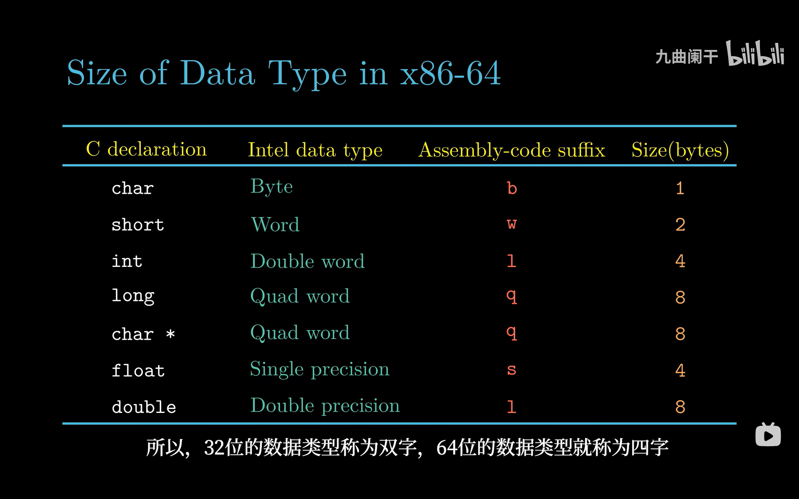

# 3.3 数据格式

> **📖 本节定位**　第 3 章「程序的机器级表示」· 教材 P119
> **一句话**：x86-64 的汇编把数据按 **1 / 2 / 4 / 8 字节**分成四档，用 `b / w / l / q` 四个后缀标注；而 `float → s`、`double → l` 是 x87 时代留下的"反直觉"命名，必须单独记。

[← 上一节：3.2 程序编码](3.2%20程序编码.md)　｜　[下一节：3.4 访问信息 →](3.4%20访问信息.md)

---

## 🎯 核心结论

| # | 结论 |
| :-: | :--- |
| 1 | 四档宽度：**1 字节 `b`（byte）、2 字节 `w`（word）、4 字节 `l`（double word）、8 字节 `q`（quad word）** |
| 2 | 这里的"字（word）"是 **8086 时代的 16 位**，与 2.1 节"字长 = 指针宽度 = 64 位"**不是同一个概念** |
| 3 | `int` 用 `l`、`long` 用 `q`、**指针永远用 `q`**（x86-64 下 8 字节） |
| 4 | `float` 用 **`s`**（single precision），`double` 用 **`l`**（long real，8 字节） |
| 5 | 同一个字母 `l`，在整数指令里是 4 字节，在浮点指令里是 8 字节——**看它搬的是什么类型** |
| 6 | x86-64 下 `long` 与指针都是 8 字节；IA32（`-m32`）下两者都是 4 字节，"可移植性"陷阱就在这 |

---

## 3.3.1 四档大小与四个后缀

汇编指令**不检查数据类型**：`mov` 只管搬字节，搬几个字节完全由**后缀**决定。所以学习机器级编程的第一步，是把"C 类型 ↔ 汇编后缀 ↔ 字节数"这张表刻进脑子：



*▲ 图 3-3-1：x86-64 下基本数据类型的宽度表。注意 `long` 与 `char *` 同为 Quad word（8 字节），而 `double` 在 Intel 数据类型里叫 Double precision、后缀却是 `l`——这两处是本节最容易记错的地方。*

把它抄成便于背诵的 Markdown 表：

| C 声明 | Intel 数据类型 | 汇编后缀 | 字节数 | 位数 |
| :--- | :--- | :-: | ---: | ---: |
| `char` | Byte | `b` | 1 | 8 |
| `short` | Word | `w` | 2 | 16 |
| `int` | Double word | `l` | 4 | 32 |
| `long` | Quad word | `q` | 8 | 64 |
| `char *` | Quad word | `q` | 8 | 64 |
| `float` | Single precision | `s` | 4 | 32 |
| `double` | Double precision | `l` | 8 | 64 |

**"梯子"记忆法**：每上一档，字节数翻倍，后缀换一个字母。

```text
   字节数    位数     后缀    典型 C 类型      指令示例
  ┌───────┬────────┬───────┬───────────────┬───────────────────┐
  │   1   │    8   │   b   │ char          │ movb (%rdi), %al  │
  │   2   │   16   │   w   │ short         │ movw (%rdi), %ax  │
  │   4   │   32   │   l   │ int           │ movl (%rdi), %eax │
  │   8   │   64   │   q   │ long / 指针   │ movq (%rdi), %rax │
  └───────┴────────┴───────┴───────────────┴───────────────────┘
       浮点另开一条线：float → s（4 字节）    double → l（8 字节）
```

**具体该用哪条指令**（本节只需认得后缀，指令细节在 3.4 / 3.11）：

| C 类型 | 宽度 | 整数搬运用 | 浮点搬运用（SSE） | 老 x87 写法 |
| :--- | :-: | :--- | :--- | :--- |
| `char` | 1 | `movb` | — | — |
| `short` | 2 | `movw` | — | — |
| `int` | 4 | `movl` | — | — |
| `long` / 指针 | 8 | `movq` | — | — |
| `float` | 4 | ✗ 不要用 `movl` | `movss` | `flds` / `fstps` |
| `double` | 8 | ✗ 不要用 `movq` | `movsd` | `fldl` / `fstpl` |

> [!WARNING]
> `float` 和 `int` **都是 4 字节**，但绝不能互换指令。`movl` 会把这 4 个字节当整数搬（搬运本身位模式不变），可后续若用整数指令去运算，就是把 IEEE 754 编码当补码算了——数值完全错乱（见 2.4）。

---

## 3.3.2 "字"为什么是 16 位

教材特意提醒：x86 术语里的 **word 指 16 位**，而不是"这台机器的字长"。原因纯粹是历史——8086 是 16 位机器，它的"一个字"就是 16 位，之后所有数据类型的名字都按这个基准往上翻倍：

| 术语 | 英文 | 位数 | 字节数 | 出处 |
| :--- | :--- | ---: | ---: | :--- |
| 字节 | byte | 8 | 1 | 8086 的最小寻址单位 |
| 字 | word | 16 | 2 | **8086 的机器字** |
| 双字 | double word（dword） | 32 | 4 | 两个字 |
| 四字 | quad word（qword） | 64 | 8 | 四个字 |

这与 2.1 节讲的"字长"必须严格区分：

```text
   8086（1978）：机器字 = 16 位
        └──▶ 数据格式沿用这套命名：word = 2 字节，dword = 4，qword = 8

   x86-64（今天）：字长 = 64 位（= 指针宽度 = 虚拟地址宽度）
        └──▶ 但"word"仍然 = 2 字节，一个字都没变！
```

> [!IMPORTANT]
> **考试高频陷阱**：问"x86-64 的一个字是多少位？"
> - 若问 **字长 / 机器字（word size）** → **64 位**（决定指针 8 字节，见 2.1.3）；
> - 若问 **数据格式里的 word**（`movw` 的 `w`、图 3-3-1 的 Word）→ **16 位 / 2 字节**。
> 答错这一条，后面 `movw` / `movl` / `movq` 的选择就全乱了。

---

## 3.3.3 `float` 的 `s` 与 `double` 的 `l`

这张表里最反直觉的两行是：

| C 类型 | 后缀 | 字节 | 字面意思 |
| :--- | :-: | ---: | :--- |
| `float` | `s` | 4 | **s**ingle precision（单精度） |
| `double` | `l` | 8 | **l**ong real（长实数），即"双精度" |

为什么 `double` 不用 `d` 而用 `l`？因为这套后缀继承自 **x87 浮点协处理器**（1980 年的 8087），它把实数分三档：

```text
   x87 的三档实数                     对应 C 类型      后缀
  ┌──────────────────────────────┬───────────────┬──────┐
  │ short real   （4 字节）       │ float         │  s  │
  │ long real    （8 字节）       │ double        │  l  │
  │ temporary real（10 字节，内部）│ long double   │  t │
  └──────────────────────────────┴───────────────┴──────┘
       例：flds（装 float）  fldl（装 double）  fstpl（存 double）
```

于是同一个字母 `l` 承担了两种含义，**必须靠"操作的是什么类型"来区分**：

| 出现在哪 | `l` 的含义 | 宽度 | 例子 |
| :--- | :--- | :-: | :--- |
| 整数指令 | **l**ong word / double word | 4 字节 | `movl %eax, (%rdi)` 写 4 字节 |
| 浮点指令 | **l**ong real（double） | 8 字节 | `fldl (%rdi)` 读 8 字节的 `double` |

> [!NOTE]
> 现代编译器搬浮点数据主要用 SSE 指令，助记符反而更直观：`movss` = **s**calar **s**ingle（4 字节），`movsd` = **s**calar **d**ouble（8 字节）。但教材图 3-3-1 给的是历史沿用的 `s` / `l` 后缀，做题时以教材那张表为准，别把 `movsd` 的 `d` 当成"后缀 d = 8 字节"。

> [!TIP]
> 记忆口诀：**"单 s 双 l，整数 l 是四个。"** 看到 `l` 先问一句：这条指令是在算整数还是在算浮点？整数 → 4 字节；浮点 → 8 字节。

---

## 3.3.4 指针、`long` 与 IA32 对照

指针的类型不影响它的大小——**所有指针在 x86-64 上都是 8 字节**，因为虚拟地址是 64 位：

```c
char  *pc;    /* 8 字节 */
int   *pi;    /* 8 字节 */
double *pd;   /* 8 字节 */
```

教材把 `char *` 专门列进表里，就是为了强调这一点：**指针的宽度由机器的地址宽度决定，与它指向什么无关**。

而 `long` 的宽度是"随字长变"的，这正是 32 位 / 64 位移植事故的根源：

| C 声明 | IA32（`-m32`） | x86-64（`-m64`） | 备注 |
| :--- | :-: | :-: | :--- |
| `char` | 1 | 1 | 不变 |
| `short` | 2 | 2 | 不变 |
| `int` | 4 | 4 | **不变**（64 位下仍是 4 字节） |
| `long` | **4** | **8** | 随字长变 |
| `long long` | 8 | 8 | 不变 |
| `char *` | **4** | **8** | 随字长变 |
| `float` | 4 | 4 | 不变 |
| `double` | 8 | 8 | 不变 |

```c
/* 一段能在两种模式下看出差别的代码 */
printf("%zu %zu %zu %zu\n",
       sizeof(long), sizeof(char *), sizeof(int), sizeof(double));
/* x86-64 输出: 8 8 4 8      IA32 输出: 4 4 4 8 */
```

宽度直接决定了指令的选择与访存的字节数：

```asm
# long *p 在 %rdi，long 型数组元素间隔 8 字节
movq    (%rdi), %rax        # rax = p[0]，一次读 8 字节
movq    8(%rdi), %rcx       # rcx = p[1]，地址 +8

# double d 存在 %xmm0，dest 指针在 %rdi
movsd   %xmm0, (%rdi)       # *dest = d，写 8 字节

# int i 在 %esi，dest 在 %rdi
movl    %esi, (%rdi)        # *dest = i，只写 4 字节（高 4 字节不动！）
```

---

## 📌 重点速记

```text
后缀  b  1 字节   char                     movb
后缀  w  2 字节   short                    movw
后缀  l  4 字节   int                      movl
后缀  q  8 字节   long / 任何指针           movq
浮点  s  4 字节   float                    flds / movss
浮点  l  8 字节   double                   fldl / movsd
x87   t  10 字节  long double              fldt（x86-64 实际按 16 字节对齐存）
word       = 16 位（8086 遗产），≠ 字长 64 位
dword      = 32 位；qword = 64 位
l 的歧义   整数指令 4 字节；浮点指令 8 字节 —— 看类型
指针       恒 8 字节，与指向类型无关
long       IA32=4，x86-64=8；int 恒 4
```

---

## ⚠️ 易错点

1. **以为 `long` 永远是 8 字节。** `-m32` 下 `long` 是 **4 字节**；只有 x86-64 才是 8 字节。跨平台代码应该用 `int64_t`。
2. **以为 `l` 永远是 4 字节。** `movl` 是 4 字节，但 `double` 的 `l`（`fldl`）是 **8 字节**——这是本节最大的坑。
3. **以为 `float` 可以用 `movl` 搬。** 宽度确实都是 4 字节，但 `movss`/`movl` 分属浮点与整数流水线；用错指令后一旦参与运算，位模式就被当整数解释。
4. **把数据格式的 `word`（2 字节）当成字长 64 位。** 看到 `movw` 就应该是 2 字节，与 CPU 是 32 位还是 64 位无关。
5. **用 `movl` 去写 `double` 或 `long`。** 只写低 4 字节，高 4 字节保留垃圾值，读出的是一个"半新半旧"的数。
6. **以为指针大小取决于指向的类型。** `char *` 与 `double *` 都是 8 字节；差别只在 `p+1` 的步长（前者 +1，后者 +8）。
7. **记混 `s` 与 `d`。** 教材表里 `double` 的后缀是 `l`；SSE 指令助记符是 `movsd`。写作业时按题目要求（教材后缀）统一，别一半 `l` 一半 `d`。

---

## ✅ 自测

1. 写出 `b / w / l / q` 四个后缀对应的字节数，并各举一个 C 类型。
2. `int`、`long`、`char *` 在 x86-64 下各占几字节？分别该用哪条 `mov` 指令搬运？
3. 为什么 `float` 的后缀是 `s`，而 `double` 的后缀是 `l`？请从历史来源解释。
4. 解释"word = 16 位"与"字长 = 64 位"为什么会同时成立。
5. `-m32` 与 `-m64` 下 `sizeof(long)` 与 `sizeof(char *)` 分别是多少？由此会产生什么移植 bug？

<details>
<summary>参考答案</summary>

1. `b` = 1 字节（`char`）；`w` = 2 字节（`short`）；`l` = 4 字节（`int`）；`q` = 8 字节（`long` / 指针）。
2. `int` 4 字节 → `movl`；`long` 8 字节 → `movq`；`char *` 8 字节 → `movq`。
3. 后缀继承自 x87 的实数分档：`s` = short real（单精度，4 字节），`l` = long real（双精度，8 字节）。所以 `double` 用 `l` 而不是 `d`。
4. "word = 16 位"是 8086（16 位机）留下的**数据格式命名**，描述的是操作数宽度；"字长 = 64 位"描述的是**指针 / 地址宽度**。两者在不同的语境里使用，x86-64 并没有把 `word` 改成 64 位。
5. `-m32`：`long` = 4，指针 = 4；`-m64`：`long` = 8，指针 = 8。把指针或 `long` 存进 `int` 的代码在 64 位下会截断（丢高 32 位），32 位下却"碰巧正确"。

</details>

---

## 🔗 与其他章节的联系

| 本节内容 | 后续用在哪 |
| :--- | :--- |
| `b/w/l/q` 后缀 | 3.4 `mov` 指令族与 `movz`/`movs` 扩展 |
| 浮点宽度与 `s`/`l` | 3.11 浮点代码、2.4 IEEE 754 |
| 指针 8 字节 | 3.8 数组与指针运算（比例变址 `S`） |
| `long` 的宽度差异 | 2.1 字长、7 章链接、9 章虚拟内存 |
| 数据类型对齐 | 3.9 异质数据结构（结构体对齐） |

---

[← 上一节：3.2 程序编码](3.2%20程序编码.md)　｜　[下一节：3.4 访问信息 →](3.4%20访问信息.md)
