# 3.4 访问信息

> **📖 本节定位**　第 3 章「程序的机器级表示」· 教材 P119–P128
> **一句话**：一条机器指令真正"干活"的部分是**操作数**——本节把 x86-64 的三种操作数、九种寻址方式，以及负责"搬数据"的整个 `mov` 家族一次讲透。

[← 上一节：3.3 数据格式](3.3%20数据格式.md)　｜　[下一节：3.5 算术和逻辑操作 →](3.5%20算术和逻辑操作.md)

---

## 🎯 核心结论

| # | 结论 |
| :-: | :--- |
| 1 | 操作数只有三类：**立即数** `$Imm`、**寄存器** `%rax`、**内存引用** `Imm(r_b,r_i,s)`；前两类在 CPU 内部，第三类要访存 |
| 2 | 内存引用的有效地址 = `Imm + R[r_b] + R[r_i]·s`，比例因子 `s` 只能取 1/2/4/8，因为机器码里只用 2 位编码它 |
| 3 | 寄存器是"同一块 64 位物理存储的多个别名"：`%rax ⊃ %eax ⊃ %ax ⊃ %al`；写 32 位子寄存器会**把高 32 位清零** |
| 4 | `mov` 按宽度分为 `movb/movw/movl/movq`；立即数不能做目的，**内存到内存不允许**，必须经寄存器中转 |
| 5 | `movq $Imm,%rax` 的立即数只有 32 位并做**符号扩展**；要装真正的 64 位常数必须用 `movabsq` |
| 6 | 栈向**低地址**增长，`%rsp` 指向栈顶元素；`pushq` = 先减指针再写，`popq` = 先读再增指针，**pop 不清内存** |

---

## 3.4.1 操作数指示符

机器指令由两部分组成：**操作码（operation code）**说明"做什么"，**操作数（operand）**说明"对谁做"。教材里一句 `movq (%rdi), %rax` 看着简单，但 `(%rdi)` 到底指什么、机器怎样算出地址，正是本节要解决的问题。

### （1）八个"老寄存器"：从 16 位时代继承下来的套娃

x86 的寄存器不是一次设计成 64 位的，而是 16 位 → 32 位 → 64 位一路"加宽"过来的。每加宽一次，旧名字都保留下来，指向**低位的某一段**：

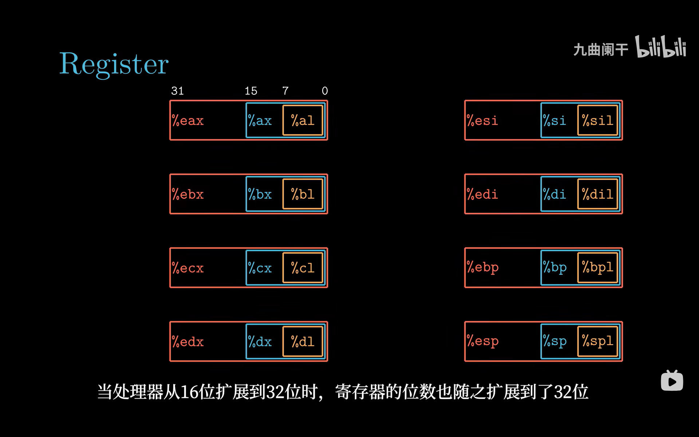

*▲ 图 3-4-1：最能说明"别名"关系的一张图——红色框的 `%eax` 是 32 位的整块，蓝框 `%ax` 只占它的低 16 位，黄框 `%al` 又只占 `%ax` 的低 8 位。三个名字**不是三个寄存器**，而是同一块硬件的三个"取景框"。*

| 32 位 | 16 位 | 8 位（低） | 8 位（高） | 传统用途 |
| :---: | :---: | :---: | :---: | :--- |
| `%eax` | `%ax` | `%al` | `%ah` | 累加器（accumulator） |
| `%ebx` | `%bx` | `%bl` | `%bh` | 基址（base） |
| `%ecx` | `%cx` | `%cl` | `%ch` | 计数（counter），移位量专用 |
| `%edx` | `%dx` | `%dl` | `%dh` | 数据（data） |
| `%esi` | `%si` | `%sil` | — | 源变址（source index） |
| `%edi` | `%di` | `%dil` | — | 目的变址（destination index） |
| `%ebp` | `%bp` | `%bpl` | — | 基址指针（base pointer） |
| `%esp` | `%sp` | `%spl` | — | 栈指针（stack pointer） |

### （2）扩展到 64 位：`%rax` 套住 `%eax`

2003 年 AMD 把 x86 扩到 64 位，命名规则很省事：**在 32 位名字前加一个 `r`**（`%r` + `ax` = `%rax`，`%r` + `sp` = `%rsp`）。

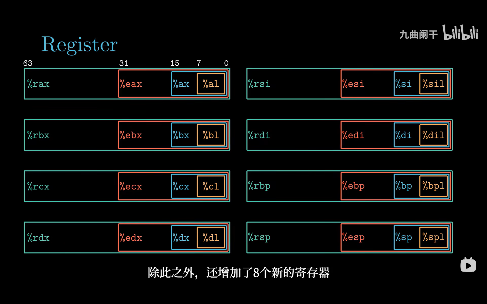

*▲ 图 3-4-2：上方标尺 63/31/15/7/0 是最好的读图钥匙——`%rax` 占 63–0，`%eax` 占 31–0，`%ax` 占 15–0，`%al` 占 7–0。整条绿色粗框才是"一个寄存器"，四个彩色框只是它的不同宽度入口。*

**宽度与命名一一对应**：64 位是 `%r` + 原名，32 位是 `%e` + 原名，16 位就是原名，8 位在原名后加 `l`（`%al`、`%spl`）；`%r8`–`%r15` 则统一加后缀 `d/w/b`。只有 `%ax/%bx/%cx/%dx` 四家有"高 8 位"名字（`%ah`…），`%sil/%dil/%bpl/%spl` 是 64 位时代才补的，没有高 8 位版本。

> [!IMPORTANT]
> **写 32 位子寄存器会把高 32 位清零。** 执行 `movl $-1, %eax` 之后，`%rax = 0x00000000FFFFFFFF`，而不是 `0xFFFFFFFFFFFFFFFF`。原因是 x86-64 规定：**任何产生 32 位结果的指令都自动零扩展到 64 位**。这条规则最初是为了消除"部分寄存器写"造成的执行依赖，副作用是编译器很爱用它——`xorl %eax, %eax` 因此成为清零整个 `%rax` 最省字节的写法。但写 8/16 位**不会**影响高位，这个不对称性后文还会反复考。

### （3）新增的八个寄存器：`%r8`–`%r15`

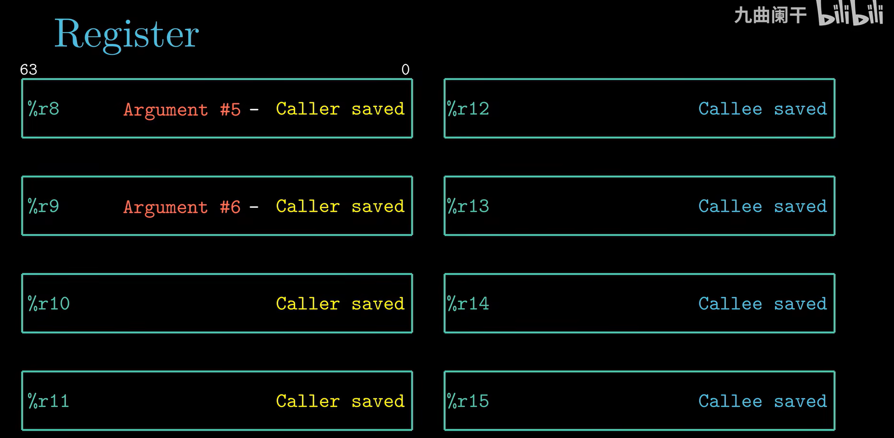

*▲ 图 3-4-3：这 8 个寄存器没有历史包袱，直接编号 `%r8`–`%r15`，宽度后缀统一加 `d/w/b`（`%r8d`、`%r8w`、`%r8b`）。图右侧的 Caller saved / Callee saved 是**调用约定**里的归属，现在只要记住"哪些寄存器归谁保护"，3.7 节才正式用到。*

| 寄存器 | 调用约定中的角色 | 说明 |
| :---: | :--- | :--- |
| `%r8` | 第 5 个参数，caller saved | 前 6 个整型参数依次放 `%rdi %rsi %rdx %rcx %r8 %r9` |
| `%r9` | 第 6 个参数，caller saved | 第 7 个及以后的参数就要走栈 |
| `%r10` `%r11` | caller saved | 调用者自己负责保存 |
| `%r12`–`%r15` | callee saved | 被调用者用完必须还原 |

### （4）把寄存器放回 CPU 里看

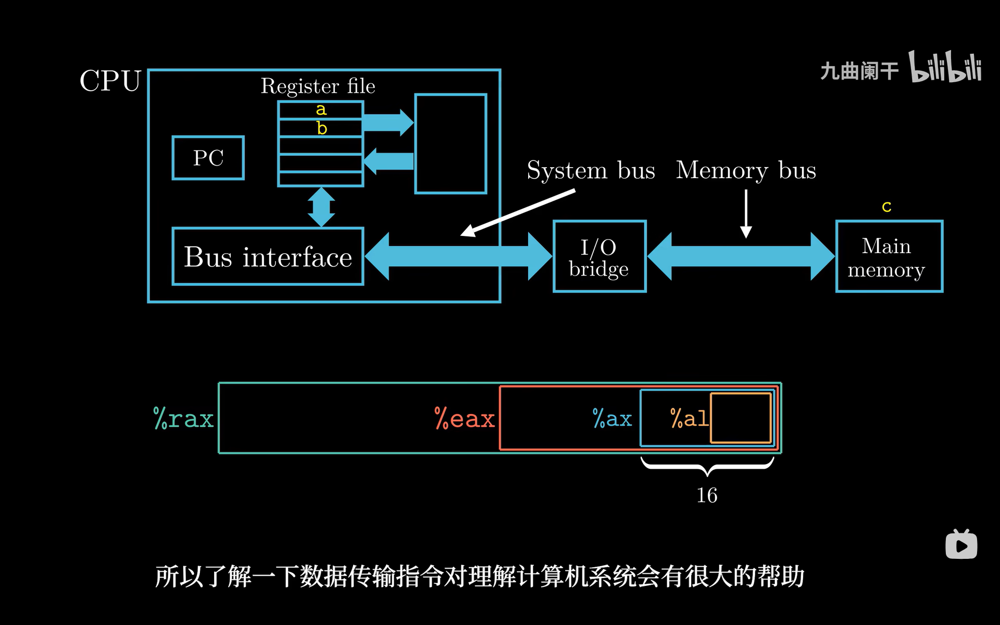

*▲ 图 3-4-4：CPU 里有 PC（保存下一条指令地址）、register file（16 个通用寄存器）、ALU（运算部件）和 bus interface（总线接口），右侧经 I/O bridge 连到主存。图下半部分把 `%rax`→`%eax`→`%ax`→`%al` 的包含关系又画了一遍，最后那个花括号标的 16 就是 `%ax` 的宽度。*

执行一条指令时，数据就在这几块之间流动：

```text
   PC ──▶ 取指、译码 ──▶ ALU ──┬──▶ 写回 register file（%rax … %r15）
                               │
                               └──▶ bus interface ──▶ 主存（内存引用时才走这条路）
```

### （5）三种操作数类型

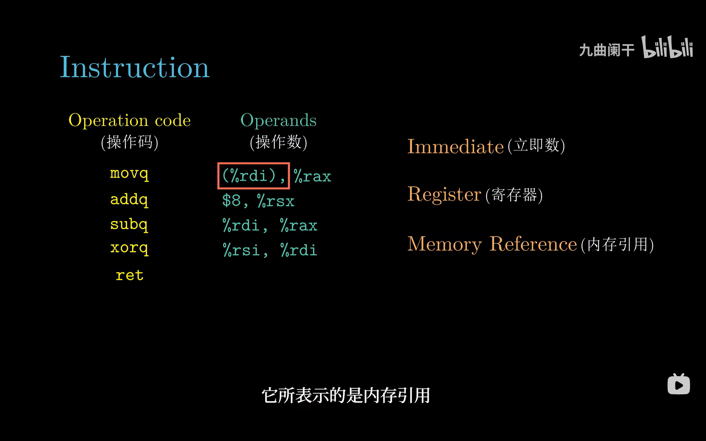

*▲ 图 3-4-5：左列是操作码（`movq`/`addq`/`subq`/`xorq`/`ret`），中列是操作数，右侧列出三种类型。图里特意用红框圈出 `(%rdi)`：**带括号 = 内存引用**，不带括号的 `%rax` 只是寄存器里存的值，两者完全不同。*

| 类型 | 写法 | 操作数的值 | 例子 |
| :--- | :--- | :--- | :--- |
| **立即数** Immediate | `$Imm` | `Imm` 本身（一个常数） | `$0x1F`、`$-17` |
| **寄存器** Register | `%r` | `R[r]`，即该寄存器里存的 64 位值 | `%rax`、`%eax`、`%al` |
| **内存引用** Memory | `Imm(r_b,r_i,s)` | `M[Imm + R[r_b] + R[r_i]·s]` | `8(%rbp)`、`(%rdi,%rcx,4)` |

最容易混淆的三行，摆在一起对比：

```asm
    movq    $8, %rax          # 立即数 8 → 寄存器 %rax
    movq    %rax, %rbx        # 寄存器 → 寄存器（值不变，换个地方存）
    movq    (%rax), %rbx      # 以 %rax 的值为地址，去内存读 8 字节 → %rbx
```

### （6）内存引用：一个公式统管所有寻址

内存是一排按字节编号的格子（2.1 节的字节数组模型）。`M_b[addr]` 表示"从地址 `addr` 开始的 `b` 个字节"，`b` 由指令后缀决定：`movb` 取 1、`movw` 取 2、`movl` 取 4、`movq` 取 8。

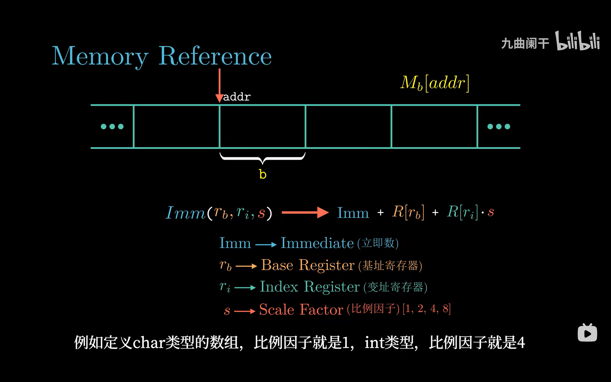

*▲ 图 3-4-6：上半部分是"内存 = 字节数组"，箭头 `addr` 指向某一格，下方花括号标出这次访问覆盖 `b` 个字节；下半部分是本节的核心公式 `Imm + R[r_b] + R[r_i]·s`，四个符号分别叫立即数、基址寄存器、变址寄存器、比例因子。*

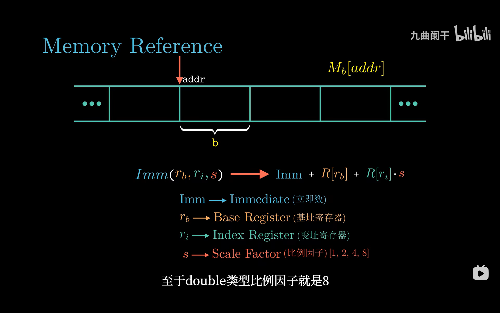

*▲ 图 3-4-7：同一页的下一帧，字幕补上最后一块拼图——double 类型的比例因子就是 8。于是 $s\in\{1,2,4,8\}$ 不再是要硬背的规则：元素占几个字节，$s$ 就是几。*

**有效地址 = `Imm + R[r_b] + R[r_i] × s`**

四个部件各自负责什么：

| 部件 | 名字 | 作用 | 可省略？ |
| :---: | :--- | :--- | :---: |
| `Imm` | 立即数 / 位移 displacement | 常量偏移，适合结构体成员 | 可 |
| `r_b` | 基址寄存器 base register | 数组首地址、指针 | 可 |
| `r_i` | 变址寄存器 index register | 下标 `i` | 可 |
| `s` | 比例因子 scale factor | 元素大小，只能 1/2/4/8 | 省略即 1 |

**为什么 `s` 只能是 1/2/4/8？** 因为机器码里它只占 **2 位**，编码 `00/01/10/11` 对应 1/2/4/8（即 `2^0`–`2^3`）。这不是随便定的：C 的 `char`/`short`/`int`/`long` 与指针恰好是 1/2/4/8 字节，于是数组元素 `A[i]` 的地址 `A + i·sizeof(T)` 一条指令就能算完。

**一个完整例子**：设 `%rax = 0x100`、`%rdx = 0x3`，看 `0x10(%rax,%rdx,4)` 怎样算：

```text
   0x10(%rax, %rdx, 4)      已知 %rax = 0x100，%rdx = 0x3
        │    │    └── s = 4        → R[%rdx] × 4 = 3 × 4 = 0xC
        │    └─────── r_i = %rdx
        └──────────── Imm = 0x10，r_b = %rax

   有效地址 = 0x10 + 0x100 + 0xC = 0x11C  →  movl 读 M_4[0x11C]（0x11C~0x11F）
```

### （7）九种寻址方式总表

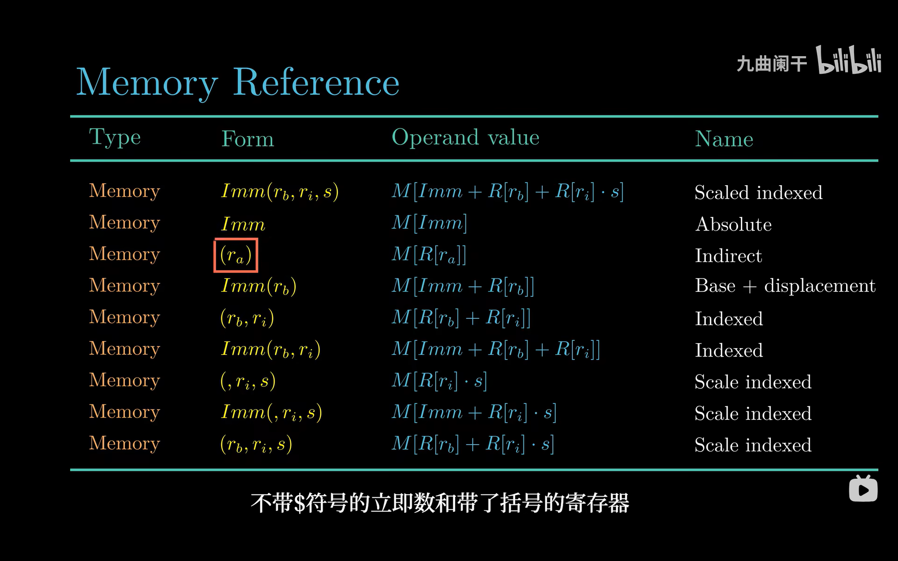

*▲ 图 3-4-8：本节最该背下来的一张表。红框圈出 `(r_a)`，因为它是误读率最高的一种——它不是寄存器操作数，而是"以寄存器值为地址"的间接寻址。最后三行的名字都写作 Scale indexed，区别只在于少了 `Imm`、少了 `r_b`，还是两者都在。*

| 形式 | 操作数的值 | 名称 | 中文 | 实例 |
| :--- | :--- | :--- | :--- | :--- |
| `Imm(r_b,r_i,s)` | `M[Imm + R[r_b] + R[r_i]·s]` | Scaled indexed | 比例变址（最一般形式） | `0x10(%rax,%rdx,4)` |
| `Imm` | `M[Imm]` | Absolute | 绝对寻址 | `0x1234` |
| `(r_a)` | `M[R[r_a]]` | Indirect | 间接寻址 | `(%rdi)` |
| `Imm(r_b)` | `M[Imm + R[r_b]]` | Base + displacement | 基址＋偏移 | `8(%rbp)` |
| `(r_b,r_i)` | `M[R[r_b] + R[r_i]]` | Indexed | 变址 | `(%rax,%rdx)` |
| `Imm(r_b,r_i)` | `M[Imm + R[r_b] + R[r_i]]` | Indexed | 带偏移的变址 | `8(%rax,%rdx)` |
| `(,r_i,s)` | `M[R[r_i]·s]` | Scale indexed | 比例变址 | `(,%rdx,4)` |
| `Imm(,r_i,s)` | `M[Imm + R[r_i]·s]` | Scale indexed | 带偏移的比例变址 | `0x10(,%rdx,4)` |
| `(r_b,r_i,s)` | `M[R[r_b] + R[r_i]·s]` | Scale indexed | 无偏移的比例变址 | `(%rax,%rdx,4)` |

<sub>说明：课件后三种写作 `Scale indexed`，教材写作 `Scaled indexed`，指同一种方式。</sub>

三条书写规则：①**逗号不能乱**，`(r_b,r_i,s)` 三个字段位置固定，省略 `r_b` 时逗号必须留着——`(,%rdx,4)` 的第一个字符就是逗号；②**基址/变址必须是 64 位寄存器**，写 `(%eax)` 汇编器直接报错；③**`s` 只能写 1/2/4/8**，写 `(,%rdx,3)` 是语法错误，不是运行时才报错。

> [!WARNING]
> 表里 Form 一栏的 `Imm` **不带 `$`**，因为它是内存地址中的位移，不是立即数操作数。`movl 0x4050, %eax` 是把地址 `0x4050` 处的 4 字节读进 `%eax`，而 `movl $0x4050, %eax` 才是把常数 `0x4050` 放进 `%eax`。多写或漏写一个 `$`，汇编器照样通过，语义却天差地别。

---

## 3.4.2 数据传送指令

### （1）`mov` 家族：四种宽度

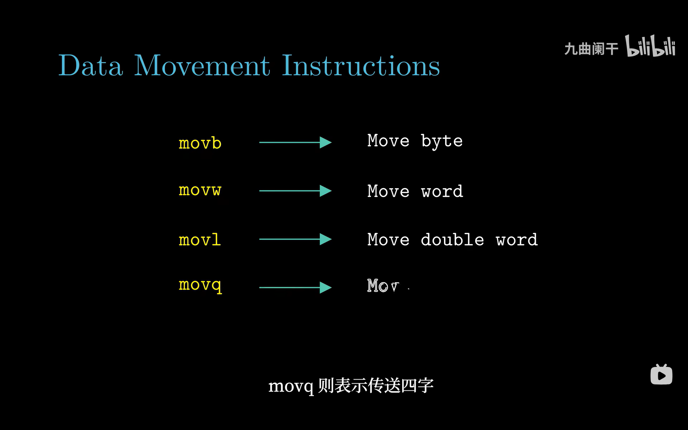

*▲ 图 3-4-9：`mov` 后面那个字母就是**宽度**，依次是 byte(1) / word(2) / double word(4) / quad word(8)。注意最后一行 `movq` 才对应 8 字节——x86 里的 "word" 永远指 16 位，不等于"一个字长"。*

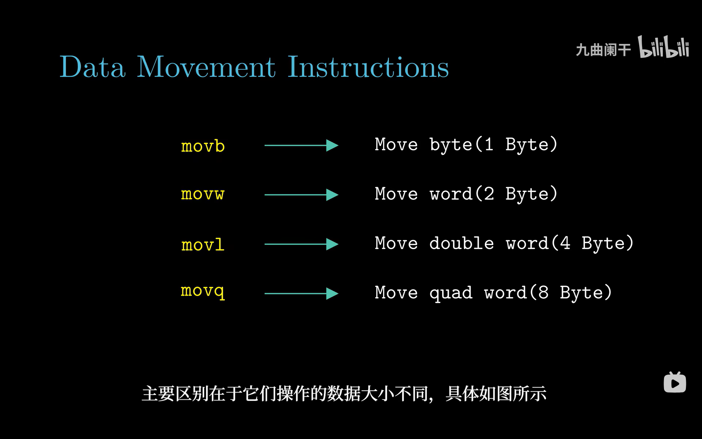

*▲ 图 3-4-10：同一页动画播完的样子，四行末尾补出了 1 / 2 / 4 / 8 字节。上一帧 `movq` 的说明还没展开，容易被误读成别的宽度，以这张为准。*

| 指令 | 宽度 | 对应的 C 类型 | 寄存器写法 |
| :---: | :---: | :--- | :--- |
| `movb` | 1 字节 | `char` | `%al`、`%r8b` |
| `movw` | 2 字节 | `short` | `%ax`、`%r8w` |
| `movl` | 4 字节 | `int` / `unsigned` | `%eax`、`%r8d` |
| `movq` | 8 字节 | `long` / 指针 | `%rax`、`%r8` |

**为什么必须有宽度后缀？** 机器码里只有"搬 4 个字节"这件事，没有"这是 `int` 还是 `float`"的信息（3.3 节讲过：类型信息编译后就消失了）。同一条 `movl` 既能搬 `int` 也能搬 `float` 的位模式，"迁移几个字节"只能靠后缀写明。

### （2）源和目的的组合限制

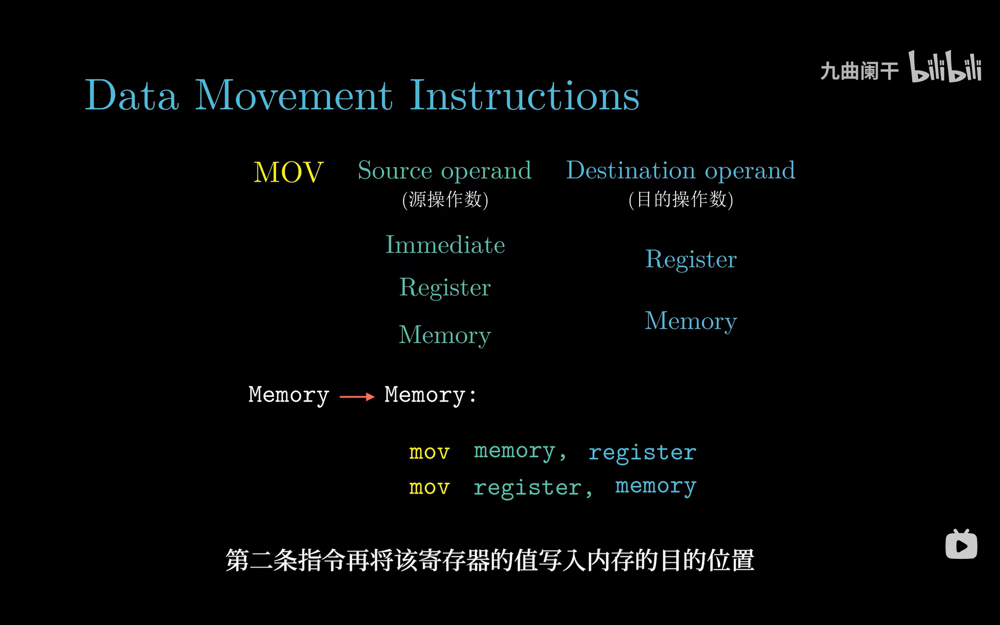

*▲ 图 3-4-11：左列是源操作数的三种来源（Immediate / Register / Memory），右列是目的操作数的两种去向（Register / Memory），两侧交叉就得到 4 种合法组合；最下面单独写出 Memory → Memory 只能拆成两条 `mov`、经寄存器中转。*

| 源 \ 目的 | 寄存器 | 内存 |
| :--- | :---: | :---: |
| **立即数** | ✅ `movq $8, %rax` | ✅ `movq $8, (%rdi)` |
| **寄存器** | ✅ `movq %rax, %rbx` | ✅ `movq %rax, (%rdi)` |
| **内存** | ✅ `movq (%rdi), %rax` | ❌ 不允许 |

> [!WARNING]
> `movq (%rdi), (%rsi)` 是**非法指令**：x86 的 `mov` 只有"从内存读"或"向内存写"一个方向，不能一次访存同时读和写。想完成内存到内存的复制，必须写两条：
> ```asm
> movq    (%rdi), %rax      # 第一条：内存 → 寄存器
> movq    %rax, (%rsi)      # 第二条：寄存器 → 内存
> ```

### （3）五个典型例子

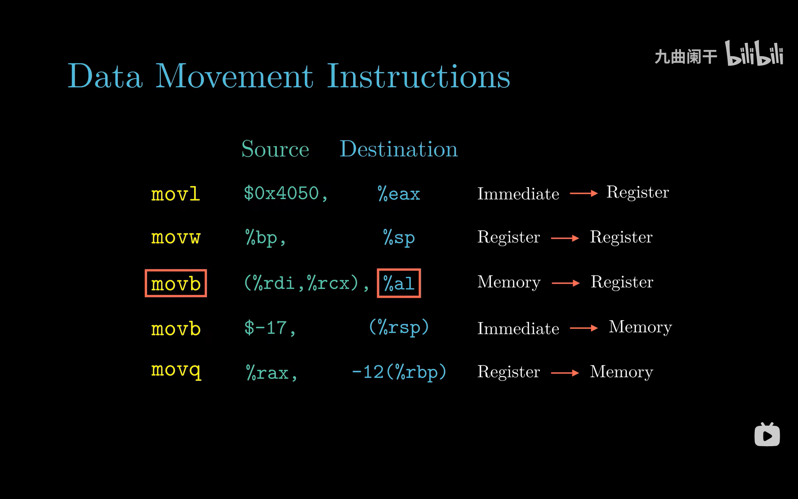

*▲ 图 3-4-12：五行正好覆盖 `mov` 的全部 5 种合法组合（内存→内存本来就不允许）。第 2 行 `movw %bp,%sp` 提醒你：**后缀必须和操作数宽度一致**，写成 `movl %bp,%esp` 是错的。第 3 行把 `movb` 与 `%al` 都框了出来，说明"1 字节的指令"与"1 字节的寄存器"必须成对出现。*

| 指令 | 源类型 | 目的类型 | 结果 |
| :--- | :---: | :---: | :--- |
| `movl $0x4050, %eax` | 立即数 | 寄存器 | `%eax = 0x4050`，且 `%rax` 高 32 位被清零 |
| `movw %bp, %sp` | 寄存器 | 寄存器 | 2 字节从 `%bp` 搬到 `%sp` |
| `movb (%rdi,%rcx), %al` | 内存 | 寄存器 | 读 `M_1[R[%rdi] + R[%rcx]]` 的 1 字节 |
| `movb $-17, (%rsp)` | 立即数 | 内存 | 把 `0xEF`（−17 的 8 位补码）写进 `%rsp` 指向的那 1 字节 |
| `movq %rax, -12(%rbp)` | 寄存器 | 内存 | 把 8 字节写到 `R[%rbp] − 12` 处 |

### （4）`movq` 装立即数：只有 32 位，还要符号扩展

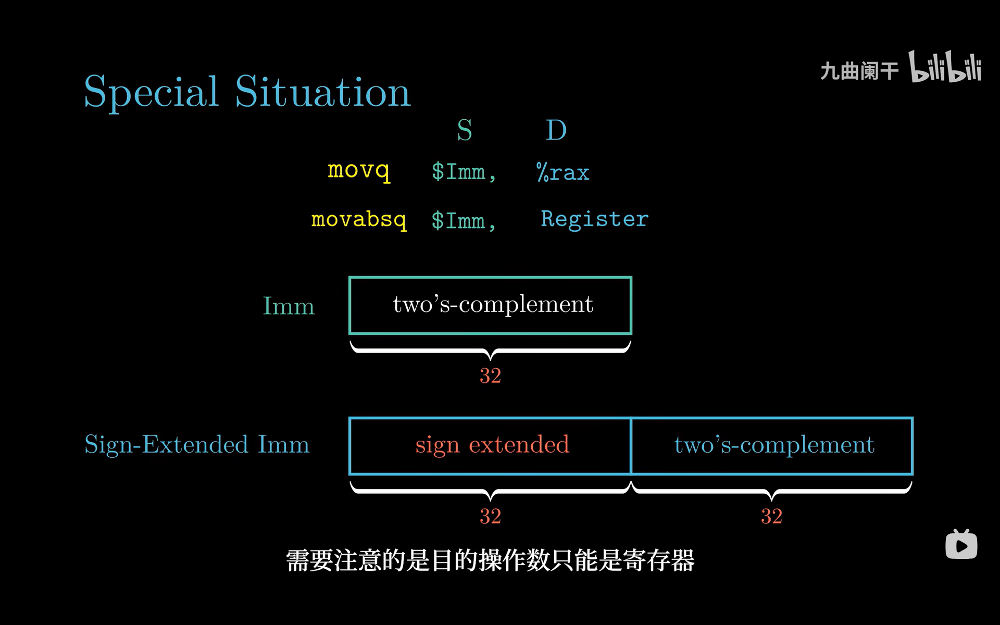

*▲ 图 3-4-13：`movq $Imm, %rax` 的立即数字段只有 32 位（图中 `two's-complement` 那一段的宽度标注就是 32），写成 64 位时高 32 位由**符号扩展**补出（`sign extended` 那段）。所以它只能表示"符号扩展之后仍是自己"的那部分 64 位常数。*

x86-64 的指令编码里放不下 64 位立即数（太贵），于是 `movq` 的立即数字段定为 **32 位补码**，写入 64 位寄存器时按符号扩展：

```asm
    movq    $-1, %rax          # 32 位 -1 符号扩展 → 0xFFFFFFFFFFFFFFFF
    movq    $0x7FFFFFFF, %rax  # 正数，符号位为 0 → 0x000000007FFFFFFF
    movq    $0x80000000, %rax  # 0x80000000 当补码看是负数！
                               # 符号扩展后 = 0xFFFFFFFF80000000
```

想装任意 64 位常数，得换 `movabsq`（move absolute quad word），它有一条能塞下完整 64 位立即数的编码：

```asm
    movabsq $0x1122334455667788, %rax     # 64 位立即数完整装入
    movabsq $0x1122334455667788, (%rdi)   # ❌ 目的只能是寄存器！
```

> [!WARNING]
> 两点都要记住：①`movabsq` 的**目的操作数只能是寄存器**，想写进内存得 `movabsq` 到 `%rax` 再 `movq %rax,(%rdi)`；②`movq $0x80000000,%rax` 得到的是 `0xFFFFFFFF80000000` 而非 `0x0000000080000000`，这是考试高频陷阱。

### （5）零扩展：`movz` 家族

C 里把 `unsigned char` 赋给 `int`、`unsigned short` 赋给 `int`，语义是**零扩展**（高位补 0）。汇编里由 `movz` 系列完成：

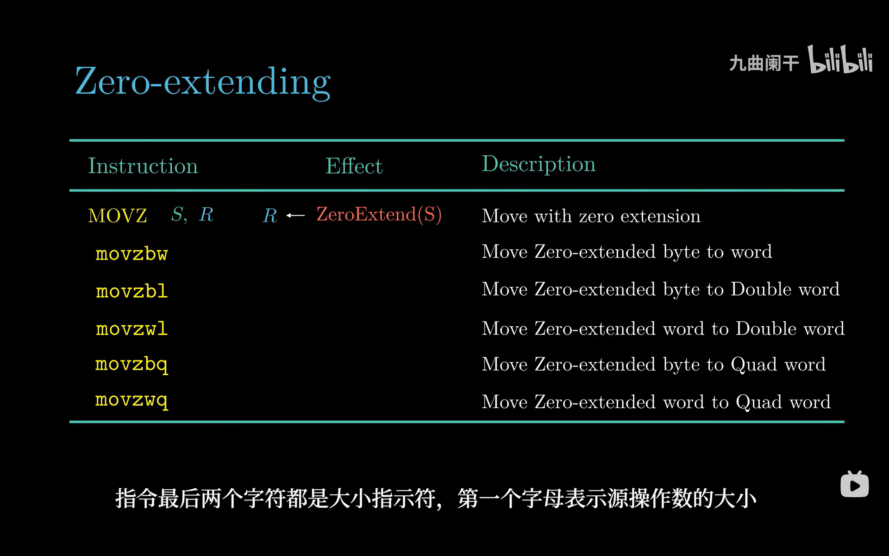

*▲ 图 3-4-14：指令名最后两个字母是"源宽度 + 目的宽度"，前面的 `movz` 表示零扩展。所以 `movzbl` 读作"从 byte 零扩展到 long（double word）"，不是"从 b 到 l 的神秘操作"。*

| 指令 | 效果 | 说明 |
| :--- | :--- | :--- |
| `movzbw` | `R ← ZeroExtend(S)`，1→2 字节 | byte → word |
| `movzbl` | 1→4 字节 | byte → double word |
| `movzwl` | 2→4 字节 | word → double word |
| `movzbq` | 1→8 字节 | byte → quad word |
| `movzwq` | 2→8 字节 | word → quad word |

**注意表里没有 `movzlq`**——不需要。因为"32 位结果自动零扩展到 64 位"这条规则，任何 `movl` 写寄存器的操作本身就完成了 32→64 位零扩展（`movl %eax, %eax` 即可）。这也解释了为什么 `movz` 家族只有 5 条而不是 6 条。

### （6）符号扩展：`movs` 家族与 `cltq`

有符号数的类型提升（`char` → `int`、`int` → `long`）要**符号扩展**（高位补符号位）：

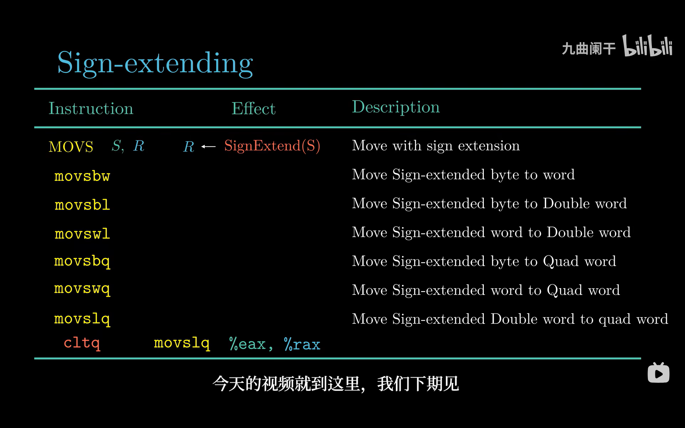

*▲ 图 3-4-15：结构与上一张表完全对称，只把 `z` 换成 `s`（sign）。多出来的最后一行是 `cltq`：它不带操作数，固定把 `%eax` 符号扩展到 `%rax`，等价于 `movslq %eax, %rax`。*

| 指令 | 效果 | 说明 |
| :--- | :--- | :--- |
| `movsbw` | `R ← SignExtend(S)`，1→2 字节 | byte → word |
| `movsbl` | 1→4 字节 | byte → double word |
| `movswl` | 2→4 字节 | word → double word |
| `movsbq` | 1→8 字节 | byte → quad word |
| `movswq` | 2→8 字节 | word → quad word |
| `movslq` | 4→8 字节 | double word → quad word |
| `cltq` | `%rax ← SignExtend(%eax)` | 无操作数，专用于 32→64 位 |

**符号扩展具体怎么做？** 把源操作数的最高位（符号位）复制到所有新增的高位上。例如 `movsbl %al, %eax`：若 `%al = 0x80`（= −128），则 `%eax = 0xFFFFFF80`；若 `%al = 0x7F`（= +127），则 `%eax = 0x0000007F`。记法：`movz` 的 `z` = zero（补 0），`movs` 的 `s` = sign（补符号位）——"无符号小类型 → 大类型"用 `movz`，"有符号小类型 → 大类型"用 `movs`。

### （7）五大类传送指令总表

| 类别 | 指令 | 作用 | 备注 |
| :---: | :--- | :--- | :--- |
| ① 基本传送 | `movb` `movw` `movl` `movq` | 原样搬运 1/2/4/8 字节 | `movl` 写寄存器会清零高 32 位 |
| ② 大立即数 | `movabsq` | 装载完整 64 位立即数 | 目的**只能**是寄存器 |
| ③ 零扩展 | `movzbw` `movzbl` `movzwl` `movzbq` `movzwq` | 高位补 0 | 无 `movzlq`，`movl` 已自带零扩展 |
| ④ 符号扩展 | `movsbw` `movsbl` `movswl` `movsbq` `movswq` `movslq` `cltq` | 高位补符号位 | `cltq` = `movslq %eax, %rax` |
| ⑤ 栈传送 | `pushq` `popq` | 压栈 / 出栈 8 字节 | 本质是"改指针 + 搬运"，见 3.4.4 |

---

## 3.4.3 数据传送示例

教材用一个交换函数把上面的规则串了起来：

```c
long exchange(long *xp, long y)
{
    long x = *xp;    // 读出 xp 指向的值
    *xp = y;         // 把 y 写回去
    return x;        // 返回原来的值
}
```

编译结果（AT&T 语法）：

```asm
exchange:
    movq    (%rdi), %rax    # x = *xp    ：%rdi 是 xp，(%rdi) 是它指向的 8 字节
    movq    %rsi, (%rdi)    # *xp = y    ：%rsi 是 y，写回 xp 指向的位置
    ret                     # return x   ：返回值约定放在 %rax
```

三条指令的分工（AT&T 语法**源操作数在前、目的在后**）：`%rdi` 拿第 1 个参数 `xp`，`%rsi` 拿第 2 个参数 `y`；局部变量 `x` 因为没被取地址，直接住在 `%rax` 里；返回值也约定放在 `%rax`。

`(%rdi)` 读作"`%rdi` 所指的那块内存"，对应 3.4.1 表里的 **Indirect（间接寻址）**。同一个 `(%rdi)`，出现在源位置是"读"，出现在目的位置是"写"——括号里是**地址**，括号整体是**内存中的值**。把它画成指针最直接：

```text
        %rdi = 0x2000（xp 的值本身就是一个地址）
                                       │
              ▼
     地址 0x2000  ┌────────────────────┐
                  │ 0x000000000000000A │  ← *xp = 10（8 字节，小端）
                  └────────────────────┘

     movq (%rdi), %rax   →  把 10 读进 %rax，%rax = 0xA
     movq %rsi, (%rdi)   →  若 %rsi = 20，就把 20 写进 0x2000
                             （0x2000 处从 0xA 变成 0x14，%rax 仍是 0xA）
```

为什么局部变量 `x` 能不占内存？因为 C 只要求"**通过取地址（`&x`）能访问到的变量必须存放在内存中**"。`exchange` 里没人对 `x` 求地址，编译器就把它放在 `%rax` 里——这就是第 5 章"寄存器分配"优化的雏形。

---

## 3.4.4 压入和弹出栈数据

### （1）栈：一段特殊的、向低地址生长的内存

程序运行时栈（stack）是一段内存区域，有两条"反直觉"的约定：

- **栈底在高地址，栈顶在低地址**——栈向**低地址**方向增长；
- `%rsp`（stack pointer）**指向栈顶元素**，即当前栈中最低的那个有效地址。

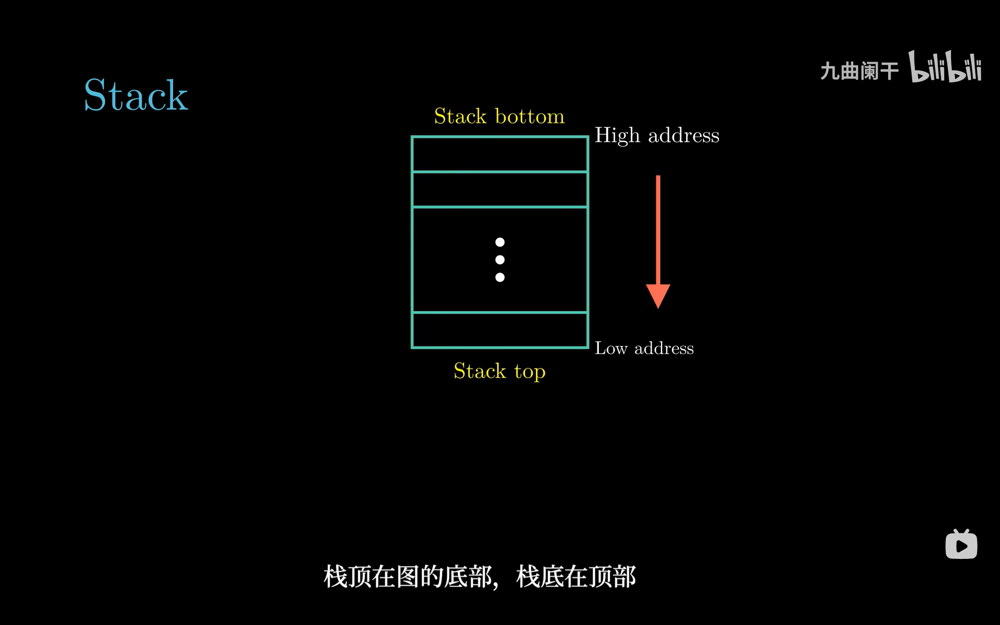

*▲ 图 3-4-16：图上方写 Stack bottom（栈底）配 High address，下方写 Stack top（栈顶）配 Low address，右侧红箭头表示增长方向。初学者最容易把"栈顶"想成图的上方——在内存示意图里，栈顶恰恰在**下面**。*

```text
   高地址  0xFFFF…FFFF
           ┌──────────────────┐  ← 栈底 stack bottom（最早压入的数据）
           │      旧数据      │
           ├──────────────────┤  ← %rsp 指向栈顶元素
           │     栈顶数据     │
           └──────────────────┘
   低地址  0x0000…0000      ▼ push 时 %rsp 减小，栈向低地址生长
```

**为什么向低地址增长？** 这是历史沿袭的约定，没有硬件强制。栈从高地址往低地址长、堆从低地址往高地址长，两者在地址空间中间"对进"，于是一段连续地址就能同时容纳向下长的栈和向上长的堆（第 9 章虚拟内存会再见到这个布局）。

### （2）`pushq`：压栈 = 先减指针，再写内存

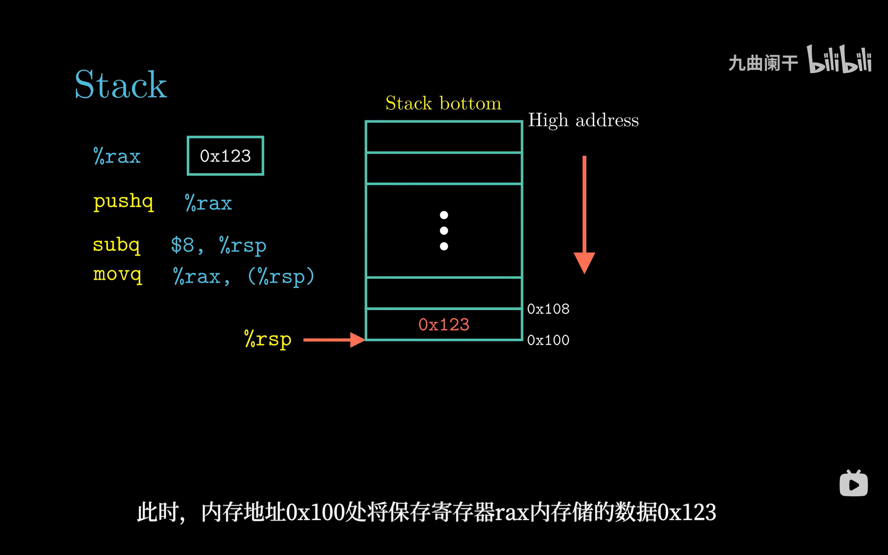

*▲ 图 3-4-17：左边三行依次是 `pushq %rax` 和它展开出的两条等价指令，右侧是栈的变化。注意执行后 `%rsp` 从 `0x108` 变成 `0x100`（减 8），而内存 `0x100` 处出现了 `%rax` 的值 `0x123`。**顺序不能反**：必须先把指针减下去，再往新栈顶写。*

```asm
    pushq %rax
    # 等价于：
    subq  $8, %rsp          # ① 栈顶下移 8 字节（分配一格）
    movq  %rax, (%rsp)      # ② 把 %rax 写进新的栈顶
```

代入具体数值：

```text
   执行前：%rsp = 0x108，%rax = 0x123
        ① subq $8, %rsp      →  %rsp = 0x100
        ② movq %rax, (%rsp)  →  M_8[0x100] = 0x123

   每格 8 字节：
  ┌───────┬────────────────────────────┐
  │ 0x110 │          旧数据            │
  ├───────┼────────────────────────────┤
  │ 0x108 │          旧数据             │ ← pushq 之前 %rsp
  ├───────┼────────────────────────────┤
  │ 0x100 │ 0x0000000000000123          │ ← pushq 之后 %rsp（新栈顶）
  └───────┴────────────────────────────┘
```

### （3）`popq`：出栈 = 先读内存，再增指针

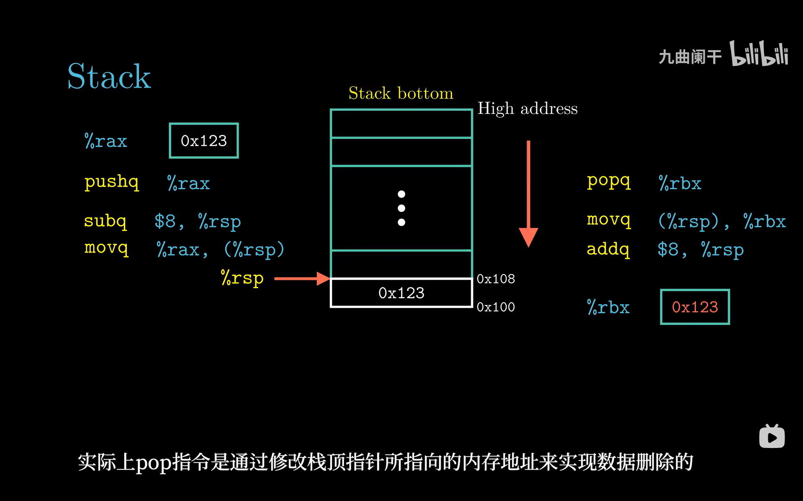

*▲ 图 3-4-18：`popq %rbx` 展开成两句，执行后 `%rbx` 得到 `0x123`、`%rsp` 从 `0x100` 回到 `0x108`。**内存 0x100 里的 0x123 并没有被抹掉**，只是这块空间不再属于栈。*

```asm
    popq %rbx
    # 等价于：
    movq  (%rsp), %rbx      # ① 先读出栈顶的 8 字节
    addq  $8, %rsp          # ② 再把栈顶上移 8 字节（释放一格）
```

```text
   执行前：%rsp = 0x100，M_8[0x100] = 0x123
        ① movq (%rsp), %rbx  →  %rbx = 0x123
        ② addq $8, %rsp      →  %rsp = 0x108

   每格 8 字节：
  ┌───────┬────────────────────────────┐
  │ 0x110 │          旧数据            │
  ├───────┼────────────────────────────┤
  │ 0x108 │          旧数据             │ ← popq 之后 %rsp（栈顶回到这里）
  ├───────┼────────────────────────────┤
  │ 0x100 │ 0x0000000000000123          │ ← 数据还在！只是"逻辑上"已出栈
  └───────┴────────────────────────────┘
```

> [!WARNING]
> **`pop` 不会清除内存内容**，它只改 `%rsp`。由此有三条纪律：
> 1. 出栈后那块内存里仍是旧值，下一次 `pushq`、`callq` 或任何写栈的操作都可能覆盖它；
> 2. 不要写"出栈之后再读那块内存"的代码——它已经不属于你，读到的是残值（5.4 节缓冲区溢出与信息泄露正源于此）；
> 3. `popq %rsp` 语义特殊（先把值读进 `%rsp` 再加 8），不要用它代替 `addq` 来"一次跳过好几格"。

---

## 📌 重点速记

```text
操作数三类    : 立即数 $Imm | 寄存器 %rax | 内存 Imm(r_b,r_i,s)
寻址公式      : 有效地址 = Imm + R[r_b] + R[r_i]×s；s ∈ {1,2,4,8}
寄存器层次    : %rax ⊃ %eax ⊃ %ax ⊃ %al；新增 %r8–%r15
写 32 位      : 清零高 32 位（movl $-1,%eax → %rax=0x00000000FFFFFFFF）
mov 宽度      : movb(1) movw(2) movl(4) movq(8)
组合限制      : 立即数不能做目的；内存→内存 ✗，需寄存器中转
movq 立即数   : 只有 32 位补码 + 符号扩展；64 位常数用 movabsq
零扩展        : movzbw movzbl movzwl movzbq movzwq（无 movzlq）
符号扩展      : movsbw movsbl movswl movsbq movswq movslq + cltq
栈            : 高地址是栈底，低地址是栈顶，向低地址增长
pushq %rax    : subq $8,%rsp ; movq %rax,(%rsp)
popq  %rbx    : movq (%rsp),%rbx ; addq $8,%rsp（不清内存）
```

---

## ⚠️ 易错点

1. **把 `(%rax)` 当成"取 `%rax` 的值"** —— `%rax` 是寄存器里的值，`(%rax)` 是"以它为地址去内存取值"，中间差一次访存。`movq %rax,%rbx` 与 `movq (%rax),%rbx` 完全是两件事。

2. **宽度后缀与寄存器名不匹配** —— `movl %al, %eax` 汇编不过，`movb %ax, %al` 也错。后缀、源、目的三者宽度必须一致；`movz`/`movs` 是唯一例外，它们在指令名里显式写了"源宽度"和"目的宽度"。

3. **漏写或多写 `$`** —— `movl 0x4050, %eax` 读的是内存地址 `0x4050`（多半直接段错误），`movl $0x4050, %eax` 才是装常数。汇编里 `$` 标立即数、`%` 标寄存器，两个前缀一个都不能错。

4. **以为 `movq $0x80000000, %rax` 得到 `0x0000000080000000`** —— 32 位立即数 `0x80000000` 按补码是负数，符号扩展后是 `0xFFFFFFFF80000000`。要装真 64 位常数就用 `movabsq`。

5. **把"写 32 位清零高 32 位"推广到 8/16 位** —— 只有 **32 位**写入会清零高半；`movb $-1,%al` 只改最低字节，`movw $-1,%ax` 只改低 16 位。这个不对称性是最爱考的点。

6. **直接写内存到内存的 `mov`** —— `movq (%rdi),(%rsi)` 非法，必须拆成 `movq (%rdi),%rax` + `movq %rax,(%rsi)` 两条。

7. **以为 `popq` 会清掉内存，或以为出栈后还能安全读那块内存** —— `pop` 只做 `movq` + `addq`，内容原封不动留在栈里；那块空间随时会被下一次压栈覆盖。

---

## ✅ 自测

1. 设 `%rax = 0x100`、`%rcx = 0x2`，求 `0x8(%rax,%rcx,4)` 的有效地址；若指令是 `movl`，它访问哪几个字节？
2. 下面三条指令哪些非法？为什么？（a）`movq %rax, (%rdi)`　（b）`movq (%rdi), (%rsi)`　（c）`movw $0x1, %al`
3. `%al = 0x80` 时，分别执行 `movzbl %al,%eax` 与 `movsbl %al,%eax`，`%eax` 各是多少？
4. 执行 `movl $-1, %eax` 后 `%rax` 是多少？若 `%rax` 原为 `0x1122334455667788`，改成执行 `movb $-1, %al` 后 `%rax` 又是多少？
5. 写出 `pushq %rdi` 与 `popq %rdi` 的等价指令序列，并说明 `pushq` 之后 `%rsp` 与内存分别发生了什么变化。

<details>
<summary>参考答案</summary>

1. 有效地址 = `0x8 + R[%rax] + R[%rcx]×4` = `0x8 + 0x100 + 0x8` = `0x110`；`movl` 访问 `M_4[0x110]`，即 `0x110`–`0x113` 这 4 个字节。
2. （b）非法，x86 的 `mov` 不支持内存到内存；（c）非法，`movw` 搬运 2 字节而 `%al` 只有 1 字节，后缀与操作数宽度不匹配；（a）合法。
3. `movzbl`：`%eax = 0x00000080`（= 128）；`movsbl`：`0x80` 的符号位是 1，`%eax = 0xFFFFFF80`（= −128）。
4. `movl $-1,%eax` → `%rax = 0x00000000FFFFFFFF`（写 32 位清零高半）；`movb $-1,%al` → 只有最低字节变 `0xFF`，`%rax = 0x11223344556677FF`。
5. `pushq %rdi` ≡ `subq $8,%rsp` + `movq %rdi,(%rsp)`；`popq %rdi` ≡ `movq (%rsp),%rdi` + `addq $8,%rsp`。压栈后 `%rsp` 减 8 指向新栈顶，该地址处写入 `%rdi` 的 8 字节；原栈顶及以上的数据不受影响。

</details>

---

## 🔗 与其他章节的联系

| 本节内容 | 后续用在哪 |
| :--- | :--- |
| 通用寻址公式 `Imm(r_b,r_i,s)` 与比例因子 | 3.5 `leaq` 直接算地址、3.8 数组/二维数组寻址、3.9 结构体成员寻址 |
| `movz` / `movs` 与 `cltq` | 3.6 `set` 指令后把 1 字节结果扩展到 `int`、2.2 类型转换的机器级实现 |
| `%r8`–`%r15` 与 caller/callee saved | 3.7 过程调用的寄存器保存约定、3.7 递归函数的栈帧 |
| `pushq` / `popq` | 3.7 函数序言与尾声、3.7 传递第 7 个及以后的参数 |
| 写 32 位清零高 32 位 | 第 5 章优化：编译器偏爱用 32 位运算缩短指令、消除依赖 |

---

[← 上一节：3.3 数据格式](3.3%20数据格式.md)　｜　[下一节：3.5 算术和逻辑操作 →](3.5%20算术和逻辑操作.md)
