# 3.5 算术和逻辑操作

> **📖 本节定位**　第 3 章「程序的机器级表示」· 教材 P128–P135
> **一句话**：`mov` 家族只负责搬运位，真正让数据"变形"的是 `leaq`、加减乘、位运算与移位这几类指令；它们大多顺手改写条件码，为 3.6 的分支埋下伏笔。

[← 上一节：3.4 访问信息](3.4%20访问信息.md)　｜　[下一节：3.6 控制 →](3.6%20控制.md)

---

## 🎯 核心结论

| # | 结论 |
| :-: | :--- |
| 1 | `leaq S, D` 把**有效地址**写进 `D`，**根本不访存**；因此可当"加法 / 乘加"指令用，且**不改变条件码** |
| 2 | 二元运算统一是 `D ← D op S`：第一个操作数是源，第二个既当源又当目的；目的只能是寄存器或内存，**不能是立即数** |
| 3 | `xor %eax,%eax` 是清零惯用法：2 字节、不依赖旧值，并把 `CF`、`OF` 清 0、`ZF` 置 1 |
| 4 | 移位量来自立即数或 `%cl`，但硬件**只取 `%cl` 的低 `m` 位**，其中 $2^m = w$：8/16/32/64 位分别取 3/4/5/6 位 |
| 5 | 乘除法有"双字"形式：`imulq`/`mulq` 的 128 位积写在 `%rdx:%rax`；`idivq`/`divq` 从 `%rdx:%rax` 取被除数，商在 `%rax`、余数在 `%rdx` |
| 6 | 编译器用 `lea + shift` 合成乘常数（如 `z*48`），动机是**缩短关键路径**：`imul` 延迟约 3 周期，`lea`+`sal` 各 1 周期 |

---

## 3.5.1 加载有效地址（leaq）

`leaq` 是 `mov` 家族里最"名不副实"的一条：名字叫"加载"，却**从不访问内存**。

```asm
leaq S, D          # D ← &S，即只把 S 这个地址表达式的值算出来写进 D
```

- 源 `S` 必须写成内存寻址形式 `Imm(%r_b,%r_i,s)`，但处理器只做**地址计算**，不读那个地址；
- 目的 `D` **必须是寄存器**（`leaq 8(%rax), (%rdx)` 是非法指令）；
- 算的就是 3.4 的通用公式 `Imm + R[r_b] + R[r_i] × s`，其中 `s ∈ {1, 2, 4, 8}`。

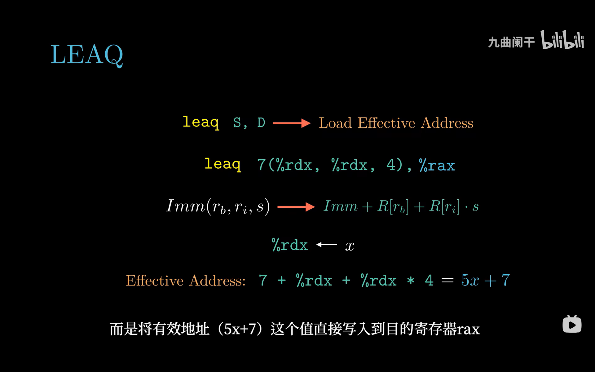

*▲ 图 3-5-1：`Imm(r_b,r_i,s)` 展开成 `Imm + R[r_b] + R[r_i]·s`。这里 `%rdx` 同时充当基址和变址，于是 `7 + x + 4x = 5x + 7` 一条指令就出来了。*

### （1）当加法、乘加指令用

既然 `leaq` 只算数，那么凡是能塞进"基址 + 变址×比例 + 偏移"的线性式，都能一条指令算完：

| 写法 | 等价于 | 说明 |
| :--- | :--- | :--- |
| `leaq 8(%rax), %rdx` | `%rdx = %rax + 8` | 加法（`addq $8,%rax` 也行，但会改目的与条件码） |
| `leaq (%rdi,%rsi), %rax` | `%rax = x + y` | 两寄存器相加，比例因子缺省为 1 |
| `leaq (%rdi,%rdi,2), %rax` | `%rax = 3x` | 自己加自己两次 |
| `leaq 7(%rdx,%rdx,4), %rax` | `%rax = 5x + 7` | 一次乘加，教材的招牌例子 |

### （2）比例因子为什么只能是 1、2、4、8

`leaq` 的机器码里，比例因子存在 **SIB 字节的 2 位 scale 字段**中：`00→1`、`01→2`、`10→4`、`11→8`。两比特只能编出这四个值，因为它们的真实用途是"按元素大小换算下标"——x86 支持的数据宽度恰好是 1、2、4、8 字节。

于是常数 12 就不能直接当比例因子，`12z` 必须拆成 `4 × (3z)`：先用一条 `leaq` 造出 `3z`，再让比例因子 4 去乘它。

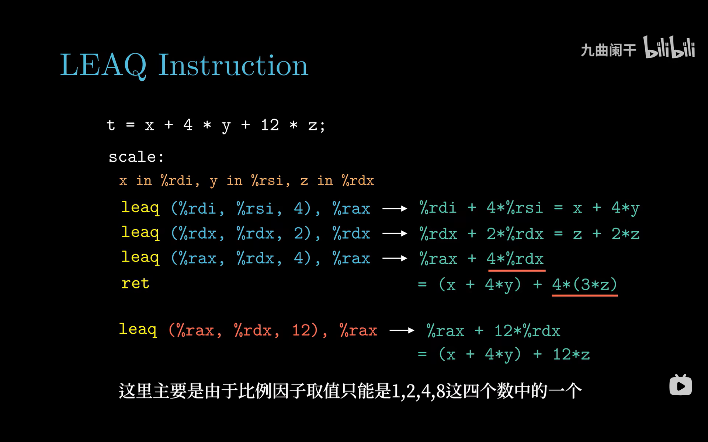

*▲ 图 3-5-2：`x` 在 `%rdi`、`y` 在 `%rsi`、`z` 在 `%rdx`。第三条 `leaq (%rax,%rdx,4)` 里 `%rdx` 已经是 `3z`，所以等价于 `4·(3z)`；红字那行 `leaq (%rax,%rdx,12)` 是**反例**，汇编器会直接报错。*

```asm
# long t = x + 4*y + 12*z;      x:%rdi   y:%rsi   z:%rdx
leaq  (%rdi,%rsi,4), %rax     # %rax = x + 4y
leaq  (%rdx,%rdx,2), %rdx     # %rdx = z + 2z = 3z
leaq  (%rax,%rdx,4), %rax     # %rax = (x + 4y) + 4*(3z)
ret
```

> [!IMPORTANT]
> 比例因子只有 1/2/4/8，是**硬件编码**的限制，不是编译器的偷懒。任何常数都能用"移位 + 加法"拼出来（如 `12z = (3z)<<2`），所以 `leaq` 依旧是编译器最爱的"三操作数加法器"。

> [!NOTE]
> `leaq` 有两个"副作用为零"的优点：**不访存**（不会触发缺页或段错误）、**不写条件码**（不会破坏上一条 `cmp` 的结果）。编译器因此敢把它插在"比较—分支"之间随意使用。

---

## 3.5.2 一元和二元操作

### （1）一元操作：只有一个操作数

`inc`（`D ← D+1`）、`dec`（`D ← D−1`）、`neg`（`D ← 0−D`，按补码取负）、`not`（`D ← ~D`，按位取反）。操作数既是源又是目的，可以是寄存器或内存：`incq (%rdi)` 直接把内存里的数加 1，`notq %rax` 等价于 `-x-1`。

### （2）二元操作：D ← D op S

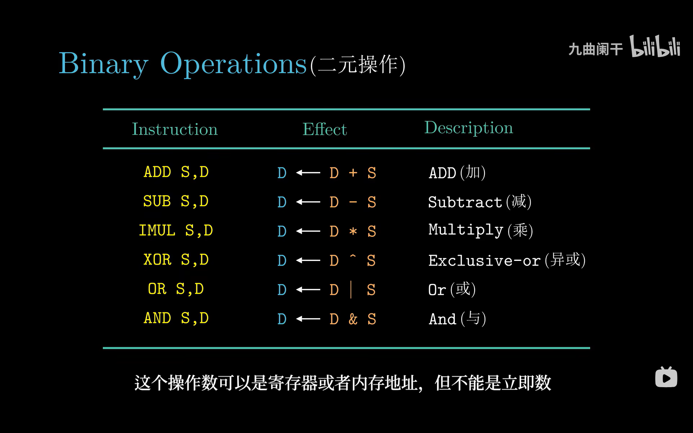

*▲ 图 3-5-3：六条二元指令的效果一律是 `D ← D op S`。图中字幕说"不能是立即数"，指的是**目的操作数 D**；源操作数 S 恰恰可以是立即数。*

AT&T 的书写顺序是"**源在前、目的在后**"，这是最容易背反的地方：`subq %rax, %rbx` 算的是 `%rbx = %rbx - %rax`，不是 `%rax - %rbx`。六条指令依次是 `addq`、`subq`、`imulq`、`xorq`、`orq`、`andq`，其中 `imulq S,D` 只保留**低 64 位**（完整 128 位积见 3.5.5）。

> [!WARNING]
> **源可以是立即数，目的不行。** `subq $8, %rsp` 完全合法（把栈指针下移 8 字节），立即数 8 编成 `imm8` 并**符号扩展**到 64 位；但 `subq %rax, $8` 没有这种编码。x86-64 的 ALU 立即数只有 `imm8`、`imm32` 两种，装不下 64 位大常数，得先 `movabsq` 进寄存器。

### （3）`imul` 的立即数形式受限

教材把 `imul` 也列进二元运算，但它的操作数限制比 `add`/`sub` 严：

```asm
imulq  $48, %rdx, %rax      # 合法：三操作数形式，imm 只能是 imm8/imm32
imulq  %rdx, 8(%rsp)        # 非法：二元 imul 的目的必须是寄存器
imulq  $0x123456789, %rdx   # 非法：立即数超 32 位，装不下
```

原因还是编码：二元 `imul` 的目的字段只能指向寄存器（它要把结果截断后写回），而立即数域只有 32 位、且做符号扩展。所以"`imul` 不能随便带立即数"的准确表述是：**立即数只能是 32 位以内，且目的必须是寄存器**。

### （4）`xor %rax,%rax` 清零的惯用法

`xorl %eax,%eax` 只占 2 字节（`31 C0`），`xorq %rax,%rax` 占 3 字节（`48 31 C0`），效果相同。它比 `movq $0, %rax` 更受编译器青睐：机器码更短，且 CPU 认出"异或自身"后**不依赖旧值**，直接给出 0，不占用执行单元的数据通路。代价是它会**改写条件码**（`CF=0`、`OF=0`、`ZF=1`、`SF=0`）——这一点在 3.6 里会变成实打实的 bug 来源。

### （5）算术逻辑指令总表

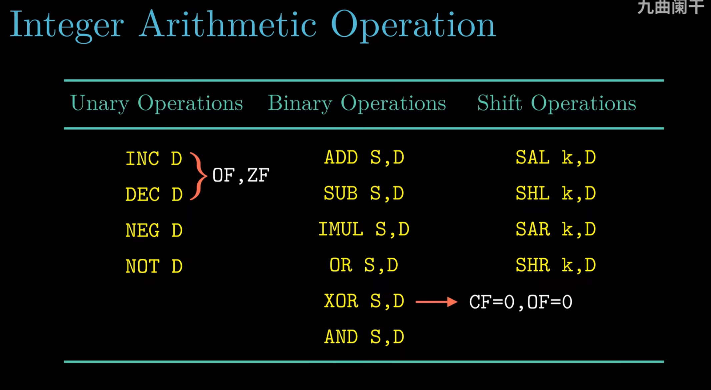

*▲ 图 3-5-4：一元、二元、移位三类指令汇总。红括号标出 `INC/DEC` 只更新 `OF`、`ZF`（**不动 `CF`**），红箭头标出 `XOR` 会把 `CF`、`OF` 清 0。*

| 指令 | 效果 | CF | OF | SF/ZF | 备注 |
| :--- | :--- | :-: | :-: | :-: | :--- |
| `inc D` / `dec D` | `D ← D ± 1` | 不变 | ✔ | ✔ | 循环计数常用，故意不破坏 `CF` |
| `neg D` | `D ← 0 − D` | ✔ | ✔ | ✔ | 操作数非 0 时 `CF=1` |
| `not D` | `D ← ~D` | — | — | — | **不改任何条件码** |
| `add/sub S,D` | `D ← D ± S` | ✔ | ✔ | ✔ | 无符号看 `CF`，有符号看 `OF` |
| `imul S,D` | `D ← D × S` | ✔ | ✔ | 未定义 | `CF=OF=1` 表示积超出 64 位 |
| `and/or/xor S,D` | 按位运算 | 0 | 0 | ✔ | 逻辑运算把 `CF`、`OF` 清 0 |
| `sal/shl/sar/shr k,D` | 移位 | ✔ | ✔ | ✔ | `CF` = 最后移出的那一位 |
| `cmp S,D` / `test S,D` | 只置条件码 | ✔ | ✔ | ✔ | **不写结果**，详见 3.6 |

### （6）操作数寻址练习

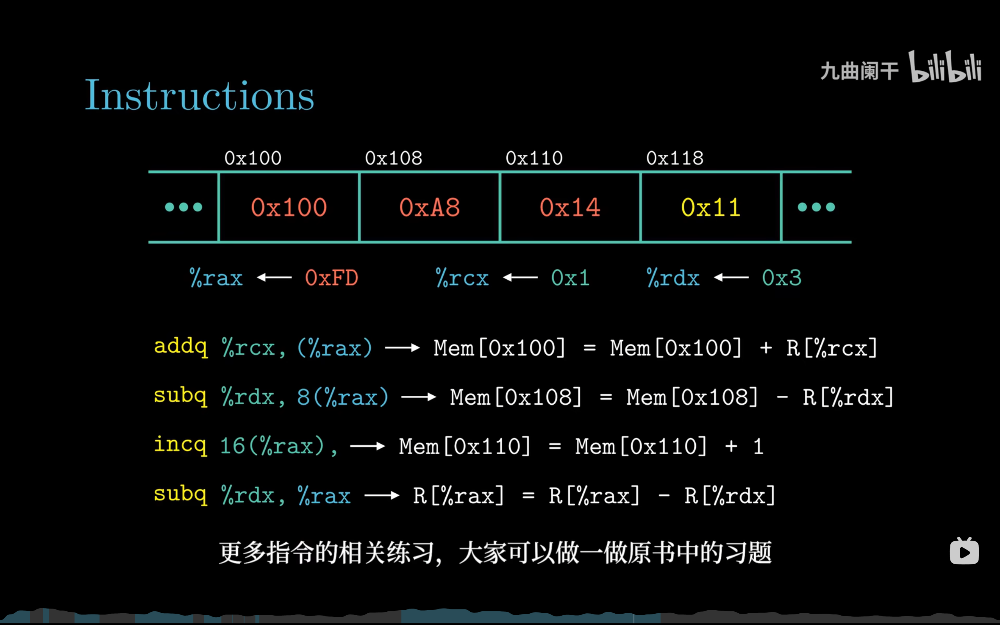

*▲ 图 3-5-5：内存 0x100/0x108/0x110 处依次是 0x100/0xA8/0x14，`%rcx=1`、`%rdx=3`。按 `%rax=0x100` 逐步展开四条指令（幻灯片把第 4 条的结果 0xFD 误标成了初值）。*

| 指令 | 有效地址 | 执行结果（设 `%rax=0x100`） |
| :--- | :--- | :--- |
| `addq %rcx,(%rax)` | `0x100 + 0 = 0x100` | `Mem[0x100] ← 0x100 + 1 = 0x101` |
| `subq %rdx,8(%rax)` | `0x100 + 8 = 0x108` | `Mem[0x108] ← 0xA8 − 3 = 0xA5` |
| `incq 16(%rax)` | `0x100 + 16 = 0x110` | `Mem[0x110] ← 0x14 + 1 = 0x15` |
| `subq %rdx,%rax` | 无（寄存器直接运算） | `%rax ← 0x100 − 3 = 0xFD` |

> [!NOTE]
> 原课件此处标注有笔误：它把 `%rax` 的初值写成了 `0xFD`，可 `0xFD` 正是**第 4 条指令执行后**的结果。若真按 `%rax=0xFD` 起算，第一条就会去写 `Mem[0xFD]`，与图上标的 `Mem[0x100]` 矛盾。本笔记统一按 `%rax=0x100` 讲解。

---

## 3.5.3 移位操作

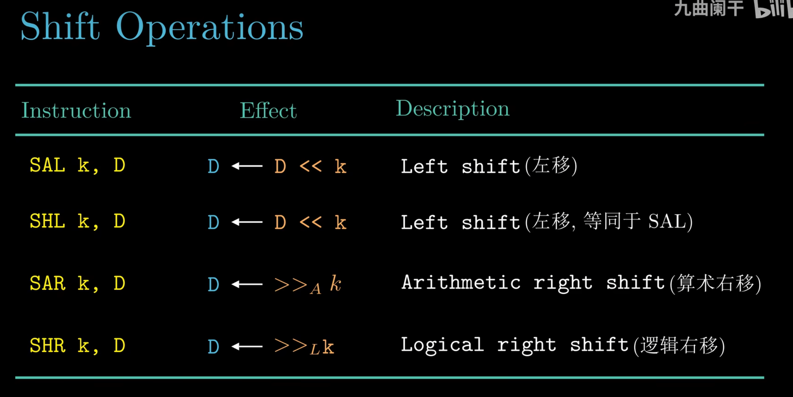

*▲ 图 3-5-6：`SAL` 与 `SHL` 的效果完全相同（都左移补 0）；`SAR` 是算术右移、补符号位；`SHR` 是逻辑右移、补 0。*

| 指令 | 效果 | 高位补什么 | 数学含义 |
| :--- | :--- | :--- | :--- |
| `sal k, D` / `shl k, D` | `D ← D << k` | 低位补 `k` 个 0 | `D × 2^k mod 2^w` |
| `sar k, D` | `D ← D >>_A k` | 补 `k` 个**符号位** | `⌊D / 2^k⌋` |
| `shr k, D` | `D ← D >>_L k` | 补 `k` 个 0 | `D / 2^k`（无符号） |

`SAL` 和 `SHL` 是同一个机器码，汇编器都接受；真正要分清的是两个右移。用 8 位的 `0x95 = 1001 0101`（即 -107）试一下：

```text
sar 1 → 1100 1010 = 0xCA = -54      ← 补符号位 1
shr 1 → 0100 1010 = 0x4A = +74      ← 补 0
sal 1 → 0010 1010 = 0x2A = +42      ← 移出的最高位直接丢弃
```

注意 `sar` 得到的是 `-54`，而 `-107 / 2` 在 C 里截断成 `-53`：**算术右移是向下取整（floor），不是向零取整**。这正是 2.3.7 里"有符号除法要加偏置修正"的根源。

### （1）移位量从哪来：立即数或 `%cl`

移位指令的第二个操作数（移位量 `k`）只有两个来源：8 位立即数，或 `%cl`（**只能是 `%cl`，不能是 `%cx`、`%ecx`、`%rcx`**）。

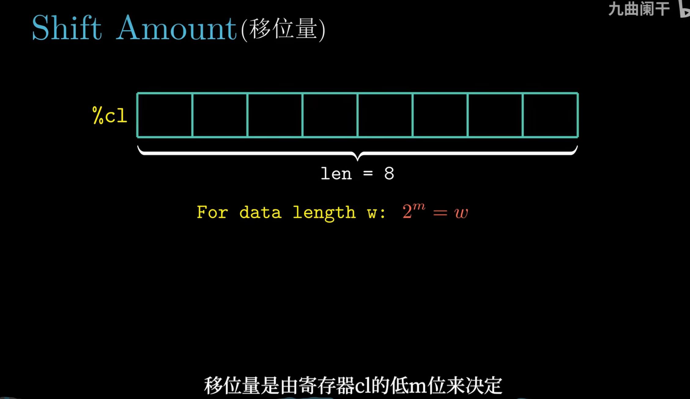

*▲ 图 3-5-7：`%cl` 有 8 位，但真正参与移位决策的只是低 `m` 位，且满足 $2^m = w$；高位被硬件直接忽略。*

### （2）只取低 m 位：`2^m = w`

| 目的操作数宽度 `w` | 指令后缀 | `m = log2(w)` | 实际移位量 | `%cl = 0xFF` 时 |
| :-: | :-: | :-: | :--- | :-: |
| 8 位 | `salb` | 3 | `%cl & 0b111` | 7 |
| 16 位 | `salw` | 4 | `%cl & 0b1111` | 15 |
| 32 位 | `sall` | 5 | `%cl & 0b11111` | 31 |
| 64 位 | `salq` | 6 | `%cl & 0b111111` | 63 |

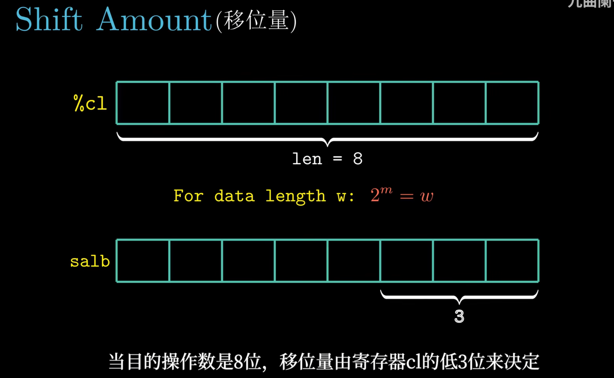

*▲ 图 3-5-8：目的操作数是 8 位（`salb`），`w=8`、$2^3=8$，所以硬件只截取 `%cl` 的最低 3 位。*

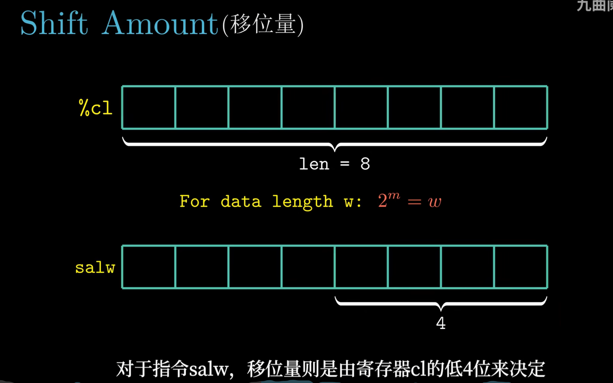

*▲ 图 3-5-9：`salw` 的 `w=16`、$2^4=16$，于是取低 4 位；把这两张图并排看，就能记住"后缀变宽，截取位数加一"。*

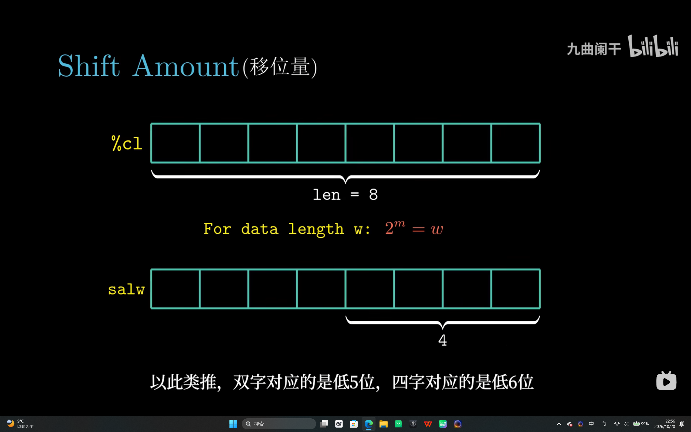

*▲ 图 3-5-10：同一页的收尾帧，把 salb / salw 的规律一口气推广到位——双字（`sall`）取 `%cl` 低 5 位，四字（`salq`）取低 6 位。规律就是 $m=\log_2 w$。*

**为什么只取低位？** 移位器（barrel shifter）要能在 `0 ~ w-1` 之间任意移位，控制端只需要 `m = log2(w)` 根选择线就够了。如果把 `%cl` 的 8 位全接进去，就得为 `0~255` 做译码，多出成倍的连线和门电路，而"移 64 位以上"本身没有意义。于是硬件统一做 `k mod w`：**省线、省译码，还让任何输入都有确定结果**。

副作用也很实际：`movb $0x40, %cl; salq %cl, %rax` 实际一位都不移（`0x40 & 0x3F = 0`）。C 语言里 `x << k`（`k ≥ w`）是未定义行为，机器码却"悄悄"取模——所以汇编层看到的行为不能反推 C 的语义。

---

## 3.5.4 讨论

### （1）编译器怎样把 `z * 48` 变成两条指令

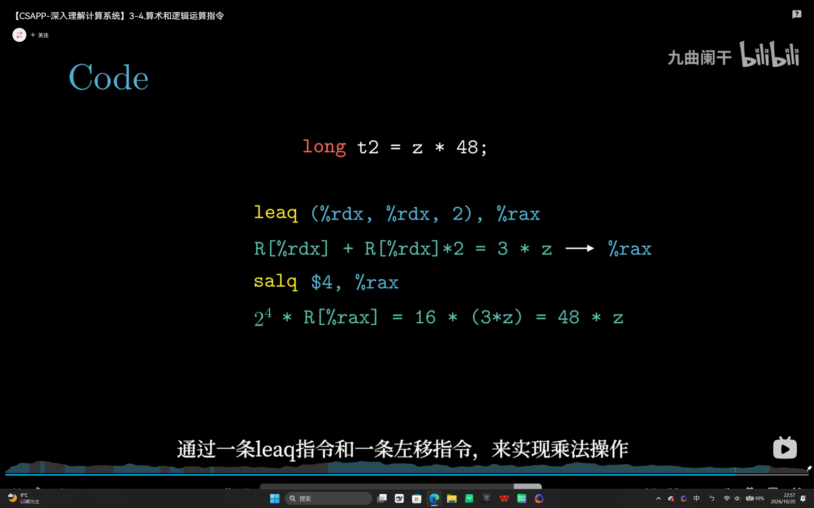

*▲ 图 3-5-11：先把 `z` 变成 `3z`（`leaq` 一条搞定），再左移 4 位乘 16，合起来正好 `48z`；全程没有用乘法器。*

```asm
# long t2 = z * 48;      z 在 %rdx
leaq  (%rdx,%rdx,2), %rax     # %rax = z + 2z = 3z
salq  $4, %rax                # %rax = 3z * 16 = 48z
```

拆法可以理解为 `48 = 3 × 16`：`leaq` 负责"乘 3"（比例因子允许 1、2、4，而 `1+2=3`），`sal` 负责"乘 16"。

### （2）为什么不直接 `imulq $48, %rdx, %rax`

那条指令确实存在（48 能编成 `imm8`），但现代 x86 上 `imul` 的**延迟约 3 个周期**，而 `lea` 和 `sal` 各只要 1 个周期：`lea`+`sal` 的关键路径是 2，比 `imul` 少一拍。在循环体、依赖链里，这一拍会被放大很多倍。此外两者用的是不同的执行端口，可以和其他指令并行发射。

这就是"**用 lea + shift 代替 imul**"的全部动机：不是省指令条数（都是两条），而是**压短延迟、错开端口**。同理，任何乘常数都能拆成"移位 + 加减"的组合，这也是 2.3.7 与 3.5.1 能接上的原因。

### （3）这些指令与 3.6 条件码的关系

3.5 的指令是**条件码的生产者**，3.6 是消费者：

```text
  addq/subq/imulq/salq …  ──写──▶  CF  ZF  SF  OF  ──读──▶  sete/setl、jne、cmov
  cmpq / testq            ──写──▶  （只置条件码，不写结果）
  leaq                    ──✗──▶  条件码（完全不碰，可安全插在 cmp 与 jne 之间）
```

- 要在 3.6 里判断 `a < b`，靠的是 `cmpq %rsi,%rdi` 先做一次"减法但不写结果"，把差值特征留在 `SF`/`OF`/`ZF` 里；
- 正因为 `leaq` 不写条件码，编译器可以放心地在比较与跳转之间插入地址计算；而 `xor %eax,%eax`、`addq $1,%rax` 这类指令会**覆盖**条件码，插进去就出错；
- 反过来，`subq` 自己也会置条件码，所以 `if (x - y > 0)` 常被编译成一条 `subq` 加一条 `jg`，不再单独 `cmp`。

---

## 3.5.5 特殊的算术操作

### （1）产生 128 位结果：`imulq S` 与 `mulq S`

普通的二元 `imulq S, D` 只保留低 64 位，高位直接丢掉。要拿到完整乘积，得用**单操作数**形式：它隐含 `%rax` 为一个乘数，结果写进 `%rdx:%rax`。

```text
              %rdx（高 64 位）               %rax（低 64 位）
   ┌──────────────────────────────┬──────────────────────────────┐
   │ imulq/mulq: 积的高半部分     │ 积的低半部分（%rax × S）     │
   │ idivq/divq: 被除数高半部分   │ 被除数低半部分 → 商回 %rax   │
   └──────────────────────────────┴──────────────────────────────┘
```

### （2）`cqto`：把 `%rax` 符号扩展到 `%rdx:%rax`

指令就是 `cqto`：`R[%rdx]:R[%rax] ← SignExtend(R[%rax])`。32 位下的对应指令是 `cltd`（把 `%eax` 符号扩展到 `%edx:%eax`）；有些资料把同一条指令写作 `clto`，两种写法指的是同一个操作。它的唯一用途是**为有符号除法准备 128 位被除数**。

### （3）`idivq` / `divq`：128 位除以 64 位

被除数一律是 `R[%rdx]:R[%rax]`，除以 `S` 之后商写 `%rax`、余数写 `%rdx`；区别只在除法前的准备：有符号用 `cqto` 做符号扩展，无符号用 `xor %edx,%edx` 把高位清 0。

```asm
# long divrem(long a, long b)   a:%rdi  b:%rsi
divrem:
    movq  %rdi, %rax     # 被除数的低 64 位
    cqto                 # 高 64 位 = %rax 的符号扩展 → 得到真正的 128 位被除数
    idivq %rsi           # %rax ← 商，%rdx ← 余数
    ret
```

有符号除法还要注意余数的符号：x86 的 `idiv` 与 C 的 `/`、`%` 一致，**向零截断**，所以余数与被除数同号（`-7 / 2 = -3`，`-7 % 2 = -1`）。

### （4）双字运算指令表

| 指令 | 效果 | 说明 |
| :--- | :--- | :--- |
| `imulq S` | `R[%rdx]:R[%rax] ← R[%rax] × S` | 有符号 128 位积 |
| `mulq S` | `R[%rdx]:R[%rax] ← R[%rax] × S` | 无符号 128 位积；低 64 位与 `imulq` 相同 |
| `cqto` | `R[%rdx]:R[%rax] ← SignExtend(R[%rax])` | 有符号除法前必备 |
| `idivq S` | 商 → `%rax`，余数 → `%rdx` | 有符号除，被除数 `%rdx:%rax` |
| `divq S` | 商 → `%rax`，余数 → `%rdx` | 无符号除 |

> [!WARNING]
> `idivq` 有两个致命细节。①**忘记 `cqto`**：`%rdx` 里若是上一次运算的垃圾，128 位被除数就会被放大，商可能装不进 64 位，触发 `#DE`（除法错误）异常——Linux 把它报成 `SIGFPE`，进程直接崩。②**除数为 0**：同样触发 `#DE`。这也是为什么 C 里 `a / b` 必须在语言层面保证 `b != 0`，而编译器不会替你插入检查。

---

## 📌 重点速记

```text
leaq S,D      : D ← &S = Imm + R[rb] + R[ri]*s    s=1/2/4/8   不访存、不改条件码
一元          : inc/dec D   neg D   not D          (inc/dec 不动 CF)
二元          : add/sub/imul/xor/or/and S,D        D ← D op S，目的不能是立即数
清零惯用法    : xor %eax,%eax（2 字节）→ CF=OF=0, ZF=1
移位          : sal/shl 左移补 0；sar 补符号位；shr 补 0
移位量        : 立即数 $k 或 %cl，只取低 m 位，2^m = w：b→3  w→4  l→5  q→6
双字乘        : imulq S / mulq S  →  R[%rdx]:R[%rax] = R[%rax] * S
符号扩展      : cqto              →  %rdx:%rax = SignExtend(%rax)
双字除        : idivq/divq S      →  商 %rax，余数 %rdx（被除数在 %rdx:%rax）
除零          : #DE 异常 → SIGFPE
乘常数        : z*48 = (3z)<<4    →  leaq + salq，躲开 imul 的 3 周期延迟
```

---

## ⚠️ 易错点

1. **以为 `leaq` 会读内存。** `leaq 8(%rax),%rdx` 只做 `%rdx = %rax + 8`，`(%rax)` 里的内容根本不参与；就算 `%rax` 指向非法地址也不会出错。
2. **把 `leaq` 的目的写成内存。** `leaq 8(%rax),(%rdx)` 非法——`lea` 的目的只能是寄存器，因为它的"结果"是一个地址值，不是要写回内存的数据。
3. **把 `subq` 的方向弄反。** `subq %rax,%rbx` 是 `%rbx ← %rbx − %rax`；AT&T 里**最后一个才是目的**。判题时先看逗号右边。
4. **以为 `%cl` 的 8 位全参与移位。** `movb $0x40,%cl; salq %cl,%rax` 一位都不移（低 6 位是 0）；`salq` 最多移 63 位，`salb` 最多移 7 位。
5. **`xor %eax,%eax` 当"无害清零"用。** 它会把 `CF`、`OF` 清 0、`ZF` 置 1，若紧跟在 `cmp` 后面就会毁掉比较结果；此时应改用不写条件码的 `movq $0,%rax`，或把清零挪到 `cmp` 之前。
6. **单操作数 `imulq` 只看 `%rax`。** `imulq %rsi` 之后 `%rdx` 被乘积高半部分**覆盖**，若 `%rdx` 里还有活跃变量就丢了；只要低 64 位请用二元 `imulq %rsi,%rdi`。
7. **`idivq` 前漏掉 `cqto`。** 典型现象是"除以 2 偶尔崩"，因为 `%rdx` 残留高位使商溢出。无符号除法同理，必须先 `xor %edx,%edx` 或 `movl $0,%edx`。

---

## ✅ 自测

1. `leaq 3(%rdi,%rsi,8),%rax` 计算什么？若 `%rdi=2`、`%rsi=5`，结果是多少？
2. 为什么 `leaq (%rax,%rax,12),%rdx` 汇编不通过？请用 `leaq` 算出 `13x`。
3. 若 `%cl = 0xFF`，`sarq %cl,%rax`、`sarb %cl,%dl` 实际各移几位？为什么硬件要这样设计？
4. 写出 `long q = a / b;` 对应的核心汇编，说明 `cqto` 的作用；若 `b == 0` 会发生什么？
5. 用两条指令实现 `z * 48`，并解释为什么不直接用 `imulq $48,%rdx,%rax`。

<details>
<summary>参考答案</summary>

1. 计算 `%rax = 3 + %rdi + 8 × %rsi`；代入得 `3 + 2 + 40 = 45`。这里 `%rsi` 是变址、比例因子 8、`3` 是偏移。
2. 比例因子只能编码 1/2/4/8，12 不在其中。把 `13x` 拆成 `8x + 5x`：`leaq (%rax,%rax,4),%rdx` 得 `5x`，再 `leaq (%rdx,%rax,8),%rdx` 得 `5x + 8x = 13x`。
3. `sarq` 取低 6 位：`0xFF & 0x3F = 63` 位；`sarb` 取低 3 位：`0xFF & 0x07 = 7` 位。硬件只保留 `log2(w)` 根控制线，省连线与译码，且保证结果确定。
4. `movq %rdi,%rax; cqto; idivq %rsi`，商在 `%rax`。`cqto` 把 `%rax` 符号扩展到 `%rdx`，凑齐 128 位被除数，避免 `%rdx` 残留导致商溢出。`b == 0` 触发 `#DE` 异常，Linux 上表现为 `SIGFPE`。
5. `leaq (%rdx,%rdx,2),%rax; salq $4,%rax`。因为 `48 = 3 × 16`：`lea` 造 `3z`，`sal` 乘 16。`imulq $48` 虽只有一条，但延迟约 3 周期，而 `lea`+`sal` 的关键路径只有 2 周期。

</details>

---

## 🔗 与其他章节的联系

| 本节内容 | 后续用在哪 |
| :--- | :--- |
| `leaq` 与地址公式 | 3.8 数组/结构体寻址、3.9 异构数据结构，下标换算全靠 `lea` |
| `leaq` 不写条件码 | 3.6 条件码与 `cmp`/`jne` 的指令调度 |
| 二元运算与标志位 | 3.6 `set`/`jmp`/`cmov`、4.2 HCL 的 ALU 与条件码逻辑 |
| 移位与乘除 | 2.3.7 乘常数优化、3.5.4 强度削弱 |
| `imulq`/`idivq` 双字形式 | 3.7 过程调用的返回值约定（`%rdx:%rax` 返回 128 位） |
| 除零异常 `#DE` | 8.1 异常控制流、8.4 信号（`SIGFPE`） |

---

[← 上一节：3.4 访问信息](3.4%20访问信息.md)　｜　[下一节：3.6 控制 →](3.6%20控制.md)
