# 3.6 控制

> **📖 本节定位**　第 3 章「程序的机器级表示」· 教材 P135–P164
> **一句话**：C 的 `if`、`while`、`for`、`switch` 到了机器级只剩两套招法——**条件码 + 跳转**（改控制流）与**条件码 + 条件传送**（改数据流）。

> [!IMPORTANT] 本节要回答的三个问题
> 1. 机器级没有 `if` / `while` 指令，CPU 到底根据什么决定"跳还是不跳"？
> 2. 为什么 `cmp` 算完不留下结果，`jl` 却知道 `a < b`？四个条件码各管什么？
> 3. 编译器什么时候用 `cmov`、什么时候用跳转表，又为什么有时偏要写 `cmp` + `jXX`？

**读之前你需要会**：3.5 的 `cmp` / `sub` / `test` 会写条件码、`leaq` 不写；以及 C 的 `if`、`while`、`for`、`switch` 语法。都不会也没关系——本节会把用到的部分重新解释。

[← 上一节：3.5 算术和逻辑操作](3.5%20算术和逻辑操作.md)　｜　[下一节：3.7 过程 →](3.7%20过程.md)

---

## 🎯 核心结论

| # | 结论 |
| :-: | :--- |
| 1 | 条件码 `CF/ZF/SF/OF` 是 CPU 的"体检报告"：一切条件判断最终都化为对这 4 个 1 位标志的测试 |
| 2 | `cmp` = `sub` 相减但**不写回**，`test` = `and` 相与但**不写回**，二者只更新条件码 |
| 3 | `setXX` 把条件码变成 0/1 字节；**有符号比较靠 `SF^OF`，无符号比较靠 `CF`** |
| 4 | `jmp` 无条件转移，`jXX` 条件转移，条件表与 `setXX` **完全同构**；条件分支 = 「测试 + 跳转」 |
| 5 | 条件传送 = 「两条路都算 + `cmov` 选一个」，用数据流替掉控制流，绕开分支预测失败；`switch` 则用**跳转表**把 O(n) 次比较压成 1 次 |

---

## 3.6.1 条件码

### 先建立直觉：CPU 顺手记下的四张小纸条

**先说它想解决什么问题**：执行 `if (a < b)` 时，CPU 并不会"理解小于"。它只会做减法 `a - b`，**而且通常不会把差告诉你**；真正留下来供下一条指令判断的，是减法过程中顺手记下的四个 1 位性质。

```text
   你让 CPU 算 a - b
        │
        ├── 差 → 如果你要，才写进寄存器
        └── 顺手写四张小纸条（条件码）
             CF：无符号看，有没有进位/借位？ 1 = 有
             ZF：结果是不是 0？              1 = 相等
             SF：结果的最高位是不是 1？      1 = 看起来是负的
             OF：有符号看，结果有没有溢出？  1 = 符号被算翻了
```

**一句话直觉**：条件码是 CPU 为"最近一次运算"留下的**四张便签**，也就是一组**隐式的中间结果**；`cmp` 只是故意只写便签、不把差写回寄存器。

先把"处理器状态"摆齐：程序运行到哪、上一步算出了什么性质，分别由 `%rip` 和条件码记录；本节的所有条件判断，最后都落在这两块状态上（`cmov` 则把条件码变成数据选择）。

| 状态 | 典型存放 | 与本节的关系 |
| :--- | :--- | :--- |
| 临时数据 | `%rax`…`%r15` | `cmp`/`test` 的操作数，`cmov` 的源与目的 |
| 运行时栈 | `%rsp` | 3.7 过程调用才展开；本节例子不依赖它 |
| 当前控制点 | `%rip` | `jmp`/`jXX` 改写它；3.6.4 讲跳转指令的偏移编码 |
| 条件码 | `CF`/`ZF`/`SF`/`OF` | 本节核心：所有条件判断都读它 |

**形式化定义**：
CPU 除 16 个通用寄存器外，还维护一组 **1 位的条件码（condition code）寄存器**，描述**最近一次算术/逻辑运算**结果的性质：

| 标志 | 名称 | 置 1 的条件 | 谁用它 |
| :-: | :--- | :--- | :--- |
| `CF` | 进位 Carry Flag | 无符号运算最高位产生**进位**（加）或**借位**（减） | 无符号比较、多字长加减 |
| `ZF` | 零 Zero Flag | 运算结果为 **0** | `a == b`、循环是否结束 |
| `SF` | 符号 Sign Flag | 结果的**最高位为 1**（按有符号看是负数） | `a < 0`、有符号比较 |
| `OF` | 溢出 Overflow Flag | **有符号**结果超出表示范围（正+正得负、负+负得正） | 有符号比较的修正项 |

<details>
<summary>✅ 检查点 1：`cmpq %rsi, %rdi` 与 `subq %rsi, %rdi` 置的条件码一样吗？</summary>

一样。两条指令走同一条减法通路，`CF/ZF/SF/OF` 的置位规则完全相同；唯一差别是 `subq` 还会把差写回 `%rdi`，`cmpq` 不写回。所以只要不关心那个差，用哪个来判断都行。
</details>

> [!NOTE]
> 条件码描述的是"**最近一条**影响它们的指令"。它们没有名字，不能直接 `movq` 出来，只能经 `setXX` / `jXX` / `cmovXX` 间接使用（3.6.2、3.6.3）。

### （1）先认识 CF 与 ZF

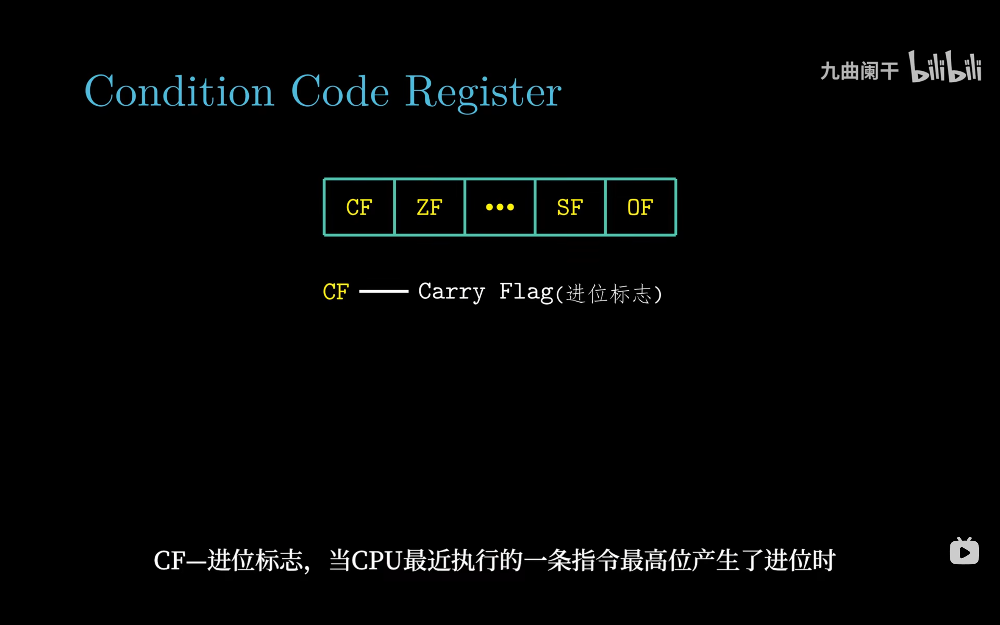

*▲ 图 3-6-1：条件码寄存器的位布局，本节只关心 `CF`、`ZF`、`SF`、`OF` 四格。图下方点明 CF 的判据——「最近执行的指令最高位产生了进位」；关键在"最高位"，所以 CF 只对**无符号**解释有意义。*

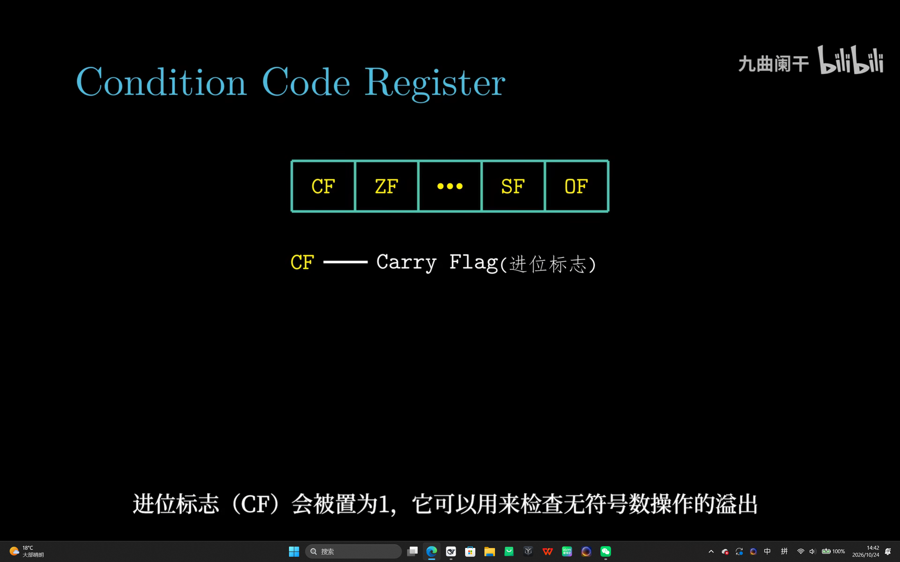

*▲ 图 3-6-2：同一页的下一帧，字幕把话说完——进位标志被置 1，就可以用来检查**无符号数**运算的溢出。把它和 SF/OF 对照记：CF 管无符号、OF 管有符号。*

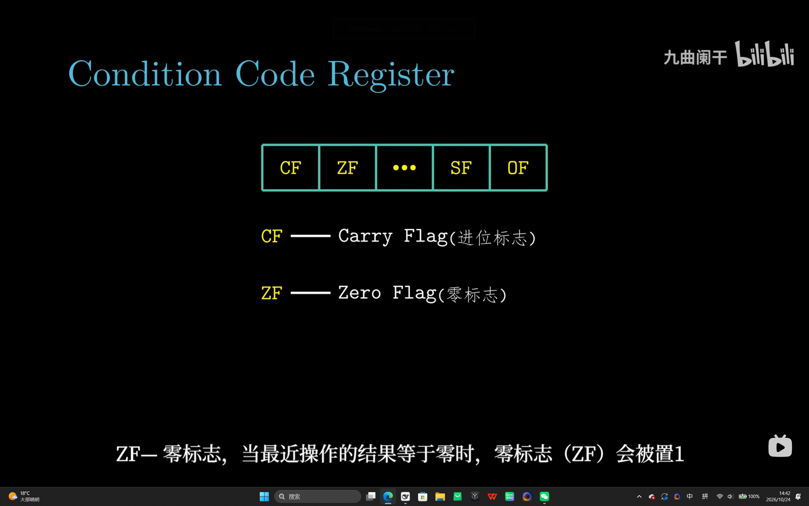

*▲ 图 3-6-3：CF 与 ZF 并排。ZF 的判据是「最近操作的结果等于零」，与操作数有没有符号**无关**——所以 `je / jne / sete / setne` 只认 ZF，不认 SF。*

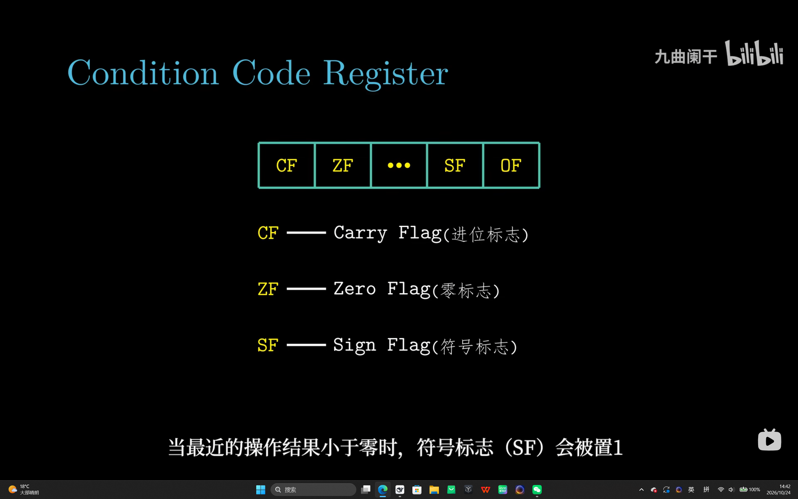

*▲ 图 3-6-4：第三格点亮。SF 就是**结果的最高位**——结果为负只是这个位为 1 的另一种说法，所以它服务于有符号比较与 `sets`。*

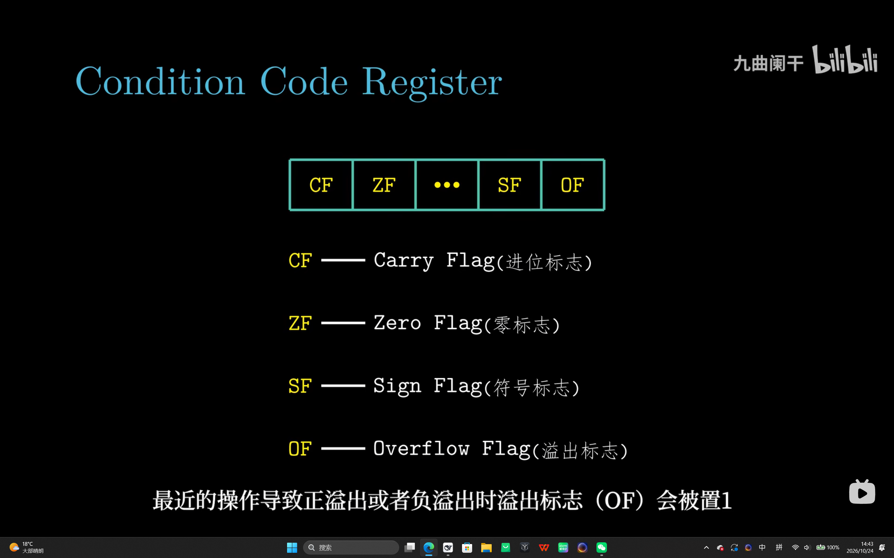

*▲ 图 3-6-5：四格全亮。到这里规律已经清楚：CF/SF 各看一位，ZF 看是否全零，OF 看符号有没有被加翻。下一张会在下面补一行红字，把 OF 的适用范围钉死。*

把四位凑齐，顺便记住最下面那行标注：

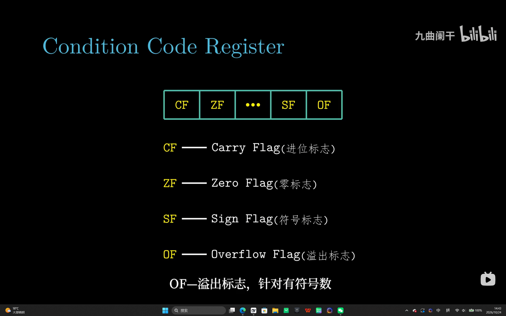

*▲ 图 3-6-6：**OF 是针对有符号数的**——只有把结果当有符号数看，"溢出"才有意义。同一个 `0xFF`，当无符号 255 不溢出，当有符号 −1 也不溢出，溢出与否取决于解释方式。*

### （2）亲手算一遍四个标志

设 `%rax = 0x7FFF FFFF FFFF FFFF`（即 $2^{63}-1$）、`%rdx = 1`。`addq %rdx,%rax` 得 `0x8000…00`：没有进位（CF=0），但正+正得负 → **OF=1**。把 `%rax` 清 0 后再 `subq %rdx,%rax` 得 `0xFFFF…FF`：无符号借位 → **CF=1**；而当有符号看是 −1、完全合法 → OF=0。

**同一份结果 `0xFFFF FFFF FFFF FFFF`，读法不同结论就不同**：按无符号看是 $2^{64}-1$（发生借位，CF=1），按有符号看是 −1（无溢出，OF=0）——这是 2.2 节"同一位模式、两种解释"在标志位上的翻版。

顺带记住：**`lea` 不碰条件码**。`leaq 8(%rdi,%rsi,4), %rax` 只做地址算术、不产生"要写回的结果"，所以四位一个都不动；编译器要在两条需保持条件码的指令之间算地址时，会特意挑 `lea` 而不是 `add`。

**把置位规则写成式子**（`addq` 记 `t = a + b`，`cmpq Src1,Src2` 记 `t = Src2 - Src1`，其中 `a` 是目的操作数）：

```text
addq:  CF = 最高位有进位              ZF = (t == 0)   SF = (t < 0)
       OF = (a>=0 && b>=0 && t<0) || (a<0 && b<0 && t>=0)

cmpq:  CF = (unsigned)a < (unsigned)b  ZF = (t == 0)   SF = (t < 0)
       OF = (a>=0 && b<0 && t<0) || (a<0 && b>=0 && t>0)
```

`OF` 的两条式子正好概括了"什么时候才可能溢出"：**加法看同号**（两个非负、两个负），**减法看异号**（非负−负、负−非负）；同号相减不可能溢出。注意 `0 − (−128)` 也会溢出，所以减法式子里用的是 `a >= 0` / `b >= 0`，不能把 0 漏掉（课件 p5 写成 `a > 0`，会漏掉这个边界）。3.6.2 的四情形表就是把这式子拆开验算。

### （3）`cmp` 与 `sub`，`test` 与 `and`

```asm
cmpq %rax, %rdx        # 算 %rdx - %rax，只置条件码
subq %rax, %rdx        # 算 %rdx - %rax，置条件码 **并**写回 %rdx
testq %rax, %rdx       # 算 %rdx & %rax，只置条件码
andq  %rax, %rdx       # 算 %rdx & %rax，置条件码 **并**写回 %rdx
```

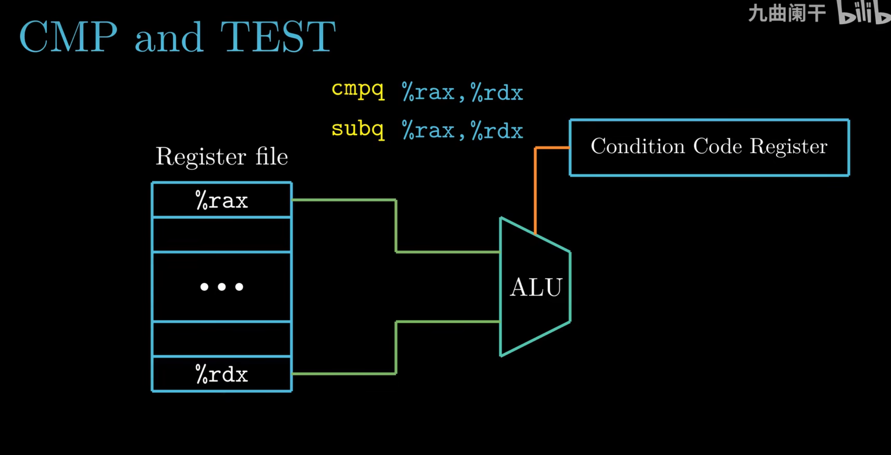

*▲ 图 3-6-7：`cmpq` 与 `subq` 走**同一条** ALU 通路，都更新右侧的条件码寄存器；唯一区别是写回寄存器堆的那根线——`cmpq` 没有它。这就是"`cmp` 与 `sub` 的唯一差别是不写回结果"的硬件版本。*

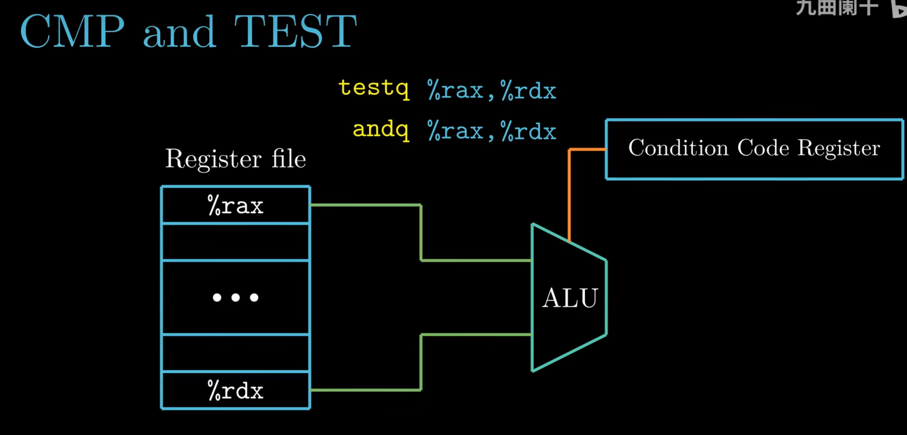

*▲ 图 3-6-8：`testq` / `andq` 完全同理，只是 ALU 做按位与。正因为结果等于操作数本身，`testq %rax,%rax` 成了"判断 `%rax` 是否为 0 / 最高位是否为 1"的标准写法。*

> [!IMPORTANT]
> `cmp`/`test` 与 `sub`/`and` 的**条件码副作用完全相同**。所以"`cmpq %rsi,%rdi` 之后 `jl` 跳不跳"与"`subq %rsi,%rdi` 之后 `jl` 跳不跳"答案一致（前提是 `subq` 的写回不影响后续代码）。

`test` 最常见的另一副面孔是**掩码**：`testq $0x1,%rdi` 只问最低位是不是 1（`ZF=0` 即该位为 1），`testb $0x80,%al` 只问最高位。它等价于 `and` 但不破坏原值，并且**强制 `CF=OF=0`**——所以 `test` 之后不可能靠 `jc` 判断进位，那条路永远不跳。

### （4）谁写条件码，谁只读

| 指令族 | 对条件码的影响 |
| :--- | :--- |
| `leaq` | **四位全不改** |
| `addq` / `subq` / `negq` | 四位都改 |
| `imulq` | 只有 `CF/OF` 有意义（乘积超 64 位时置 1）；`SF/ZF` 无定义 |
| `andq` / `orq` / `xorq` | `CF = OF = 0`，`ZF/SF` 按结果 |
| `incq` / `decq` | 改 `ZF/SF/OF`，**故意不动 `CF`**（便于多字长加法链） |
| `cmpq` / `testq` | 同 `subq` / `andq`，但不写回 |
| `setXX` / `jXX` / `cmovXX` | **只读，不写** |

**"写"条件码的指令与"读"条件码的指令必须紧邻**：中间插进任何一条 `add` / `xor` / `cmp`，前面的结论就作废了。

---

## 3.6.2 访问条件码

条件码只有 1 位，搬不进通用寄存器。x86-64 给了一族 **`set` 指令**：按条件码的组合，把目标操作数的**最低字节**置成 0 或 1。

### （1）从 `sete` 开始

```asm
comp:                     # int comp(long a, long b) { return a == b; }
    cmpq %rsi, %rdi       # 算 a - b，只置条件码
    sete %al              # ZF == 1 ? %al = 1 : %al = 0
    movzbl %al, %eax      # 1 字节零扩展成 32 位 → 作为 int 返回
    ret
```

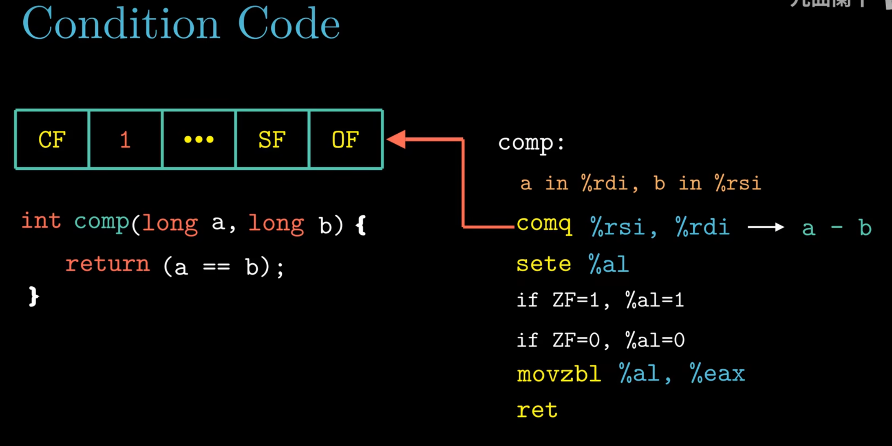

*▲ 图 3-6-9：`sete` 只写 `%al` 一个字节，所以后面必须跟 `movzbl %al,%eax` 把高 24 位清零；而 `%eax` 一写，`%rax` 的高 32 位也自动清零。图右侧标了 `if ZF=1, %al=1 / if ZF=0, %al=0`。（课件把 `cmpq` 误印成了 `conq`，以 `cmpq` 为准。）*

### （2）`char` 版：指令后缀跟着操作数走

```asm
comp:                     # int comp(char a, char b) { return a < b; }
    cmpb %sil, %dil       # 按 1 字节比较，后缀是 b
    setl %al              # 有符号小于 → SF^OF
    movzbl %al, %eax
    ret
```

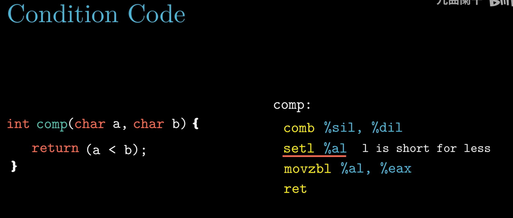

*▲ 图 3-6-10：参数是 `char`，所以 `cmp` 写成 `cmpb`、操作数用 `%sil / %dil`（`%rsi/%rdi` 的低 8 位）。`setl` 里的 `l` 是 **less** 的缩写，不是"long"——这点极易看错。（课件把 `cmpb` 印成了 `comb`，不是合法助记符，以 `cmpb` 为准。）*

### （3）为什么有符号比较是 `SF ^ OF`

`a < b` 等价于判断 `t = a - b` 的符号。不会溢出时 `t` 的符号（SF）就是答案；一旦溢出，符号就"翻"了，而 `OF` 恰好记录翻没翻，于是 $a < b \iff SF \oplus OF = 1$。四种情形（8 位数，范围 −128 ~ 127）：

| # | 情形 | 例子 | $t = a-b$ | SF | OF | `SF^OF` | 与 `a<b` 一致？ |
| :-: | :--- | :--- | :--- | :-: | :-: | :-: | :-: |
| 1 | 无溢出且 $t<0$ | a=−5, b=3 | −8 | 1 | 0 | **1** | ✅ 是 |
| 2 | 无溢出且 $t>0$ | a=3, b=−5 | 8 | 0 | 0 | **0** | ✅ 是 |
| 3 | **负溢出**：$t<0$ 却回绕成正 | a=−2, b=127 | −129 → **+127** | 0 | 1 | **1** | ✅ 是 |
| 4 | **正溢出**：$t>0$ 却回绕成负 | a=1, b=−128 | 129 → **−127** | 1 | 1 | **0** | ✅ 是 |

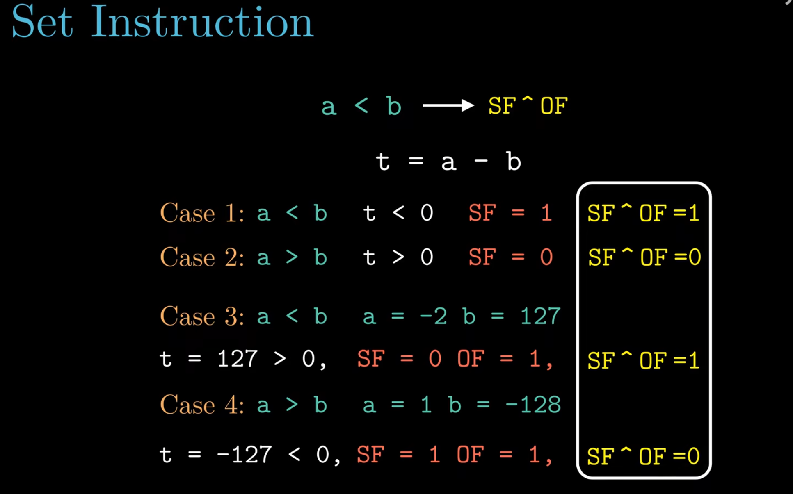

*▲ 图 3-6-11：Case 1/2 是"不溢出"的常规情况，SF 直接就是答案；Case 3/4 是**溢出**的反直觉情况——`a=−2, b=127` 时 `a−b=−129` 塞不进 8 位，回绕成 `+127`（SF=0），但 OF=1 把这个"谎"修正了，`SF^OF=1` 依然正确回答"a<b"。右侧白框就是结论列。Case 4 尤其容易被符号位骗：`a=1` 明显大于 `b=−128`，可 `t=−127` 的 SF=1，**只看 SF 会判成 a<b**——这就是 `OF` 存在的全部理由。*

#### 一起算一遍

把 `a = −2`、`b = 127` 放进 8 位寄存器，执行 `cmpb %bl, %al`（即 `a − b`），逐位看四张便签：

| 步骤 | 动作 | 二进制 / 结果 | 便签 |
| :-: | :--- | :--- | :--- |
| ① | 写出补码 | `a = −2 = 1111 1110`；`b = 127 = 0111 1111` | — |
| ② | 求 `−b` 的补码 | 取反 `1000 0000`，加 1 得 `1000 0001`（`−127`） | — |
| ③ | 把减法变加法 | `1111 1110 + 1000 0001 = 1 0111 1111` | 8 位只留 `0111 1111 = +127` |
| ④ | 看最高位 | 结果的最高位是 0 | `SF = 0` |
| ⑤ | 看无符号借位 | 无符号 `254 − 127` 够减（③ 多出的最高位是加法进位，不是减法借位） | `CF = 0` |
| ⑥ | 看有符号范围 | 真值 `−129` 超出 `[−128, 127]` | `OF = 1` |
| ⑦ | 结果非 0 | `+127 ≠ 0` | `ZF = 0` |

**关键的一步是解释 `SF=0` 为什么不能直接回答"不小于"**：真实差是 `−129`，可 8 位寄存器只能装下 `+127`，符号位被回绕"洗白"了。`OF=1` 正是在喊"这个符号不可信"，于是用 `SF ⊕ OF = 0 ⊕ 1 = 1` 把结论修正回"`a < b` 成立"。这也正是 `setl` / `jl` 用 `SF^OF` 而不是只看 `SF` 的原因。

> [!NOTE] 换个角度想
> 如果没有条件码，编译器要实现 `a < b`，就得把差写进一个临时寄存器，再用另一条指令取符号位、还要单独判 0，既占寄存器又拉长依赖链。条件码相当于让 ALU **免费附赠**一份"结果性质"；代价是它是全局隐式状态，所以 `cmp` 与 `jXX` 之间不能随便插别的运算。

### （4）无符号比较：只看 `CF`

无符号减法 `a − b` 时，若 `a < b` 必然要**借位**，CF=1，所以根本用不着 OF/SF：

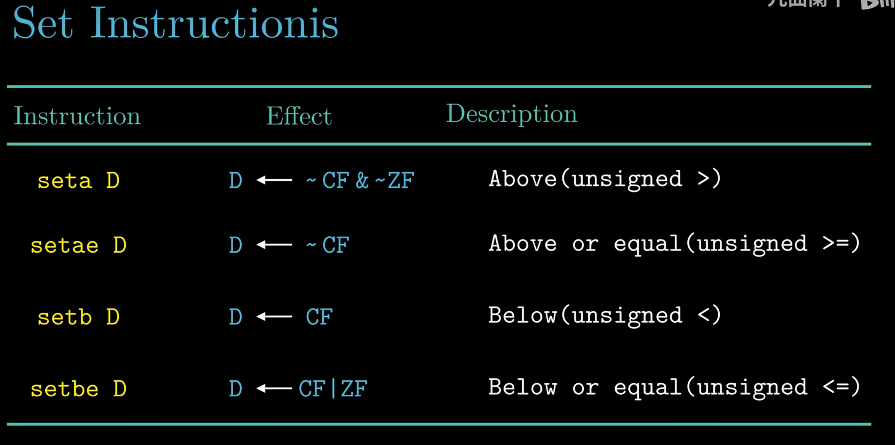

*▲ 图 3-6-12：`seta / setae / setb / setbe` 的条件只用到 `CF`（`seta` 再加一个 `~ZF`）。记忆法：**above / below 给无符号数用，greater / less 给有符号数用**——英文备两套词，就是为了不让你混。*

### （5）`set` 指令总表

| 指令 | 条件 | 含义 | `cmpq b,a` 之后的 C 表达式 |
| :--- | :--- | :--- | :--- |
| `sete D` | `ZF` | 相等 / 为零 | `a == b` |
| `setne D` | `~ZF` | 不等 / 非零 | `a != b` |
| `sets D` | `SF` | 负数 | `a < 0` |
| `setns D` | `~SF` | 非负 | `a >= 0` |
| `setg D` | `~(SF^OF) & ~ZF` | 有符号大于 | `a > b` |
| `setge D` | `~(SF^OF)` | 有符号大于等于 | `a >= b` |
| `setl D` | `SF^OF` | 有符号小于 | `a < b` |
| `setle D` | `(SF^OF) \| ZF` | 有符号小于等于 | `a <= b` |
| `seta D` | `~CF & ~ZF` | 无符号大于 | `a > b` |
| `setae D` | `~CF` | 无符号大于等于 | `a >= b` |
| `setb D` | `CF` | 无符号小于 | `a < b` |
| `setbe D` | `CF \| ZF` | 无符号小于等于 | `a <= b` |

GNU 汇编器还接受同义拼写：`setz`/`setnz`、`setnge`/`setng`、`setnle`/`setnl`、`setnbe`/`setnb`、`setnae`/`setna`；反汇编里看到它们别当成新指令。

### （6）`set` 只写 1 个字节

`sete %al` 只改 `%al`，`%rax` 的高 56 位**保持原样**；直接把 `%rax` 当返回值，高位就是垃圾。标准套路永远是"`set` + 扩展"：最常见是 `movzbl %al, %eax`（零扩展成 0/1 的 `int`）；要"真 = −1"语义用 `movsbq %al, %rax`；存成 `char`/`bool` 变量则直接 `movb %al, (%rsp)`。

---

## 3.6.3 跳转指令

### （1）`jmp` 与 `jXX`

`jmp` 无条件把控制转到**标号**处；`jXX` 只有条件满足才跳。条件表与 `setXX` **同构**——同一套条件码组合，只是一个写字节、一个改 PC：

| 指令 | 条件 | 含义 |
| :--- | :--- | :--- |
| `jmp Label` | 1 | 无条件 |
| `je` / `jz` | `ZF` | 相等 / 为零 |
| `jne` / `jnz` | `~ZF` | 不等 / 非零 |
| `js` / `jns` | `SF` / `~SF` | 负 / 非负 |
| `jg` / `jnle` | `~(SF^OF) & ~ZF` | 有符号 > |
| `jge` / `jnl` | `~(SF^OF)` | 有符号 >= |
| `jl` / `jnge` | `SF^OF` | 有符号 < |
| `jle` / `jng` | `(SF^OF) \| ZF` | 有符号 <= |
| `ja` / `jnbe` | `~CF & ~ZF` | 无符号 > |
| `jae` / `jnb` | `~CF` | 无符号 >= |
| `jb` / `jnae` | `CF` | 无符号 < |
| `jbe` / `jna` | `CF \| ZF` | 无符号 <= |

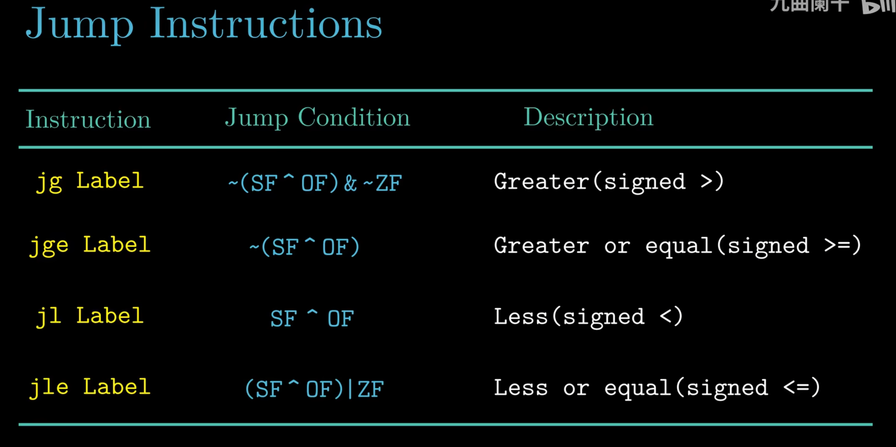

*▲ 图 3-6-13：有符号四条跳转的条件表达式，与 `setg/setge/setl/setle` 逐字相同——唯一差别是满足时"改 PC"而不是"写字节"。*

> 记一个坑：`js` 只看 `SF`、不看 `OF`，所以"减法后判断是否小于 0"不能直接用 `js`——溢出时它给相反结论，必须用 `jl`（`SF^OF`）。

### （2）`absdiff_se`：一条 `jl` 分两路

```c
long absdiff_se(long x, long y)
{
    long result;
    if (x < y) result = y - x;
    else       result = x - y;
    return result;
}
```

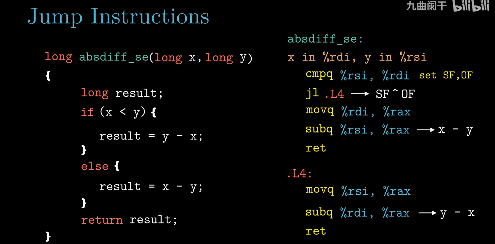

*▲ 图 3-6-14：`cmpq %rsi,%rdi` 把 SF/OF 置好，`jl .L4` 依据 `SF^OF` 决定是否跳到"y−x"那块。注意方向：C 里 `x<y` 走 **then**，汇编里 `x<y` 却是**跳到后面那块**——这就是 3.6.5 要讲的"条件取反 + 交换块顺序"。*

```asm
absdiff_se:
    cmpq %rsi, %rdi        # 算 x - y，置 SF、OF
    jl   .L4               # x < y → 跳到后置块
    movq %rdi, %rax        # else：rax = x
    subq %rsi, %rax        #       rax = x - y
    ret
.L4:
    movq %rsi, %rax        # then：rax = y
    subq %rdi, %rax        #       rax = y - x
    ret
```

### （3）跳转目标：标号 or 寄存器

```asm
    jmp .L2                # 直接跳转：目标是代码里的标号
    jmp *%rax              # 间接跳转：目标地址在 %rax 里
    jmp *(%rax)            # 间接跳转：目标地址取自内存
```

`*` 是"间接"的标记，读作"跳到 `%rax` 里存的那个**地址**去"。`switch` 的跳转表（3.6.8）用的就是 `jmp *%rax`；函数指针调用在 3.7 会再见。

---

## 3.6.4 跳转指令的编码

汇编器把 `jmp .L2` 变成机器码时有两种思路：**PC 相对**（记"跳多远"）与**绝对**（记"跳去哪"）。

### （1）PC 相对：编码里存的是偏移

| 形式 | 机器码 | 偏移宽度 | 目标计算 |
| :--- | :--- | :-: | :--- |
| 短跳转 | `eb cb` | 1 字节 | 下一条指令地址 + 符号扩展的 `cb` |
| 近跳转 | `e9 cd` | 4 字节 | 下一条指令地址 + 符号扩展的 `cd` |

基准是**跳转指令的下一条指令的地址**，也就是执行该跳转时 `%rip` 已自增后的值。

```text
4004d3:  eb 08             jmp 4004dd     ; 指令长 2，下一条在 0x4004d5
4004e0:  eb f6             jmp 4004d8     ; 偏移 0xf6 = −10，下一条在 0x4004e2
4004e5:  e9 f6 ff ff ff    jmp 4004e0     ; 指令长 5，下一条在 0x4004ea
```

- 第一行（前向跳）：`0x4004d5 + 0x08 = 0x4004dd`；第二行（后向跳）：`0x4004e2 + (−10) = 0x4004d8`——负偏移正是循环"往回跳"的编码基础，3.6.7 的每个循环都靠它。
- 第三行：偏移**同样**是 −10，但基准变成 `0x4004ea`，落点就是 `0x4004e0`——**同一偏移、不同基准，差 8 字节**；PC 相对的基准永远紧跟在本条跳转之后。

### （2）绝对：指令里直接写地址

绝对形式把地址直接写进指令：`ff 25 78 05 40 00` 就是 `jmp *0x400578`（4 字节绝对地址），`ff e0` 就是 `jmp *%rax`（地址来自寄存器）。

> [!NOTE]
> **辨析**：x86 的 `e9` 后面那 4 个字节**永远是相对位移**，不是绝对地址——有些资料把它说成"`e9` + 32 位地址"的绝对编码，其实混淆了两种形式。真正"指令里含绝对地址"的是间接形式 `ff 25` + 4 字节地址（`jmp *0x400578`），以及 32 位平坦地址空间里的老式写法；64 位 ELF 里这类绝对地址几乎已被"RIP 相对 + 间接"取代。

### （3）为什么偏爱 PC 相对

| 好处 | 说明 |
| :--- | :--- |
| **指令更短** | 同函数内跳转用 `eb` + 1 字节偏移，共 **2 字节**；绝对形式至少 5~6 字节 |
| **代码可重定位（PIC）** | 偏移只与"两条指令的相对距离"有关，函数搬到内存任何位置都不变，**加载器一个字节都不用改**；这同时支撑了共享库（被映射到每个进程的不同地址，绝对地址没法预先写死，第 7 章） |

同一条原则在 3.6.8 的跳转表里再次出现：表项存的也是"**标号 − 表基址**"的相对量（这是 PIC 版；课件另有 8 字节绝对表，见 3.6.8（5））。

顺带说 `rep ret`：`objdump` 里常见函数以 `rep ret`（`f3 c3`）结尾——`rep` 本是字符串指令前缀，贴在 `ret` 前 CPU 会忽略它。编译器这么做是为了**对齐**：让返回点落在更规整的地址上，并避开某些微架构对 `ret` 目标预测的惩罚。类似的填充还有 `nop`、`nopl 0(%rax)` 和伪指令 `.p2align 4`。

---

## 3.6.5 用条件控制来实现条件分支

### （1）统一模板：测试 + 跳转

C 的 `if-else` 在机器级只有一条路：**把条件算成条件码，再用条件跳转决定走哪块**。教材给出的通用模板（C 的 goto 形式）：

```c
    t = test-expr;
    if (!t) goto false;
    then-statement;
    goto done;
false:
    else-statement;
done:
```

```text
   test-expr ──► jXX false ──► else-statement ──┐   （jXX 用取反后的条件）
        │                                       │
        └──► then-statement ──► jmp done ───────┴──► done:
```

把 `absdiff_se` 套进这个模板就是 `if (x >= y) goto Else;`——注意判断被**取反**了（完整的 C 与汇编对照见上一小节的 `absdiff_se`：`jl .L4` 就是那个"取反"）；编译器还可能把 **else 块放到前面**，于是条件再翻一次。所以读汇编看到 `jge` / `jl` 与源码方向相反别慌，那往往只是块顺序问题。

**课件的 old-style 开关**：`gcc -Og -S -fno-if-conversion control.c`。`-fno-if-conversion` 禁止编译器把 `if` 改写成 `cmov`，所以能稳定看到 `cmpq` + `jle` 的纯跳转版；不加它，gcc 可能把 `absdiff` 改写成 3.6.6 的 `cmovle` 版（是否改写取决于 gcc 版本与优化选项）。教材与课件里同一个函数出现两种汇编，往往只是编译选项不同，不是代码变了。

### （2）分支预测失败的代价

现代 CPU 是流水线的（第 4 章）：取指阶段就要猜"下一条指令在哪"。遇到条件跳转时它**不知道**条件是否成立，只能猜：

```text
取指:  jXX → A → B → C ……            （猜"不跳"，沿顺序取指）
执行:             条件算出 = 跳！→ 前面十几级全部作废 flush
                   → 从正确目标重新取指，白扔 15~20 个周期
```

教材给的量级：一次预测错误约损失 **15~20 个时钟周期**。所以循环边界几乎总能预测对（跳 N−1 次、不跳 1 次），代价可忽略；而 `if` 条件**随机**时错误率接近 50%，代价惊人——这正是 3.6.6 的 `cmov` 要解决的问题。

---

## 3.6.6 用条件传送来实现条件分支

### （1）换个思路：两条路都算，再"选"

条件传送（conditional move）不改控制流，只改**数据流**：

```text
              ┌───────────────────────┐
   x, y ─────►│ 计算 then 分支的值 v1  │──┐
   x, y ─────►│ 计算 else 分支的值 v2  │──┼──► cmovXX 二选一 ──► 结果
              └───────────────────────┘  │         ▲ 条件码（前面的 cmp 置好）
                                          └─────────┘
```

### （2）`cmovdiff` 实例

```c
long cmovdiff_se(long x, long y)
{
    long rval = y - x, eval = x - y;
    if (x >= y) rval = eval;
    return rval;
}
```

```asm
cmovdiff_se:
    movq %rsi, %rdx        # rdx = y
    subq %rdi, %rdx        # rdx = y - x        （rval）
    movq %rdi, %rax        # rax = x
    subq %rsi, %rax        # rax = x - y        （eval）
    cmpq %rsi, %rdi        # 比较 x : y
    cmovge %rdx, %rax      # 若 x >= y，则 rax = rdx（改成 rval）
    ret
```

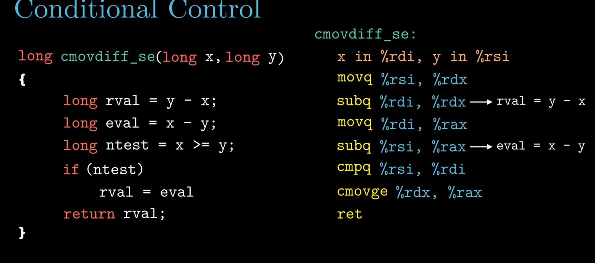

*▲ 图 3-6-15：两条 `subq` **都执行了**（`%rdx` 与 `%rax` 各算一个差），最后一句 `cmovge` 才按 `x>=y` 决定把哪一个搬进返回值。C 里那个 `if` 在汇编里彻底消失——没有比较跳转，只有一次数据选择。*

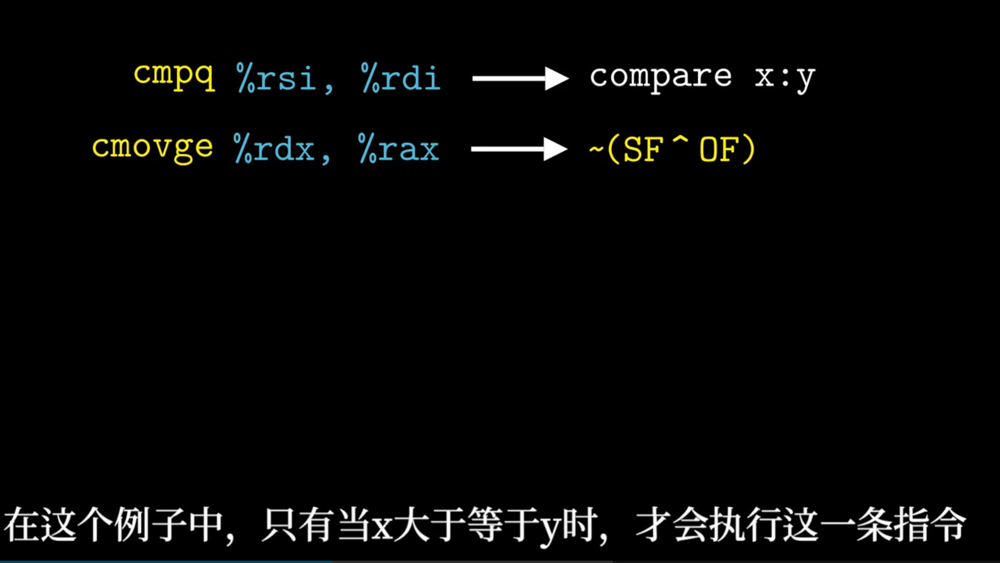

*▲ 图 3-6-16：把最后两条放大——`cmpq %rsi,%rdi` 置条件码，`cmovge %rdx,%rax` 仅在 `SF^OF=0`（即 `x>=y`）时把 `%rdx` 写进 `%rax`；否则 `%rax` 原封不动，保留已算好的 `x−y`。*

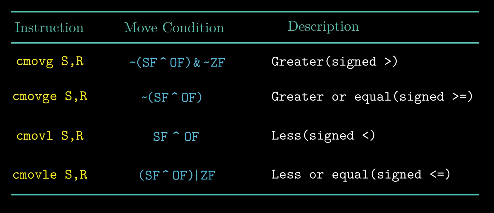

*▲ 图 3-6-17：`cmov` 的条件与 `set` / `jXX` 仍是同一套。`cmovge S,R` 读作"若 `SF^OF=0`（大于等于），则 `R ← S`"；注意 AT&T 里**源在前、目的在后**，目的必须是寄存器。完整一族：有符号 `cmovg/cmovge/cmovl/cmovle`，相等 `cmove/cmovne`，符号 `cmovs/cmovns`，无符号 `cmova/cmovae/cmovb/cmovbe`。*

### （3）为什么这样更快

`cmovdiff` 里两条 `subq` 各 1 个周期，多算一条几乎免费；而一次预测失败能顶 15 条 `subq`。所以"两条路径都很便宜"时，条件传送稳赢——它把**控制冒险**换成了**多余计算**。

### （4）`cmov` 不是万能的

关键前提：**两条路径都必须能安全地、无条件地提前算出来**。

```c
long cread(long *xp) {
    return (xp ? *xp : 0);     /* 若用 cmov 实现…… */
}
```

用 `cmov` 就得先算 `*xp`——`xp == NULL` 时直接**段错误**；而 C 的 `?:` 保证"条件为假时不求值"。所以 `cread` 只能用分支实现（gcc 确实生成 `testq %rdi,%rdi` + `je`）。

其余三类雷区：**有副作用**（`i++ > 0 ? f() : g()` 会把两个函数都调用）、**计算昂贵**（`x > 0 ? sqrt(a) : log(b)` 两条都算，代价翻倍）、**可能触发异常**（`b ? a / b : 0` 在 `b == 0` 时除零）。

> [!WARNING]
> `?:` 不等于"一定会编译成 `cmov`"。gcc 只在**能证明安全且划算**时才做 if-conversion，C 里也没有"强制条件传送"的语法。反过来说，汇编里出现 `cmov`，就说明编译器已确认两条路径都无副作用、不会出错。

---

## 3.6.7 循环

机器级没有"循环"这条指令——循环 = **条件测试 + 往回跳**。C 的三种循环形式对应三种骨架。

### （1）`do-while`：先做后测

```c
long fact_do(long n)
{
    long result = 1;
    do { result *= n; n = n - 1; } while (n > 1);
    return result;
}
```

```asm
fact_do:
    movl $1, %eax          # result = 1
.L2:
    imulq %rdi, %rax       # result *= n
    subq $1, %rdi          # n = n - 1
    cmpq $1, %rdi          # 比较 n : 1
    jg   .L2               # n > 1 → 回头再算一遍
    rep ret
```

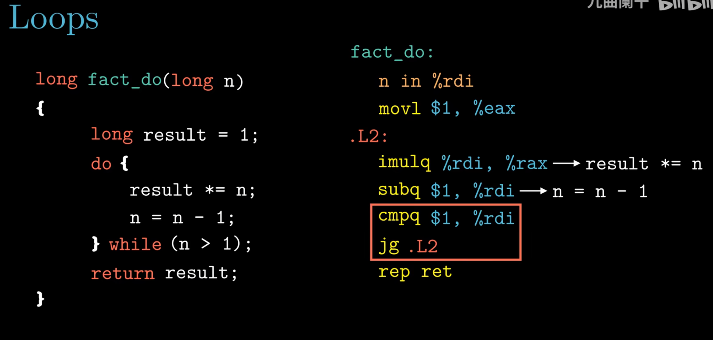

*▲ 图 3-6-18：循环体（`imulq` + `subq`）在前，测试（红框里的 `cmpq` + `jg`）在后，`jg` 成立就跳回 `.L2`。**测试在循环尾**，所以即便 `n == 1` 也已经乘过一次——do-while"至少执行一次"的语义在汇编里一眼可见。*

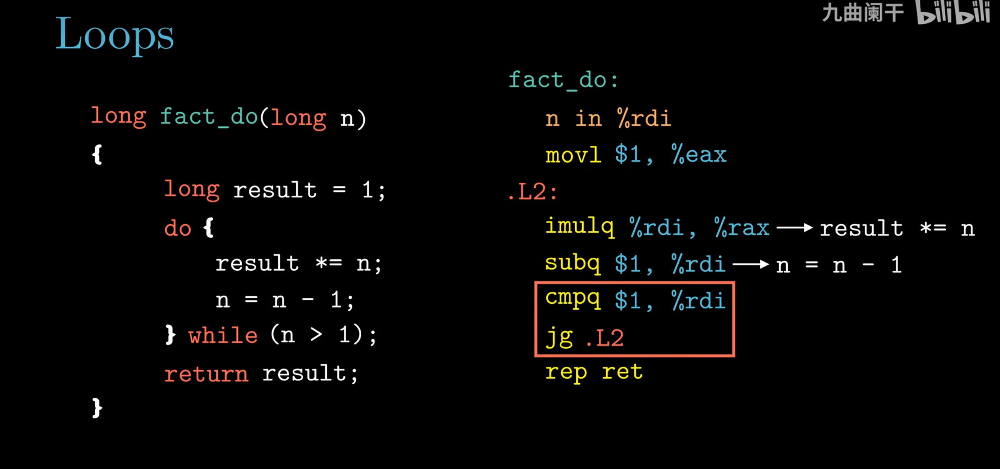

*▲ 图 3-6-19：同一页的第二次截取，取景与字号略有差别，循环体与底部条件测试的框选位置一致。留在这里是为了记住底部那对红框——`cmpq $1,%rdi` 与 `jg .L2` 才是 do-while 的灵魂，循环体本身反而简单。*

**再看一个把"测试"藏进更新指令的例子**（课件 p20 的 popcount）：

```c
long pcount_do(unsigned long x)
{
    long result = 0;
    do {
        result += x & 0x1;
        x >>= 1;
    } while (x);
    return result;
}
```

```asm
pcount_do:
    movl $0, %eax          # result = 0
.L2:
    movq %rdi, %rdx
    andl $1, %edx          # t = x & 1
    addq %rdx, %rax        # result += t
    shrq %rdi              # x >>= 1，同时按结果置 ZF
    jne  .L2               # 直接用 shrq 的 ZF：x != 0 就继续
    rep ret
```

这里没有 `cmpq $0,%rdi`：`shrq` 既是循环更新，又是循环测试。`andl` 也置过 ZF，但中间的 `addq` 把它覆盖了，所以末尾的 `jne` 只能读 `shrq` 留下的标志——**谁最后写条件码，`jXX` 就听谁的**。这也解释了为什么循环尾常常看不到显式的 `cmp`。do-while 至少执行一次，`x = 0` 时也会进循环体一次，只是 `result` 加 0。

### （2）`while`：跳到中间先测

```asm
fact_while:
    movl $1, %eax          # result = 1
    jmp  .L5               # 先跳到测试
.L6:
    imulq %rdi, %rax       # 循环体：result *= n
    subq $1, %rdi          #        n = n - 1
.L5:
    cmpq $1, %rdi          # 测试：n > 1 ？
    jg   .L6               # 成立 → 回循环体
    rep ret
```

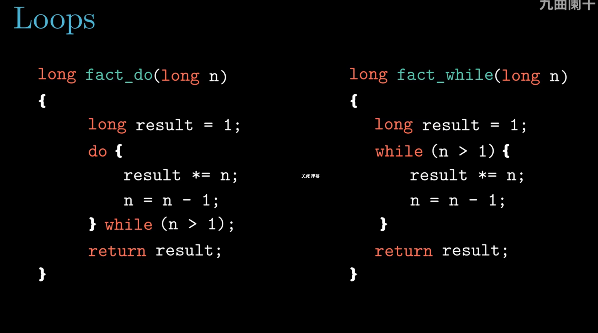

*▲ 图 3-6-20：左边 `fact_do`、右边 `fact_while`，C 源码只差"测试放在哪"。**`do-while` 至少执行一次，`while` 可能一次都不执行**——这个语义差别在汇编里就体现为测试块在后还是在中间。*

> [!TIP]
> `while` 还有第二种翻译 **guarded-do**：先测一次，命中才进 `do-while` 形式，即 `if (!t) goto done; do {…} while (t);`。它省掉"jmp 到中间"那条跳转，`-O2` 下更常见。

课件给出的分水岭更早：**`-Og` 倾向"跳到中间"，`-O1` 起就常用 guarded-do**，`-O2` 下更常见。

### （3）`for`：先翻译成 `while` 再编译

C 标准规定 `for (init; test; update)` 等价于 `init; while (test) { body; update; }`：

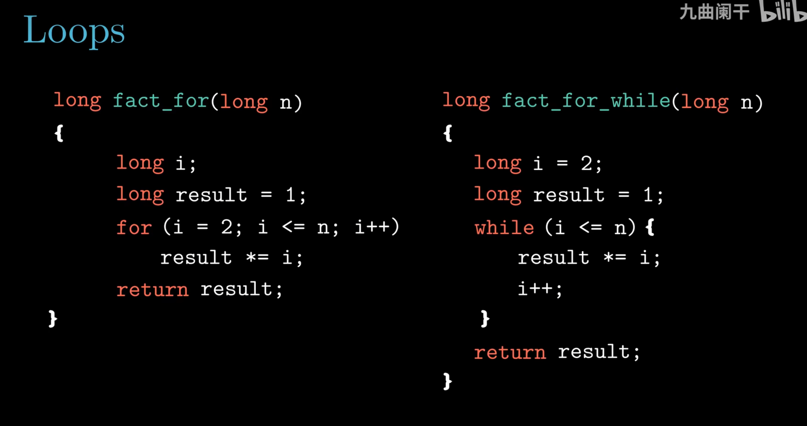

*▲ 图 3-6-21：`fact_for` 里 `for (i = 2; i <= n; i++)` 被机械改写成 `i = 2;` + `while (i <= n) { …; i++; }`。`init` 提到循环外、`update` 挪到循环体末尾——纯语法变换，与优化无关。*

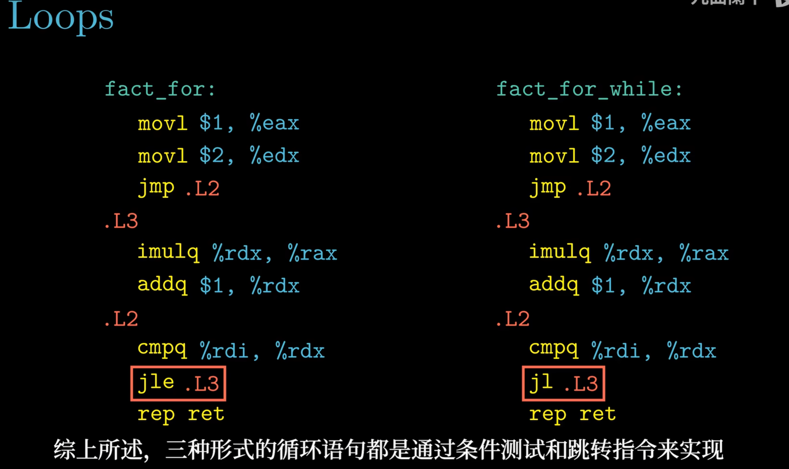

*▲ 图 3-6-22：`fact_for` 与手写 while 版**逐条对应**：`movl $1,%eax`（result）、`movl $2,%edx`（i）、`jmp .L2`（先测）、循环体、底测。唯一差别落在最后那条边界跳转上（`jle` 与 `jl`，两个红框）——这是编译器对边界条件的规约选择，说明**汇编骨架与源码写 `for` 还是 `while` 无关**；手写汇编时按 C 的真实边界选指令，别照抄。*

课件把这条链走得更完整：`for → while → guarded-do → goto`。`Init` 只执行一次，`Update` 在每轮 `Body` 后执行，所以简单循环等价于：

```text
Init;
if (!Test) goto done;
loop:
  Body
  Update
  if (Test) goto loop;
done:
```

若 `Init` 后 `Test` 恒真（如 `i = 0; i < 64`），入口那次测试可能被优化掉——课件 p30 的 `pcount_for` 就标了"初始化测试将被优化删除"。所以读 `-O2` 汇编时，`for` 的入口守卫可能整个消失。

### （4）三种骨架对照

```text
   do-while                while                   for
   ─────────────────       ──────────────────      ─────────────────
   L:  body                jmp   T                 init
       test                L:    body              jmp   T
       jXX   L             T:    test              L:    body
                           jXX   L                       update
                                                   T:    test
                                                   jXX   L
```

三条要点：① 测试在尾（do-while）→ 至少执行一次；② 测试在中/首（while）→ 可能零次；③ for 先被改写成 while，所以后两者骨架一致，只是 init / update 位置不同。三种循环的返回处都出现 `rep ret`，即 3.6.4 讲的对齐前缀。

上面的 `for` 画的是"跳到中间"骨架；若编译器选 guarded-do，入口的 `jmp T` 会换成 `if (!Test) goto done`，底部测试不变（见（3））。

### （5）`-Og` 与 `-O2` 的差别

- **循环结构**：`-Og` 与原 C 一一对应、一个循环一段代码；`-O2` 可能**展开**（unroll 2/4 次）、拆分、合并。
- **条件判断**：`-Og` 基本照搬源码边界；`-O2` 会重写边界（`<=` 与 `<` 互换、归纳变量替换）。
- **变量**：`-Og` 常常 `push`/`pop` 在栈上；`-O2` 尽量全程留在寄存器，循环不变计算提到循环外。

教材坚持用 `-Og` 就是为了让汇编与 C "能对上号"。拿 `-O2` 的输出对照教材，会发现循环没了、`imulq` 变成 `lea` 链、函数被内联——那不是教材写错，是你打开了优化。

---

## 3.6.8 `switch` 语句

`switch` 当然可以用一串 `if-else` 实现，但那样要比较 n 次。当 case 值**密集**时，编译器改用**跳转表（jump table）**：一次范围检查 + 一次查表 + 一次间接跳转。

#### 一起算一遍

拿一个含 7 个互不相同 case（0~6）的 `switch` 数一数（本节 `switch_eg` 的跳转表也正好 7 项）。假设 `if-else` 链按 0、1、2、3、4、5、6 的顺序逐个比较：

| `n` | `if-else` 要比较几次 | 跳转表要做什么 |
| :-: | :-: | :--- |
| 0 | 1 次（第一次就中） | 1 次范围检查 + 1 次查表 + 1 次间接跳转 |
| 3 | 4 次 | 同上，仍是常数次 |
| 6 | 7 次（前面都没中） | 同上 |
| −1 / 7 | 7 次都没中，落 default | 1 次 `ja` 直接落 default |

7 个 case 平均比较 `(1+2+…+7)/7 = 4` 次；case 越多，`if-else` 链越长，而跳转表**永远只做一次范围检查、一次查表、一次跳转**，这就是 O(n) 与 O(1) 的差别。表本身只占 `7 × 4 = 28` 字节，代价是这块内存和一次间接跳转。

**但 O(1) 不等于"任何 `switch` 都更快"**：case 稀疏时表会大得离谱，间接跳转也可能预测失败，编译器会退回比较链——见本节末尾。

<details>
<summary>✅ 检查点 2：`n = -1` 时，`cmpq $6,%rsi; ja .L8` 为什么能一步跳到 default？</summary>

`ja` 按**无符号**比较。`-1` 的 64 位表示是 `0xFFFF…FF`，无符号值远大于 6，所以条件成立，直接跳 default；同一条 `ja` 也顺带挡住了 `n > 6`。
</details>

### （1）C 源码

```c
void switch_eg(long x, long n, long *dest)
{
    long val = x;
    switch (n) {
    case 0: val *= 13; break;
    case 2: val += 10;              /* fall through，故意不写 break */
    case 3: val += 11; break;
    case 4: case 6: val += 11; break;
    default: val = 0;
    }
    *dest = val;
}
```

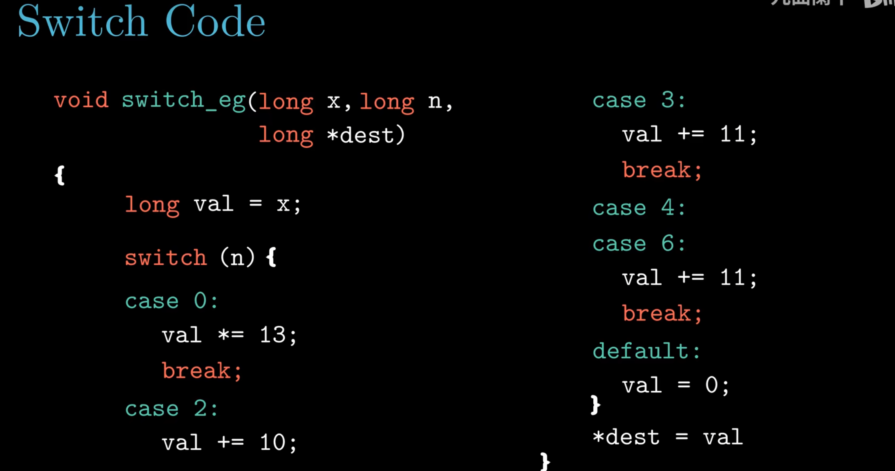

*▲ 图 3-6-23：注意 **case 2 后面没有 `break`**，它会"贯穿"（fall through）到 case 3，所以 `n == 2` 时 `val` 要加 `10 + 11 = 21`。case 4 与 case 6 写在一起共用一段代码；default 同时覆盖 1、5 和一切越界值。case 值正好铺满 0~6，密集得很，非常适合跳转表。*

### （2）分派入口：查表 + 间接跳

```asm
switch_eg:                        # x:%rdi   n:%rsi   dest:%rdx
    movq %rdx, %r8                # dest 挪进 %r8，腾出寄存器做表寻址
    movq %rdi, %rdx               # val = x，全程放在 %rdx
    cmpq $6, %rsi                 # 比较 n : 6
    ja   .L8                      # n > 6（无符号）→ default
    leaq .L4(%rip), %rcx          # rcx = 跳转表基址
    movslq (%rcx,%rsi,4), %rax    # rax = 表[n]：4 字节偏移，符号扩展成 64 位
    addq %rcx, %rax               # rax = .L4 + 偏移 = 目标地址
    jmp  *%rax                    # 间接跳转，走人
```

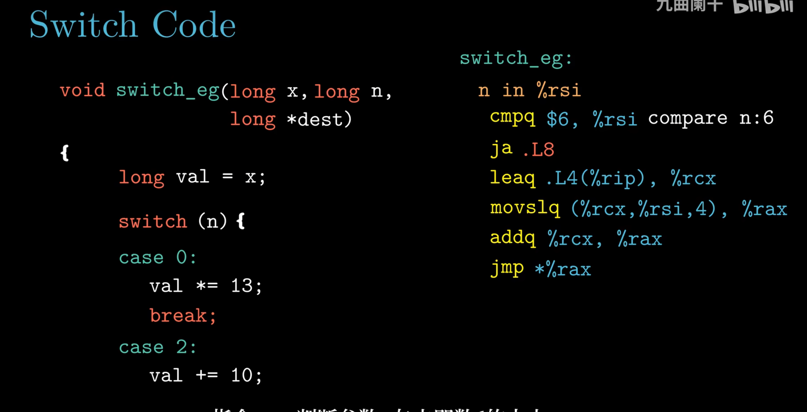

*▲ 图 3-6-24：图中截取的是 `cmpq` 起的五条核心指令——范围检查、取表基址、查表、把相对偏移加回基址、间接跳转。整段 `switch` 的"分派逻辑"就这五行，与 case 有多少个无关。*

**越界检查为什么用 `ja`**：`cmpq $6,%rsi` 之后，无符号解释下负数是一个巨大的数（`−1` → `0xFFFF…FF`）。`ja .L8`（无符号大于 6 就跳走）**一次性**排除了 `n > 6` 与 `n < 0`；用 `jg` 则还得补一条"小于 0"的判断。

### （3）跳转表长什么样

跳转表通常放在 `.rodata`（只读数据段），并按表项宽度对齐：8 字节表项用 `.align 8`，4 字节表项用 `.align 4`。

```asm
.section .rodata
.align 4
.L4:
    .long .L3 - .L4        # case 0
    .long .L8 - .L4        # case 1 → default
    .long .L5 - .L4        # case 2
    .long .L6 - .L4        # case 3
    .long .L7 - .L4        # case 4
    .long .L8 - .L4        # case 5 → default
    .long .L7 - .L4        # case 6（与 case 4 共用同一目标）
```

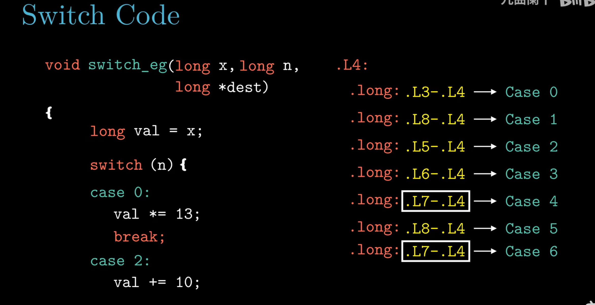

*▲ 图 3-6-25：7 个表项与 7 个 case 一一对应，每项只占 4 字节（`.long`）。方框圈出的两处 `.L7 − .L4` 说明 **case 4 与 case 6 共享同一段代码**——源码写成 `case 4: case 6:`，表里就填两个相同偏移，省一份代码。*

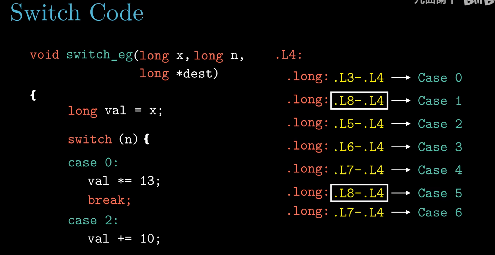

*▲ 图 3-6-26：另一种共享——`case 1` 与 `case 5` 的偏移都指向 `.L8`（default 块）。表项重复是"跳转表干掉 if-else 链"的直接体现：查表是 O(1)，case 再多也不增加比较次数。*

### （4）各分派目标的代码

```asm
.text
.L3:                           # case 0：val *= 13
    leaq (%rdx,%rdx,2), %rax        # rax = 3 * val
    leaq (%rdx,%rax,4), %rdx        # rdx = val + 4*(3val) = 13*val
    jmp  .L2
.L5:                           # case 2：val += 10
    addq $10, %rdx
.L6:                           # case 3：val += 11（case 2 贯穿到这里）
    addq $11, %rdx
    jmp  .L2
.L7:                           # case 4 / case 6：val += 11
    addq $11, %rdx
    jmp  .L2
.L8:                           # default（含 case 1、case 5）
    movl $0, %edx                  # val = 0
.L2:
    movq %rdx, (%r8)               # *dest = val
    ret
```

`.L5` 块**没有 `jmp`**，执行完就顺序掉进 `.L6`——这正是"没写 break 就贯穿"在机器级的模样。另外 `.L6` 与 `.L7` 动作相同却各自成块，说明重复代码要不要合并得看编译器心情，别指望。

课件 p39–p40 还展示了"贯穿"的另一种形态：`case 3` 单独进入时 `w` 要从 1 开始，但从 `case 2` 贯穿下来时不能重新置 1；编译器于是让 `case 3` 的直接入口先做 `w = 1`，而 `case 2` 用 `jmp merge` 跳过它，二者在 `w += z` 处汇合。**贯穿共享的是后半段代码，不一定是整个 case 块**。

### （5）表项为什么存"标号 − .L4"

绝对地址每项 8 字节（7 项 56 B）、加载时还得把表改一遍；相对偏移每项 4 字节（7 项 28 B）、整块搬家不用改——**既省一半空间，又免掉重定位**。

因为 `目标地址 = .L4 + 表项值`，只要表和代码的**相对距离**不变，偏移就永远有效——与 3.6.4 的 PC 相对跳转是同一思想。`movslq` 负责把 32 位**有符号**偏移扩展到 64 位：范围 ±2 GB，函数内部绝对够用。

**课件还展示了另一种写法：8 字节绝对表。**（与上面的 4 字节表二选一，别同时定义 `.L4`。）它把目标地址直接存成 `.quad`，比例因子相应变成 8：

```asm
.section .rodata
.align 8
.L4:
    .quad .L3              # case 0
    .quad .L8              # case 1 → default
    .quad .L5              # case 2
    .quad .L6              # case 3
    .quad .L7              # case 4
    .quad .L8              # case 5 → default
    .quad .L7              # case 6
```

分派只要一条 `jmp *.L4(,%rsi,8)`：CPU 从 `.L4 + n*8` 取出 8 字节**绝对地址**，不需要 `movslq` 和 `addq` 两步。代价是表项翻倍（7 项 56 B），而且绝对地址让代码/表失去位置无关性，加载时可能要做重定位。两种形态都要认得：**8 字节 `.quad` + 比例 8** 常见于非 PIE/旧代码，**4 字节 `.long 标号−.L4` + 比例 4** 是现代 PIC 的常见写法。

反过来，若 case 值很稀疏（如 0、1000、200000），跳转表要占一大片内存，编译器会退回 `if-else` 链或二分查找。

---

## 📌 重点速记

```text
条件码     CF 无符号进位/借位 | ZF 结果==0 | SF 结果最高位 | OF 有符号溢出
不置位     leaq 四位全不动；inc/dec 故意不动 CF
只看不算   cmpq = subq 减去不写回 ； testq = andq 与了不写回
比较公式   有符号 a<b ⟺ SF^OF ；无符号 a<b ⟺ CF
set 系列   sete/setne/sets/setns/setg/setge/setl/setle；seta/setae/setb/setbe（无符号）
           只写 1 字节 → 后面必跟 movzbl %al,%eax
跳转       jmp 无条件；jXX 与 setXX 同构；目标可写标号或 *%rax
编码       eb rel8 / e9 rel32，目标 = 下一条指令地址 + 偏移 → 可重定位（PIC）
分支       if-else = 测试 + 跳转；预测失败 ≈ 15~20 个周期
传送       cmovXX：两条路都算再选；禁止"可能非法/有副作用/昂贵"的表达式
循环       do-while 底测；while 跳中（jmp 到测试）；for = init + while
隐式测试   循环更新指令（shrq/and 等）最后写标志，可直接接 jne
switch     cmpq $6,%rsi + ja 越界 → leaq .L4(%rip) → movslq → addq → jmp *%rax
           表项 = 标号 − .L4（4 字节，位置无关）；重复 case 共享目标
跳转表     8 字节 .quad 绝对（比例 8）或 4 字节 .long 相对（比例 4）
```

---

## ⚠️ 易错点

1. **把 `jl` 当成"小于等于"。** `jl` 是 `<`，`jle` 才是 `<=`；且 `jl` 只适用于**有符号**。若 `%eax` 是 `unsigned`，`cmpl $0,%eax; jl` 会把 `0x80000000`（无符号 21 亿）判成负数。
2. **写 `sete %eax`。** `set` 的目标只能是 8 位寄存器（`%al`、`%r8b`…），写 `%eax` 汇编直接报错；而且必须 `movzbl %al,%eax` 清零高位，否则 `%rax` 高 56 位是旧值。
3. **把 `cmpq %rax,%rdx` 算成 `%rax − %rdx`。** AT&T 是源在前、目的在后，实际算 `%rdx − %rax`；判断方向时务必按"后减前"。
4. **以为 `lea` 会置条件码。** `leaq` 四位全不动；想让 `%rax == 0` 的判断生效，前面必须有 `testq %rax,%rax` 或 `cmpq $0,%rax`。
5. **在 `cmp` 与 `jXX` 之间插别的指令。** 任何置条件码的指令都会覆盖前面的结论；要保住结论，得先用 `setXX` 存成字节。
6. **以为 `cmov` 能替代所有分支。** 拿它改写 `p ? *p : 0` 会无条件解引用；`cmov` 的前提是两条路径都能安全、无条件地提前求值。
7. **忘了 case 贯穿。** `case 2` 不写 `break` 就会继续执行 `case 3`，跳转表里表现为 `.L5` 末尾没有 `jmp`。这不是编译器 bug，是 C 的语义。
8. **以为循环末尾一定要有一条 `cmpq`。** `shrq`、`andq`、`subq` 等都会置 ZF，`jne` 可以直接接在它们后面；若中间又插了 `addq`，标志就被覆盖，必须重新测试。
9. **以为跳转表只有一种编码。** 8 字节 `.quad` 绝对表用比例因子 8，4 字节 `.long` 相对表用比例因子 4；看到 `jmp *.L4(,%rsi,8)` 不要套用笔记里的 `movslq` 版。

---

## ❓ 常见困惑

**Q：`cmp` 和 `sub` 到底有什么区别？**
A：**计算结果完全相同，条件码也完全相同**，唯一区别是 `sub` 把差写回目的操作数，`cmp` 不写。因此 `cmp` 可以放心比较两个还要继续用的值；如果你本来就想更新那个值，直接用 `sub` 再跟 `jXX` 更省一条指令。

**Q：`cmov` 既然能躲开分支预测失败，为什么有时反而更慢？**
A：因为它强制两条路都算：如果其中一条很贵，或者 `cmov` 的两个输入和条件码构成一条长依赖链，多做的功可能超过一次预测失败的代价。分支高度可预测时（例如循环边界），普通跳转反而更划算；`cmov` 通常只在"两条路都便宜且条件难以预测"时占优。

**Q：`switch` 一定要用跳转表吗？**
A：不一定。只有 case 值**密集且范围不大**时才划算；若 case 是 0、1000、200000 这种稀疏值，表会浪费大量空间，编译器会退回 `if-else` 链或二分查找。case 很少时，几次比较也比"建表 + 间接跳转"便宜。

---

## 🛠 动手试试

1. 新建 `cread.c`：

   ```c
   long cread(long *xp) { return xp ? *xp : 0; }
   ```

   运行 `gcc -Og -S cread.c && grep -E 'testq|je|cmov' cread.s`。预期看到 `testq %rdi,%rdi` 和 `je`，**没有 `cmov`**——因为 `cmov` 会提前解引用空指针。

2. 再写 `long absdiff(long x, long y) { return x < y ? y-x : x-y; }`，分别用 `gcc -Og -S -fno-if-conversion` 与 `gcc -Og -S` 编译：前者预期出现 `cmpq` + `jl`，后者可能变成两条 `subq` + `cmovle`（gcc 版本不同会略有差异）。

3. 编译本节 `switch_eg`，用 `gcc -Og -S switch.c && grep -A8 '^.L4:' switch.s` 数表项，预期看到 7 个 `.long`；把 case 改成 0、1000、200000 后重编，预期 `.L4:` 跳转表和 `jmp *%rax` 都消失，换成 `cmp`/`je` 链或二分结构。

---

## ✅ 自测

1. `int comp(char a, char b) { return a < b; }`，调用 `comp(-2, 127)` 返回什么？把中间的条件码逐个写出来。
2. 机器码 `4004e0: eb f6` 的跳转目标在哪？若同一位置改成 `e9 f6 ff ff ff`，目标又是哪？
3. `switch` 的越界检查为什么用 `ja` 而不是 `jg`？以 `n = -1` 为例说明。
4. 把 `cread`（`return xp ? *xp : 0;`）用 `cmov` 实现会发生什么？编译器实际怎么处理？
5. 跳转表项为什么存 `.L3 - .L4` 而不是绝对地址？`movslq` 在这里起什么作用？
6. `pcount_do` 的汇编里，`andl $1,%edx` 也置过 ZF，为什么结尾的 `jne` 不是用它？`pcount_do(0)` 返回多少、循环体执行几次？
7. 课件的 8 字节跳转表和笔记的 4 字节跳转表，表项各存什么、比例因子为何不同？哪一种位置无关？

<details>
<summary>参考答案</summary>

1. `cmpb %sil,%dil` 算 `−2 − 127 = −129`，1 字节装不下，回绕成 `0x7F`（+127）：`SF = 0`、`OF = 1`；`setl` 用 `SF^OF = 1` → `%al = 1` → 返回 **1**（确实 −2 < 127）。
2. `eb` 版：下一条指令在 `0x4004e2`，`0xf6` 符号扩展为 `−10`，目标 = `0x4004e2 − 10 = 0x4004d8`。`e9` 版：指令长 5 字节，下一条在 `0x4004e5`，偏移仍是 `−10`，目标 = `0x4004e5 − 10 = 0x4004db`——**基准随指令长度变化**。
3. `n = −1` 时 `cmpq $6,%rsi` 得到"有符号小于"，`jg`（只判有符号大于）会放行，于是拿 `−1` 去查表 → 越界访问。`ja` 是无符号比较，`−1` 的无符号值是 `0xFFFF…FF`，必然"大于 6"，一步跳 default。一条 `ja` 同时挡住 `n<0` 与 `n>6`。
4. `cmov` 要求两条路径都求值，`*xp` 在 `xp == NULL` 时会段错误，而 `?:` 保证条件为假时不求值 → 语义被破坏甚至崩溃。所以 gcc 不做这个转换，生成 `testq %rdi,%rdi` + `je` 的分支版本。
5. 存相对偏移使表项只需 4 字节（7 项 28 B，绝对地址要 56 B），且代码整体搬迁时表项一个字节都不用改 → **位置无关代码**；`movslq` 把 32 位有符号偏移符号扩展成 64 位，好让 `addq %rcx,%rax` 加到表基址上得到 64 位目标地址。
6. `andl` 的 ZF 被随后的 `addq` 覆盖，末尾 `jne` 读的是 `shrq` 按右移结果设置的 ZF。`pcount_do(0)` 仍会进循环体一次（do-while 至少执行一次），`result += 0`，`x` 仍为 0，`shrq` 置 ZF=1，`jne` 不跳，返回 **0**。
7. 8 字节表项存目标的**绝对地址**，`jmp *.L4(,%rsi,8)` 直接用 `n*8` 取地址，不需要 `movslq`/`addq`；4 字节表项存 `标号 − .L4` 的**相对偏移**，比例因子 4，需 `movslq` 符号扩展再 `addq` 基址。后者省一半空间且位置无关，是现代 PIC 的常见形态；前者常见于非 PIE/旧代码。

</details>

---

## 🔗 与其他章节的联系

| 本节内容 | 后续用在哪 |
| :--- | :--- |
| 条件码 `CF/ZF/SF/OF` | 4.2 HCL 里 ALU 的标志输出、4.3 Y86-64 的 `CC` 与 `jXX` 实现 |
| `cmp` / `test` / `set` | 3.7 过程返回值的 0/1 判断、3.9 结构体与联合的判空 |
| `jmp` 与 PC 相对编码 | 4.3 指令编码、第 7 章链接与重定位、共享库 PIC |
| 条件传送 `cmov` | 第 5 章「优化程序性能」：分支 vs 条件传送的权衡 |
| 循环骨架 | 3.8 数组遍历、第 5 章循环展开、第 6 章局部性 |
| 跳转表 | 3.10 控制与数据结合的综合例子、第 7 章 `.rodata` 只读段 |

---

[← 上一节：3.5 算术和逻辑操作](3.5%20算术和逻辑操作.md)　｜　[下一节：3.7 过程 →](3.7%20过程.md)
