# 3.7 过程

> **📖 本节定位**　第 3 章「程序的机器级表示」· 教材 P164–P176
> **一句话**：过程调用不是一条指令的事，而是**调用者与被调用者共同遵守的栈 + 寄存器契约**：参数怎么传、返回地址放在哪、哪些寄存器谁负责保存，全部有章可循。

[← 上一节：3.6 控制](3.6%20控制.md)　｜　[下一节：3.8 数组分配和访问 →](3.8%20数组分配和访问.md)

---

## 🎯 核心结论

| # | 结论 |
| :-: | :--- |
| 1 | 每次过程调用都在栈上有一段私有空间——**栈帧**；`%rsp` 指向栈顶，栈向**低地址**增长 |
| 2 | `call` = 压入返回地址 + 跳到目标；`ret` = 弹出返回地址送回 `%rip`；返回地址是 `call` 的**下一条指令**地址 |
| 3 | 前 6 个整型/指针参数依次用 `%rdi %rsi %rdx %rcx %r8 %r9`；第 7 个起放栈上，从 `8(%rsp)` 开始 |
| 4 | 参数在寄存器里按实际**宽度**取子寄存器名（`%edi`/`%di`/`%dil`），在栈上则一律按 **8 字节**占位 |
| 5 | 寄存器分两派：**caller-saved** 由调用者自己保命，**callee-saved**（`%rbx %rbp %r12–%r15`）由被调用者恢复 |
| 6 | 递归没有特殊机制：每层调用一个独立栈帧，各层的 `n` 存在自己的帧里 |

---

## 3.7.1 运行时栈

C 的过程调用能一层套一层，靠的是一个**后进先出（LIFO）**的栈。P 调用 Q 时，P 以及整条调用链上更早的过程都处于挂起状态，现场必须原封不动地留在内存里；Q 结束后再逐个恢复。

**栈帧（stack frame）** 就是过程在栈上占用的那块区域。当前正在执行的过程的帧总在**栈顶**，`%rsp`（stack pointer）指向它的最低地址；栈向**低地址方向**增长，所以压栈是 `%rsp` 减小，弹栈是 `%rsp` 增大。

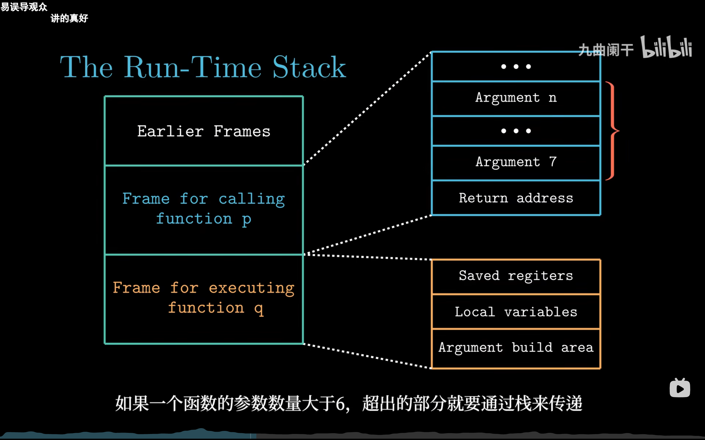

*▲ 图 3-7-1：左列是整条调用链的栈，右列把 p、q 各自的帧展开。注意 p 的帧底部是「参数 7…n + 返回地址」，而 q 的帧里才是保存的寄存器、局部变量和它给更下层准备的参数构造区。*

```text
        高地址（栈底）
        ┌──────────────────────────────┐
        │        Earlier Frames        │  ← 更早的调用者（如 main）
        ├──────────────────────────────┤
        │  调用者 p 的栈帧             │
        │  ┌────────────────────────┐  │
        │  │ 参数构造区（参数 7…n） │  │  ← p 为调用 q 预留
        │  ├────────────────────────┤  │
        │  │ 返回地址（0x700）      │  │  ← call 压入
        │  ├────────────────────────┤  │
        │  │ 保存的寄存器           │  │
        │  ├────────────────────────┤  │
        │  │ 局部变量               │  │
        │  └────────────────────────┘  │
        ├──────────────────────────────┤
        │  被调用者 q 的栈帧（当前）   │
        │  ┌────────────────────────┐  │
        │  │ 保存的寄存器           │  │
        │  ├────────────────────────┤  │
        │  │ 局部变量               │  │
        │  ├────────────────────────┤  │
        │  │ 参数构造区（给 q 的）  │  │
        │  └────────────────────────┘  │
        ├──────────────────────────────┤ ← %rsp
        ▼
        低地址（栈增长方向）
```

一个帧从高地址到低地址通常包含：

| 组成部分 | 由谁写入 | 作用 |
| :--- | :--- | :--- |
| 参数构造区（argument build area） | 调用者 | 存放第 7 个及以后的参数 |
| 返回地址 | `call` 指令 | `call` 之后那条指令的地址，`ret` 靠它回家 |
| 保存的寄存器 | 被调用者 | 用到的 callee-saved 寄存器的旧值 |
| 局部变量 | 被调用者 | 寄存器放不下、被取地址、或是数组/结构体 |

> [!NOTE]
> **帧指针 `%rbp`**：早期编译器固定用 `%rbp` 指向帧的起始处，方便调试器回溯调用链。开启优化（如 `-Og`）后，gcc 通常**省略帧指针**，把 `%rbp` 当普通通用寄存器用——本节 `P` 的例子正是如此，所以读汇编时不要假定 `%rbp` 一定是帧指针。

**参数超过 6 个怎么办？** 前 6 个走寄存器，第 7 个起由调用者写进自己的**参数构造区**（栈上、返回地址之上）。这就是图 3-7-1 里 p 的帧还要留一块「Argument 7…n」的原因。

> [!TIP]
> `pushq` 等价于 `subq $8, %rsp; movq 源, (%rsp)`，`popq` 等价于 `movq (%rsp), 目的; addq $8, %rsp`。记住这条等价式，后面所有栈帧图都能自己推出来。

---

## 3.7.2 转移控制

过程调用与返回只靠两条指令：

| 指令 | 写法 | 做什么 |
| :--- | :--- | :--- |
| 调用 | `call Label` / `call *Operand` | ① 把**返回地址**压栈；② 把 `%rip` 设为被调过程入口 |
| 返回 | `ret` | 从栈顶弹出返回地址，送回 `%rip` |

关键是**返回地址**：它是 `call` **下一条指令**的地址，而不是 `call` 自己的地址。这样 `ret` 回来时才能接着往下走。

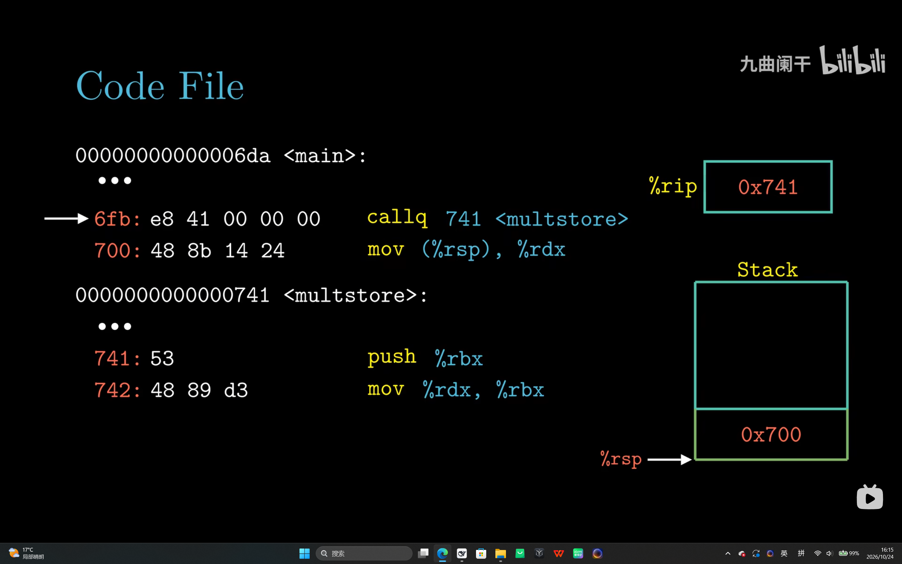

*▲ 图 3-7-2：`callq 741 <multistore>` 位于 `0x6fb`，长 5 字节，所以下一条指令在 `0x700`；执行后 `%rip` 变成 `0x741`，栈顶压着返回地址 `0x700`。*

```text
调用前： %rip = 0x6fb，%rsp = 0x7fffffffe0a8
  0x6fb: e8 41 00 00 00   callq 741 <multistore>
  0x700: 48 8b 14 24      mov (%rsp), %rdx      ← 返回地址就是它
执行 callq：
  ① %rsp ← %rsp - 8 = 0x7fffffffe0a0
  ② M[0x7fffffffe0a0] ← 0x700
  ③ %rip ← 0x741
调用后： %rip = 0x741，栈顶 = 0x700
```

机器码 `e8 41 00 00 00` 里，`e8` 是 `call` 的操作码，后 4 字节是**相对位移** `0x41`：`0x700 + 0x41 = 0x741`，正好落到 `multistore` 的入口。反汇编器显示的 `741` 是绝对地址，机器码里存的却是相对量。

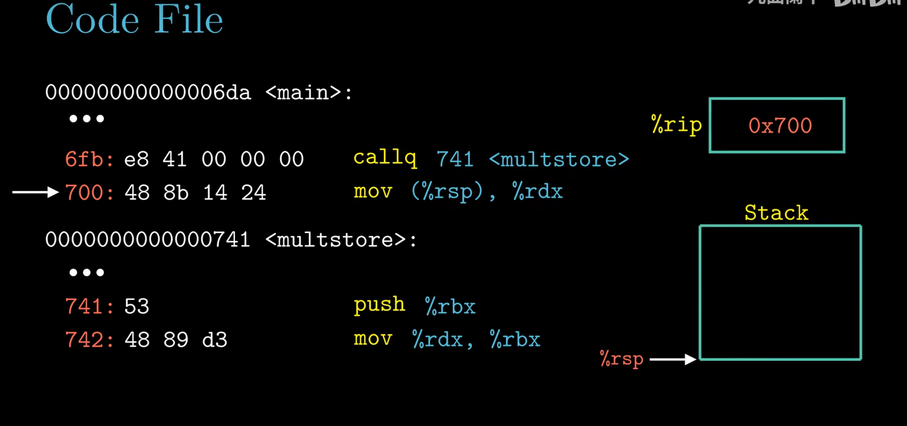

*▲ 图 3-7-3：`ret` 把栈顶的 `0x700` 弹回 `%rip`，`%rsp` 加 8 回到调用前的位置，箭头重新指向 `0x700` 那条 `mov`。*

```text
执行 ret（multistore 的 ret）：
  ① %rip ← M[0x7fffffffe0a0] = 0x700
  ② %rsp ← 0x7fffffffe0a8
返回后： %rip = 0x700，栈顶回到 0x7fffffffe0a8
```

`call`/`ret` 只负责「改 `%rip` + 动栈顶」这两件事，**不负责**保存任何通用寄存器。参数怎么传、寄存器谁保存，属于**调用约定**（3.7.3–3.7.5），不是硬件行为——把这两层分清，很多题就不会绕晕。

---

## 3.7.3 数据传送

x86-64 规定：**前 6 个整型（整数、指针）参数**依次放在 6 个寄存器里，且这 6 个寄存器全是 **caller-saved**；更多的参数通过栈传递。

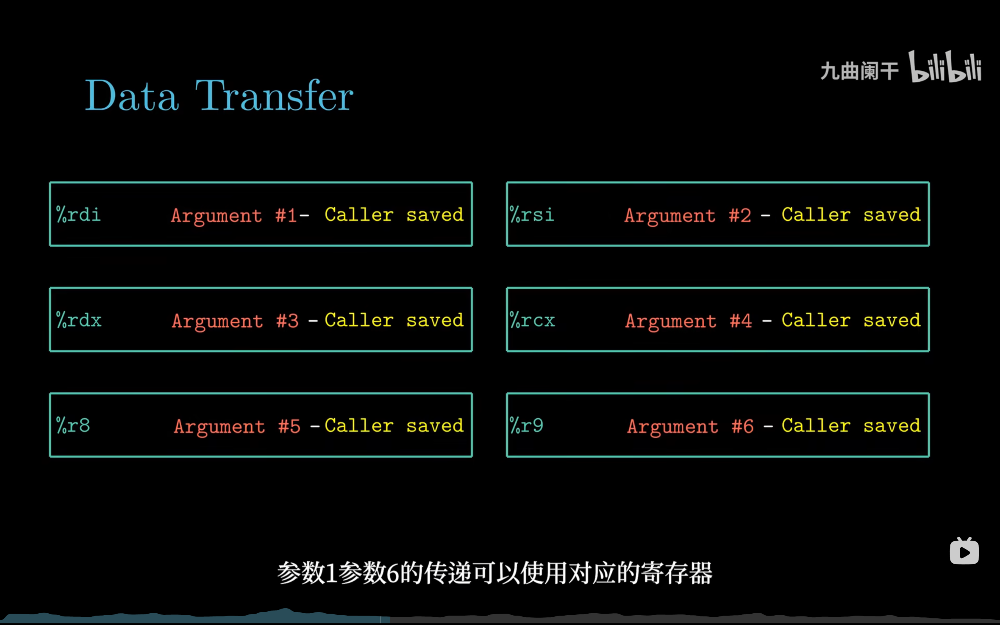

*▲ 图 3-7-4：参数 1–6 与 `%rdi/%rsi/%rdx/%rcx/%r8/%r9` 一一对应。图里反复出现的 "Caller saved" 很关键：这些寄存器被调用者可以随便改，调用者想留就得自己事先存。*

### （1）参数宽度决定子寄存器名

参数是 `int` 就用 32 位名字，是 `short` 就用 16 位，是 `char` 就用 8 位——同一个物理寄存器，换一个名字就是换宽度：

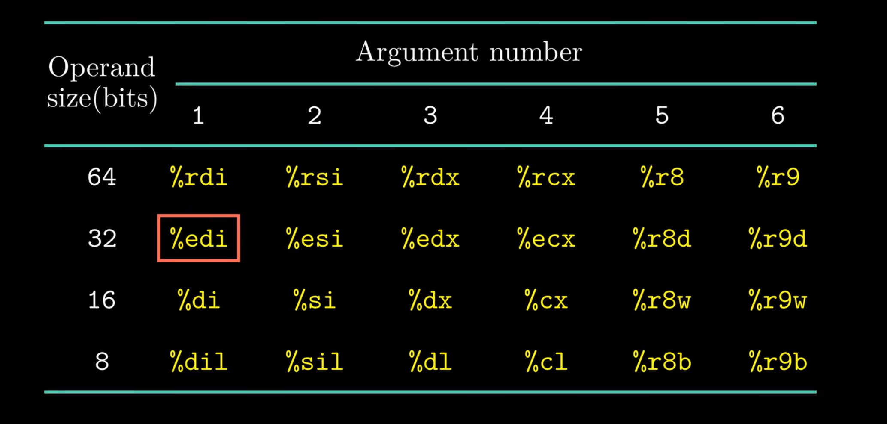

*▲ 图 3-7-5：四行分别是 64/32/16/8 位操作数对应的寄存器名。第 2 行第 1 列被红框标出的 `%edi`，就是「第 1 个参数按 32 位传」时的写法。*

| 宽度 | 参数 1 | 参数 2 | 参数 3 | 参数 4 | 参数 5 | 参数 6 |
| :-: | :-: | :-: | :-: | :-: | :-: | :-: |
| 64 位 | `%rdi` | `%rsi` | `%rdx` | `%rcx` | `%r8` | `%r9` |
| 32 位 | `%edi` | `%esi` | `%edx` | `%ecx` | `%r8d` | `%r9d` |
| 16 位 | `%di` | `%si` | `%dx` | `%cx` | `%r8w` | `%r9w` |
| 8 位 | `%dil` | `%sil` | `%dl` | `%cl` | `%r8b` | `%r9b` |

### （2）第 7 个参数起：放到栈上

栈上参数从 `8(%rsp)` 开始编号，因为 `(%rsp)` 已经被返回地址占用了：

```text
  高地址
  ┌──────────────────────┐
  │ 参数 9               │  24(%rsp)
  ├──────────────────────┤
  │ 参数 8               │  16(%rsp)
  ├──────────────────────┤
  │ 参数 7               │   8(%rsp)
  ├──────────────────────┤
  │ 返回地址             │    (%rsp)  ← %rsp
  └──────────────────────┘
  低地址
```

**每个栈上参数都按 8 字节对齐占位**，哪怕它只是个 `char`。这样参数地址统一成 `8 + 8k`，也便于维持 `%rsp` 的 16 字节对齐。

### （3）完整例子：8 个不同类型的参数

```c
void proc(long a1, long *a1p, int a2, long *a2p,
          short a3, long *a3p, char a4, long *a4p)
{
    a1p += a1;
    a2p += a2;
    a3p += a3;
    a4p += a4;
}
```

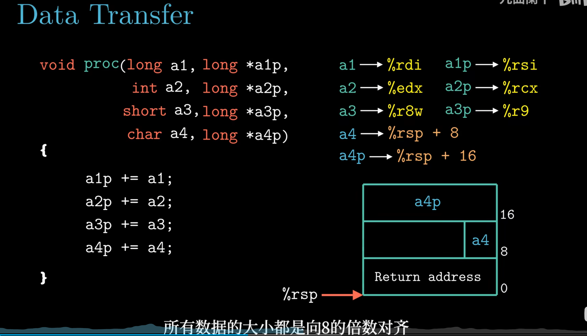

*▲ 图 3-7-6：前 6 个参数占满 6 个寄存器，`a4`（`char`）和 `a4p`（指针）溢出到 `8(%rsp)`、`16(%rsp)`。右下栈图特意画出：两个栈槽都占满 8 字节，图中 8、16 是相对 `%rsp` 的偏移。*

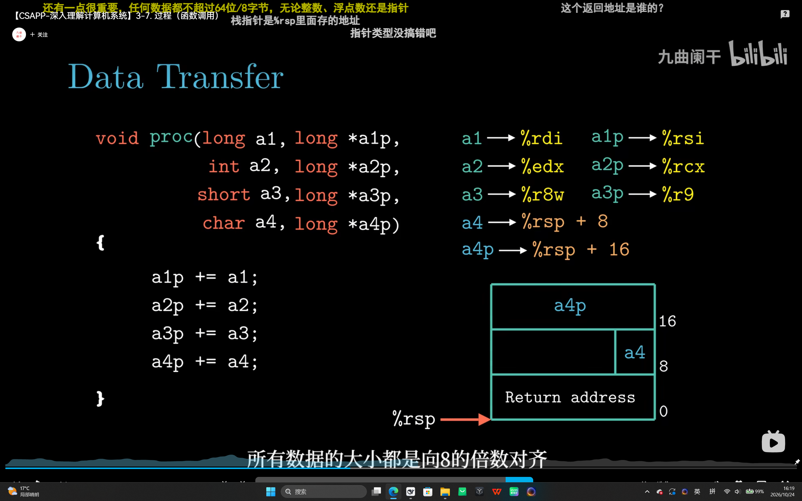

*▲ 图 3-7-7：同一页的第一次截取，画面上还留着弹幕和任务栏。与上一张是同一幅图，留它是因为底部字幕把结论说全了——所有数据大小都向 8 的倍数对齐。这就是 `char a4` 只有 1 字节却仍占满 `8(%rsp)` 一整个槽的原因。*

| 参数 | 类型 | 位置 | 宽度 |
| :--- | :--- | :--- | :-: |
| `a1` | `long` | `%rdi` | 64 |
| `a1p` | `long *` | `%rsi` | 64 |
| `a2` | `int` | `%edx` | 32 |
| `a2p` | `long *` | `%rcx` | 64 |
| `a3` | `short` | `%r8w` | 16 |
| `a3p` | `long *` | `%r9` | 64 |
| `a4` | `char` | `8(%rsp)` | 8（占 8 字节） |
| `a4p` | `long *` | `16(%rsp)` | 64 |

```asm
proc:
    movq    16(%rsp), %r10      # a4p
    movsbq  8(%rsp), %rax       # a4（char 符号扩展到 64 位）
    addq    %rax, (%r10)        # a4p += a4
    movq    (%rdi), %rax        # a1
    addq    %rax, (%rsi)        # a1p += a1
    movslq  %edx, %rax          # a2（int 符号扩展到 64 位）
    addq    %rax, (%rcx)        # a2p += a2
    movswq  %r8w, %rax          # a3（short 符号扩展到 64 位）
    addq    %rax, (%r9)         # a3p += a3
    ret
```

> [!IMPORTANT]
> 「不同类型也各占一个参数位」：`a2` 是 `int`、`a3` 是 `short`、`a4` 是 `char`，但它们不会挤进同一个寄存器，也不会因为窄就省掉一个栈槽。参数位由**声明顺序**决定，宽度只决定用哪个子寄存器、以及要不要扩展。

---

## 3.7.4 栈上的局部存储

寄存器只有 16 个，很多局部变量躲不开内存。以下情况**必须**把局部变量放栈上：

1. **寄存器不够用**——活跃变量多于可用寄存器；
2. **对局部变量取地址**（如 `&arg1`）——寄存器没有地址，被取地址的变量必须有内存位置；
3. **局部变量是数组或结构体**——只能通过内存寻址访问；
4. **必须跨调用保持**——调用别人时 caller-saved 寄存器会被覆盖，只有栈（或 callee-saved 寄存器）能保住它。

### （1）标准例子：caller 里的 arg1 / arg2

```c
long caller()
{
    long arg1 = 534;
    long arg2 = 1057;
    long sum  = swap(&arg1, &arg2);
    long diff = arg1 - arg2;
    return sum * diff;
}
```

因为 `&arg1`、`&arg2` 被取地址，两个变量只能放栈上，编译器一次性分配 16 字节：

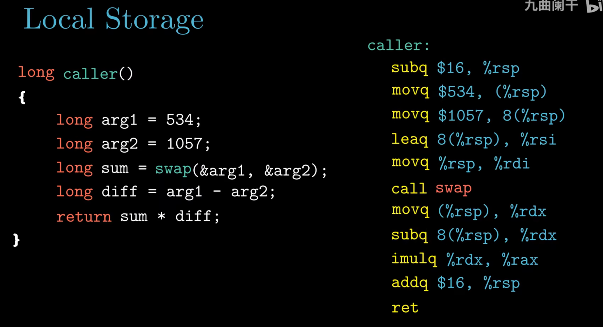

*▲ 图 3-7-8：`subq $16, %rsp` 一次性分配两个 8 字节槽；`movq $534, (%rsp)` 写 arg1、`movq $1057, 8(%rsp)` 写 arg2；再用 `leaq 8(%rsp), %rsi` 和 `movq %rsp, %rdi` 把两个**地址**作为参数传给 `swap`。*

```asm
caller:
    subq    $16, %rsp           # 分配 16 字节局部空间
    movq    $534, (%rsp)        # arg1 = 534
    movq    $1057, 8(%rsp)      # arg2 = 1057
    leaq    8(%rsp), %rsi       # 参数 2 = &arg2
    movq    %rsp, %rdi          # 参数 1 = &arg1
    call    swap
    movq    (%rsp), %rdx        # 取回交换后的 arg1
    subq    8(%rsp), %rdx       # diff = arg1 - arg2
    imulq   %rdx, %rax          # sum * diff（%rax 是 swap 的返回值）
    addq    $16, %rsp           # 释放局部空间
    ret
```

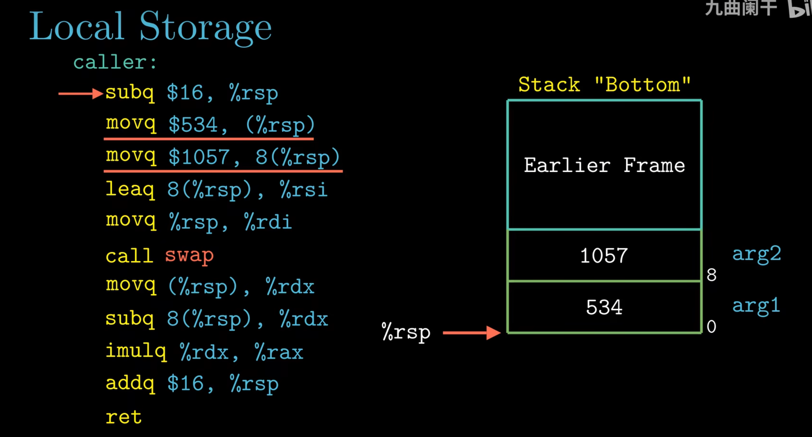

*▲ 图 3-7-9：`subq $16` 之后，`(%rsp)` 是 arg1 = 534，`8(%rsp)` 是 arg2 = 1057。**先分配的变量在低地址**，这与「栈向低地址增长」一致：`%rsp` 下移 16 字节，新空间的最低字节就是 arg1 的起点。*

`swap` 返回后两数已互换：`arg1 = 1057`、`arg2 = 534`，所以 `diff = 1057 - 534 = 523`。若 `swap` 返回两数之和 1591，则结果为 `1591 × 523 = 832093`。

### （2）分配与释放：一条 sub，一条 add

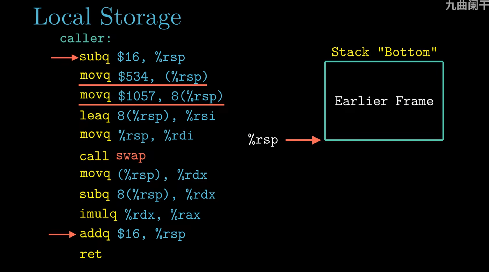

*▲ 图 3-7-10：`subq $16, %rsp` 把栈顶向下推，圈出 16 字节；返回前 `addq $16, %rsp` 把栈顶推回原位。**成对出现、数值相同**，这是编译器保证栈平衡的基本手法。*

忘记 `addq $16, %rsp`，或加错数值，`ret` 就会从错误的位置取返回地址，程序直接跑飞；只 `subq $8` 却按 `8(%rsp)` 写第二个变量，则是越界写进了别人的帧。

### （3）8 个参数的调用：前 6 个寄存器，后 2 个落栈

```c
long call_proc()
{
    long  x1 = 1;
    int   x2 = 2;
    short x3 = 3;
    char  x4 = 4;
    proc(x1, &x1, x2, &x2, x3, &x3, x4, &x4);
    return (x1 + x2) * (x3 - x4);
}
```

四个变量都被取了地址，全部放栈上；同时第 7、8 个参数（`x4`、`&x4`）也要占两个栈槽：

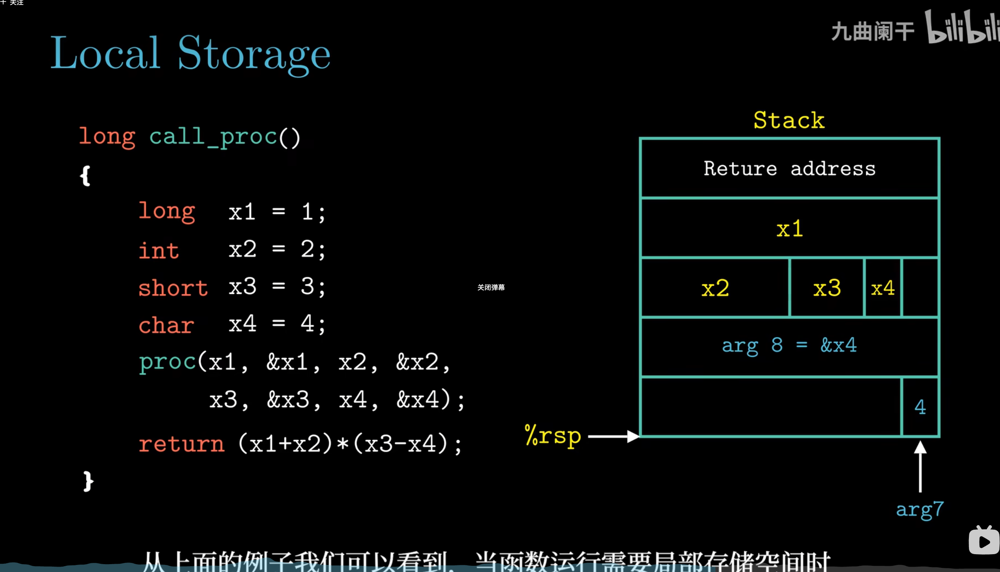

*▲ 图 3-7-11：从高地址往下依次是返回地址、x1、x2/x3/x4 挤在一个 8 字节槽里、`arg8 = &x4`、`arg7 = x4`；`%rsp` 指向最底下的 arg7 槽。前 6 个参数则分别进 `%rdi %rsi %edx %rcx %r8w %r9`。*

| 参数 | 值 | 传递位置 |
| :--- | :--- | :--- |
| 1 `x1` | 1 | `%rdi` |
| 2 `&x1` | 栈地址 | `%rsi` |
| 3 `x2` | 2 | `%edx` |
| 4 `&x2` | 栈地址 | `%rcx` |
| 5 `x3` | 3 | `%r8w` |
| 6 `&x3` | 栈地址 | `%r9` |
| 7 `x4` | 4 | `(%rsp)` |
| 8 `&x4` | 栈地址 | `8(%rsp)` |

```asm
call_proc:
    subq    $32, %rsp           # x1/x2/x3/x4 + 两个栈参数
    ...                         # x1–x4 写入 24/16/20/22(%rsp)，前 6 个参数装入 %rdi…%r9
    movq    $4, (%rsp)          # 参数 7：x4 落栈（仍占 8 字节）
    leaq    22(%rsp), %rax      # &x4
    movq    %rax, 8(%rsp)       # 参数 8：&x4 落栈
    call    proc
```

**同一变量 `x4` 在栈上出现两次**：一份是它作为局部变量的家（`22(%rsp)`，供 `&x4` 指向），一份是它作为第 7 个参数的副本（`(%rsp)`）。这是「被取地址」和「参数超过 6 个」两条规则叠加的结果。

---

## 3.7.5 寄存器中的局部存储空间

寄存器是**所有过程共享**的资源：P 正在用 `%rbx`，它调用的 Q 也可能想用。没有约定，P 的值就会被 Q 悄悄改掉。x86-64 的调用约定把通用寄存器分成两派：

| 类别 | 寄存器 | 谁负责保存 | 直观理解 |
| :--- | :--- | :--- | :--- |
| **caller-saved**（调用者保存） | `%rax` `%rdi` `%rsi` `%rdx` `%rcx` `%r8` `%r9` `%r10` `%r11` | **调用者** | 谁用谁存：被调用者可以随便改 |
| **callee-saved**（被调用者保存） | `%rbx` `%rbp` `%r12` `%r13` `%r14` `%r15` | **被调用者** | 借了要还：改之前先存，返回前恢复 |
| 特殊 | `%rsp` | 全体 | 永远指向栈顶，由 `call`/`ret`/`push`/`pop` 维护 |

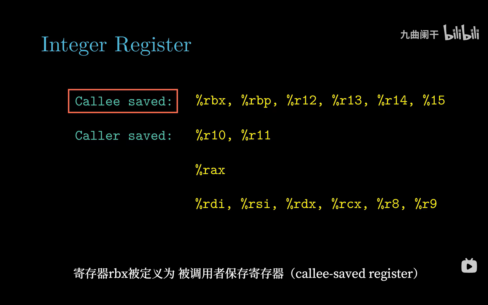

*▲ 图 3-7-12：红框标出 callee-saved 的 6 个寄存器（`%rbx %rbp %r12–%r15`）；下面才是 caller-saved：`%r10 %r11`、返回值 `%rax`、以及 6 个参数寄存器。这张图的划分与 ABI 一致。*

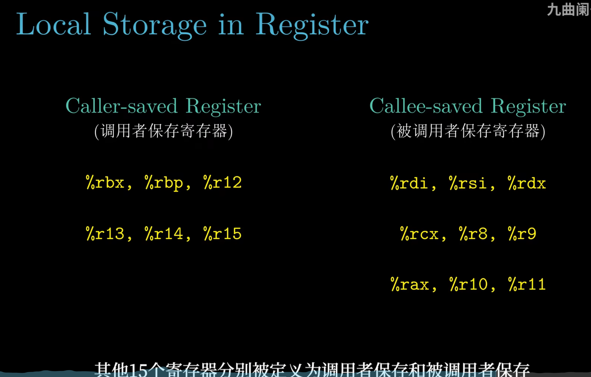

*▲ 图 3-7-13：⚠️ **这张课件截图把两栏的寄存器清单标反了**：左栏「Caller-saved」列出的 `%rbx %rbp %r12–%r15` 实际是 callee-saved，右栏「Callee-saved」列出的 `%rdi %rsi %rdx %rcx %r8 %r9 %rax %r10 %r11` 实际是 caller-saved。请以图 3-7-12 和上表为准。*

### （1）P 两次调用 Q：把 x 存进 callee-saved 寄存器

```c
void P(long x, long y)
{
    long u = Q(y);
    long v = Q(x);
    return u + v;
}
```

`x` 要活过第一次 `call Q`，而 `%rdi` 是 caller-saved，调用后不可信了。于是 P 选 callee-saved 的 `%rbp` 来存 x：

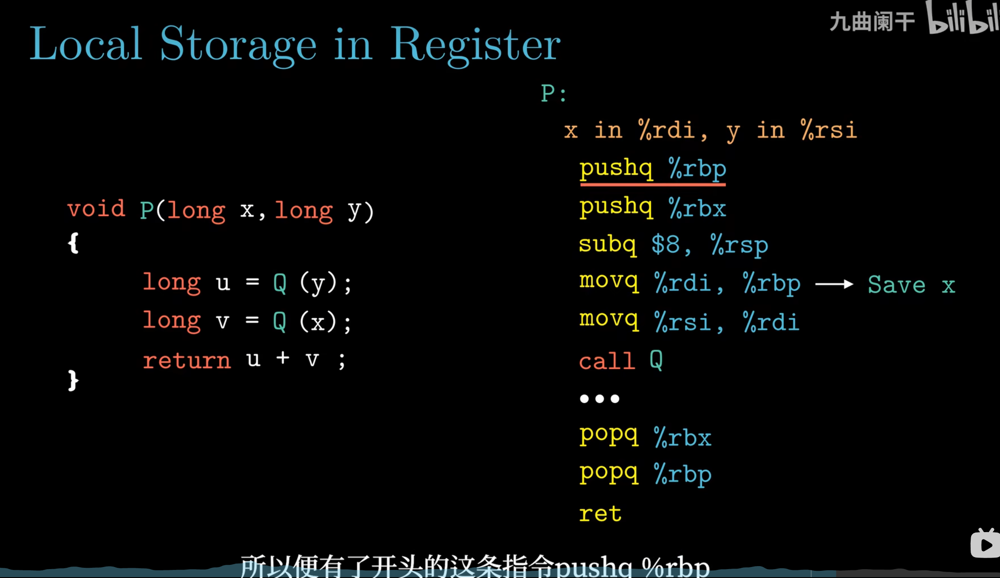

*▲ 图 3-7-14：开头的 `pushq %rbp`、`pushq %rbx` 先把两个 callee-saved 寄存器的旧值存进栈；`movq %rdi, %rbp` 把参数 x 搬进 `%rbp`（图右侧手写 "Save x"），之后才 `call Q`。这样 Q 无论怎么折腾，`%rbp` 里的 x 都还在。*

```asm
P:
    pushq   %rbp                # 保存旧的 %rbp
    pushq   %rbx                # 保存旧的 %rbx
    subq    $8, %rsp            # 让 %rsp 在 call 前 16 字节对齐
    movq    %rdi, %rbp          # x → %rbp（callee-saved）
    movq    %rsi, %rdi          # 参数 = y
    call    Q
    movq    %rax, %rbx          # u → %rbx（callee-saved）
    movq    %rbp, %rdi          # 参数 = x（从 %rbp 取回）
    call    Q
    addq    %rbx, %rax          # 返回值 = u + v
    addq    $8, %rsp            # 撤销对齐用的 8 字节
    popq    %rbx                # 后进先出：先恢复 %rbx
    popq    %rbp                # 再恢复 %rbp
    ret
```

### （2）恢复顺序必须与保存顺序相反

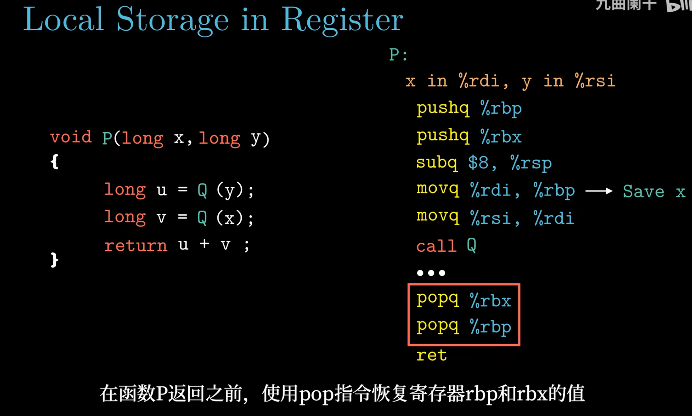

*▲ 图 3-7-15：红框里的 `popq %rbx` 必须在 `popq %rbp` 之前。因为栈是 LIFO：最后压入的 `%rbx` 在栈顶，必须最先弹出；顺序写反会把旧 `%rbp` 装进 `%rbx`、旧 `%rbx` 装进 `%rbp`，两个寄存器一起错位。*

```text
pushq %rbp  →  栈顶：[ 旧 %rbp ]
pushq %rbx  →  栈顶：[ 旧 %rbx ][ 旧 %rbp ]
popq  %rbx  →  栈顶：[ 旧 %rbp ]          ← 取走最上面那个，正好是 %rbx
popq  %rbp  →  栈顶：[       ]           ← 再取 %rbp
```

### （3）双方都要守约：func_A 与 func_B

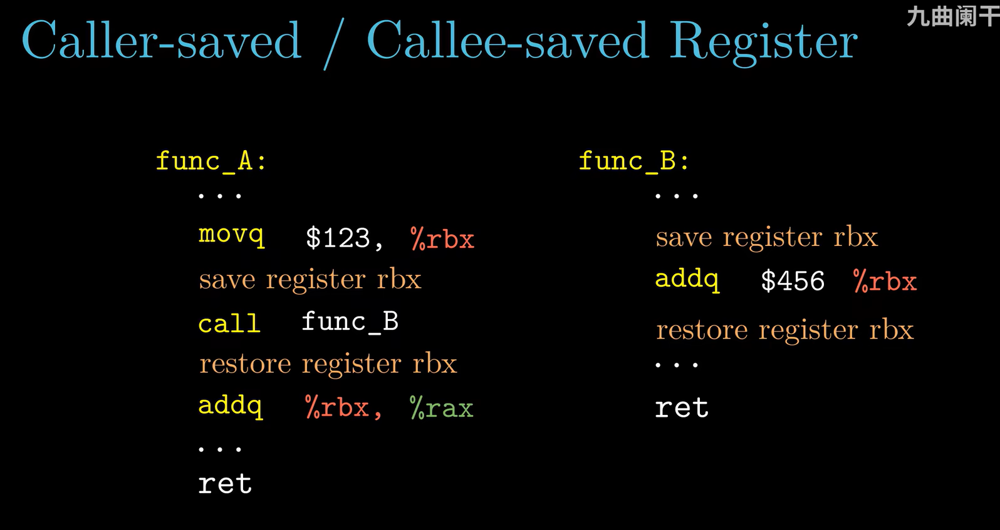

*▲ 图 3-7-16：`func_A` 把 123 放进 `%rbx`，随后 `call func_B`；`func_B` 想用 `%rbx`，于是先 save、加 456、再 restore 才 `ret`。回到 `func_A` 后，`addq %rbx, %rax` 里的 `%rbx` 仍是 123——这就是 callee-saved 的意义。*

> [!IMPORTANT]
> 责任是**双向**的：被调用者若用了 callee-saved 寄存器，**必须**在返回前恢复原值；调用者若想让 caller-saved 寄存器里的值活过调用，**必须**自己提前保存。只记住「callee-saved 安全」不够——安全的前提是被调用者真的执行了 push/pop。

---

## 3.7.6 递归过程

递归看起来特殊，其实**没有任何特殊指令**：每次调用都走一遍 `call`，都在栈上压一个新帧，各层的局部变量互不干扰。教材用 `rfact` 演示：

```c
long rfact(long n)
{
    long result;
    if (n <= 1)
        result = 1;              // 基准情形
    else
        result = n * rfact(n - 1);
    return result;
}
```

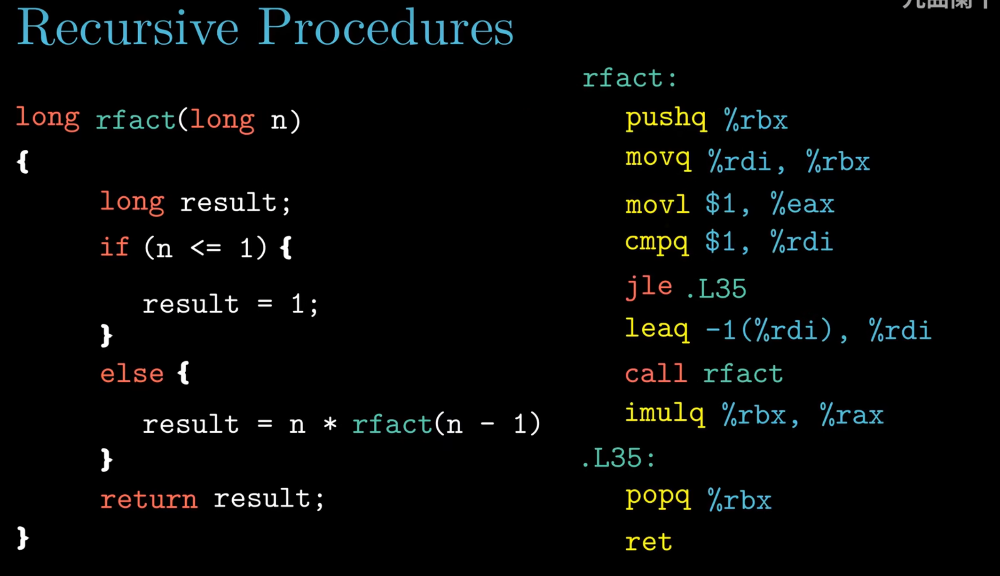

*▲ 图 3-7-17：左边 C，右边汇编。注意 `pushq %rbx` + `movq %rdi, %rbx` 这一对——先把当前层的 n 存进 callee-saved 的 `%rbx`；`cmpq $1, %rdi` 与 `jle .L35` 处理基准情形；`leaq -1(%rdi), %rdi` 算好 n-1 再 `call rfact`。*

```asm
rfact:
    pushq   %rbx                # 保存 %rbx（callee-saved，借了要还）
    movq    %rdi, %rbx          # 本层的 n 存进 %rbx
    movl    $1, %eax            # result = 1（先按基准情形准备好）
    cmpq    $1, %rdi            # 比较 n 与 1
    jle     .L35                # n <= 1 → 直接返回 1
    leaq    -1(%rdi), %rdi      # 参数 = n - 1
    call    rfact               # 递归
    imulq   %rbx, %rax          # result = n * rfact(n-1)
.L35:
    popq    %rbx                # 恢复 %rbx
    ret                         # 返回 result（在 %rax 中）
```

**为什么必须存进 `%rbx`？** 因为 `%rdi` 是 caller-saved：`call rfact` 返回后，`%rdi` 里早已不是本层的 n（被更深的调用改掉了）。而 `%rbx` 是 callee-saved，递归调用会替我们保存并恢复它，所以 `imulq %rbx, %rax` 拿到的仍是**本层**的 n。

**返回值的传递**：`%rax` 是返回值寄存器。基准情形下 `%eax = 1`；递归返回后 `%rax` 里是 `rfact(n-1)`，再乘 `%rbx` 里的 n，结果仍放回 `%rax` 交给上一层。

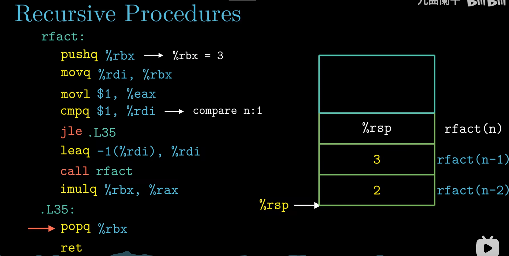

*▲ 图 3-7-18：右侧栈图从上往下是 `rfact(n)`、`rfact(n-1)`、`rfact(n-2)` 的帧，格里的 3、2 就是 `pushq %rbx` 保存下来的父层 n。注意每层 `pushq` 存的是**上一层**的 n，本层的 n 此刻正放在自己的 `%rbx` 里。*

```text
   rfact(4) 的调用链（栈向低地址增长）

   高地址
   ┌──────────────────────────────┐
   │ rfact(4)：返回地址 → main    │
   │           保存的 %rbx = 旧值 │
   ├──────────────────────────────┤
   │ rfact(3)：返回地址 → 4 的 imul│
   │           保存的 %rbx = 4    │
   ├──────────────────────────────┤
   │ rfact(2)：返回地址 → 3 的 imul│
   │           保存的 %rbx = 3    │
   ├──────────────────────────────┤
   │ rfact(1)：返回地址 → 2 的 imul│
   │           %rbx = 1，存父层 2 │
   └──────────────────────────────┘  ← %rsp
   低地址

   逐层返回、逐层相乘：1 → 2×1=2 → 3×2=6 → 4×6=24
```

每层帧里都有一份**独立的 n**：深度为 n 时栈上同时存在 n 份现场，空间开销 O(n)。递归太深（n 大到几十万）会把默认 8 MB 的栈撑爆——这不是递归本身的错，而是栈空间有限。

---

## 📌 重点速记

```text
栈帧     : %rsp 指栈顶；栈向低地址增长；帧 = 参数构造区 + 返回地址 + 保存寄存器 + 局部变量
call     : push 返回地址（call 的下一条）+ %rip ← 目标
ret      : %rip ← 栈顶返回地址；%rsp += 8
参数寄存器: 1 %rdi  2 %rsi  3 %rdx  4 %rcx  5 %r8  6 %r9   （全部 caller-saved）
第 7 个起 : 8(%rsp), 16(%rsp), 24(%rsp) …   每个占 8 字节
子寄存器 : %rdi→%edi→%di→%dil；%rsi→%esi→%si→%sil
栈偏移   : 局部变量用 (%rsp)、8(%rsp)…；先分配的在低地址
caller-saved: %rax %rdi %rsi %rdx %rcx %r8 %r9 %r10 %r11
callee-saved: %rbx %rbp %r12 %r13 %r14 %r15
栈平衡   : subq $16 分配 → addq $16 释放；push 与 pop 逆序配对
递归     : 每层一个帧；n 存 callee-saved；返回值走 %rax
```

---

## ⚠️ 易错点

1. **把返回地址当成 `call` 自己的地址**——`0x6fb` 处的 `callq 741` 压入的是下一条指令地址 `0x700`，不是 `0x6fb`。
2. **以为第 7 个参数在 `(%rsp)`**——`(%rsp)` 是返回地址，第 7 个参数在 `8(%rsp)`。
3. **以为 `char` 参数在栈上只占 1 字节**——栈上每个参数都按 8 字节对齐占位。
4. **把 caller-saved 与 callee-saved 记反**——`%rbx %rbp %r12–%r15` 是 callee-saved；参数寄存器、`%rax`、`%r10/%r11` 是 caller-saved。课件截图也标反了。
5. **`push`/`pop` 顺序写反**——先 `pushq %rbp` 再 `pushq %rbx`，就必须先 `popq %rbx` 再 `popq %rbp`。
6. **返回前忘记恢复 `%rsp`**——`subq $16` 必须配 `addq $16`，否则 `ret` 取错返回地址。
7. **递归里直接用 `%rdi` 参与乘法**——`call` 之后 `%rdi` 已被改，必须把 n 存进 `%rbx`（或栈）里。

---

## ✅ 自测

1. `call` 指令压入栈的返回地址是什么？若 `call` 位于 `0x6fb`、长 5 字节，返回地址是多少？
2. 某函数有 9 个 `long` 参数，第 7、8、9 个分别从哪里取？为什么不从 `(%rsp)` 开始？
3. `subq $16, %rsp` 与 `addq $16, %rsp` 各起什么作用？`caller` 中 arg1、arg2 分别在什么位置？
4. 下面这段恢复代码错在哪：`pushq %rbp; pushq %rbx; ...; popq %rbp; popq %rbx; ret`？
5. `rfact` 为什么必须 `pushq %rbx`？若把 n 留在 `%rdi` 里、返回后用 `imulq %rdi, %rax` 会怎样？

<details>
<summary>参考答案</summary>

1. 返回地址是 `call` **下一条指令**的地址；`0x6fb + 5 = 0x700`。
2. 分别从 `8(%rsp)`、`16(%rsp)`、`24(%rsp)` 取；因为 `(%rsp)` 存的是返回地址，栈参数从它上面一格开始。
3. `subq $16` 分配 16 字节局部空间，`addq $16` 在返回前释放、恢复栈平衡；arg1 在 `(%rsp)`、arg2 在 `8(%rsp)`，且 `swap` 之后两者已互换。
4. `pop` 顺序必须与 `push` 相反：应先 `popq %rbx`、再 `popq %rbp`，否则两个寄存器的值互相装反。
5. 因为 `%rdi` 是 caller-saved，递归调用会覆盖它，返回后拿到的不是本层的 n；`%rbx` 是 callee-saved，递归调用会负责恢复。改成 `imulq %rdi, %rax` 会乘上一个已被改写的值，结果错误。

</details>

---

## 🔗 与其他章节的联系

| 本节内容 | 后续用在哪 |
| :--- | :--- |
| 栈帧 / `%rsp` | 3.8 数组与指针运算、3.10 缓冲区溢出（改写返回地址） |
| `call`/`ret` 与返回地址 | 3.10 缓冲区溢出、第 4 章 Y86-64 的调用/返回实现、第 7 章链接 |
| 参数传递约定 | 3.8 结构体按值传递、第 7 章链接、第 9 章虚拟内存的栈区 |
| caller/callee-saved | 3.7.6 递归、第 5 章程序优化（寄存器分配） |
| 递归栈帧 | 第 9 章虚拟内存、栈溢出与栈保护 |

---

[← 上一节：3.6 控制](3.6%20控制.md)　｜　[下一节：3.8 数组分配和访问 →](3.8%20数组分配和访问.md)
