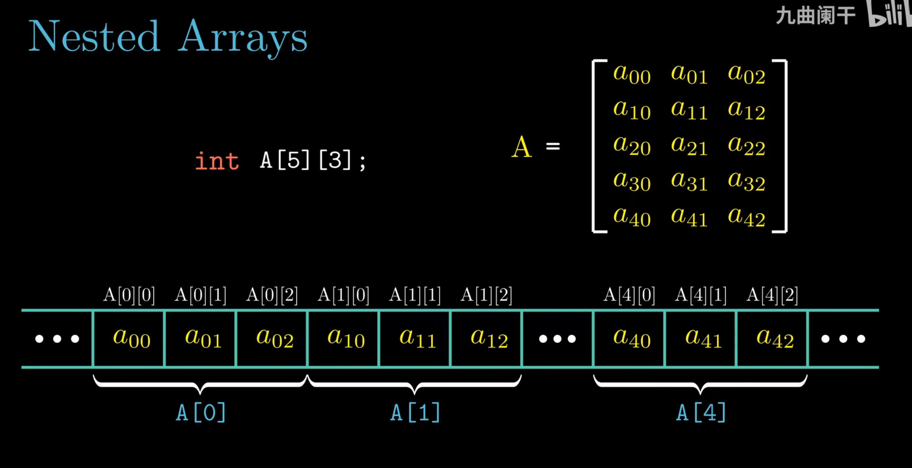
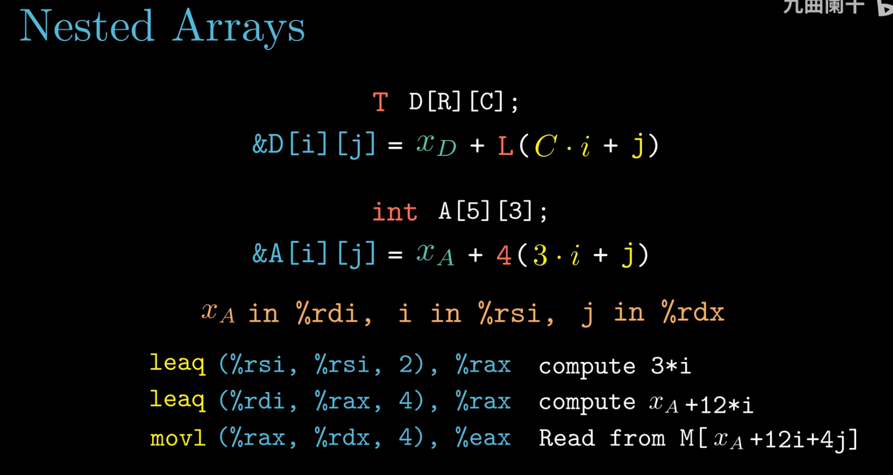
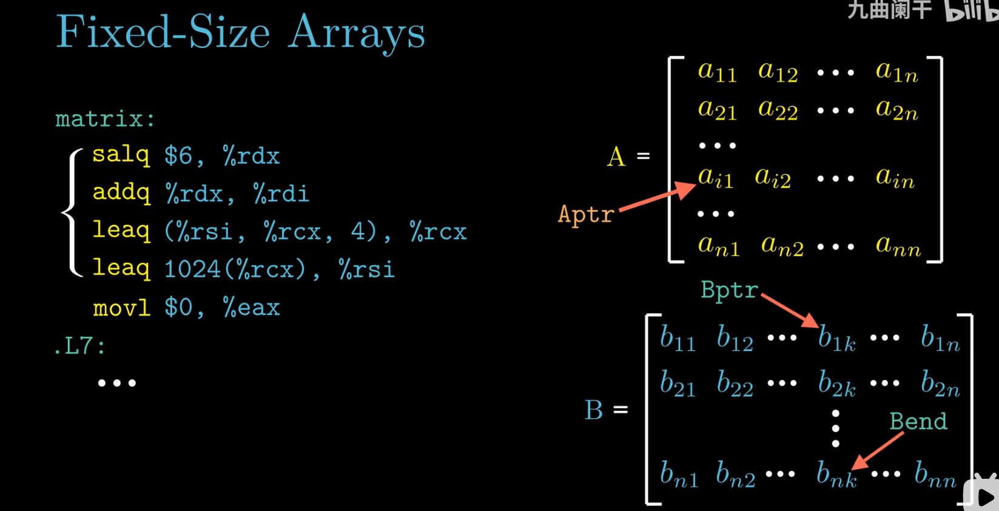
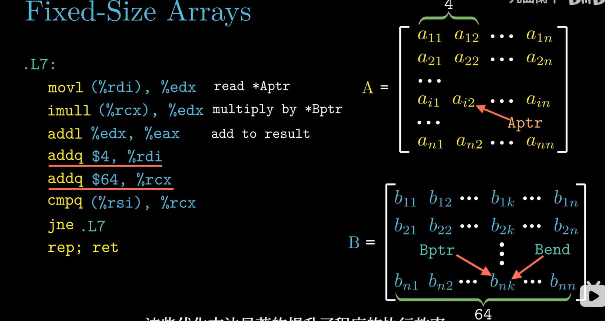
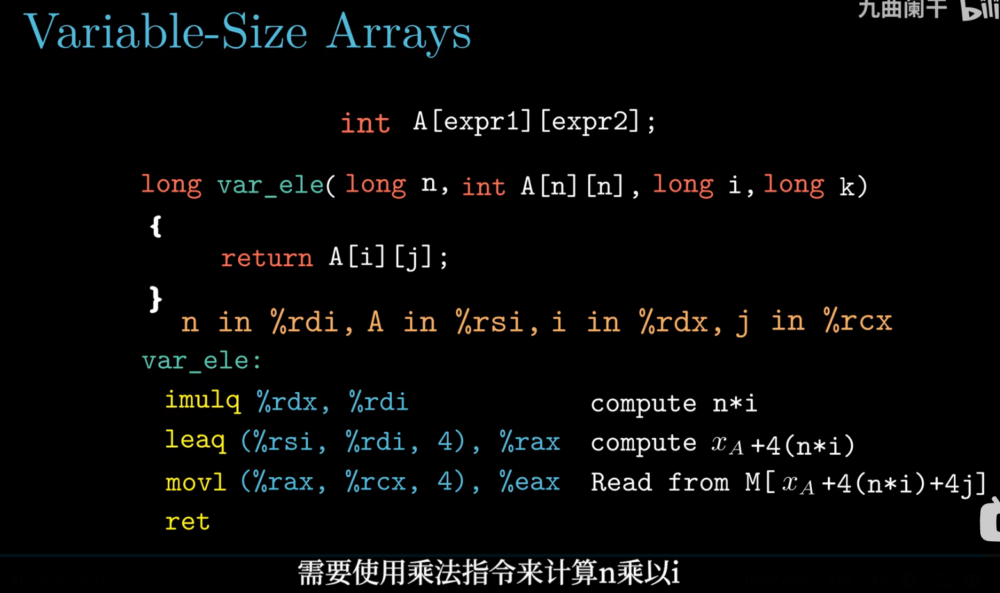
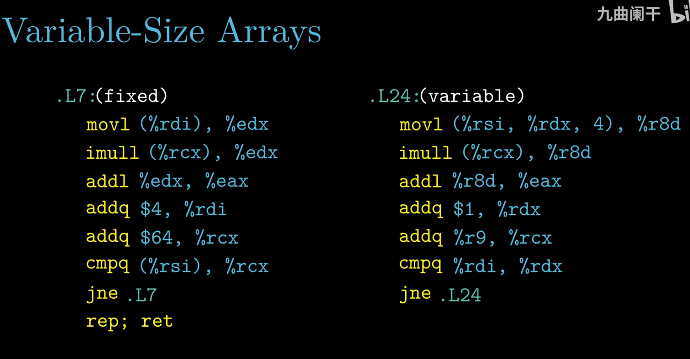

# 3.8 数组分配和访问

> **📖 本节定位**　第 3 章「程序的机器级表示」· 教材 P176–P183
> **一句话**：数组在机器级只是"一块连续内存 + 首地址"，下标访问被编译成一条"基址 + 变址 × 比例因子"的地址计算，再加一次访存。

> [!IMPORTANT] 本节要回答的三个问题
> 1. `A[i]` 里那个 `i`，机器凭什么把它变成一个内存地址？
> 2. 二维数组 `A[i][j]` 为什么**必须**知道列数 C，行数 R 却能省掉？
> 3. 同样写 `x[i][j]`，为什么 `int pgh[4][5]` 只读一次内存，`int *univ[3]` 要读两次？

**读之前你需要会**：`leaq` 只算地址、不访存，以及寻址模式 `D(Rb,Ri,S)` 里的 S 只能取 1/2/4/8（见 [3.4 访问信息](3.4%20访问信息.md)）。不会也没关系——本节会把用到的部分重讲一遍。

[← 上一节：3.7 过程](3.7%20过程.md)　｜　[下一节：3.9 异质的数据结构 →](3.9%20异质的数据结构.md)

---

## 🎯 核心结论

| # | 结论 |
| :-: | :--- |
| 1 | `T A[L]` 在内存中是 **L × sizeof(T) 字节的连续区域**，`A` 的值就是首元素地址 |
| 2 | 元素地址公式 **&E[i] = E + i × sizeof(T)**；比例因子只能是 1/2/4/8，正好对上寻址模式的 scale |
| 3 | 二维数组按**行主序**存放，`int A[R][C]` 的 `A[i][j]` 位于 `A + sizeof(T) × (C×i + j)` |
| 4 | 指针 `p + i` 加的是 **i 个元素**（地址加 `i × sizeof(T)`），与整数加法是两件事 |
| 5 | `A + i` ≡ `&A[i]`，`*(A + i)` ≡ `A[i]` |
| 6 | 编译器把"下标 × 常数"**强度削弱**成移位/加法，把"重算下标"改成"指针自增"；VLA 的维长是运行时值，乘法无法静态优化 |

---

## 3.8.1 基本原则

**先说它想解决什么问题**：`A[i]` 在 C 里只是一个下标，机器要的却是一个**字节地址**。数组元素不是"一个名字一个格子"，而是一排**等宽**的柜子：光知道柜号不够，还得知道每格多宽，才能算出第 i 格离起点多远。

```text
  A:   ┌──────┬──────┬──────┬──────┬──────┐
       │ A[0] │ A[1] │ A[2] │ A[3] │ A[4] │   每个柜子 4 字节（int）
       └──────┴──────┴──────┴──────┴──────┘
       x_A    +4     +8     +12    +16
       └──── A[i] 的门牌 = x_A + i × 4 ────┘
```

**形式化定义**：`sizeof(T)` 就是"柜子的宽度"，下标 `i` 是"数到第几个柜子"，于是 `&A[i] = x_A + i × sizeof(T)`——**下标算术 = 地址算术**，乘的那一个 `sizeof(T)` 就是全部区别。

C 允许声明 `T A[L]`，它表示一个 **L 个元素、每个元素类型为 T** 的数组。在机器级，它就是一块连续内存，占 `L × sizeof(T)` 字节；指向首元素的指针就是 `A`（准确说是 `A` 退化成的 `&A[0]`）。设起始地址为 $x_A$，则：

```text
     &A[i]  =  x_A + i × sizeof(T)          （i 必须用 64 位寄存器）
```

**为什么一定要乘 sizeof(T)？** 因为地址以**字节**为单位，而元素可能占多个字节。把"第 i 个元素"翻译成"第几个字节"，只能乘元素大小。而 x86-64 寻址模式 `D(Rb, Ri, S)` 的 S **只允许 1、2、4、8**——这不是巧合，而是为 C 的基本类型量身定制的：

| 元素类型 T | sizeof(T) | 能用的寻址模式 | `&A[i]` 的写法 |
| :--- | :-: | :--- | :--- |
| `char` | 1 | S = 1 | `(%rdi,%rsi)` |
| `short` | 2 | S = 2 | `(%rdi,%rsi,2)` |
| `int`、`float` | 4 | S = 4 | `(%rdi,%rsi,4)` |
| `long`、`double`、指针 | 8 | S = 8 | `(%rdi,%rsi,8)` |

```c
int E[5];                  /* 20 字节，E 的地址记作 x_E */
void demo(long i) {
    E[i] = 0;              /* 写 */
    int v = E[i];          /* 读 */
}
```

```asm
# E 的首地址在 %rdx，i 在 %rcx
    movl    $0, (%rdx,%rcx,4)     # E[i] = 0      —— 比例因子 4 = sizeof(int)
    movl    (%rdx,%rcx,4), %eax   # v = E[i]
```

> [!NOTE]
> "取地址"和"取值"只差一条指令：`leaq (%rdx,%rcx,4), %rax` 是算 `&E[i]`，`movl (%rdx,%rcx,4), %eax` 是取元素值。
> **同样是算地址，`mov` 会顺着地址读内存，`leaq` 只算不读**——这是 3.5 节 `leaq` 双重身份的直接应用。

数组的总大小由同一条公式给出，课件用四个声明做对照：

| 声明 | 元素大小 | 元素个数 | 总字节数 | 合法下标 |
| :--- | :-: | :-: | :-: | :-: |
| `char string[12]` | 1 | 12 | **12** | 0–11 |
| `int val[5]` | 4 | 5 | **20** | 0–4 |
| `double a[3]` | 8 | 3 | **24** | 0–2 |
| `char *p[3]` | 8（指针） | 3 | **24** | 0–2 |

```text
char   string[12];   x ├────────── 12 字节 ──────────▶ x+12
int    val[5];       x ├──── 20 字节 ────▶ x+20
double a[3];         x ├──── 24 字节 ────▶ x+24
char  *p[3];         x ├──── 24 字节 ────▶ x+24   （三个 8 字节指针，不是 3 个字符）
```

最后一行最容易被看错：`p` 是**指针数组**，每个元素 8 字节，`p[0]` 本身就是一个地址，真正的字符还在别处。另外 `sizeof(A)` 给的是**整块**字节数（L × sizeof(T)），`sizeof(*A)` 才是一个元素的字节数——数组名在 `sizeof` 里不退化，这一点 3.8.2 还会用到。

### 二维数组与行主序

C 的二维数组 `int A[4][3]` 可理解为"4 个元素的数组，每个元素是 `int[3]`"。内存里先排完一整行再排下一行，这就是**行主序（row-major order）**：

```text
int A[4][3];        /* 12 个 int，48 字节，行主序 */

偏移:    0     4     8  │ 12    16    20  │ 24    28    32  │ 36    40    44
      ┌─────┬─────┬─────┼─────┬─────┬─────┼─────┬─────┬─────┼─────┬─────┬─────┐
      │[0][0]│[0][1]│[0][2]│[1][0]│[1][1]│[1][2]│[2][0]│[2][1]│[2][2]│[3][0]│[3][1]│[3][2]│
      └─────┴─────┴─────┴─────┴─────┴─────┴─────┴─────┴─────┴─────┴─────┴─────┘
       └──── 行 0 ────┘ └──── 行 1 ────┘ └──── 行 2 ────┘ └──── 行 3 ────┘
```

*▲ 图 3-8-1：行主序把二维下标 (i, j) 压成线性下标 `3i + j`，再乘 4 字节得到偏移。*

```text
    &A[i][j] = A + sizeof(T) × (C × i + j)
    int A[4][3] 时：  &A[i][j] = A + 4 × (3i + j) = A + 12i + 4j
```

> [!WARNING]
> 行主序是 C 的约定，**不是所有语言的约定**。Fortran、MATLAB 用列主序（column-major），同样的 `int A[4][3]` 在那边先排完一列。跨语言传矩阵时不写清"行优先还是列优先"，数据会整体"转置"。

---

## 3.8.2 指针运算

C 的指针运算规则是：**`p + i` 中的 i 以"元素个数"为单位**，编译器自动乘上 `sizeof(*p)`。

```c
int  A[4] = {1, 2, 3, 4};
int *p = &A[0];        /* 或直接写 p = A，两者等价 */

int *q  = p + 3;       /* 地址 = p + 3 × 4 = p + 12 字节 */
long d  = q - p;       /* 3 —— 相减得到的是"元素个数"，不是字节数 */
```

```text
   地址:   A+0     A+4     A+8     A+12
             │       │       │       │
    元素:   A[0]    A[1]    A[2]    A[3]
             ▲                       ▲
             p                       q = p+3   （字节地址只前进了 12）
```

*▲ 图 3-8-2：`p + 3` 在地址上加 12 字节；若是整数加法 `(long)p + 3`，地址只加 3 字节，就指到 `A[0]` 的中间去了。*

因为元素大小是常数，`p + i` 一条 `leaq` 就够：

```asm
# int *p 在 %rdi，long i 在 %rsi
    leaq    (%rdi,%rsi,4), %rax    # p + i  →  地址加 4i
# 若换成 char *p，同一句 C 代码变成：
    leaq    (%rdi,%rsi), %rax      # p + i  →  地址加 i（比例因子 1）
# 若换成 double *p：
    leaq    (%rdi,%rsi,8), %rax    # p + i  →  地址加 8i
```

> [!IMPORTANT]
> **指针的类型决定三件事**：① 一次访存读几个字节（`movb/movl/movq`）；② 指针算术的步长；③ 解引用时如何解释这些位。这就是 3.10.1 节"每个指针都有类型"的根源。

<details>
<summary>✅ 检查点 1：`int *p` 执行 `p + 3`，地址加了几个字节？先把 `p` 强转成 `char *` 再 `+3` 呢？</summary>

前者加 **12** 字节（3 个 `int`），后者只加 **3** 字节。`p + i` 的加数永远是 `i × sizeof(*p)`——类型决定步长，这条规则在二维、结构体上一样成立。
</details>

### 数组名与指针变量

`A` 和 `p` 都能用 `[]`、都能 `+i`，但类型不同：`A` 是"5 个 `int` 的数组"，`p` 是"存着一个地址的变量"。先看同一个 `int val[5] = {1, 5, 2, 1, 3};`（起始地址 `x`）的七种写法：

| 表达式 | 类型 | 值 |
| :--- | :--- | :--- |
| `val[4]` | `int` | 3 |
| `val` | `int *` | x（首元素地址） |
| `val + 1` | `int *` | x + 4 |
| `&val[2]` | `int *` | x + 8 |
| `&val[1] + 1` | `int *` | x + 8 |
| `val + i` | `int *` | x + 4i |
| `*(val + 1)` | `int` | 5 |
| `val[5]` | `int` | **未定义**（越界一格，但能编译） |

`val[5]` 是课件故意留成"??"的一行：`val[4]` 已占 x+16..x+19，`val[5]` 落在 x+20，读出来的是相邻内存——可能是别的变量、也可能是填充。C 不做边界检查，越界只在运行时"碰运气"。

再把"数组 vs 指针"逐项对一遍。课件用三列打分：**Comp**（能否编译）、**Bad**（解引用是否危险，比如空指针或越界引用）、**Size**（`sizeof` 结果）：

| 声明 | Comp | Bad | Size | `*A` 的大小 |
| :--- | :-: | :-: | :-: | :-: |
| `int A1[3]` | Y | N | **12** | 4（元素已分配） |
| `int *A2` | Y | **Y** | **8** | 4（指向哪里未知） |

```text
int A1[3];    A1 ──▶ [int][int][int]           12 字节，元素就在原地
int *A2;      A2 ──▶ [8 字节指针] ──▶ ？？？     指针自己已分配，指向的目标未分配
```

> [!NOTE]
> **"为指针分配空间"和"为它指向的对象分配空间"是两件事。** `int *A2;` 只给了 8 字节放地址，`*A2` 能不能读，全看 A2 有没有被初始化——这就是野指针。数组名 `A1` 则永远指向一块已经存在的 12 字节，所以 `*A1` 必然安全。注意 `sizeof(*A2)` 依然是 4：`sizeof` 只看类型，不会真的去解引用。

第二层（`An`、`*An`、`**An`）才把"指针数组"和"数组指针"分开：

| 声明 | `sizeof(An)` | `sizeof(*An)` | `sizeof(**An)` |
| :--- | :-: | :-: | :-: |
| `int A1[3]` | 12 | 4 | 不能编译 |
| `int *A2[3]` | **24** | 8 | 4（两次解引用，危险） |
| `int (*A3)[3]` | **8** | **12** | 4（A3 未初始化时危险） |

```c
int *A2[3];      /* 等价于 int *(A2[3])：A2 是数组，3 个元素，每个是 int* —— 指针数组 */
int (*A3)[3];    /* A3 是指针，指向 int[3] —— 数组指针；A3 + 1 前进 12 字节 */
```

区别全在优先级：C 里 `[]` 高于 `*`，所以 `A2` 先和 `[3]` 结合成数组、再看元素类型；`A3` 用括号把 `*` 提上来，先成为指针、再指向 `int[3]`。同一个套路还用在函数指针上：`int (*pf)(int, int)` 是"指向函数的指针"，`int *pf(int, int)` 是"返回指针的函数"。

| 名字 | 写法 | 本质 | `sizeof` |
| :--- | :--- | :--- | :-: |
| 数组 | `int A[3]` | 3 个 `int` 连续存放 | 12 |
| 指针数组 | `int *A[3]` | 3 个指针 | 24 |
| 数组指针 | `int (*A)[3]` | 1 个指针，指向 `int[3]` | 8 |

数组名还有两条"不是指针"的铁证：`A = p`、`A++` 都编译不过（数组名不是可修改的左值）；`sizeof(A)` 是整块 12 而不是 8。而一旦进了函数参数表，三者彻底等价：

```c
void f(int A[3]);      /* 与下面两个完全同义 */
void f(int A[]);
void f(int *A);        /* 真身：指针，sizeof(A) == 8 */
```

长度信息在退化那一刻就丢了，函数里再写 `sizeof(A) / sizeof(A[0])` 只会得到 `8 / 4 = 2`。要长度就另传一个参数——这也是 3.8.5 节 VLA 形参必须把 `n` 写在 `A[n][n]` 前面的原因。

---

## 3.8.3 嵌套的数组

先看 `int A[5][3]` 在内存里长什么样：逻辑上它是 5 行 3 列的矩阵，落进内存却是一条首尾相接的一维序列，一行固定占 3 个 `int`（12 字节）。



*▲ 图 3-8-3：上半部分是逻辑上的 5×3 矩阵，下半部分是同一批元素在内存里的实际排布。注意大括号：`A[0]`、`A[1]` 各占连续 12 字节，隔着中间几行跳到 `A[4]` 仍然同样宽——每行的宽度只由列数 3 决定，与行号无关。*

C 的"多维数组"其实是**数组的数组**，`int A[5][3]` 的类型可以写成：

```c
typedef int row3_t[3];    /* 一行 = 3 个 int，占 12 字节 */
row3_t A[5];              /* 5 行；sizeof(A[0]) == 12，sizeof(A) == 60 */
```

<details>
<summary>✅ 检查点 2：`A` 和 `A[0]` 数值一样，它们真的等价吗？各自的 `sizeof` 是多少？</summary>

不等价，**类型不同**：`A` 是 `int[5][3]`，`sizeof` 为 60；`A[0]` 是 `int[3]`，`sizeof` 为 12。`A + 1` 跨一整行 12 字节，`A[0] + 1` 只跨 4 字节——值相同、步长不同，这就是"数组的数组"的准确含义。
</details>

所以 `A[i][j]` 的地址是 `A + 12i + 4j`。**关键一步是"12i"**：比例因子最大只有 8，12 无法一次乘出来，于是编译器用两条 `leaq`——先算 `3i`，再乘 4 并加上 A：

```c
int A[5][3];
int get(long i, long j) { return A[i][j]; }
```

```asm
# A 在 %rdi，i 在 %rsi，j 在 %rdx
get:
    leaq    (%rsi,%rsi,2), %rax      # %rax = 3i          （行内元素个数 C = 3）
    leaq    (%rdi,%rax,4), %rax      # %rax = A + 12i     （乘 sizeof(int)）
    movl    (%rax,%rdx,4), %eax      # 取出 A[i][j]       （最后的比例因子 4）
    ret
```

把上面的地址公式和这三条指令对起来看：



*▲ 图 3-8-4：一般式 `&D[i][j] = x_D + L(C·i + j)` 在 `int A[5][3]` 上具体化成 `x_A + 4(3i + j)`。三条指令正好一人负责一段：先算 `3i`，再用比例因子 4 凑出 `12i` 并加上基址，最后一条 `movl` 才补上 `4j` 并真正读内存。*

#### 一起算一遍

取 `int A[5][3]`、首地址 `x_A = 0x1000`，求 `&A[2][1]`：

| 步骤 | 动作 | 结果 |
| :-: | :--- | :--- |
| ① | 每行 3 个 `int`，行跨距 = `C × 4` | 12 字节 |
| ② | 第 2 行起点 = `0x1000 + 2 × 12` | `0x1018` |
| ③ | 行内第 1 列 = `1 × 4` | 4 字节 |
| ④ | 合起来 = `0x1000 + 4 × (3×2 + 1)` | `0x1000 + 28 = 0x101C` |
| ⑤ | 用通式验算 `&A[i][j] = x_A + 4(3i + j)`，代入 i=2、j=1 | `0x1000 + 4×7 = 0x101C` ✅ |

再验一遍"线性下标"：`3i + j = 7`，说明 `A[2][1]` 是整块数组里的**第 7 个** `int`（从 0 数），偏移 `7 × 4 = 28 = 0x1C`。反过来已知线性下标 7，倒推 `i = 7 / 3 = 2`、`j = 7 % 3 = 1`——**二维下标 `(i, j)` 与一维下标 `3i + j` 一一对应**，`leaq (%rsi,%rsi,2)` 算的就是这个 `3i`。

三条指令逐步对账：`leaq (%rsi,%rsi,2), %rax` 出 `3i = 6`；`leaq (%rdi,%rax,4), %rax` 出 `A + 24 = 0x1018`，此时 `%rax` 已是行首地址；`movl (%rax,%rdx,4), %eax` 再补 `4j = 4`，读到 `0x101C`。

> [!NOTE] 换个角度想
> 寻址模式的 S 为什么只给 1/2/4/8，偏偏没有 3 和 12？因为 S 在机器码里只占 **2 位**，4 种编码刚好对上 C 的 4 种基本宽度。所以 `int A[5][3]` 的 `12i` 不是编译器笨，而是**硬件没有"乘 12"这一档**：只能先用 `leaq (%rsi,%rsi,2)` 凑出 `3i`，再用 S=4 补 4 字节。换成 `long A[5][3]`（行跨距 24），也还是这两步。

> [!TIP]
> 只关心"行首地址"或一维数组时，`leaq (%rdi,%rsi,4), %rax` 这种**单条**形式就够了：它算 `A + 4i`，即 `&A[i][0]`（一维时就是 `&A[i]`）。一旦行跨距超过 8 字节，就必须"先算行基址、再算列偏移"。

### 行向量：`A[i]` 是什么

二维数组的"行"不是语法糖，它本身就是一个数组对象。`int A[R][C]` 里：

| 表达式 | 类型 | 值 / 步长 |
| :--- | :--- | :--- |
| `A` | `int (*)[C]`（退化成行指针） | 首行地址；`A + 1` 前进 `C × 4` 字节 |
| `A[i]` | `int[C]`（数组，多数场合退化成 `int *`） | 第 i 行首地址 `A + i × C × 4` |
| `&A[i]` | `int (*)[C]` | 与 `A[i]` 数值相同，但类型是"指向整行的指针" |
| `&A[i][0]` | `int *` | 同样数值，类型是"指向单个 int 的指针" |
| `A[i][j]` | `int` | `*(*(A + i) + j)` |

所以 `A[i]`、`&A[i]`、`&A[i][0]` 三个值一样、类型三样。`&A[i] + 1` 直接跨到下一行（+`C×4` 字节），`&A[i][0] + 1` 只走一个元素（+4 字节）——这正是 3.8.2 那句"指针的类型决定步长"在二维上的体现。

返回一整行时，函数签名写 `int *`，编译器只算行基址、不做列偏移：

```c
#define PCOUNT 4
typedef int zip_dig[5];
zip_dig pgh[PCOUNT];                             /* 等价于 int pgh[4][5] */

int *get_row(int index) { return pgh[index]; }   /* 返回第 index 行首地址 */
```

```asm
# index 在 %rdi
    leaq    (%rdi,%rdi,4), %rax      # 5 * index      —— 行内 5 个 int
    leaq    pgh(,%rax,4), %rax       # pgh + 20*index —— 每行 20 字节
    ret
```

两条 `leaq`：先凑出"第几行"，再乘行宽 20。**返回类型是 `int *` 而不是 `int (*)[5]`**：若按行指针返回，调用方得写 `(*row)[j]`；返回 `int *` 可以直接 `row[j]`，代价是列数 5 这个信息也一并丢了——和 3.8.2 的"数组作参数退化"是同一件事。

行主序下访存顺序决定性能：按行遍历是连续 12 字节，按列遍历每步跨 12 字节，cache 命中率天差地别（第 6 章讲局部性时会回到这一点）。

### 从二维推广到三维

同一套"行主序 + 逐层乘维长"的规则可以往上叠。`int A[2][3][4]`（96 字节）的三级地址是：

```text
&A[i][j][k] = A + 4 × ( (3×4)×i + 4×j + k )
            = A + 4 × ( 12i + 4j + k )
```

| 表达式 | 类型 | 退化指针 `+1` 的步长 | `+1` 指向 |
| :--- | :--- | :-: | :--- |
| `A` | `int (*)[3][4]` | 48 字节 | 下一个 3×4 的"面" |
| `A[i]` | `int[3][4]` → `int (*)[4]` | 16 字节 | 下一行 |
| `A[i][j]` | `int[4]` → `int *` | 4 字节 | 下一个 `int` |
| `A[i][j][k]` | `int` | — | 单个 `int` |

通式：`T A[D1][D2]…[Dn]` 的元素地址为 `A + sizeof(T) × (((i1×D2 + i2)×D3 + i3)…×Dn + in)`——从最外层开始，每下一层先乘下一层的维长、再加本层下标。二维只是 n = 2 的特例：`int A[4][3]` 是 `A + 4 × (3i + j)`，三维是 `A + 4 × (12i + 4j + k)`，规则相同，只是多套了一层括号。

### 摊平：把二维数组当一维用

既然行主序已经把 `A[i][j]` 压成线性下标 `C×i + j`，就可以把二维数组整体当 `int *` 用：

```c
zip_dig pgh[4] = {{1,5,2,0,6}, {1,5,2,1,3}, {1,5,2,1,7}, {1,5,2,2,1}};

int *linear_zip = (int *) pgh;        /* 整个 4×5 看成 20 个 int */
int *zip2       = (int *) pgh[2];     /* 只看第 2 行，仍从 0 开始编号 */

int result = pgh[0][0] + linear_zip[7] + *(linear_zip + 8) + zip2[1];
```

| 表达式 | 等价写法 | 值 |
| :--- | :--- | :-: |
| `pgh[0][0]` | `linear_zip[0]` | 1 |
| `linear_zip[7]` | `pgh[1][2]`（`7 = 5×1 + 2`，已跨到第 1 行） | 2 |
| `*(linear_zip + 8)` | `pgh[1][3]` | 1 |
| `zip2[1]` | `pgh[2][1]` | 5 |
| **result** | | **9** |

这张表说明两件事：① 线性下标换回二维就是 `i = idx / C`、`j = idx % C`；② 编译器**不会**检查 `linear_zip + 8` 是否还在某一行内——指针只认"元素个数"，行边界是程序员脑子里的约定。`(int *) pgh` 这种强制转换能成立，前提正是整个数组在内存里连续且按行主序排列。

### 多层级数组：指针的数组

还有一种完全不同的"二维"：每行是独立数组，外层数组里只存指向它们的指针。

```c
#define UCOUNT 3
zip_dig cmu = {1, 5, 2, 1, 3};
zip_dig mit = {0, 2, 1, 3, 9};
zip_dig ucb = {9, 4, 7, 2, 0};

int *univ[UCOUNT] = {mit, cmu, ucb};   /* 3 个元素的数组，每个元素是 int* */
```

```text
univ:  ┌──────────┬──────────┬──────────┐   24 字节
       │  &mit    │  &cmu    │  &ucb    │   每个 8 字节指针
       └────┬─────┴────┬─────┴────┬─────┘
            ▼          ▼          ▼
       [0,2,1,3,9] [1,5,2,1,3] [9,4,7,2,0]   ← 三块彼此独立的 20 字节
```

元素访问要**读两次内存**：先读出 `univ[index]` 这个指针，再按 `4*digit` 去找元素。

```asm
# index 在 %rdi，digit 在 %rsi
    salq    $2, %rsi                 # 4 * digit
    addq    univ(,%rdi,8), %rsi      # 第一次访存：取出 univ[index] 指针，加到 4*digit 上
    movl    (%rsi), %eax             # 第二次访存：取元素
    ret
```

同一个 `x[index][digit]` 写法，两种完全不同的机器码：

| | 嵌套数组 `int pgh[4][5]` | 多层级 `int *univ[3]` |
| :--- | :--- | :--- |
| 元素地址 | `Mem[pgh + 20×index + 4×digit]` | `Mem[Mem[univ + 8×index] + 4×digit]` |
| 访存次数 | **1 次** | **2 次**（先指针，后元素） |
| 行宽 | 固定 `C`，编译期常量 | 各行可以不同 |
| 行与行的关系 | 连续且等距 | 各自独立，地址无规律 |
| 汇编特征 | `leaq` 直接算出行基址 | `addq univ(,%rdi,8),%rsi` 从内存里取指针 |
| 典型用途 | 矩阵、定长记录（学号、邮编） | 字符串数组、长度不一的行 |

> [!TIP]
> **能用嵌套数组就别用指针数组。** 嵌套数组的行连续等距，地址一次算完、只访存一次；指针数组每访问一个元素都要多读一次内存，而且各行散落在数据段/堆的各个位置，cache 局部性也更差。只有"每行长度确实不同"（如 `char *names[]`）时，才值得付这笔代价。

一个容易忽略的细节：`univ` 的每个元素只是一个指针，C **不关心**它指向的数组有多长——所以三行长度可以不同，甚至可以有一个元素是 `NULL`（这既是灵活性，也是空指针崩溃的来源）。

---

## 3.8.4 定长数组

先看矩阵乘在进入循环之前，要把 A、B 的两个行指针摆到哪里：



*▲ 图 3-8-5：左边几条指令只做准备工作——`salq $6` 把行号 i 变成字节偏移 64i，`Aptr` 落在 A 的第 i 行行首，`Bptr` 落在 B 的第 k 列，`Bend` 是这一列走到行尾时的上界。右边两个 n×n 矩阵标出了这三个指针的位置。*

当维长是**编译期常量**时，编译器能做的远不止"算地址"：

```c
#define N 16
typedef int fix_matrix[N][N];

/* 计算乘积矩阵的 (i, k) 元素：A 的第 i 行 · B 的第 k 列 */
int fix_prod_ele(fix_matrix A, fix_matrix B, long i, long k)
{
    long j;  int result = 0;
    for (j = 0; j < N; j++)
        result += A[i][j] * B[j][k];
    return result;
}
```

`N = 16`、`sizeof(int) = 4`，行跨距 `16 × 4 = 64 = 2⁶` 字节，乘以 64 被**强度削弱（strength reduction）**成左移 6 位：

```asm
# A 在 %rdi，B 在 %rsi，i 在 %rdx，k 在 %rcx
fix_prod_ele:
    salq    $6, %rdx                 # 64i  ← N*sizeof(int) = 2^6，乘法变左移
    addq    %rdx, %rdi               # %rdi = A + 64i，指向 A[i][0]
    leaq    (%rsi,%rcx,4), %rsi      # %rsi = B + 4k，指向 B[0][k]
    leaq    1024(%rdi), %rax         # 行末地址：A + 64i + 64*16
    movl    $0, %ecx                 # result = 0
.L7:
    movl    (%rdi), %edx             # 读 A[i][j]（每轮 +4 字节）
    imull   (%rsi), %edx             # 乘 B[j][k]（每轮 +64 字节，沿列走）
    addl    %edx, %ecx               # result += 乘积
    addq    $4, %rdi                 # A 指针右移一格
    addq    $64, %rsi                # B 指针下移一行
    cmpq    %rax, %rdi
    jne     .L7
    movl    %ecx, %eax               # 返回 result
    ret
```

内层循环只有七条指令，重点看两条 `addq`：



*▲ 图 3-8-6：`Aptr` 每轮只前进 4 字节（沿行读 A），`Bptr` 每轮要跨 64 字节（沿列读 B，恰好一整个行宽），图中顶部的 4 与底部的 64 就是这两个步长。末尾的 `cmpq` 把自增的指针和事先算好的边界比，循环上界不用每轮重算。*

**反例**：若写成 `#define N 15`，行跨距是 `60`，**不是 2 的幂**，编译器只能生成 `imulq $60, %rdx, %rdx`。同样是"把乘法变便宜"，只是移位这条路走不通了——这就是"常数是不是 2 的幂"在机器码上留下的痕迹。

同一个 `64i`，在"只取一个元素、不进循环"时短得只剩三条指令：

```c
#define N 16
typedef int fix_matrix[N][N];
int fix_ele(fix_matrix A, size_t i, size_t j) { return A[i][j]; }
```

```asm
# A 在 %rdi，i 在 %rsi，j 在 %rdx
    salq    $6, %rsi                 # 64*i      ← 行跨距 N*sizeof(int) = 2^6
    addq    %rsi, %rdi               # A + 64*i  ← 第 i 行行首
    movl    (%rdi,%rdx,4), %eax      # + 4*j     ← 比例因子补上列偏移
    ret
```

对比 3.8.5 的 VLA 版：那里 `64i` 变成了 `imulq %rdx, %rdi`，多出来的正是"维长未知"的代价。定长数组的全部优势，就浓缩在这条 `salq` 与 `imulq` 的差别里。

当访问模式是"每次跨一整行再加一格"时，编译器还会**把下标运算搬到循环外**，直接用字节偏移做循环变量：

```asm
# void fix_set_diag(fix_matrix A, int val) —— A 在 %rdi，val 在 %esi
    movl    $0, %eax                 # 用"字节偏移"当循环变量，初值 0
.L13:
    movl    %esi, (%rdi,%rax)        # A[i][i] = val
    addq    $68, %rax                # 下一对角元素：跨一行(64) + 一个 int(4)
    cmpq    $1088, %rax              # 16 × 68 = 1088，循环上界是常数
    jne     .L13
```

---

## 3.8.5 变长数组

先看变长数组长什么样：维长是运行时表达式，取一个元素的地址就得真做一次乘法。



*▲ 图 3-8-7：`int A[expr1][expr2]` 的维长要到运行时才有值，所以 `n*i` 无法像定长版那样变成移位，只能生成一条 `imulq`，再用 `leaq (%rsi,%rdi,4)` 补上 `4·n·i`。图上还有讲义的一处笔误：形参写的是 `long k`，函数体和寄存器注释用的却是 `j`——按 `j` 理解即可，不影响结论。*

C99 引入**变长数组（VLA）**：维长可以是运行时表达式。这时行跨距不是常数，编译器只能老实做乘法：

```c
int var_ele(long n, int A[n][n], long i, long j) { return A[i][j]; }
```

形参里 `n` **必须写在 `A[n][n]` 之前**：数组形参会退化成指针 `int (*)[n]`，而 `n` 是计算地址时唯一的行跨距来源。这种"为计算类型而额外传递的整数"就是**隐藏参数**，调用者必须把它压进参数寄存器。

```asm
# n 在 %rdi，A 在 %rsi，i 在 %rdx，j 在 %rcx
var_ele:
    imulq   %rdx, %rdi               # n*i —— n 未知，只能真做乘法
    leaq    (%rsi,%rdi,4), %rax      # A + 4*n*i
    movl    (%rax,%rcx,4), %eax      # 再加 4j，取数
    ret
```

版式与定长版一模一样，唯一区别是 **`salq $6` 变成了 `imulq %rdx, %rdi`**——这一点差别，就是"编译期常量"与"运行时变量"在机器码上的全部代价。

取 `A[i][j]` 这件小事，教材给了三种写法，差别不在语法，而在**维长什么时候已知**：

| 写法 | 维长来源 | 地址计算 | 可移植性 |
| :--- | :--- | :--- | :--- |
| `fix_ele(fix_matrix A, i, j)` | 编译期常量 `N` | `salq $6` + 比例因子 4，无乘法 | 最好 |
| `vec_ele(size_t n, int *A, i, j)` 配 `IDX(n,i,j)` | 运行时参数 `n` | 手工压成一维下标，`imulq` 算 `n*i` | 最好，C89 起可用 |
| `var_ele(size_t n, int A[n][n], i, j)` | 运行时参数 `n`（VLA 形参） | 编译器自动生成 `imulq` | **C99 起才有，MSVC 的 C 编译器不支持** |

```c
#define IDX(n, i, j)  ((i) * (n) + (j))     /* 传统做法：自己把二维压成一维 */

int vec_ele(size_t n, int *A, size_t i, size_t j)
{
    return A[IDX(n, i, j)];                 /* 与 A[i][j] 等价，但乘法要自己写 */
}
```

`vec_ele` 的 `A` 是货真价实的 `int *`：二维数组传进来会退化成首元素指针，行数、列数**全部丢失**，所以 `n` 只能另外传。这也解释了为什么"数组作参数"时永远拿不到长度——函数里的 `sizeof(A)` 只有 8。VLA 版把这份信息编进了类型 `int (*)[n]`，代价是绑定 C99 与特定编译器。

```c
long var_prod_ele(long n, int A[n][n], int B[n][n], long i, long k)
{
    long j;  int result = 0;
    for (j = 0; j < n; j++)  result += A[i][j] * B[j][k];
    return result;
}
```

```asm
# n 在 %rdi，A 在 %rsi，B 在 %rdx，i 在 %rcx，k 在 %r8
    imulq   %rdi, %rcx               # n*i
    leaq    (%rsi,%rcx,4), %r10      # Aptr = A + 4*n*i，指向 A[i][0]
    leaq    (%rdx,%r8,4), %r11       # Bptr = B + 4*k，指向 B[0][k]
    leaq    (,%rdi,4), %rdx          # 4n —— 列方向的步长，运行时才算得出
    leaq    (%r10,%rdx), %rsi        # Aend = Aptr + 4n，循环上界
    movl    $0, %eax                 # result = 0
.L15:
    movl    (%r10), %ecx             # A[i][j]
    imull   (%r11), %ecx             # * B[j][k]
    addl    %ecx, %eax               # result += ...
    addq    $4, %r10                 # Aptr++
    addq    %rdx, %r11               # Bptr += 4n（步长本身是变量）
    cmpq    %rsi, %r10
    jne     .L15
    ret
```

即使 `n` 未知，编译器仍做了"指针自增"式的强度削弱；只是**每轮要加的那个步长**得先算出来（`leaq (,%rdi,4), %rdx`）。

把两个版本的内层循环并排放，差别一眼可见：



*▲ 图 3-8-8：左右两列逐行对应，只有步长和比较方式不同——定长版的 `addq $4` / `addq $64` 是烧进指令的常数，变长版退化成 `addq $1, %rdx`（下标自增）加 `addq %r9, %rcx`（每轮加上运行时算出的行跨距 4n）。本节 `var_prod_ele` 的清单把这个循环标作 `.L15`，讲义这里写作 `.L24`，是同一段代码。*

> [!WARNING]
> VLA 有真实风险：`int A[n][n]` 的 `n` 若来自用户输入，一个 `n = 100000` 就能让栈帧涨到 40 GB 直接崩溃。**大数组一律 `malloc` 放堆上**，别用 VLA 赌栈够不够。

---

## 📌 重点速记

```text
一维地址 : &E[i] = E + i * sizeof(T)
比例因子 : char 1 | short 2 | int/float 4 | long/double/指针 8
二维地址 : &A[i][j] = A + sizeof(T)*(C*i + j)     行主序
int A[4][3] : A + 12i + 4j
等价关系 : A+i ≡ &A[i]      *(A+i) ≡ A[i]
指针算术 : p+i 前进 i 个元素；p-q 得到元素个数
嵌套数组 : int A[5][3] → leaq (%rsi,%rsi,2) 算 3i；leaq (%rdi,%rax,4) 加 12i
定长优化 : N=16 → 64i 变成 salq $6；偏移量变循环变量；上界变常数
VLA      : 维长运行时才知道 → imulq 替掉 salq；n 必须作为参数传入
```

```text
数组名   : sizeof 不退化（int A[3] 是 12）；作参数后退化成指针，变 8 且长度丢失
指针数组 : int *A2[3] = 24 字节  │  数组指针 int (*A3)[3] = 8 字节，A3+1 跨 12 字节
多层级   : int *univ[3] → Mem[Mem[univ + 8i] + 4j]，要读两次内存
三维     : &A[i][j][k] = A + sizeof(T) × (S*C*i + C*j + k)
```

---

## ⚠️ 易错点

1. **把 `A[i]` 当成"第 i 个字节"**。它是第 i 个**元素**，地址是 `A + i*sizeof(T)`；对 `int*` 差 4 倍。
2. **下标用 `int` 而不是 `long`**。64 位下用 32 位下标要先 `movslq` 符号扩展，多一条指令；大数组还可能溢出成负偏移。
3. **二维公式写成 `A + 4*(R*i + j)`**。行主序里乘 i 的是**列数 C**，`int A[4][3]` 应是 `A + 4*(3i+j)`。
4. **以为 `p+1` 与 `(long)p+1` 一样**。前者按元素大小缩放，后者只加 1 字节，会指到元素中间。
5. **以为 `sizeof(A)` 等于指针大小**。数组名在 `sizeof` 里不退化：`int A[4]` 是 16；作为参数传进去后退化成指针，`sizeof` 变 8。
6. **VLA 的 `n` 提前用**。`void f(int A[n][n], int n)` 编译不过，必须 `int n, int A[n][n]`。
7. **以为越界会编译报错**。`int val[5]` 写 `val[5]` 语法完全合法，读的是紧邻的 4 字节；课件那段遍历 `for (i = 0; i <= ZLEN; i++) z[i]++` 就多走了一格。`i <= L` 与 `i < L` 在机器码里没有任何保护，下标越界只会安静地改坏相邻内存。

---

## ❓ 常见困惑

**Q：数组名和指针到底差在哪？`int A[3]` 和 `int *p` 不都能写 `A[i]`、`p[i]` 吗？**
A：差在**类型**和**有没有自己的存储**。`A` 的类型是 `int[3]`，它没有独立的 8 字节来放地址，所以 `sizeof(A) == 12`、`A = p`、`A++` 都编译不过；`p` 是个真变量，占 8 字节、`sizeof(p) == 8`，可以改指向。只有进了参数表，数组才退化成指针，两者才等价——长度信息正是在那一刻丢掉的。

**Q：为什么 `A[i]` 等价于 `*(A + i)`？**
A：因为 C 标准就是把 `A[i]` **定义**成 `*(A + i)`。而 `A + i` 在指针算术下等于"地址 + i × sizeof(T)"，解引用拿到的正好是第 i 个元素。顺带解释了 `i[A]` 为什么居然合法：`*(i + A)` 与 `*(A + i)` 是一回事。

**Q：二维数组传参，为什么必须给列数、行数却可以不写？**
A：算 `A[i][j]` 只需要**行跨距**，而跨距 = 列数 C × sizeof(T)；行数只在做越界检查时才用得上，可 C 不检查越界。所以 `void f(int A[][3])` 合法，`void f(int A[][])` 编译不过——`int (*A)[3]` 里那个 3 就是行跨距的全部信息。

---

## 🛠 动手试试

1. 亲手验证 `A[i]` 与 `*(A + i)` 是同一件事：

   ```c
   int A[4] = {1, 2, 3, 4};
   printf("%p %p %zu %zu\n", (void *)(A + 2), (void *)&A[2], sizeof(A), sizeof(A + 0));
   ```

   预期两个地址完全相同（都是 `&A[2]`），而两个 `sizeof` 打印 16 和 8——数组名在 `sizeof` 里不退化，`A + 0` 却已经是指针。
2. 把 `int get(long i,long j){return A[i][j];}`（`A` 为 `int A[5][3]`）编成汇编：`gcc -Og -S` 后应看到 `leaq (%rsi,%rsi,2), %rax` → `leaq (%rdi,%rax,4), %rax` → `movl (%rax,%rdx,4), %eax`，与 3.8.3 一字不差。
3. 让同一个 `int A[1024][1024]` 分别按行、按列累加求和并计时，预期按行的版本快一个数量级——行主序下按行走是连续地址，按列走每步跨 4 KB（第 6 章的局部性会解释为什么）。

---

## ✅ 自测

1. `long A[5]` 首地址 `0x1000`，`A[3]` 的地址是多少？`&A[3] - A` 的值是多少？
2. `int B[5][4]` 首地址 `0x2000`，写出 `&B[i][j]` 的字节偏移公式，并求 `&B[2][1]`。
3. 把 `short *p` 的 `p + 5` 编译成一条 `leaq`，写出这条指令（设 p 在 `%rdi`）。
4. 教材里 `fix_prod_ele` 用 `salq $6, %rdx`，若改成 `#define N 10`，这条指令会变成什么？为什么 `var_ele` 里必须把 `n` 当参数传进来？
5. `int *A2[3];` 与 `int (*A3)[3];` 各自的 `sizeof` 是多少？`A3 + 1`、`A2[0] + 1` 分别前进多少字节？
6. `int pgh[4][5]` 与 `int *univ[3]` 都写成 `x[i][j]`，两者的地址公式和访存次数差在哪？

<details>
<summary>参考答案</summary>

1. `0x1000 + 3×8 = 0x1018`；`&A[3] - A = 3`（单位是元素，不是字节）。
2. `&B[i][j] = B + 4×(4i + j) = 0x2000 + 16i + 4j`；`&B[2][1] = 0x2000 + 32 + 4 = 0x2024`。
3. `leaq (%rdi,%rsi,2), %rax`（`short` 占 2 字节，比例因子 2）。
4. 行跨距变成 `10 × 4 = 40`，不是 2 的幂，`salq $6` 变成 `imulq $40, %rdx, %rdx`。VLA 的 `n` 决定行跨距，而它在编译期未知，只能由调用者在运行时通过参数寄存器传入；`fix_prod_ele` 的 `N` 是常量，64 直接烧进指令。
5. `sizeof(A2) = 24`（3 个指针，每个 8 字节），`sizeof(A3) = 8`（一个指针）。`A3 + 1` 前进 12 字节（跨过一个 `int[3]`），`A2[0] + 1` 前进 4 字节（`A2[0]` 是 `int *`，指向单个 `int`）。区别的根源是类型：`A3` 是 `int (*)[3]`，`A2` 是 `int *[3]`。
6. 嵌套是 `Mem[pgh + 20×i + 4×j]`，行基址由 `leaq` 一次算完，**访存 1 次**；多层级是 `Mem[Mem[univ + 8×i] + 4×j]`，要先把 `univ[i]` 从内存读出来，**访存 2 次**，换来的是各行长度可以不同。

</details>

---

## 🔗 与其他章节的联系

| 本节内容 | 后续用在哪 |
| :--- | :--- |
| `&E[i] = E + i*sizeof(T)` | 3.10.1 指针算术、5.1 编译器优化（循环展开） |
| 行主序与二维偏移 | 6.2 局部性、5.6 矩阵乘法优化（分块） |
| 比例因子 1/2/4/8 | 3.4 寻址模式、4.1 Y86-64 的访存形式 |
| 定长/VLA 的强度削弱 | 5.1 强度削弱、5.8 循环展开、3.10.5 变长栈帧 |

---

[← 上一节：3.7 过程](3.7%20过程.md)　｜　[下一节：3.9 异质的数据结构 →](3.9%20异质的数据结构.md)
