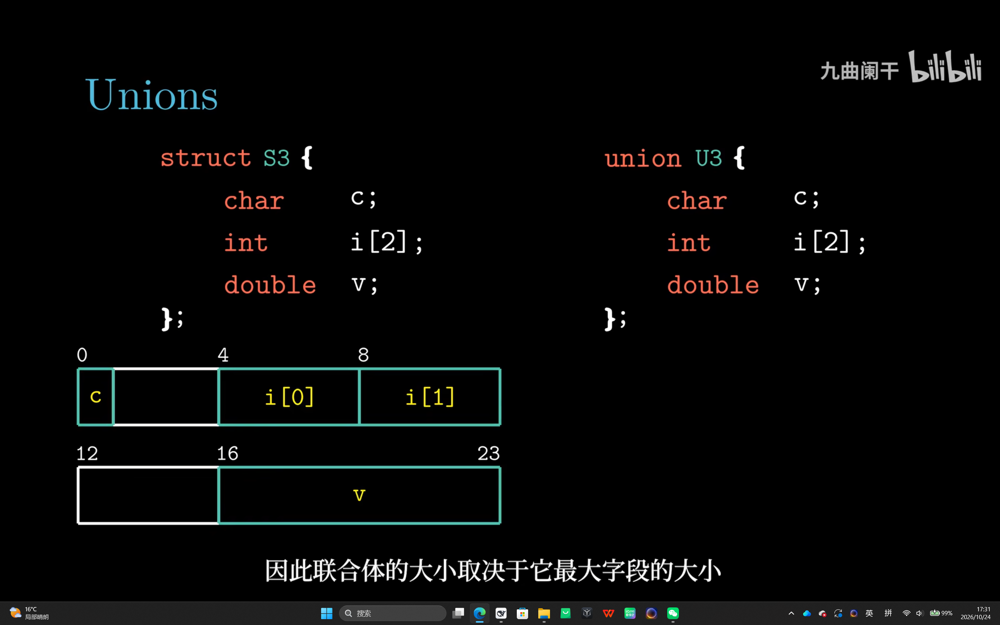
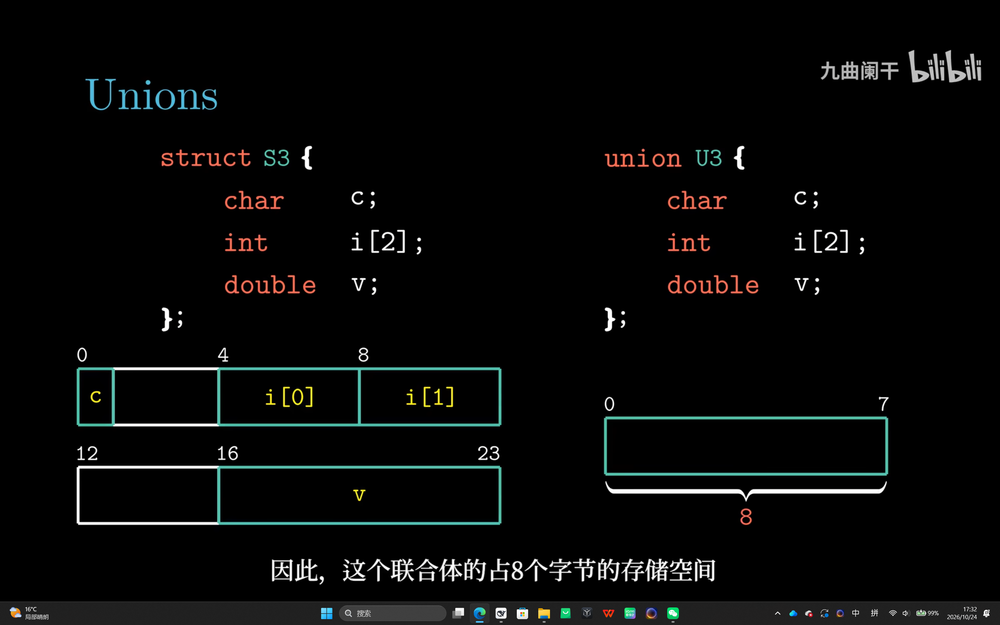
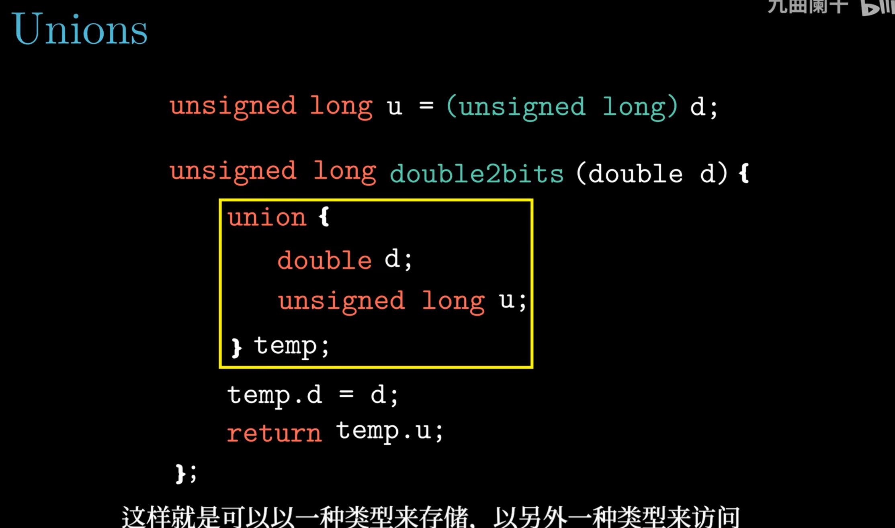
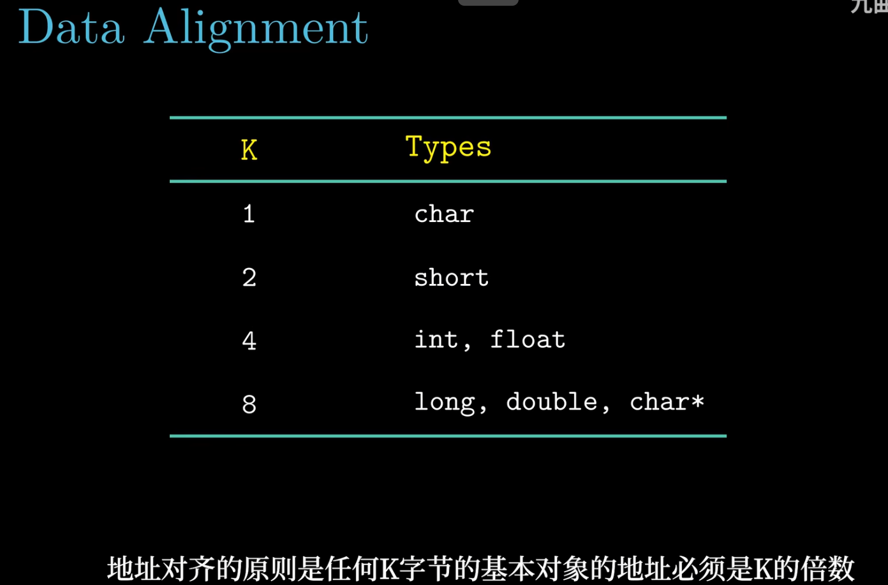
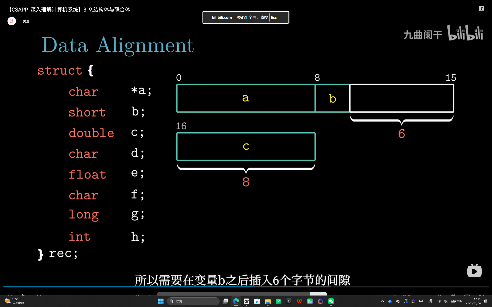
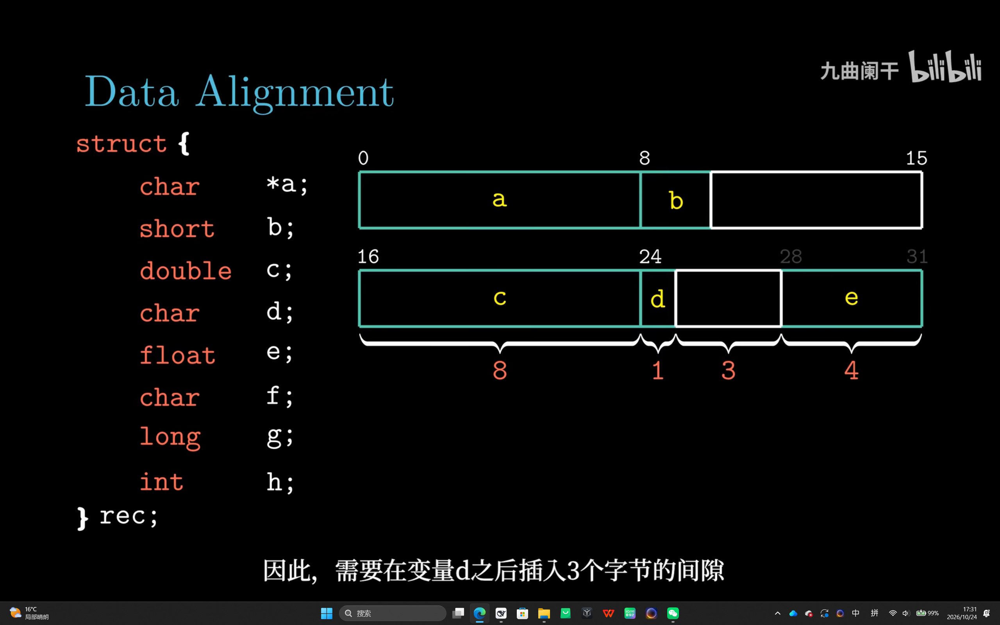
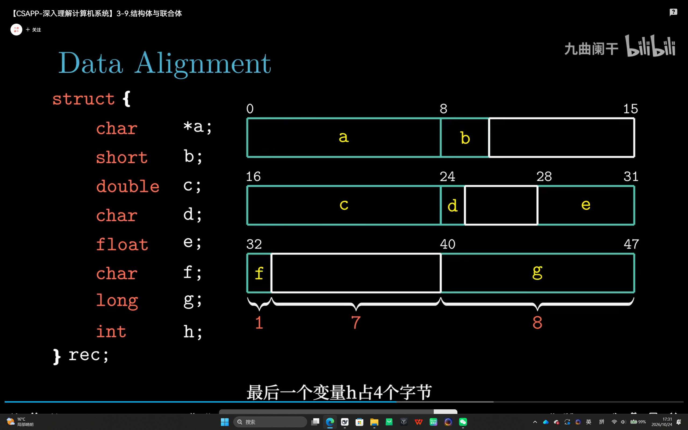
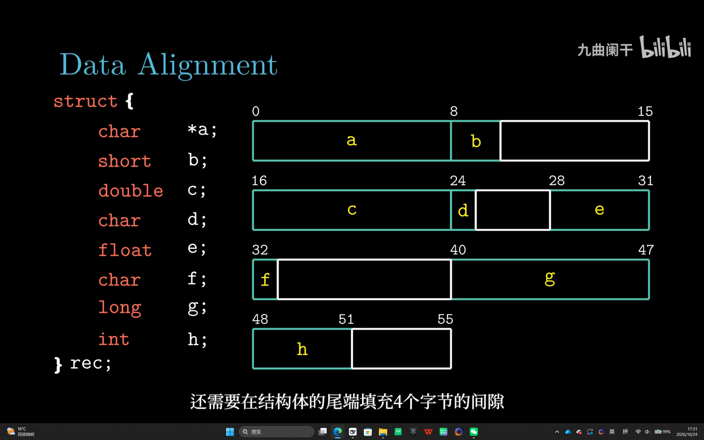

# 3.9 异质的数据结构

> **📖 本节定位**　第 3 章「程序的机器级表示」· 教材 P183–P192
> **一句话**：`struct` 和 `union` 把不同类型拼在一起，机器级只做两件事——**给每个成员一个固定偏移**、**按对齐要求插入填充字节**。

> [!IMPORTANT] 本节要回答的三个问题
> 1. `struct { char c; int i; char d; }` 明明只有 1+4+1 个字节，`sizeof` 凭什么报 12？
> 2. 对齐的要求到底是谁提的——C 语言规定的，还是硬件逼的？
> 3. `union` 与 `struct` 只差一个关键字，行为却完全相反，差别究竟落在哪一格内存上？

**读之前你需要会**：各基本类型的字节数（见 [3.3 数据格式](3.3%20数据格式.md)）与字节序（见 [2.1 信息存储](../第02章%20信息的表示和处理/2.1%20信息存储.md)）。不会也没关系——本节会把用到的部分重讲一遍。

[← 上一节：3.8 数组分配和访问](3.8%20数组分配和访问.md)　｜　[下一节：3.10 在机器级程序中将控制与数据结合起来 →](3.10%20在机器级程序中将控制与数据结合起来.md)

---

## 🎯 核心结论

| # | 结论 |
| :-: | :--- |
| 1 | 结构成员按声明顺序存放，**每个成员有一个编译期固定的字节偏移**，访问就是"基址 + 常量偏移" |
| 2 | 偏移**不等于**前面成员大小之和——对齐会插填充，末尾还可能有尾部填充 |
| 3 | `union` 的所有成员**共享同一块存储**，大小 = 最大成员按最大对齐向上取整 |
| 4 | `union` 能做"位重解释"，但结果依赖字节序与类型大小，**不可移植** |
| 5 | x86-64 要求 K 字节对象的地址是 **K 的倍数**：1、2、4、8、16 |
| 6 | 对齐是为了让一次访存取完整个对象；成员重排（大的在前）能省内存 |

---

## 3.9.1 结构

**先说它想解决什么问题**：`struct` 想把一个 `char`、一个 `int`、一个指针塞进同一块内存，可机器只肯按"类型宽度"给成员发地址。于是问题变成：**每个成员该从第几个字节开始**？

```text
  ┌────────┬────────┬────────┬────────┐
  │ 车位 0 │ 车位 1 │ 车位 2 │ 车位 3 │   每格 8 米 = 对齐要求
  └────────┴────────┴────────┴────────┘
```

**形式化定义**：成员偏移必须是 `min(自身大小, 对齐要求)` 的倍数，不够就在它前面插入填充字节。填充不属于任何成员、也不能被读写，却照样算进 `sizeof`——这就是"成员大小之和 ≠ `sizeof`"的全部原因。就像 1 米长的小车只占 1 米，可下一个 8 米成员必须从格线起步，中间那段空位就是填充。

`struct` 把不同类型的对象聚成一个整体。机器级上它没有"元数据"，只有一条规则：**每个成员放在距起始地址某个固定偏移处**。

```c
struct rec {
    int          a[4];   /* 16 字节的数组 */
    int          i;
    struct rec  *next;
};
```

| 成员 | 类型 | 大小 | 偏移 | 说明 |
| :--- | :--- | :-: | :-: | :--- |
| `a` | `int[4]` | 16 | **0** | 数组本身就是连续的 16 字节 |
| `i` | `int` | 4 | **16** | 紧跟数组末尾 |
| *（填充）* | — | 4 | 20 | 让 `next` 满足 8 字节对齐 |
| `next` | `struct rec *` | 8 | **24** | 指针必须 8 字节对齐 |
| **合计** | | **32** | | 32 是最大对齐数 8 的倍数 |

```text
struct rec r;    /* 32 字节 */

偏移:   0        4        8       12       16      20      24            32
      ┌────────┬────────┬────────┬────────┬───────┬───────┬───────────────┐
      │ a[0]   │ a[1]   │ a[2]   │ a[3]   │  i    │ 填充  │     next      │
      └────────┴────────┴────────┴────────┴───────┴───────┴───────────────┘
      └────────────── a 占 16 字节 ─────────┘        └─ 8 字节指针 ─┘
```

*▲ 图 3-9-1：`i` 只占 4 字节，但 `next` 必须落在 8 的倍数上，于是 20–23 被白白浪费——这就是"偏移不是简单累加"的最直观例子。*

<details>
<summary>✅ 检查点 1：`struct rec` 里 `next` 凭什么不能放在偏移 20？</summary>

因为 20 不是 8 的倍数。指针要求 8 字节对齐，落在 20 意味着它横跨 16–23 与 24–31 两个 8 字节块，一次 8 字节访存就得拆成两次。所以 20–23 只能填起来，把 `next` 顶到 24。**填充不是浪费，是给下一个成员"换一个合规的门牌号"**。
</details>

课件把同一个结构体的 `i` 声明成 `size_t`（8 字节），偏移表立刻变了样：

```c
struct rec2 { int a[4]; size_t i; struct rec2 *next; };
```

| 成员 | 大小 | 偏移 | 说明 |
| :--- | :-: | :-: | :--- |
| `a` | 16 | 0–15 | 不变 |
| `i` | **8** | **16–23** | `i` 自己占满 8 字节，20–23 **不再是填充** |
| `next` | 8 | **24** | 仍在 24，因为 24 本来就是 8 的倍数 |
| **合计** | **32** | | 仍是最大对齐数 8 的倍数 |

两版对比：`int i` 版是"`i` 占 4 字节 + 4 字节填充"，`size_t i` 版是"`i` 直接占 8 字节"；**偏移 16 与 24、`sizeof` 32 全都一样，填充却从 4 字节变成 0**。这说明填充量取决于"成员宽度与下一个成员对齐要求之差"，而不是成员个数。机器码也随之变化：读 `i` 从 `movslq 16(%rdi)`（读 4 字节再符号扩展）变成 `movq 16(%rdi)`（直接读 8 字节），偏移量本身不动。

成员访问的机器码，就是"基址 + 常量偏移"：

```c
void set_i(struct rec *r, int val)   { r->i = val; }
int *get_a(struct rec *r, long idx)  { return &r->a[idx]; }
struct rec *get_next(struct rec *r)  { return r->next; }
void set_val(struct rec *r, int val) { r->a[r->i] = val; }
```

```asm
# r 在 %rdi，val 在 %esi，idx 在 %rsi
    movl    %esi, 16(%rdi)           # set_i   : r->i = val（偏移直接烧进指令）
    leaq    (%rdi,%rsi,4), %rax      # get_a   : r + 4*idx = &r->a[idx]
    movq    24(%rdi), %rax           # get_next: 读偏移 24 处的 8 字节指针
    movslq  16(%rdi), %rax           # set_val : r->i 读出并符号扩展到 64 位
    movl    %esi, (%rdi,%rax,4)      #            r->a[i] = val
```

> [!IMPORTANT]
> `set_val` 里那句 `movslq` 不能省。参与地址计算的下标必须是 **64 位**，而 `r->i` 只有 32 位；`movslq` 连负数也能正确扩展，换成 `movl` 会算出错误地址。

链表遍历同理，`next` 就是"指针跟一步"：

```c
long sum(struct rec *r) { long s = 0; while (r) { s += r->a[0]; r = r->next; } return s; }
```

```asm
# r 在 %rdi
    movl    $0, %eax                 # s = 0
.L3:
    testq   %rdi, %rdi               # r == NULL ?
    je      .L5
    addl    (%rdi), %eax             # s += r->a[0]（偏移 0 可以省写）
    movq    24(%rdi), %rdi           # r = r->next
    jmp     .L3
.L5:
    ret
```

> [!TIP]
> 编译器把成员偏移当**立即数**写进指令。所以在 C 里改成员顺序（并重新编译所有用到它的代码）不影响正确性，只会改变这些立即数——但**二进制接口（ABI）** 就变了，动态库升级时这是真实事故来源。

### 结构体数组

结构体一旦进了数组，"对齐填充"就直接变成**数组步长**。`struct S3 { short i; float v; short j; } a[10];` 的成员只有 2+4+2 = 8 字节，`sizeof` 却是 **12**：

| 成员 | 类型 | 大小 | 偏移 | 填充作用 |
| :--- | :--- | :-: | :-: | :--- |
| `i` | `short` | 2 | **0–1** | — |
| *（填充）* | — | 2 | 2–3 | 把 `v` 推到 4 的倍数 |
| `v` | `float` | 4 | **4–7** | — |
| `j` | `short` | 2 | **8–9** | — |
| *（尾部填充）* | — | 2 | 10–11 | 把 `sizeof` 凑到 K = 4 的倍数 |

```text
a[0]                                a[1]
├─ i ─┬─填─┬─── v ───┬─ j ─┬─填─┼─ i ─┬─填─┬─── v ───┬─ j ─┬─填─┤
0     2    4         8     10   12    14   16        20    22   24
└────────── 12 字节 ──────────┘   └────────── 12 字节 ──────────┘
```

于是 `a[idx].j` 的地址是 `a + 12×idx + 8`。12 不是 2 的幂，编译器仍用两条 `leaq` 拼出来：

```asm
# short get_j(int idx) —— idx 在 %rdi
    leaq    (%rdi,%rdi,2), %rax      # 3 * idx
    movzwl  a+8(,%rax,4), %eax       # a + 4*(3*idx) + 8 = a + 12*idx + 8
```

两个细节：① `movzwl` 读 2 字节并**零扩展**——函数返回 `short`，调用方只看 `%ax`，高 16 位无关紧要，所以 gcc 省掉了符号扩展；若 `j` 要参与 32 位有符号运算（`return a[idx].j + 1;`），就会换成 `movswl`。② `12×idx` 拆成 `3×idx` 再乘 4，还是"比例因子最大 8"那条限制的老办法。

> [!TIP]
> **结构体数组的步长是 `sizeof`，不是成员大小之和。** `a[idx]` 的地址永远是 `a + sizeof(struct S3) × idx`；这也解释了整体对齐规则为什么必须存在——若 `sizeof` 不是 K 的倍数，`a[1]` 的起点就不再是 K 的倍数，里面每个要求 K 对齐的成员都会跟着整体错位。

---

## 3.9.2 联合

课堂上把两个声明并排放在一起：成员一模一样，只差一个关键字。



*▲ 图 3-9-2：`struct S3 { char c; int i[2]; double v; }` 的布局——`c@0`（1–3 填充）、`i[0]@4..7`、`i[1]@8..11`、`v@16..23`（12–15 填充），一共 24 字节，三个成员各占各的位置。右边 `union U3` 的存储框这时还空着，下一帧才画出来。*

`union` 的语法与 `struct` 相同，语义相反：**所有成员共享同一块起始地址**，任一时刻只有一个成员"有意义"。

```c
union U3 {
    char    c;      /* 1 字节 */
    int     i[2];   /* 8 字节 */
    double  v;      /* 8 字节 */
};
```

| 属性 | 值 | 计算方式 |
| :--- | :-: | :--- |
| 每个成员的偏移 | **0** | 全部从同一处开始 |
| 大小 `sizeof(union U3)` | **8** | 最大成员（8 字节） |
| 对齐要求 | **8** | 最大成员的对齐要求 |
| 若再加 `char buf[9]` | **16** | 9 向上取整到 8 的倍数 |

```text
union U3 u;     /* 8 字节，三个成员叠在同一块内存上 */

   偏移 0                              8
  ┌──────────────────────────────────┐
c │ ▓ │                              │   只占第 1 个字节
  ├──────────────────────────────────┤
i │ i[0]        │ i[1]              │   两个 int 铺满 8 字节
  ├──────────────────────────────────┤
v │            v                     │   一个 double 铺满 8 字节
  └──────────────────────────────────┘
```

*▲ 图 3-9-3：`union` 的大小由最胖的成员决定，但地址只有一个——写 `v` 会覆盖 `i[0]`、`i[1]`。*

同一页的下一帧把右半边补上了：同样三个字段，`union U3` 只画出一个 8 字节的框。



*▲ 图 3-9-4：`union U3` 的整块存储只有 8 字节（0–7），`c`、`i[2]`、`v` 全部从 0 开始叠放，谁都不多占一字节。对照 201 的 24 字节就能看出：`sizeof` 取决于**最大**的那个字段，不是成员大小之和；若再加一个 `char buf[9]`，则变成 9 向上取整到 16。*

### 用 union 做位重解释

课堂上把两种容易混淆的写法放在同一页对比：



*▲ 图 3-9-5：上一行 `(unsigned long) d` 是**数值转换**，`1.9` 会变成 `1`，跟位模式无关；下面的 `double2bits` 用 `union { double d; unsigned long u; } temp;` 先按 double 存、再按 unsigned long 读，拿到的才是那 64 个二进制位本身。同一个 `d`，两种写法结果完全不同。*

```c
union bits { float f; unsigned u; };

union bits x;
x.f = 1.0f;                       /* 写入浮点数 1.0 */
printf("%08X\n", x.u);            /* 同一块内存按无符号整数读 → 3F800000 */

/* 拆字节时，字节序立刻暴露出来 */
union { unsigned u; unsigned char b[4]; } y;
y.u = 0x01234567;
/* 小端（x86-64）: b = {0x67, 0x45, 0x23, 0x01} */
/* 大端          : b = {0x01, 0x23, 0x45, 0x67} */
```

课件用同一块 8 字节做了一次更完整的"一次写、多种读"实验：

```c
union {
    unsigned char  c[8];
    unsigned short s[4];
    unsigned int   i[2];
    unsigned long  l[1];
} dw;

int main(void)
{
    for (int j = 0; j < 8; j++)
        dw.c[j] = 0xf0 + j;          /* 一个字节一个字节地写 */
    printf("%lx %x %x\n", dw.l[0], dw.i[0], dw.i[1]);
    return 0;
}
```

内存里的 8 个字节永远是 `f0 f1 f2 f3 f4 f5 f6 f7`（按地址递增），但按更宽的类型读出来的**数值**取决于字节序，`l[0]` 还额外取决于 `long` 有多宽：

| 平台 | `s[0]` | `s[1]` | `i[0]` | `i[1]` | `l[0]` |
| :--- | :--- | :--- | :--- | :--- | :--- |
| IA32（小端，`long` = 4 字节） | `0xf1f0` | `0xf3f2` | `0xf3f2f1f0` | `0xf7f6f5f4` | `0xf3f2f1f0` |
| x86-64（小端，`long` = 8 字节） | `0xf1f0` | `0xf3f2` | `0xf3f2f1f0` | `0xf7f6f5f4` | `0xf7f6f5f4f3f2f1f0` |
| Sun SPARC（大端，`long` = 4 字节） | `0xf0f1` | `0xf2f3` | `0xf0f1f2f3` | `0xf4f5f6f7` | `0xf0f1f2f3` |

```text
小端：低地址存低有效字节            大端：低地址存高有效字节
 c[0] c[1] c[2] c[3]                c[0] c[1] c[2] c[3]
  f0   f1   f2   f3                  f0   f1   f2   f3
  └──── i[0] = 0xf3f2f1f0 ────┘      └──── i[0] = 0xf0f1f2f3 ────┘
         LSB         MSB                     MSB         LSB
```

`i[0]` 一定由 `c[0..3]` 拼成，`i[1]` 一定是 `c[4..7]`——**union 的成员边界只由大小决定，与字节序无关**；字节序只决定"这几个字节拼成一个数时谁当高位"。同理 `l[0]` 在 IA32 上只覆盖 `c[0..3]`，到 x86-64 才覆盖全部 8 个字节。这段实验本身就是"读非活跃成员"，靠的是实现定义的行为（见下表），所以它能演示原理，却不能当成可移植代码。

| 隐患 | 具体表现 |
| :--- | :--- |
| **字节序** | `b[4]` 的顺序在小端/大端机器上相反，代码直接失效 |
| **类型宽度** | `long` 在 32 位是 4 字节、64 位是 8 字节，`union` 大小随之改变 |
| **语言标准** | C 中"读非活跃成员"是实现定义；C++ 中是**未定义行为（UB）**，优化器可能删掉读取 |
| **严格别名** | `*(unsigned*)&f` 违反别名规则，比 `union` 更危险 |

> [!WARNING]
> 真正安全、可移植的位重解释只有一种写法：
> ```c
> unsigned u;  float f = 1.0f;
> memcpy(&u, &f, sizeof u);       /* 编译器会优化成一条 mov，无 UB */
> ```
> 它既没有别名问题，也不怕对齐问题——这是系统编程里唯一推荐的姿势。

**用 union 省空间的经典场景**：二叉树结点要么是内部结点（要子指针），要么是叶子（要值）：

```c
struct node {
    struct node *left, *right;
    union { int leaf_value; struct node *internal; } info;   /* 共享 8 字节 */
};
```

第 9 章内存分配器复用"空闲链表指针"与"已分配标记"，也是同一个思路。

---

## 3.9.3 数据对齐

对齐要求只有一条，按类型大小查表就行：



*▲ 图 3-9-6：任何 K 字节的基本对象，地址必须是 K 的倍数——`char` 无约束（K=1），`short` 要落在 2 的倍数上，`int`/`float` 要 4 的倍数，`long`/`double`/`char*` 要 8 的倍数。这张表就是后面每算一个偏移都要回头查的"尺子"。*

内存硬件不按字节粒度工作。想象一次访存以 **8 字节块**为单位：

```text
  对齐访问：对象正好落在一个块里 → 一次访存
    ┌────────┬────────┬────────┐
    │ 0 .. 7 │ 8..15  │16..23  │
    └────────┴────────┴────────┘
       ▲
       └── 一个 8 字节对象  ✔

  未对齐访问：对象横跨两个块 → 两次访存 + 拼接
    ┌────────┬────────┬────────┐
    │ 0 .. 7 │ 8..15  │16..23  │
    └────────┴────────┴────────┘
             ▲
             └── 4..11  ✘
```

*▲ 图 3-9-7：对齐把"可能两次访存"变成"必定一次访存"。跨 cache 行时更糟：要读两个 cache 行，还可能触发两次总线事务。*

三条实践理由：**性能**（一次 vs 两次访存）、**正确性**（SSE 的 `movaps` 不对齐直接触发异常）、**原子性**（跨 cache 行的写不可能原子）。

> [!NOTE] 换个角度想
> 既然对齐是为了快，为什么不干脆让**所有**成员都对到 16 字节，图个省事？代价会立刻写在 `sizeof` 上：`struct { char c; int i; }` 从 8 涨到 32，结构体数组的步长跟着翻倍，一条 cache 行能装的元素少一半。x86-64 的取舍是"**刚好够用**"——每个类型只要求自己的宽度 K，够一次访存取完就行。反过来，有些老架构（早期 ARM）连未对齐的 4 字节读都会直接触发异常，在那里对齐不是性能问题，而是**正确性**问题。

课件把第一条理由再拆细，落到存储层次上：

- 一次访存搬运的最小单位是 **4 或 8 字节块**，对象跨块就得拆成两次总线事务；
- **Intel 的优化手册建议单次访问不要跨 16 字节边界**，跨 cache 行的代价最大；
- 跨**页（page）**访问更麻烦：要做两次地址翻译、可能多一次 TLB 查找，边界处还可能触发缺页。

编译器能做的只有一件事：在结构体里**插入空白**，让每个成员都落在自己的 K 上。这条"插空白"的规则，就是下面两条铁律。

| 类型 | 大小 K | 地址必须是 K 的倍数 |
| :--- | :-: | :--- |
| `char` | 1 | 1（无约束） |
| `short` | 2 | 2 |
| `int`、`float` | 4 | 4 |
| `long`、`double`、指针 | 8 | 8 |
| `long double`、`__m128` | 16 | 16 |

**两条规则贯穿一切**：

- **成员规则**：成员偏移必须是 `min(成员大小, 对齐要求)` 的倍数，不够就在前面塞填充；
- **整体规则**：结构体总大小必须是**最大成员对齐数**的倍数，不够就在末尾塞尾部填充——否则"结构体数组"的第二个元素会不对齐。

记这个最大对齐数为 **K**（`K = max(每个成员的对齐要求)`，不是成员大小之和）。完整说法是三条：**成员偏移**是自身对齐数的倍数、**结构体起始地址**是 K 的倍数、**结构体总大小**是 K 的倍数。起点的约束最容易被忽略：结构体变量若被放在奇地址上，里面每个成员的绝对地址都会跟着错位——所以栈帧要 16 字节对齐、`malloc` 返回的块也要 16 字节对齐（3.10.5、9.9 会再见到）。

还要注意 **`K < sizeof(struct)`** 是常态：`struct { char c; int i[2]; double v; }` 的 K = 8（来自 `double`），`sizeof` = 24。K 是"地址和大小都必须整除的数"，不是结构体本身的大小。

换一种说法：K 字节对象的地址，其低 log₂K 位必须全为 0——`short` 最低 1 位为 0、`int`/`float` 最低 2 位为 00、`long`/`double`/指针最低 3 位为 000（课件按二进制位来讲，和"地址是 K 的倍数"完全等价）。

```c
struct S1 { char c; int i; char d; };     /* 直觉 1+4+1=6，实际 12 */
struct S2 { int i; char c; char d; };     /* 实际 8 */
```

```text
struct S1:   c 填充  i        d  尾部填充
  偏移:     0 1..3  4..7     8  9..11
           ┌──┬──────┬────────┬──┬─────────┐
           │c │ 填充 │   i    │d │ 尾部填充│   = 12 字节
           └──┴──────┴────────┴──┴─────────┘

struct S2:      i        c  d  填充
  偏移:       0..3       4  5  6..7
           ┌───────────┬──┬──┬──────┐
           │     i     │c │d │ 填充 │          = 8 字节
           └───────────┴──┴──┴──────┘
```

*▲ 图 3-9-8：`S1` 里 `i` 必须落在 4 的倍数上，1–3 白填；末尾又要补到 4 的倍数，9–11 再白填一次。同样的成员，重排后 `S2` 只要 8 字节。*

#### 一起算一遍

`struct S1 { char c; int i; char d; };`，一步一步算：

| 步骤 | 动作 | 偏移 / 结果 |
| :-: | :--- | :--- |
| ① | `c` 是 `char`，对齐 1，从 0 开始 | `c@0`，下一个空位是 1 |
| ② | `i` 是 `int`，对齐 4；1 不是 4 的倍数，向上取整到 4 | 填 1–3，`i@4..7`，下一个空位是 8 |
| ③ | `d` 是 `char`，对齐 1，直接放 8 | `d@8`，下一个空位是 9 |
| ④ | 整体规则：`sizeof` 必须是**最大对齐数 4** 的倍数；9 → 12，填 9–11 | 合计 **12**（有效 6 + 填充 6） |

再把成员重排成 `struct S2 { int i; char c; char d; };`：

| 步骤 | 动作 | 偏移 / 结果 |
| :-: | :--- | :--- |
| ① | `i` 对齐 4，从 0 开始 | `i@0..3` |
| ② | `c` 对齐 1，放 4 | `c@4` |
| ③ | `d` 对齐 1，放 5 | `d@5`，下一个空位是 6 |
| ④ | 整体规则：6 → 8（4 的倍数），填 6–7 | 合计 **8**（省下 4 字节） |

两次计算用的是同一条算法：**放每个成员前，把当前偏移"向上取整"到它自己对齐要求的倍数；全部放完，再把总大小向上取整到最大对齐数的倍数**。从 12 降到 8 省下的 4 字节来自两处：② 那 3 字节内部填充完全消失，④ 的尾部填充也从 3 字节缩到 2 字节。

再练三个，检验是否真会算：

| 结构 | 偏移布局 | sizeof | 浪费 |
| :--- | :--- | :-: | :-: |
| `struct S3 { char c; double d; }` | `c@0`，填充 1–7，`d@8..15` | 16 | 7 |
| `struct S4 { char c; int i[2]; double v; }` | `c@0`，填充 1–3，`i@4..11`，`v@16..23` | 24 | 4 |
| `struct S5 { short s; char c; int i; }` | `s@0..1`，`c@2`，填充 3，`i@4..7` | 8 | 1 |

<details>
<summary>✅ 检查点 2：`S5` 的 `sizeof` 是 8，那它的 K 也是 8 吗？</summary>

不是。它的 K 是 **4**（最大对齐数来自 `int`），8 只是"4 的倍数里刚好装得下的最小值"。K 是"地址和大小都必须被它整除的那个数"，`sizeof` 是"整块占多少字节"——`K < sizeof` 是常态，`K == sizeof` 反而是巧合。
</details>

上面三个都短。把教材对齐一节的例子完整推一遍才能看出填充是怎么攒起来的——8 个成员，类型故意打乱（这里的 `rec` 与 3.9.1 那个同名结构体无关）：

```c
struct {
    char   *a;     /* 8 字节 */
    short   b;     /* 2 字节 */
    double  c;     /* 8 字节 */
    char    d;     /* 1 字节 */
    float   e;     /* 4 字节 */
    char    f;     /* 1 字节 */
    long    g;     /* 8 字节 */
    int     h;     /* 4 字节 */
} rec;
```

**第 1 步：`a` 和 `b`。** 结构体从偏移 0 起算，`a` 是指针，占 0–7；`b` 是 `short`，紧跟其后放在 8–9——8 本身就是 2 的倍数，不用填。



*▲ 图 3-9-9：`a@0..7`、`b@8..9` 之后该放 `c`，可它是 `double`，偏移必须是 8 的倍数；现成的下一个位置是 10，往上的第一个 8 的倍数是 16，于是 10–15 空出 6 字节，`c` 从 16 开始。*

**第 2 步：`c`、`d`、`e`。** `c` 占 16–23；`d` 是 `char`，对齐要求 1，直接落在 24；`e` 是 `float`，必须落在 4 的倍数上，25 不是、往上是 28，于是 25–27 空 3 字节，`e` 占 28–31。



*▲ 图 3-9-10：`c@16..23`、`d@24`，`d` 后面 25–27 的三字节空隙就是为了把 `e` 推到 4 的倍数 28 上，`e` 占 28–31。注意 `d` 自己只有 1 字节，却"带"出 3 字节填充——小成员夹在大成员前面正是浪费的来源。*

**第 3 步：`f` 和 `g`。** `f` 是 `char`，放在 32；`g` 是 `long`，偏移要是 8 的倍数，33 不行、往上是 40，于是 33–39 空 7 字节，`g` 占 40–47。



*▲ 图 3-9-11：`f@32` 之后是全程最大的一处浪费——为了让 `g` 从 8 的倍数开始，33–39 整整 7 字节全空，`g` 占 40–47。只要把 `g` 挪到 `f` 前面，这 7 字节就省下来了。*

**第 4 步：`h` 与尾部填充。** 剩下的 `h` 是 `int`，48 正好是 4 的倍数，直接放 48–51；有效数据到 51 就结束了，但整体规则要求 `sizeof` 是最大对齐数 8 的倍数，52 不是，补到 56。



*▲ 图 3-9-12：`h@48..51`，52–55 是尾部填充，总大小 56（= 8 × 7）。四帧连起来看就是一条规则在反复执行：每个成员都放在"上一个成员结束位置向上取整到自身对齐数"的地方。*

把四步结果汇总：

| 成员 | 类型 | 大小 | 偏移 | 为什么落在这里 |
| :--- | :--- | :-: | :-: | :--- |
| `a` | `char *` | 8 | **0–7** | 起点，指针 8 字节对齐 |
| `b` | `short` | 2 | **8–9** | 紧跟 `a`，8 已是 2 的倍数，不用填 |
| *（填充）* | — | 6 | 10–15 | 把 `c` 推到 8 的倍数 |
| `c` | `double` | 8 | **16–23** | 8 字节对齐 |
| `d` | `char` | 1 | **24** | 对齐要求 1，紧随其后 |
| *（填充）* | — | 3 | 25–27 | 把 `e` 推到 4 的倍数 |
| `e` | `float` | 4 | **28–31** | 4 字节对齐 |
| `f` | `char` | 1 | **32** | 紧随 `e` |
| *（填充）* | — | 7 | 33–39 | 把 `g` 推到 8 的倍数 |
| `g` | `long` | 8 | **40–47** | 8 字节对齐 |
| `h` | `int` | 4 | **48–51** | 48 已是 4 的倍数，`h` 前一格空隙都没有 |
| *（填充）* | — | 4 | 52–55 | 尾部填充，凑到 8 的倍数 |
| **合计** | | **56** | | 成员共 36 字节 + 填充 20 字节 |

`sizeof(rec)` 是 **56**，而成员大小之和只有 8+2+8+1+4+1+8+4 = 36——**20 字节（约 35.7%）纯粹是填充**。

**重排能省多少？** `S1` 改成"大的在前"就变成 `S2`：12 → 8 字节，省 33%。教材的建议是**按大小从大到小声明成员**，填充自然最少。

> [!NOTE]
> **编译器不会替你做这个重排。** C 标准要求成员按声明顺序存放，这样同一份头文件在不同编译器、不同版本下布局一致，ABI 才稳定。所以"大的在前"只能程序员自己写；而一旦代码里有"按字段顺序 `memcpy`/`write` 到文件或网络"的逻辑，重排就等于换了格式——先确认没有这种依赖，再动成员顺序。

但重排不是万能药。课件给的反例里，三个成员只是把 `double` 提到最前，`sizeof` 一点没变：

```c
struct V1 { char c; int i[2]; double v; };   /* 24 字节 */
struct V2 { double v; int i[2]; char c; };   /* 24 字节 */
```

| 结构 | 布局 | sizeof | 填充分布 |
| :--- | :--- | :-: | :--- |
| `V1` | `c@0`，填 1–3，`i@4..11`，填 12–15，`v@16..23` | **24** | 内部 3 + 4，尾部 0 |
| `V2` | `v@0..7`，`i@8..15`，`c@16`，填 17–23 | **24** | 内部 0，尾部 7 |

两边都是 7 字节填充，只是位置从中间挪到了末尾。原因很直白：`sizeof` 必须是 K = 8 的倍数，24 已经是"刚好装下所有成员的最小 8 的倍数"，再怎么排也降不下去。**重排只在"小成员夹在大成员之间"制造出内部填充时才有收益**；一旦总大小被 K 卡住，重排只是把填充搬家——顺带也许能改善 cache 局部性，但一个字节也省不下来。

> [!NOTE]
> `#pragma pack(1)` 或 `__attribute__((packed))` 能强制取消填充，让 `S1` 变成 6 字节。代价是成员可能不对齐（访存变慢，取成员地址再传递还可能出错），除非在写文件格式/网络协议这种"字节必须紧凑"的场合，否则不建议使用。

---

## 📌 重点速记

```text
结构     : 成员按声明顺序放，每个成员有编译期固定偏移；访问 = 基址 + 常量
偏移     : 不是大小累加！struct rec 里 i@16，next@24（20 处有 4 字节填充）
union    : 所有成员偏移 0；大小 = 最大成员按最大对齐向上取整
位重解释 : union{f,u} 读 1.0f 得 0x3F800000；跨平台请用 memcpy
对齐规则 : K 字节对象地址是 K 的倍数：1/2/4/8/16
两条铁律 : ① 成员偏移 % 对齐 == 0   ② sizeof % 最大对齐 == 0
sizeof   : S1{char,int,char}=12   S2{int,char,char}=8   S3{char,double}=16
```

```text
结构体数组: 步长 = sizeof（含填充）S3{short,float,short}=12，j@8，12*idx 拆成 3*idx*4
字节序   : 同一块 8 字节，x86-64 的 l[0]=0xf7f6f5f4f3f2f1f0；大端为 0xf0f1…f7
重排     : 只消内部填充；V1{char,int[2],double} 与 V2{double,int[2],char} 都是 24
K        : K = max(成员对齐)；起始地址、sizeof 都是 K 的倍数，且通常 K < sizeof
```

---

## ⚠️ 易错点

1. **`sizeof(struct)` 当成成员大小相加**。`struct { char c; int i; }` 是 8 不是 5。
2. **算偏移时忘了填充**。`struct rec` 里 `next` 的偏移是 24，不是 20——`i` 后面那 4 字节是填充。
3. **以为 `union` 大小是"成员大小之和"**。它是最大值：`union {char c; int i[2]; double v;}` 是 8，不是 13。
4. **对 `union` 写一个成员、读另一个成员当作"标准保证"**。C 里是实现定义，C++ 里是 UB；要可移植就用 `memcpy`。
5. **重排成员只看大小、不看语义**。能减小 padding，但若代码里有"按字段顺序做二进制序列化"的逻辑，格式就变了。
6. **以为 `int` 成员一定落在 4 字节边界**。对齐看的是**偏移是不是 4 的倍数**，而结构体起点本身又受调用方约束（栈 16 对齐、`malloc` 返回 16 对齐）。
7. **用 `packed` 后取成员地址**。`&s.i` 可能是奇地址，再传给 `int*` 参数就是未定义行为，某些平台直接崩。
8. **把结构体数组的步长当成成员大小之和**。`struct S3 { short i; float v; short j; }` 的步长是 `sizeof` = 12，不是 2+4+2 = 8；`a[idx].j` 的偏移是 `12×idx + 8`。
9. **以为重排成员总能省空间**。`struct {char c; int i[2]; double v;}` 与 `struct {double v; int i[2]; char c;}` 都是 24 字节——重排只能消掉"内部填充"，消不掉被 K 逼出来的总量。

---

## ❓ 常见困惑

**Q：编译器明明算得出"大的在前"更省，为什么不自动重排成员？**
A：因为 C 标准要求成员**按声明顺序**存放。这样同一份头文件在任何编译器、任何版本下布局都一样，ABI 才稳定，动态库升级才不会错位；还有代码靠"按字段顺序 `memcpy`/`write`"做序列化，重排等于换了文件格式。省下的几个字节，换不来这种确定性。

**Q：`union` 和 `struct` 就差一个关键字，差在哪？**
A：差在**偏移**上。`struct` 的成员依次排开、偏移递增；`union` 的成员**全部偏移 0**，叠在同一块内存上。所以 `struct` 大小 ≈ 成员之和（再补齐），`union` 大小 = 最大成员（再向上取整到最大对齐）。写一个成员就会覆盖另一个，这就是 `union` 只能"同时用一个"的原因。

**Q：`sizeof` 为什么比成员加起来大？**
A：因为中间和末尾都有**填充**。中间填充是为了让下一个成员落在它自己 K 的倍数上；尾部填充是为了让 `sizeof` 是最大对齐数 K 的倍数，否则结构体数组的第二个元素就整体错位。填充不属于任何成员、谁都不能读写，但它确实占着地址。

---

## 🛠 动手试试

1. 用 `offsetof` 把「一起算一遍」的步骤表验证一遍：

   ```c
   #include <stdio.h>
   #include <stddef.h>
   struct S1 { char c; int i; char d; };
   struct S2 { int i; char c; char d; };
   int main(void) {
       printf("%zu %zu %zu / %zu %zu\n", offsetof(struct S1, c), offsetof(struct S1, i),
              offsetof(struct S1, d), sizeof(struct S1), sizeof(struct S2));
       return 0;
   }
   ```

   预期输出 `0 4 8 / 12 8`：偏移 0、4、8 与"一起算一遍"的 ①②③ 步逐格对上，最后两个数是 12 和 8。
2. 在 `struct S1` 前加一行 `#pragma pack(1)` 再编译同一份代码，预期 `sizeof` 从 12 变成 **6**，偏移变成 `0 1 5`；删掉 pragma 又回到 12。紧凑换来的代价是成员可能落在奇地址上（对 `&s.i` 解引用在部分平台上会崩）。
3. 写一个 `int get(struct S1 *p){ return p->i; }` 并用 `gcc -Og -S` 编译，预期指令里直接出现 `movl 4(%rdi), %eax`——偏移 4 是**编译期烧进指令的常数**，运行时不做任何计算。

---

## ✅ 自测

1. `struct rec { int a[4]; int i; struct rec *next; };` 的 `sizeof` 是多少？`next` 的偏移是多少？为什么？
2. `union U { char c; short s; int i; double d; };` 的 `sizeof` 是多少？四个成员的偏移分别是多少？
3. 写出 `struct S { char c; int i; char d; }` 的完整偏移布局，并把成员重排成 8 字节的版本。
4. 为什么"结构体数组"要求 `sizeof(struct)` 是最大对齐数的倍数？若 `struct {char c; int i;}` 的 `sizeof` 被压成 5 会出什么问题？
5. `union { unsigned char c[8]; unsigned short s[4]; unsigned int i[2]; unsigned long l[1]; } dw;` 在小端 x86-64 上令 `dw.c[j] = 0xf0 + j`，`dw.i[0]`、`dw.i[1]`、`dw.l[0]` 各是多少？换到大端机呢？
6. `struct S3 { short i; float v; short j; } a[10];` 的 `sizeof`、`j` 的偏移、`&a[idx].j` 的地址公式各是什么？为什么汇编用 `movzwl a+8(,%rax,4)` 而不是 `movslq`？

<details>
<summary>参考答案</summary>

1. `sizeof = 32`，`next` 偏移 **24**。`a` 占 0–15，`i` 占 16–19，指针需 8 字节对齐，故 20–23 填充，`next` 落在 24–31。
2. `sizeof = 8`；四个成员偏移**都是 0**；对齐要求 8（由 `double` 决定）。
3. `c@0`，填充 1–3，`i@4..7`，`d@8`，尾部填充 9–11 → **12 字节**；重排为 `struct { int i; char c; char d; }` → `i@0..3`、`c@4`、`d@5`、填充 6–7 → **8 字节**。
4. 数组元素紧挨着排，第 i 个元素地址是 `base + i*sizeof`。若 `sizeof` 不是对齐数的倍数，后面元素就会错位而不对齐——例如 `A[1].i` 会落在偏移 9 处，不是 4 的倍数。
5. x86-64：`i[0] = 0xf3f2f1f0`、`i[1] = 0xf7f6f5f4`、`l[0] = 0xf7f6f5f4f3f2f1f0`（`long` 是 8 字节，覆盖 `c[0..7]`）。大端机：`i[0] = 0xf0f1f2f3`、`i[1] = 0xf4f5f6f7`、`l[0] = 0xf0f1f2f3f4f5f6f7`。字节在内存里的**位置**不变，变的只是拼成数值时的高低位方向。
6. `sizeof = 12`（`i@0..1`、填充 2–3、`v@4..7`、`j@8..9`、尾部填充 10–11）；`j` 的偏移是 **8**；`&a[idx].j = a + 12×idx + 8`。函数返回 `short`，只有 `%ax` 有意义，零扩展的 `movzwl` 就够了；若 `j` 要参与 32 位有符号运算，编译器会改用 `movswl`。

</details>

---

## 🔗 与其他章节的联系

| 本节内容 | 后续用在哪 |
| :--- | :--- |
| 成员偏移 | 3.10.1 指针与结构体、9.9 动态内存分配中的块头 |
| `union` 位重解释 | 2.4 IEEE 754、3.11.5 浮点位级操作 |
| 对齐与填充 | 3.10.5 栈帧对齐、9.9 `malloc` 的 16 字节对齐 |
| 结构体数组 | 6.2 局部性（结构体数组 vs 数组的结构体）、7 章链接与 ABI |

---

[← 上一节：3.8 数组分配和访问](3.8%20数组分配和访问.md)　｜　[下一节：3.10 在机器级程序中将控制与数据结合起来 →](3.10%20在机器级程序中将控制与数据结合起来.md)
