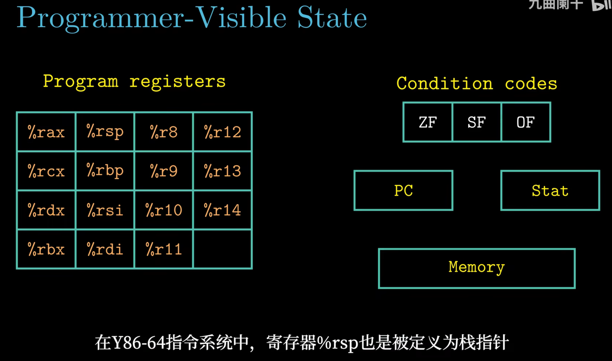
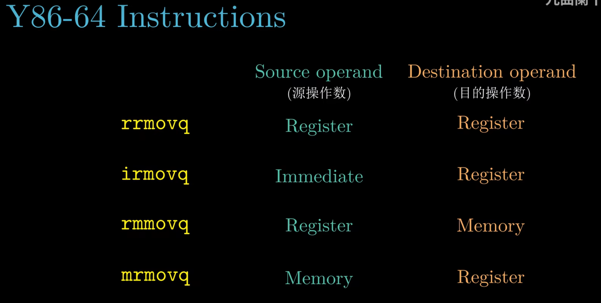
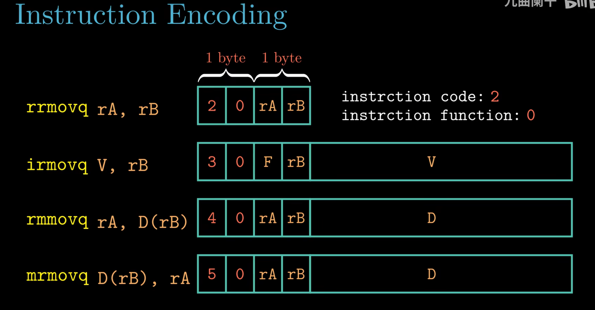
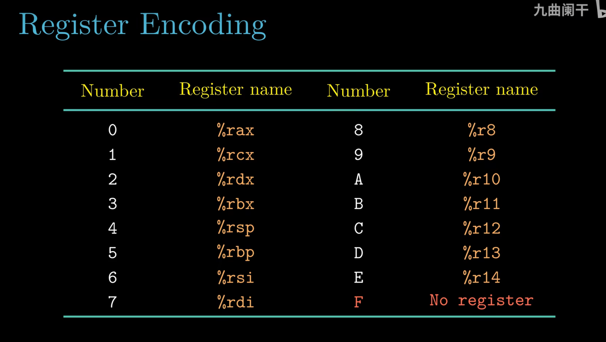
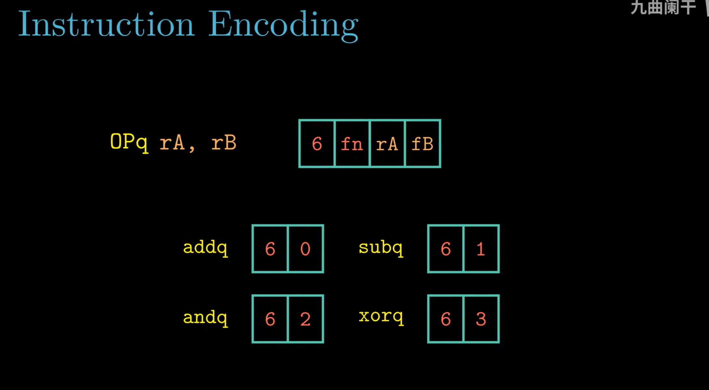
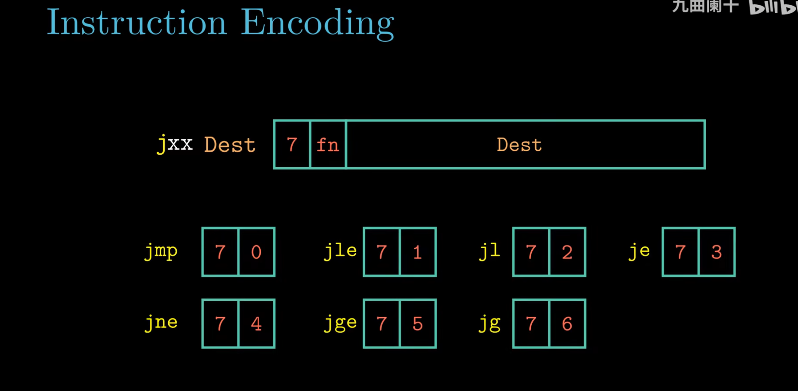
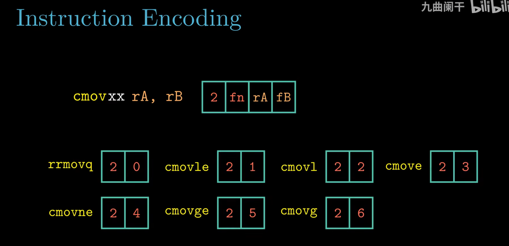
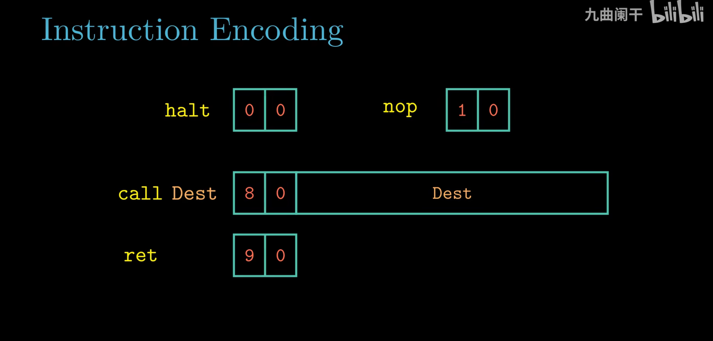
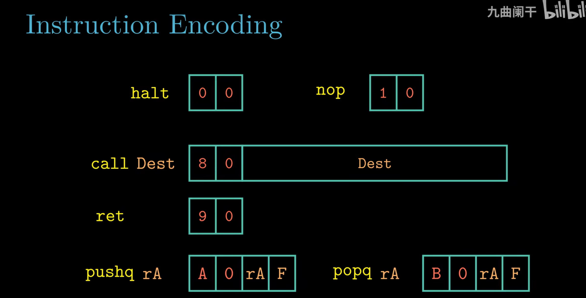
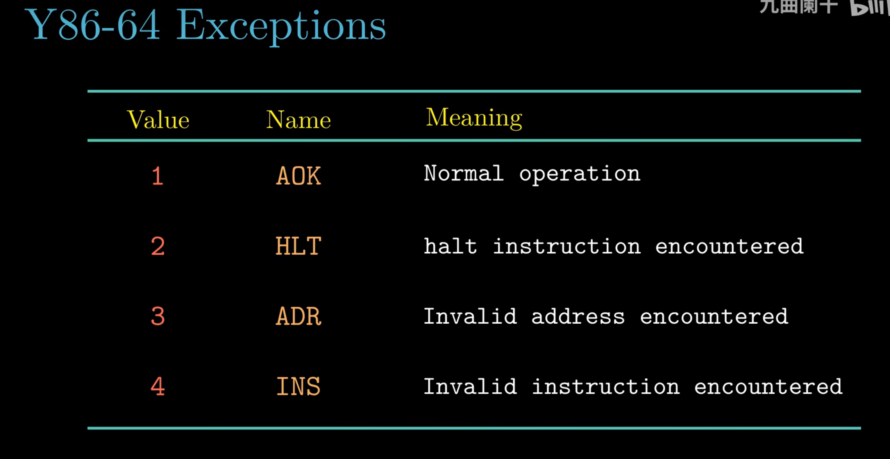

# 4.1 Y86-64 指令集体系结构

> **📖 本节定位**　第 4 章「处理器体系结构」· 教材 P245–P255
> **一句话**：为了讲清"处理器怎么造"，先造一个**足够小、足够规整**的指令集——Y86-64，它保留了 x86-64 的骨架，但把指令砍到 20 条左右。

[← 本章导读](00%20本章导览.md)　｜　[下一节：4.2 逻辑设计和硬件控制语言 HCL →](4.2%20逻辑设计和硬件控制语言%20HCL.md)

---

## 🎯 核心结论

| # | 结论 |
| :-: | :--- |
| 1 | Y86-64 只有 15 个通用寄存器（`%rax`–`%r14`，**没有 `%r15`**） |
| 2 | 条件码只有 3 个：`ZF`、`SF`、`OF`（**没有 `CF`**，因为不做无符号溢出检测） |
| 3 | 每条指令 1–10 字节，第一字节固定是 `icode:ifun`，第二字节固定是 `rA:rB` |
| 4 | 立即数与地址一律 **8 字节小端**，因为 Y86-64 是 64 位字长 |
| 5 | 跳转用**绝对地址**（x86 用相对地址），这让指令编码更简单 |
| 6 | 异常不"陷入"，只把状态码记进 `Stat` 并停止写回 |

---

## 4.1.1 程序员可见的状态

"程序员可见"= 写汇编的人能直接操作的东西。Y86-64 的状态只有四类：



*▲ 图 4-1-1：课堂原版 "Programmer-Visible State"——Program registers 一栏正好 15 格（`%rax`…`%r14`，没有 `%r15`），右边 Condition codes 只有 ZF/SF/OF，再往右单列 PC、Stat、Memory；页脚还特意点明 `%rsp` 就是栈指针。下面的 ASCII 方框图强调"四类状态"的结构，这张截图是课堂原貌，两者对照更清楚哪些东西对程序员可见。*

```text
        ┌──────────────────────────────────────────────────────────┐
        │                     Y86-64 程序员可见状态                │
        ├──────────────────────────────────────────────────────────┤
        │  程序寄存器（15 个 64 位）                               │
        │   ┌────┬────┬────┬────┬────┬────┬────┬────┐              │
        │   │rax │rcx │rdx │rbx │rsp │rbp │rsi │rdi │  0 … 7       │
        │   ├────┼────┼────┼────┼────┼────┼────┼────┤              │
        │   │r8  │r9  │r10 │r11 │r12 │r13 │r14 │ -- │  8 … 14      │
        │   └────┴────┴────┴────┴────┴────┴────┴────┘              │
        │                            ↑ 注意：没有 r15              │
        ├──────────────────────────────────────────────────────────┤
        │  程序计数器  PC = %rip        （存放下一条指令的地址）   │
        ├──────────────────────────────────────────────────────────┤
        │  条件码      ZF  SF  OF      （1 位；指令执行后自动更新）│
        ├──────────────────────────────────────────────────────────┤
        │  状态码      Stat            （AOK / HLT / ADR / INS）   │
        ├──────────────────────────────────────────────────────────┤
        │  内存        DMEM（按字节编址、小端、可存指令与数据）    │
        └──────────────────────────────────────────────────────────┘
```

| 组件 | 说明 | 与 x86-64 的差别 |
| :--- | :--- | :--- |
| 通用寄存器 | 15 个，`%rsp` 专作栈指针 | x86-64 有 16 个（含 `%r15`） |
| `%rip` | 下一条指令地址 | 相同 |
| 条件码 | `ZF`（结果为零）、`SF`（结果为负）、`OF`（有符号溢出） | 少了 `CF`（进位标志） |
| `Stat` | 处理器当前状态 | x86 用异常/中断机制 |
| 内存 | 一个大字节数组，指令与数据不分 | 相同（冯·诺依曼结构） |

> [!NOTE]
> **为什么没有 `CF`？** Y86-64 的设计目标只是"够讲清流水线"，它不打算支持无符号比较。少了 `CF`，条件码更新逻辑就简单一大截——这是教学中典型的"削减需求换简单"。

---

## 4.1.2 Y86-64 指令

Y86-64 的指令可以按"做什么"分成六族：

| 族 | 指令 | 作用 |
| :--- | :--- | :--- |
| 传送 | `rrmovq`、`irmovq`、`rmmovq`、`mrmovq` | 寄存器/立即数/内存之间搬数据 |
| 运算 | `addq`、`subq`、`andq`、`xorq` | 整数加减与位运算（都更新条件码） |
| 跳转 | `jmp`、`jle`、`jl`、`je`、`jne`、`jge`、`jg` | 改 `%rip` |
| 条件传送 | `cmovle`、`cmovl`、`cmove`、`cmovne`、`cmovge`、`cmovg` | 条件成立才写目的寄存器 |
| 栈 | `pushq`、`popq` | 用 `%rsp` 压栈/出栈 |
| 杂项 | `halt`、`nop`、`call`、`ret` | 停机、空操作、调用、返回 |

先看六族中的**传送族**，它规定了数据可以在哪几种位置之间流动：



*▲ 图 4-1-2：课堂把传送族按"源操作数（Source operand）→ 目的操作数（Destination operand）"排开：`rrmovq` 是 Reg→Reg、`irmovq` 是 Imm→Reg、`rmmovq` 是 Reg→Mem、`mrmovq` 是 Mem→Reg。注意四条里**没有 Mem→Mem**——Y86-64 不允许一条指令直接把内存搬到内存，要中转必须先经过寄存器。*

这四条的助记符本身就标了操作数类型：`i` 是立即数、`r` 是寄存器、`m` 是内存，`q` 表示 64 位。

**完整指令集与编码（教材 图 4.2）**：

| 指令 | `icode` | `ifun` | 字节数 | 形式 |
| :--- | :-: | :-: | :-: | :--- |
| `halt` | 0 | 0 | 1 | |
| `nop` | 1 | 0 | 1 | |
| `rrmovq rA, rB` | 2 | 0 | 2 | `rA:rB` |
| `cmovle rA, rB` | 2 | 1 | 2 | `rA:rB` |
| `cmovl rA, rB` | 2 | 2 | 2 | `rA:rB` |
| `cmove rA, rB` | 2 | 3 | 2 | `rA:rB` |
| `cmovne rA, rB` | 2 | 4 | 2 | `rA:rB` |
| `cmovge rA, rB` | 2 | 5 | 2 | `rA:rB` |
| `cmovg rA, rB` | 2 | 6 | 2 | `rA:rB` |
| `irmovq V, rB` | 3 | 0 | 10 | `0xF:rB` + 8 字节 V |
| `rmmovq rA, D(rB)` | 4 | 0 | 10 | `rA:rB` + 8 字节 D |
| `mrmovq D(rB), rA` | 5 | 0 | 10 | `rA:rB` + 8 字节 D |
| `addq rA, rB` | 6 | 0 | 2 | `rA:rB` |
| `subq rA, rB` | 6 | 1 | 2 | `rA:rB` |
| `andq rA, rB` | 6 | 2 | 2 | `rA:rB` |
| `xorq rA, rB` | 6 | 3 | 2 | `rA:rB` |
| `jmp Dest` | 7 | 0 | 9 | 8 字节绝对地址 |
| `jle Dest` | 7 | 1 | 9 | 同上 |
| `jl Dest` | 7 | 2 | 9 | 同上 |
| `je Dest` | 7 | 3 | 9 | 同上 |
| `jne Dest` | 7 | 4 | 9 | 同上 |
| `jge Dest` | 7 | 5 | 9 | 同上 |
| `jg Dest` | 7 | 6 | 9 | 同上 |
| `call Dest` | 8 | 0 | 9 | 8 字节绝对地址 |
| `ret` | 9 | 0 | 1 | |
| `pushq rA` | 0xA | 0 | 2 | `rA:0xF` |
| `popq rA` | 0xB | 0 | 2 | `rA:0xF` |

> [!IMPORTANT]
> 注意 `rrmovq` 与 `cmovXX` **共用 `icode = 2`**，靠 `ifun` 区分（`ifun = 0` 就是无条件传送）。`addq/subq/andq/xorq` 共用 `icode = 6`，同样靠 `ifun`。这种"一族一个指令码"的设计让译码器非常省——**只用 `icode` 判断"做哪类事"，用 `ifun` 判断"具体哪个"**。

**寄存器 ID**（编码进 `rA`/`rB` 字段）：

| ID | 0 | 1 | 2 | 3 | 4 | 5 | 6 | 7 |
| :--- | :-: | :-: | :-: | :-: | :-: | :-: | :-: | :-: |
| 寄存器 | `%rax` | `%rcx` | `%rdx` | `%rbx` | `%rsp` | `%rbp` | `%rsi` | `%rdi` |

| ID | 8 | 9 | A | B | C | D | E | F |
| :--- | :-: | :-: | :-: | :-: | :-: | :-: | :-: | :-: |
| 寄存器 | `%r8` | `%r9` | `%r10` | `%r11` | `%r12` | `%r13` | `%r14` | **无寄存器** |

> [!WARNING]
> ID `0xF` 是"**没有寄存器**"的专用编码：`irmovq` 把它填在 `rA` 位（表示"源不是寄存器"），`pushq`/`popq` 把它填在 `rB` 位。**它不是 `%r15`**——Y86-64 根本没有 `%r15`。

---

## 4.1.3 指令编码

### （1）统一的字节布局

```text
   字节:    0        1        2   3   4   5   6   7   8   9
        ┌────────┬────────┬───────────────────────────────┐
        │icode:  │ rA:rB  │      8 字节立即数/偏移/地址   │
        │  ifun  │        │        （小端，按需出现）     │
        └────────┴────────┴───────────────────────────────┘
           4+4 位    4+4 位            64 位
```

- **第 0 字节**永远是 `icode`（高 4 位）+ `ifun`（低 4 位）；
- **第 1 字节**永远是 `rA`（高 4 位）+ `rB`（低 4 位）；
- 只有需要立即数/偏移/地址的指令才追加 8 字节，因此长度为 **1、2、9、10 字节**。

```text
  1 字节 : halt nop ret
  2 字节 : rrmovq cmovXX OPq pushq popq
  9 字节 : jXX call
 10 字节 : irmovq rmmovq mrmovq
```

编码表不是一次讲完的，课堂上它是同一页 PPT 一页页补出来的。下面按讲课顺序把每一族过一遍——注意看"哪些字段固定、哪些按需追加"。



*▲ 图 4-1-3：传送族四条的编码：`rrmovq` 是 `2 0 rA rB`；`irmovq` 是 `3 0 F rB` 再接 8 字节 V；`rmmovq` 是 `4 0 rA rB` 再接 8 字节 D；`mrmovq` 是 `5 0 rA rB` 再接 8 字节 D。注意只有 `rrmovq` 停在 2 字节，其余三条都追加了一个 8 字节字段——长度差别全在"要不要立即数/偏移"。*

**编码规律**：每条传送指令独占一个 `icode`（2/3/4/5），`ifun` 全为 0；`0xF` 只出现在 `irmovq` 的 `rA` 位，宣告"源不是寄存器"。



*▲ 图 4-1-4：寄存器编号表：0–7 是 `%rax`/`%rcx`/`%rdx`/`%rbx`/`%rsp`/`%rbp`/`%rsi`/`%rdi`，8–E 是 `%r8`–`%r14`，F 是红色标注的 "No register"。注意 F 不是第 16 个寄存器，而是"这一侧没有寄存器"的占位符。*

**编码规律**：`rA:rB` 一个字节正好塞下两个 4 位编号，于是 0–E 分给 15 个寄存器、F 留作空位；这正是前面那两张 ID 表的全部内容。



*▲ 图 4-1-5：OPq 的格式是 `6 fn rA rB`，四条运算共用 `icode=6`，靠 `fn` 区分：addq=0、subq=1、andq=2、xorq=3。注意 `fn` 就是第二个半字节 `ifun`，译码时把它直接送进 ALU 控制逻辑即可。*

**编码规律**：`icode` 决定"这是运算族"，`ifun` 决定"做哪一种运算"，`rA` 是源、`rB` 既是源又是目的。



*▲ 图 4-1-6：jXX 的格式是 `7 fn Dest`，`Dest` 是 8 字节绝对地址：jmp=0、jle=1、jl=2、je=3、jne=4、jge=5、jg=6。注意第 1 字节直接就是地址的开头，没有 `rA:rB`——所以 jXX 是 9 字节而不是 10 字节。*

**编码规律**：`icode=7` 固定、`ifun` 选条件；省掉寄存器字节换来"取指后目标地址立刻到手"，代价是地址要占满 8 字节。



*▲ 图 4-1-7：cmovXX 的格式是 `2 fn rA rB`，和 `rrmovq` 同族：rrmovq=0、cmovle=1、cmovl=2、cmove=3、cmovne=4、cmovge=5、cmovg=6。注意 `rrmovq` 就是 `ifun=0` 的特例——无条件传送不过是"条件恒成立"的条件传送。*

**编码规律**：同一族共用一个 `icode=2`，`ifun=0` 表示无条件、1–6 对应六种条件码组合；`rA` 是源、`rB` 是目的，条件不成立时 `rB` 保持原值。



*▲ 图 4-1-8：这一帧只有 halt `0 0`、nop `1 0`、call `8 0` + Dest、ret `9 0` 四条——还没有 pushq/popq。注意 halt/nop/ret 都是 1 字节，call 因为带着 8 字节地址而是 9 字节。*

**编码规律**：杂项各占一个 `icode`（0/1/8/9），`ifun` 一律为 0；只有 `call` 追加地址，`ret` 的目标地址隐含在栈顶。



*▲ 图 4-1-9：与上一张是同一页的两帧——后一帧才补上 pushq `A 0 rA F` 与 popq `B 0 rA F`，末尾的 F 表示不使用第二个寄存器字段。注意两条都只有 `rA` 一个操作数，`rB` 固定填 `0xF`，长度都是 2 字节。*

**编码规律**：`icode` 决定族（A/B 为栈操作），`ifun` 仍为 0，`0xF` 把不用的寄存器字段标记出来——看编码时先找那个 F，就知道这条指令用几个寄存器。

编码表到此就完整了。下面把字段落到具体字节上，做三个手工编码的练习。

### （2）三个手工编码的例子

**例 1：`irmovq $0x1234, %rax`**

```text
  icode=3, ifun=0 → 0x30
  rA=0xF, rB=0     → 0xF0        （源是立即数，所以 rA 填 0xF）
  V = 0x0000_0000_0000_1234，小端 → 34 12 00 00 00 00 00 00

  字节序列:  30 F0 34 12 00 00 00 00 00 00      （共 10 字节）
```

**例 2：`rmmovq %rax, 0x10(%rbx)`**

```text
  icode=4, ifun=0 → 0x40
  rA=%rax=0, rB=%rbx=3 → 0x03    （rA 是源寄存器，rB 是基址寄存器）
  D = 0x10，小端  → 10 00 00 00 00 00 00 00

  字节序列:  40 03 10 00 00 00 00 00 00 00
```

**例 3：`je 0x20`**

```text
  icode=7, ifun=3 → 0x73
  Dest = 0x20，小端 → 20 00 00 00 00 00 00 00
  （jXX 没有 rA:rB 字段，第 1 字节就开始放地址）

  字节序列:  73 20 00 00 00 00 00 00 00      （共 9 字节）
```

> [!TIP]
> 手工编码的诀窍：**先写 `icode:ifun`，再决定"这一族有没有 `rA:rB`"**。`jXX` 和 `call` 没有（直接跟 8 字节地址），其余都有。

### （3）为什么用绝对地址而不是相对地址

x86 用 PC 相对寻址（便于位置无关代码），但 Y86-64 用**绝对地址**：

| 方案 | 编码 | 好处 | 代价 |
| :--- | :--- | :--- | :--- |
| PC 相对（x86） | 偏移，可短可长 | 代码可重定位、指令短 | 需要加法器算目标 |
| 绝对（Y86-64） | 直接给 8 字节地址 | 取指后立刻得到目标，**不需要额外加法** | 不能重定位、指令长 |

在 4.3 里你会看到：`%rip` 的更新逻辑因此简单到只是"`valP` 或 `valC` 二选一"。

---

## 4.1.4 Y86-64 异常

Y86-64 定义了四种状态码 `Stat`：



*▲ 图 4-1-10：Stat 的取值与英文含义：1 AOK（Normal operation）、2 HLT（halt instruction encountered）、3 ADR（Invalid address encountered）、4 INS（Invalid instruction encountered）。注意只有 1 表示"一切正常"，其余三个都是"遇到事情就停住"；图里没有任何"跳到处理程序"的箭头，因为 Y86-64 的异常只记录状态、不转移控制。*

| 状态码 | 名称 | 触发条件 | 处理方式 |
| :--- | :--- | :--- | :--- |
| **1** | `AOK` | 一切正常 | 继续执行 |
| **2** | `HLT` | 执行了 `halt` | 停机（`%rip` 不再更新） |
| **3** | `ADR` | 取指或访存时地址越界 | 停止、置 `Stat=ADR` |
| **4** | `INS` | 遇到未定义的 `icode`/`ifun` 组合 | 停止、置 `Stat=INS` |

```text
   正常指令 ──▶ 更新寄存器/内存/条件码
                    │
                    ▼
   异常指令 ──▶ ① 不写回任何结果
               ② 把 Stat 置成 3 或 4
               ③ 后续指令不再产生副作用（相当于停机）
```

> [!IMPORTANT]
> Y86-64 的"异常"是**极简版**：它不保存现场、不跳到异常处理程序、不进内核，只是把状态码记下来然后停住。真正的处理器要复杂得多——第 8 章会讲。

---

## 4.1.5 Y86-64 程序

下面三个程序（教材 `sum.ys`、`rsum.ys`、`copy.ys`）是后续所有实验和习题的基础。

### （1）`sum.ys`：循环求和

```asm
# long sum(long *Start, long Count)
# Start in %rdi, Count in %rsi
sum:
    irmovq  $8, %r8          # 常数 8（指针增量）
    irmovq  $1, %r9          # 常数 1（计数减量）
    xorq    %rax, %rax       # sum = 0（同时把 ZF 置 1）
    andq    %rsi, %rsi       # 根据 Count 设置条件码
    jmp     .Test            # 先跳到条件判断
.Loop:
    mrmovq  (%rdi), %r10     # r10 = *Start
    addq    %r10, %rax       # sum += *Start
    addq    %r8, %rdi        # Start++
    subq    %r9, %rsi        # Count--
.Test:
    jne     .Loop            # Count != 0 就继续
    ret
```

> [!NOTE]
> 为什么先 `jmp .Test`？因为要处理 `Count == 0` 的情况——**while 循环的骨架天生是"先判断"**。这与 3.6.7 里 x86 的 `while` 编译策略完全一致。

### （2）`rsum.ys`：递归求和

```asm
# long rsum(long *Start, long Count)
rsum:
    xorq    %rax, %rax       # sum = 0
    andq    %rsi, %rsi       # 测试 Count
    jle     .Return          # Count <= 0 直接返回 0
    pushq   %rsi             # 保存 Count
    pushq   %rdi             # 保存 Start
    irmovq  $8, %r8
    subq    %r8, %rsi        # Count - 1
    addq    %r8, %rdi        # Start + 1
    call    rsum             # 递归调用
    popq    %rdi             # 恢复 Start（后进先出）
    popq    %rsi             # 恢复 Count
    mrmovq  (%rdi), %r10     # *Start
    addq    %r10, %rax       # sum += *Start
.Return:
    ret
```

**它为什么必须用栈？** 递归调用会把 `%rdi`/`%rsi` 覆盖掉，而返回后还要用它们取 `*Start`。**寄存器只有那么多，跨调用保存只能靠栈**——这正是 3.7.5 "caller-saved / callee-saved" 的由来。

### （3）`copy.ys`：内存块复制

```asm
# void copy(long *src, long *dst, long count)
# src in %rdi, dst in %rsi, count in %rdx
copy:
    irmovq  $8, %r8
    irmovq  $1, %r9
    andq    %rdx, %rdx
    jle     .Done
.Loop:
    mrmovq  (%rdi), %r10     # 读 src
    rmmovq  %r10, (%rsi)     # 写 dst
    addq    %r8, %rdi
    addq    %r8, %rsi
    subq    %r9, %rdx
    jne     .Loop
.Done:
    ret
```

---

## 4.1.6 一些 Y86-64 指令的详情

### （1）栈操作：先减后写 / 先读后加

```text
  pushq rA:                          popq rA:
  ┌────────────────────────────┐     ┌────────────────────────────┐
  │ R[%rsp] ← R[%rsp] - 8      │     │ R[rA]   ← M[R[%rsp]]       │
  │ M[R[%rsp]] ← R[rA]         │     │ R[%rsp] ← R[%rsp] + 8      │
  └────────────────────────────┘     └────────────────────────────┘
       先移动指针，再写                  先读数据，再移动指针
```

| 指令 | `rA` 字段 | `rB` 字段 | 语义 |
| :--- | :-: | :-: | :--- |
| `pushq rA` | 源寄存器 | `0xF` | 压栈 |
| `popq rA` | 目的寄存器 | `0xF` | 出栈 |

> [!WARNING]
> **`pushq %rsp` 是个经典坑**：按"先减后写"的顺序，压入的是**减 8 之后的新值**。这与 x86-64（压入旧值）不同。教材专门提醒过这一点，考试也爱考。

### （2）`irmovq`：`rA` 必须是 `0xF`

```text
  irmovq $V, rB   →   icode=3, ifun=0, rA=0xF, rB=目的寄存器
```

因为"源"是立即数而不是寄存器，`rA` 位必须填 `0xF`。若填了别的值，硬件会忽略它（但编码不规范）。

### （3）`OPq`：`ifun` 选运算，`rB` 既是源又是目的

```text
  addq rA, rB   →   R[rB] ← R[rB] + R[rA]      并更新 ZF/SF/OF
  subq rA, rB   →   R[rB] ← R[rB] - R[rA]
  andq rA, rB   →   R[rB] ← R[rB] & R[rA]
  xorq rA, rB   →   R[rB] ← R[rB] ^ R[rA]
```

注意 `subq rA, rB` 算的是 **`R[rB] - R[rA]`**，顺序不能反。

### （4）`cmovXX`：条件成立才写，但**条件码总是先算**

```text
  cmovge rA, rB  →  if (!SF ^ OF) then R[rB] ← R[rA]
```

- 条件码由**上一条设置条件码的指令**决定（通常是 `subq`/`andq`/`subq rA,rB` 形式的比较）；
- 条件不成立时，目的寄存器**保持原值**；
- 无论条件是否成立，`%rip` 都照常前进——这正是 `cmov` 比 `jmp` 快的原因（无分支预测失败）。

### （5）`call` / `ret`：把 `%rsp` 和 `%rip` 绑在一起

```text
  call Dest:                         ret:
  ┌────────────────────────────┐     ┌────────────────────────────┐
  │ R[%rsp] ← R[%rsp] - 8      │     │ %rip ← M[R[%rsp]]          │
  │ M[R[%rsp]] ← %rip + 9      │     │ R[%rsp] ← R[%rsp] + 8      │
  │ %rip ← Dest                │     └────────────────────────────┘
  └────────────────────────────┘
       "9" 是 call 指令自身的长度
```

> [!TIP]
> `call` 压入的是**下一条指令的地址**（`call` 占 9 字节，所以是 `%rip + 9`），不是 `call` 自己的地址。这个细节在 4.3 的"写回/更新 PC"阶段会直接体现在数据通路上。

---

## 📌 重点速记

```text
寄存器   : %rax %rcx %rdx %rbx %rsp %rbp %rsi %rdi  (0–7)
           %r8 … %r14 (8–E)        0xF = 无寄存器
条件码   : ZF  SF  OF           （没有 CF！）
指令长度 : 1 / 2 / 9 / 10 字节
字节 0   : icode:ifun
字节 1   : rA:rB   （jXX / call 没有这一字节）
第 2–9 字节 : 8 字节立即数/偏移/目标地址（小端）

指令码   : halt0 nop1 rrmovq2 irmovq3 rmmovq4 mrmovq5
           OPq6 jXX7 call8 ret9 pushqA popqB

编码实例 : irmovq $0x1234,%rax → 30 F0 34 12 00*6
           rmmovq %rax,0x10(%rbx) → 40 03 10 00*7
           je 0x20 → 73 20 00*7

状态码   : 1 AOK  2 HLT  3 ADR  4 INS
pushq    : rsp -= 8; M[rsp] = rA
popq     : rA = M[rsp]; rsp += 8
```

---

## ⚠️ 易错点

1. **以为 Y86-64 有 `%r15`。** 只有 `%r14` 为止，ID `0xF` 表示"无寄存器"。
2. **以为有条件码 `CF`。** Y86-64 只有 `ZF/SF/OF`，所以它做不了无符号比较。
3. **把 `jXX` 编成 10 字节。** `jXX` 和 `call` 是 **9 字节**（没有 `rA:rB` 字节）。
4. **把 `irmovq` 的 `rA` 填成目的寄存器。** 必须填 `0xF`，`rB` 才是目的。
5. **`subq rA, rB` 算成 `R[rA] - R[rB]`。** 正确是 `R[rB] - R[rA]`，目的在右。
6. **`pushq %rsp` 当成 x86 语义。** Y86-64 压入的是减 8 后的新值。
7. **以为 `cmov` 不成立时连条件码也不更新。** 条件码由**前一条**指令决定，`cmov` 只是决定"写不写目的寄存器"。
8. **`call` 压 `%rip` 而不是 `%rip+9`。** 压的是返回地址（下一条指令）。

---

## ✅ 自测

1. Y86-64 的 `Stat` 有哪四个值？`ADR` 在什么情况下出现？
2. 写出 `mrmovq 0x8(%rdi), %rbx` 的完整字节编码。
3. `xorq %rax, %rax` 会把哪些条件码置成什么值？
4. 为什么 Y86-64 的 `jXX` 用绝对地址？这对 4.3 的数据通路有什么好处？
5. `pushq %rsp` 与 `popq %rsp` 分别会发生什么？
6. `cmovge %r10, %r11` 在 `ZF=0, SF=1, OF=1` 时是否执行传送？

<details>
<summary>参考答案</summary>

1. `AOK(1)`、`HLT(2)`、`ADR(3)`、`INS(4)`。`ADR` 出现在取指或访存地址越界时。
2. `icode=5, ifun=0 → 0x50`；`rA=%rbx=3, rB=%rdi=7 → 0x37`；`D=0x8` 小端 → `50 37 08 00 00 00 00 00 00 00`（10 字节）。
3. `ZF=1`（结果为 0）、`SF=0`、`OF=0`。
4. 因为绝对地址可以直接从指令里取出目标、不需要再做"PC + 偏移"的加法，`%rip` 的更新简化为在 `valP` 与 `valC` 之间二选一。
5. `pushq %rsp`：先 `%rsp -= 8`，再把**新的** `%rsp` 值写入内存；`popq %rsp`：先读 `M[%rsp]`，再 `%rsp += 8`，于是 `%rsp` 变成了读出来的那个值。
6. 条件 `!SF ^ OF`：`SF^OF = 1^1 = 0`，`!0 = 1`，成立 → **执行传送**（`%r11 ← %r10`）。

</details>

---

## 🔗 与其他章节的联系

| 本节内容 | 后续用在哪 |
| :--- | :--- |
| 15 个寄存器 / `%rip` / 条件码 | 4.3 硬件结构、4.5 流水线寄存器 |
| 指令编码格式 | 4.3 译码阶段（`icode`/`ifun`/`rA`/`rB` 直接来自指令字） |
| `pushq`/`popq`/`call`/`ret` | 4.3 访存与写回阶段 |
| `cmovXX` | 4.3 执行阶段的条件判断 |
| `Stat` 异常 | 4.3 状态处理、第 8 章 真正的异常 |

---

[← 本章导读](00%20本章导览.md)　｜　[下一节：4.2 逻辑设计和硬件控制语言 HCL →](4.2%20逻辑设计和硬件控制语言%20HCL.md)
