# 4.2 逻辑设计和硬件控制语言 HCL

> **📖 本节定位**　第 4 章「处理器体系结构」· 教材 P256–P263
> **一句话**：要描述处理器，得先有一套"描述电路"的语言——HCL 就是那个把**逻辑门 → 组合电路 → 字级运算 → 时钟存储**串起来的工具。

> [!IMPORTANT] 本节要回答的三个问题
> 1. 芯片上没有"一行一行执行"这回事，那 HCL 里写下的一行行代码，最后到底变成了什么？
> 2. 为什么 HCL 的 `&&`、`[ … ]`、`in { }` 都不能照 C 的习惯去读？
> 3. 一个电路里，哪些东西"随时在变"、哪些"只在时钟沿变一次"？分不清会出什么错？

**读之前你需要会**：`&`/`|`/`^`/`~` 这些位运算与真值表（见 [2.1 信息存储](../第02章%20信息的表示和处理/2.1%20信息存储.md)）；4.1 里 Y86-64 的寄存器、条件码与指令编码（见 [4.1 Y86-64 指令集体系结构](4.1%20Y86-64%20指令集体系结构.md)）。都不会也没关系——本节会把用到的部分重讲一遍。

[← 上一节：4.1 Y86-64 指令集体系结构](4.1%20Y86-64%20指令集体系结构.md)　｜　[下一节：4.3 Y86-64 的顺序实现（待整理） →](../README.md)

---

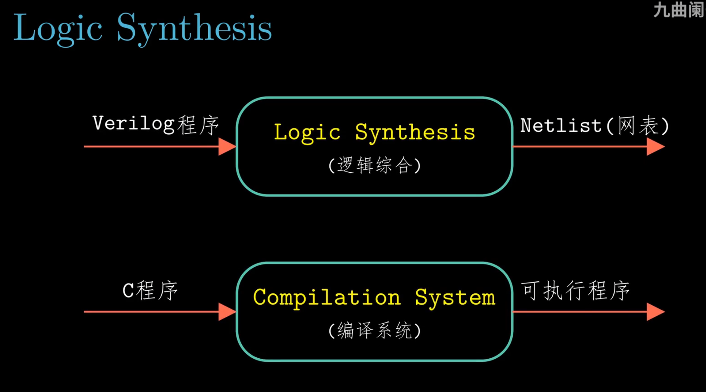

*▲ 图 4-2-1：上半支是硬件路线——Verilog 程序经**逻辑综合（Logic Synthesis）**得到**网表（Netlist）**；下半支是软件路线——C 程序经**编译系统**得到可执行程序。两条路都是"人写高层描述、工具生成低层实现"：综合器把行为级描述翻成门和触发器的连接，编译器把语句翻成指令。*

有了这层类比，本节的位置就清楚了：HCL 是教材用来**描述处理器控制逻辑**的语言，和 Verilog 一样属于"高层描述"，最终都要落到门级实现；只不过 HCL 更精简，只保留描述电路所需的那点语法。

---

## 🎯 核心结论

| # | 结论 |
| :-: | :--- |
| 1 | 三种逻辑门 `AND`/`OR`/`NOT` 就足以实现任何布尔函数 |
| 2 | **组合电路**：输出只取决于当前输入，且**不能有环路** |
| 3 | HCL 的 `&&`/`\|\|`/`!` 是**布尔运算**，不是 C 的"位运算 + 短路" |
| 4 | 字级信号用整数表达式描述，选择用 `[s: A; 1: B;]` |
| 5 | 集合关系 `in { … }` 是描述"指令码属于某几类"的利器 |
| 6 | **只有时钟寄存器（PC、条件码、寄存器文件）在时钟沿更新**；存储器读是组合的 |
| 7 | HCL 的 `[ … ]` 是**有优先级**的：条件按书写顺序取第一个为 1 的，末尾通常写 `1` 兜底 |
| 8 | **ALU 是组合逻辑**：控制值 `0/1/2/3` 选 `+ - & ^`，输出 `CF/ZF/OF`；而 CC 里存的是 `ZF/SF/OF` |
| 9 | **组合逻辑 + 时钟寄存器 = 状态机**：组合逻辑算"下一状态"，时钟沿才更新"当前状态" |

**先建立一个直觉：电路是同时工作的，不是一行一行执行的。** 在 C 里写 `a = b + c; d = a * 2;`，这两行有先后。HCL 不是这样：你写下 `int Out = A + B;` 的那一刻，描述的是一组**门和线**——加法器被"焊"在那里，`A`、`B` 一变，`Out` 过一点延迟就跟着变，**不存在"轮到这一行执行"的时刻**。

```text
   C 的读法：一行一行，按时间走
     t1 算 b+c → t2 存进 a → t3 算 a*2 → t4 存进 d
   HCL 的读法：一片门，同时响应
        A ──┬──[加法器]── Out
        B ──┘
      ↑ A、B 一变，Out 就跟着变：没有"第几步"，也没有"先算哪个"
```

**形式化定义**：一段 HCL 就是**一组信号之间的等式**——左边一个信号名，右边一个由门（`&&`/`||`/`!`/`+`/`==`/`[ … ]`）搭出来的表达式。落到硬件上，每个等式变成一片组合逻辑，所有片**同时存在、同时响应**。所以读 HCL 要问的是"**这块逻辑的输入连到哪、输出接到哪**"，而不是"先执行哪一句"；本节后面出现的"顺序"（情况表达式的先后）只是**连线的优先级**，不是时间上的先后。

---

## 4.2.1 逻辑门

在画第一个门之前，课堂先用两页交代门赖以成立的两件事：**布尔代数**给了它"算"的规则，**数字信号**给了它"电"的载体。

**1854 → 1948：从"思维规律"到开关电路。**

| 年份 | 人物 | 关键一步 |
| :-: | :--- | :--- |
| 1854 | George Boole | 在《思维规律的研究》里把命题的真假抽象成 0/1，定义了 `与`、`或`、`非`——一套"可以算"的逻辑代数 |
| 1937 / 1948 | Claude Shannon | 指出继电器触点的"通/断"恰好就是 0/1，布尔代数可以直接拿来做开关电路的**分析与设计**（论文发表于 1937 年，课件标注 1948） |

这两步隔了将近一百年：布尔代数诞生时只是逻辑学工具，和电毫无关系；Shannon 的贡献是**把两个不相干的领域对上了号**——从此"化简布尔式"就等于"化简电路"，德摩根律、分配律这些定理可以直接当电路变换规则用。HCL 里的 `!`/`&&`/`||`，本质还是 1854 年那套运算。

**数字信号：用电压阈值从连续信号里"抠"出离散值。** 导线上的电压其实是连续变化的（有噪声、有振铃、有过渡沿），但电路不需要知道精确电压，只需要判断"高还是低"：

```text
   逻辑 1  ────────────────────────────────   ← 高电平：电压 ≥ V_IH，判为 1
           ░░░░░  保护带（不确定区）  ░░░░░   ← 不算 0 也不算 1
   逻辑 0  ────────────────────────────────   ← 低电平：电压 ≤ V_IL，判为 0
```

| 概念 | 含义 | 为什么重要 |
| :--- | :--- | :--- |
| 阈值（threshold） | 判定 0/1 的分界电压 | 把连续的模拟电压"量化"成 1 位 |
| 保护带（guard band） | 高、低阈值之间那段"不允许停留"的区间 | 噪声、振铃、过渡沿都落在这里；只要噪声幅度不超出保护带，判读结果就不变 |
| 噪声容限（noise margin） | 输出保证的电平范围与下一级输入可接受范围之差 | 容限越大越抗噪，门才能一级一级串下去 |
| 1 位信号 | 最简单的数字信号：要么高、要么低 | 有了它，布尔值才对应得上导线上的电平 |

这一套约定的好处正是课堂强调的三点：

- **抗噪**：噪声只要没把电平推出保护带，0 和 1 就不会错；
- **简单、规模小**：门只需要认两个电平，不必做精密模拟电路；
- **可靠、快**：电平判读是"和阈值的比较"，比精确测量电压快得多，也允许工艺有偏差。

顺带交代一句：**"字"就是 64 根这样的 1 位信号并排**（4.2.3 的字级信号），所以下面关于门的所有讨论，对字的每一位都成立。

先看课堂上的第一帧——三种基本门的符号和布尔式。

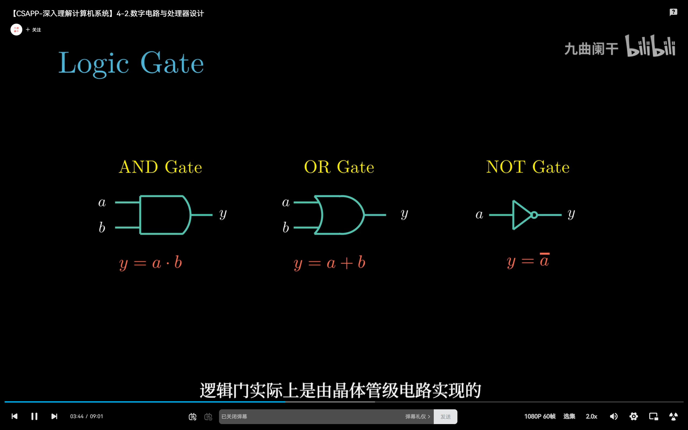

*▲ 图 4-2-2：AND `y = a·b`、OR `y = a+b`、NOT `y = ā` 三种基本门的符号与公式。这一帧保留了 B 站播放器和字幕——"逻辑门实际上是由晶体管级电路实现的"，提醒我们符号只是外壳，里面是晶体管网络（下一小节"门的物理直觉"展开）。*

同一页的干净版更适合拿来对照公式：

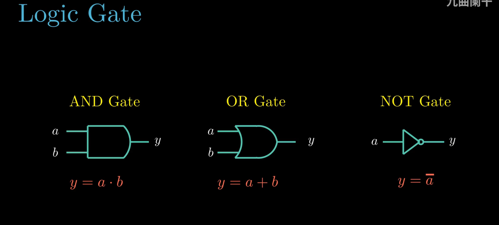

*▲ 图 4-2-3：去掉播放条与字幕后，只剩三个门的符号和公式。把它们和下面的真值表逐行对一遍，"符号—公式—真值表"三者就对应上了：AND 只有全 1 才出 1，OR 有一个 1 就出 1，NOT 直接把输入取反。*

### （1）三种基本门

```text
      AND 门                          OR 门                      NOT 门
   a ──┐                          a ──┐                      a ──┐
       ├──▶ out = a && b              ├──▶ out = a || b           ├──▶ out = !a
   b ──┘                          b ──┘                      (只有一个输入)

   符号:   a ──┐                         a ──┐                    a ──▷o── out
              │  )── out                    │  )── out
           b ──┘                         b ──┘
```

| `a` | `b` | `a && b` | `a \|\| b` | `!a` |
| :-: | :-: | :-: | :-: | :-: |
| 0 | 0 | 0 | 0 | 1 |
| 0 | 1 | 0 | 1 | 1 |
| 1 | 0 | 0 | 1 | 0 |
| 1 | 1 | 1 | 1 | 0 |

> [!NOTE]
> 现实中还会用 `NAND`（与非）、`NOR`（或非）、`XOR`（异或）。它们都可以用上面三种门组合出来——`XOR = (a && !b) \|\| (!a && b)`。硬件上用 NAND 做基本单元更省晶体管，但**描述层面**只认这三种就够了。

课堂随后把门从三个扩展到六个：

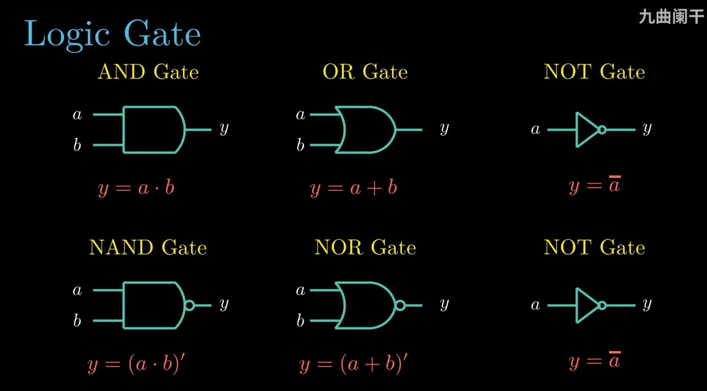

*▲ 图 4-2-4：上排仍是 AND / OR / NOT，下排补上 NAND `y=(a·b)′`、NOR `y=(a+b)′` 和 NOT。NAND、NOR 只是在与门/或门的输出端加一个小圆圈（取反），公式里的撇号就是这个圈——它们不是新原理，而是"与/或 + 非"的打包，所以描述层面仍然只需要 AND/OR/NOT 三种。*

### （2）门的物理直觉

```text
   输入电压 ──▶ [ 晶体管网络 ] ──▶ 输出电压
                  │
                  ├─ 串联 : 实现 AND（两个都通才通）
                  ├─ 并联 : 实现 OR （任一通就通）
                  └─ 反相器: 实现 NOT

   门有"延迟": 输入变化后，输出要过一小段时间才稳定
                      │
                      ▼
              这就是"组合逻辑延迟"，它决定了时钟周期能压到多短
```

**"连续响应，但有小延迟"。** 门没有时钟，输入一变它就开始跟着变；只是输出的变化比输入晚一点，而且上升沿和下降沿的快慢通常不一样。以 `b` 恒为 1、`out = a && b` 为例，`out` 就是 `a` 的"延迟版本"：

```text
   a     ┌───────────┐
   ──────┘           └─────────────

   out      ┌───────────┐
   ─────────┘           └───────────
            ↑           ↑
        上升延迟 t_pLH   下降延迟 t_pHL
```

| 指标 | 定义 | 为什么两者不相等 |
| :--- | :--- | :--- |
| **上升延迟** `t_pLH` | 输入跳变 → 输出由低变高并稳定所需的时间 | 上拉网络（PMOS）与下拉网络（NMOS）的驱动能力不同，负载电容也不同 |
| **下降延迟** `t_pHL` | 输入跳变 → 输出由高变低并稳定所需的时间 | 同上；通常 `t_pLH ≠ t_pHL` |

教材一般取两者中较大的一个作为门的**传播延迟** `t_pd`（典型值几十皮秒）。这条延迟带来两个后果：一是信号穿过 n 级门要付 n 份延迟，**串得越长越慢**；二是"数字抽象"只在输入稳定足够久时才成立——这正是 4.2.5 里"时钟周期 ≥ 最长组合延迟 + 建立时间"的物理来源。

---

## 4.2.2 组合电路和 HCL 布尔表达式

### （1）什么是组合电路

**组合电路（combinational circuit）** 的两个硬性条件：

1. **输出只取决于输入**，与"历史"无关（没有记忆）；
2. **不能有环路**（输出不能反过来直接或间接驱动自己的输入）。

```text
   ✔ 合法（无环）                       ✘ 非法（有环，会自激振荡）
   a ──▶┌────┐                        a ──▶┌────┐
        │ 门 │──▶ out                      │ 门 │──┬──▶ out
   b ──▶└────┘                             └────┘  │
                                              ▲     │
                                              └─────┘
```

### （2）HCL 布尔表达式

| HCL | 含义 | 对应 C 的写法 |
| :--- | :--- | :--- |
| `&&` | 逻辑与 | 不是 `&`！ |
| `\|\|` | 逻辑或 | 不是 `\|`！ |
| `!` | 逻辑非 | `!` |

**例：1 位相等比较器**

```text
bool eq = (a && b) || (!a && !b);
```

```text
        a ──┬──────────────┐
            │            │
            │           ┌──┴──┐
            │           │ AND │──┐
        b ──┼──────────▶└─────┘  │
            │                    │   ┌─────┐
            │  ┌─────┐           ├──▶│ OR  │──▶ eq
            └─▶│ NOT │──┐        │   └─────┘
               └─────┘  │  ┌─────┐│
                        ├─▶│ AND │┘
        b ──▶│ NOT │──┐ │  └─────┘
               └─────┘ │ │
                       └─┘
```

#### 一起算一遍

**① 把 `bool eq = (a && b) || (!a && !b);` 拆成门。** 式子里的每个运算符就是一只门：

| 步 | 子表达式 | 用什么门 | 输出接到哪 |
| :-: | :--- | :--- | :--- |
| ① | `a && b` | 1 个 AND | 末尾那个 OR 的上输入 |
| ② | `!a` | 1 个 NOT | 下面那个 AND 的一个输入 |
| ③ | `!b` | 1 个 NOT | 下面那个 AND 的另一个输入 |
| ④ | `!a && !b` | 1 个 AND | OR 的下输入 |
| ⑤ | 两个 AND 相或 | 1 个 OR | 就是 `eq` |

共 **2 个 NOT + 2 个 AND + 1 个 OR = 5 个门**。关键在 ① 和 ④ 是**同时**算的：人读式子要"先算括号"，门没有这个先后，它们一直在响应。

**② 代两组数验一遍。** `a = 1, b = 1`：①得 `1`，②③得 `0`、`0`，④得 `0`，⑤ = `1 || 0 = 1` → 两位相等 ✓。`a = 1, b = 0`：①得 `0`，②③得 `0`、`1`，④得 `0`，⑤ = `0 || 0 = 0` → 不相等 ✓。

**③ 扩到 64 位要多少门？** `A == B` 就是把这套 `eq` **复制 64 份**（每位一份），再把 64 个输出"与"起来：64 × 5 = 320 个门，加上把 64 条线并成 1 条的与树（63 个 AND），约 **383 个门**。但信号只穿 **6 层**就到终点（$2^6 = 64$）——64 位比较在硬件里并不慢：它花的是**面积**，不是**时间**。

**例：1 位多路复用器（MUX）**

```text
bool out = (s && a) || (!s && b);
```

| `s` | 输出 |
| :-: | :--- |
| 0 | `b` |
| 1 | `a` |

这个布尔式落到门级就是下面这个电路。课堂用 NAND 搭它（与/或/非都能用 NAND 拼出来，两者等价），三级 NAND 刚好对应式子的三层：

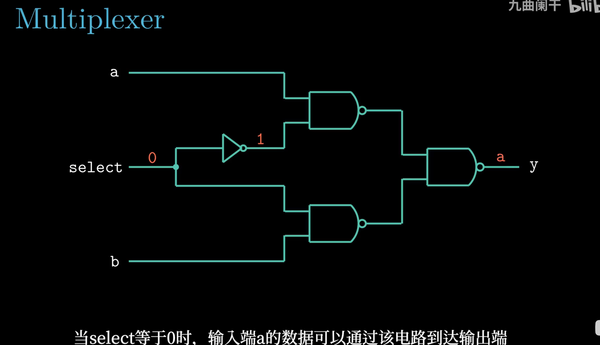

*▲ 图 4-2-5：2 选 1 MUX 的门级实现。**select = 0** 时，它直接送进下方 NAND，把 b 那一路的输出钉成 1（等于关断）；同时经反相器变成 1 送进上方 NAND，让 a 通过。末级 NAND 把 a 取反两次还原，于是 **y = a**。*

把 select 拨到 1，通路立刻换到另一边：

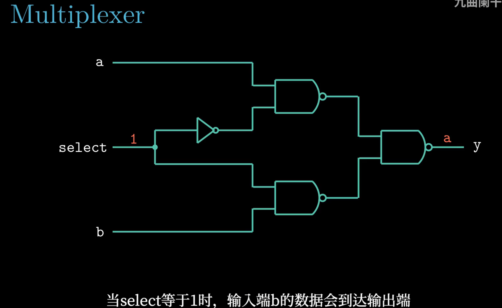

*▲ 图 4-2-6：同一电路，**select = 1**。反相器输出变 0，上方 NAND 被钉成 1、a 被挡住；下方 NAND 放行 b 并取反，末级再取反一次，所以 **y = b**。两帧合起来正是 `(s && a) || (!s && b)`：选择信号做的事，就是把不该走的那一路"置成常量"。*

> [!WARNING]
> HCL 的 `&&`/`||` **不是** C 里那种"能短路、能返回任意整数"的运算符。HCL 里没有"求值顺序"，也没有副作用——它只是**描述连线**。所以在 HCL 里写 `a && b` 与写 `b && a` 完全等价。

<details>
<summary>✅ 检查点 1：`(a && b) || (c && d)` 里，硬件是先算 `a && b` 再算 `c && d` 吗？</summary>

不是。两个 AND 门**同时**响应，OR 门一直等两边稳定下来再出结果。HCL 里根本不存在"先算哪个"；唯一有"顺序"的地方是情况表达式 `[ … ]`，而那里的顺序指的是**优先级**，也不是时间。
</details>

---

## 4.2.3 字级的组合电路和 HCL 整数表达式

### （1）字级信号

HCL 只有**两种**数据类型，而且都不写位宽：

| 类型 | 课堂上的记号 | 表示什么 | 位宽 |
| :--- | :--- | :--- | :--- |
| `bool` | 小写 `a`、`b`、`c`… | 一个布尔信号（真/假） | 固定 1 位 |
| `int` | 大写 `A`、`B`、`C`… | 一个字（word） | **不指定**：可以是 1 字节，也可以是 64 位字 |

声明照 C 的样子写，等号右边是一个表达式：

```text
bool eq  = (a && b) || (!a && !b);   # 布尔表达式 → 1 位信号
int  Out = A + B;                    # 整数表达式 → 一个字
```

> [!NOTE]
> "不指定字大小"是 HCL 的刻意设计：同一段 HCL 既能在 32 位机器上描述 32 位字，也能在 Y86-64 上描述 64 位字——位宽由**实现**而不是**语言**决定。HCL 也不做类型检查，`bool` 和 `int` 混用不会报错，但落到硬件上就是线数对不上，得自己心里有数。至于大小写（小写给位信号、大写给字），那只是书写约定，不是语法。

Y86-64 里大部分信号是 **64 位（字）**，而不是 1 位。HCL 用"整数表达式"描述字级运算：

```text
int Eq = (A == B);          # 64 位相等比较，输出 1 位布尔
int Out = A + B;            # 字级加法
```

`A == B` 在硬件里并不是一条指令，而是**把 64 个 1 位 `eq` 的结果全部 `&&` 起来**：

```text
        A63 B63        A62 B62              A0  B0
          │ │            │ │                 │ │
        ┌─▼─▼─┐        ┌─▼─▼─┐            ┌─▼─▼─┐
        │ eq  │        │ eq  │    ...     │ eq  │
        └──┬──┘        └──┬──┘            └──┬──┘
           │              │                  │
           └──────────────┴───── AND ───────┘
                              │
                              ▼
                             Eq
```

**字比较**：`int` 级还能直接比较两个字，六个运算符的结果都是 **1 位布尔**：

| HCL 写法 | 含义 | 落到硬件是什么 |
| :--- | :--- | :--- |
| `A == B` / `A != B` | 相等 / 不等 | 64 个 1 位比较器 + 与树（不等则再取反） |
| `A < B` / `A <= B` | 小于 / 小于等于 | 一个 64 位比较器（内部相当于一次减法） |
| `A > B` / `A >= B` | 大于 / 大于等于 | 同上，把两个操作数交换即可 |

还有一种是"打包比较"——**集合成员** `A in { B, C, D }`，等价于 `A == B || A == C || A == D`，专门用来判断"某个字是不是这几个常量之一"，详见 4.2.4。

### （2）选择表达式（字级 MUX）

HCL 用**选择表达式**描述多路选择：

```text
int Out = [
    s : A;      # s == 1 时选 A
    1 : B;      # 默认选 B
];
```

它的语义是"**按顺序检查，第一个成立的条件胜出**"，最后一项通常是 `1`（恒真）作为默认值。展开说，这个**情况表达式（case expression）** 由一串二元组 `布尔表达式 : 整数表达式` 组成，规则有四条：

1. **逐个求值**：从上往下依次检查每一行的布尔表达式；
2. **第一个为 1 者胜出**：某行求值为 1，就选中该行的整数表达式，后面的行不再影响结果；
3. **末尾写 `1` 兜底**：`1` 恒真，保证任何输入组合都有匹配——组合电路不允许出现"没有输出"；
4. **顺序是语义的一部分**：各行条件不必互斥，谁写在前面谁优先，所以调换两行常常就换了功能。

别把它当 C 的 `if / else if`：C 是"按顺序执行、命中后后面的不执行"；HCL 里所有条件在硬件上**同时算出**，只是输出端有一个优先级选择网络，最后挑一路送出去。所以这里的"顺序"只是**优先级**，不是 4.2.2 说的那种"求值顺序"——HCL 没有短路，也没有副作用。

```text
                  ┌───────────────┐
     A ──────────▶│               │
                  │   字级 MUX    │──────────▶ Out
     B ──────────▶│               │
                  └───────▲───────┘
                                  │
                          s
```

**多位选择（嵌套）**：

```text
int Out = [
    s0 && s1 : A;
    s0       : B;
    s1       : C;
    1        : D;
];
```

注意这四个条件并不互斥（`s0=1, s1=1` 同时满足前两行），结果完全由书写顺序决定：`(s0, s1) = 11 → A`、`10 → B`、`01 → C`、`00 → D`。这就是上面第 4 条"顺序是语义的一部分"的直接后果。

**例：Min3——三个字里取最小的**

```text
int Min3 = [
    A < B && A < C : A;   # A 严格小于另外两个 → A 最小
    B < A && B < C : B;   # B 严格小于另外两个 → B 最小
    1              : C;   # 前两行都不成立，剩下的候选只有 C
];
```

三行正好覆盖"最小者是 A / 是 B / 是 C"三种情况，所以最后一行不必再写条件，一个 `1` 就够——这正是"最后的情况保证有一个匹配值"。

```text
       A ──┐
       B ──┼──▶┌────────┐
       C ──┘   │  MIN3  │──▶ 三个字中的最小值
               └────────┘
```

**注意相等的情形**：三个数互不相等时这个写法严格正确；若出现 `A == B < C`，前两行的 `<` 都不成立，会落到 `1 : C` 上，返回的 C 并不是最小值。要覆盖相等情况，把 `<` 写成 `<=` 更稳妥（`A <= B && A <= C : A; …`）。

#### 一起算一遍

**拿 `A = 3, B = 3, C = 5` 走一遍 `Min3`，看哪一行第一个命中：**

| 行 | 条件 | 代入 | 求值 |
| :-: | :--- | :--- | :-: |
| 1 | `A < B && A < C` | `3 < 3 && 3 < 5` | `0 && 1 = 0`，不命中 |
| 2 | `B < A && B < C` | `3 < 3 && 3 < 5` | `0 && 1 = 0`，不命中 |
| 3 | `1` | 恒真 | **命中 → 输出 C = 5** |

最小值明明是 3，输出却是 5。原因正是上面那句"注意相等的情形"：前两行都用**严格小于**，一旦出现并列最小就谁都咬不住，兜底的 `1 : C` 把 C 顶了出来。改成 `A <= B && A <= C : A;`、`B <= A && B <= C : B;` 再走一遍：第 1 行 `3 <= 3 && 3 <= 5 = 1`，立刻命中，输出 3 ✓。

> 兜底行不是装饰，**它会在你没预料到的输入上生效**。写 `1 :` 之前，先想清楚"前面几行漏掉了哪些输入"。

**例：Out4——两位控制从 4 路里选 1 路**

```text
int Out4 = [
    !s1 && !s0 : D0;   # s1s0 = 00
    !s1        : D1;   # s1s0 = 01（00 已被上一行"截走"）
    !s0        : D2;   # s1s0 = 10（00、01 已被截走）
    1          : D3;   # s1s0 = 11
];
```

这叫**假定顺序匹配（assume sequential matching）**：既然前面的行已经把较小的组合截走了，后面每一行只需否定**一位**就能唯一确定剩下的组合。完整写法要给四个条件各写全两位（`!s1&&!s0`、`!s1&&s0`、`s1&&!s0`、`s1&&s0`），利用顺序后每行最多只写一位——**优先级本身就是可以省下来的信息**。

| `s1` | `s0` | 第一个为真的行 | 输出 |
| :-: | :-: | :--- | :-: |
| 0 | 0 | `!s1 && !s0` | `D0` |
| 0 | 1 | `!s1`（00 已被占掉） | `D1` |
| 1 | 0 | `!s0` | `D2` |
| 1 | 1 | `1`（兜底） | `D3` |

> [!NOTE] 换个角度想
> 为什么硬件不强制"条件互斥"，反而允许重叠、靠顺序裁决？因为**互斥是要花门的**：让四个条件各写全两位，译码器就得加宽一倍；而"按顺序挑第一个成立的"只要一条优先级链，末尾再补个恒真的 `1` 保证不漏。代价转嫁给了读代码的人——他必须自己在脑子里跑一遍顺序。C 的 `if / else if` 做了同样的取舍，只是它把"顺序"藏进了语句的书写次序里。

> [!TIP]
> 选择表达式在 4.3 里会大量出现——几乎所有"根据 `icode`/`ifun` 选信号"的逻辑，都是 `[ ... ]` 写出来的。**看到 4.3 的 HCL 代码觉得晕，多半是没把"第一个成立的条件胜出"这条记住。**

---

## 4.2.4 集合关系

HCL 提供一种紧凑写法，判断整数表达式是否属于某个集合：

```text
bool need_valC = icode in { IIRMOVQ, IRMMOVQ, IMRMOVQ, IJXX, ICALL };
```

它等价于：

```text
bool need_valC =
    (icode == IIRMOVQ) || (icode == IRMMOVQ) || (icode == IMRMOVQ) ||
    (icode == IJXX)    || (icode == ICALL);
```

**用途**：在 4.3 的数据通路里，判断"这条指令需不需要读取 8 字节立即数"、"要不要写寄存器"、"要不要访存"等，全部用 `in { }` 一次写清。

| HCL 写法 | 含义 |
| :--- | :--- |
| `iexpr in {iexpr1, iexpr2, …}` | 属于集合则真 |
| `!(iexpr in { … })` | 不属于集合 |

> [!NOTE]
> 集合里只能放**常量表达式**（如指令码常量），不能放变量。硬件上它被展开成一组比较器 + 或门，**没有"遍历集合"的过程**。

---

## 4.2.5 存储器和时钟

### （1）两类"存储"元件

| 类型 | 例子 | 何时改变 | 读操作 |
| :--- | :--- | :--- | :--- |
| **时钟寄存器**（clocked register） | `%rip`、条件码 `ZF/SF/OF`、寄存器文件内部 | 只在**时钟上升沿** | 组合输出 |
| **随机访问存储器**（RAM） | 主存 DMEM | 只在时钟沿（写） | **组合输出**（随时可读） |

```text
   时钟寄存器                          随机访问存储器
   ┌──────────────┐                   ┌──────────────────┐
   │   D    Q     │                   │  addr ──▶ 数据    │
   │   ──▶  ──▶   │                   │  （读：组合的）   │
   │      ▲       │                   │                  │
   │     clk      │                   │  we ──▶ 写入      │
   └──────────────┘                   │  （写：时钟沿）   │
   输入 D 只在时钟沿                 └──────────────────┘
   被"采样"进 Q
```

课堂把"时钟寄存器"再往下拆一层：一个 D 触发器用 Verilog 写出来只有几行。三帧是同一段代码、字幕逐句讲完，正好按"结构 → 敏感列表 → 赋值条件"的顺序看：

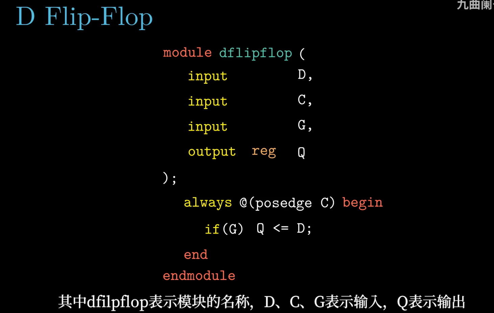

*▲ 图 4-2-7：第一帧先看**代码结构**——`module dflipflop` 是模块名，`input D, C, G` 是三个输入（数据、时钟、使能），`output reg Q` 是输出；`reg` 这个关键字说明 Q 是要"记住"值的状态，不会随 D 即时变化。*

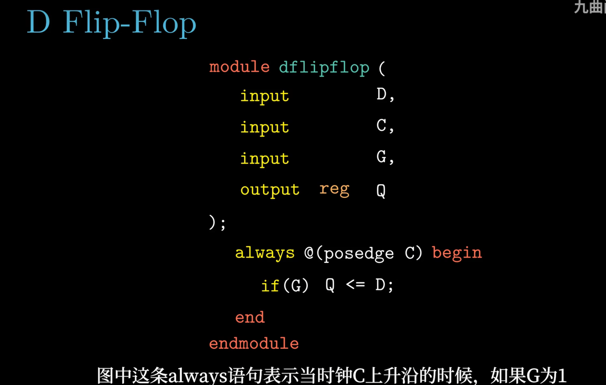

*▲ 图 4-2-8：第二帧看**敏感列表**——`always @(posedge C)` 里的 `posedge C` 限定这段代码只在**时钟 C 的上升沿**被触发；没有上升沿，`if` 和赋值根本不会被求值。这就是"只在时钟沿更新"在 Verilog 里的写法。*

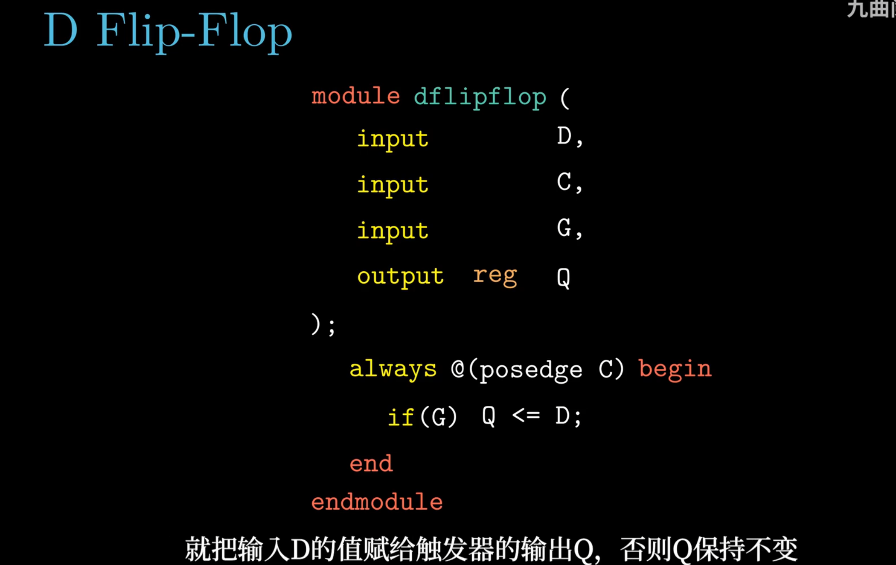

*▲ 图 4-2-9：第三帧看**赋值条件**——上升沿到来时，`if (G) Q <= D` 表示若使能 G 为 1，就把输入 D 的值赋给输出 Q，否则 Q 保持原值。三帧连起来读：**在 C 的上升沿，若 G 为 1 则 Q ← D，否则 Q 不变**——上升沿、使能、赋值条件，缺一不可。*

> [!NOTE]
> 别把 `always` 当成软件里的循环：它是"**每当时钟上升沿这个事件发生，就执行一次**"的硬件描述；`Q <= D` 也不是"立刻改 Q"，而是在时钟沿把 D 采样进 Q。这正是下文寄存器文件"写靠时钟沿、读是组合的"的底层原因。

### （2）寄存器文件（register file）

Y86-64 的寄存器文件有**两个读端口 + 一个写端口**：

```text
                     ┌─────────────────────────────┐
      srcA ─────────▶│ 读端口 A                     │
                     │                             │
      srcB ─────────▶│ 读端口 B                     │────▶ valA
                     │                             │────▶ valB
      dstE ─────────▶│ 写端口                       │
      valE ─────────▶│                             │
                     │            ▲                │
                     │           clk               │
                     └─────────────────────────────┘
```

| 信号 | 作用 |
| :--- | :--- |
| `srcA` / `srcB` | 读哪个寄存器的**编号**（4 位） |
| `valA` / `valB` | 读出的**值**（64 位），组合输出，无需时钟 |
| `dstE` / `dstM` | 写哪个寄存器的编号 |
| `valE` / `valM` | 要写入的值 |
| `clk` | **只有写在时钟沿生效** |

上面的框图只画了"对外接口"。课堂用四帧把内部结构一层一层搭出来，正好看清每个端口怎么落到门和触发器上：

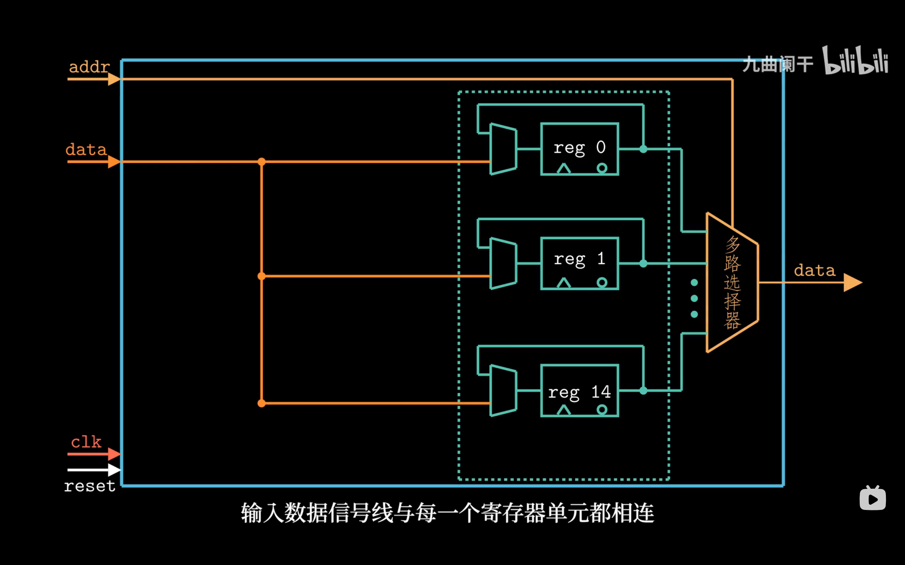

*▲ 图 4-2-10：第 1 步——**先把 data 线接到每一个寄存器单元**。图中只画出 reg 0、reg 1、reg 14（内部共 15 个），可以看到输入 data 线分叉后同时连到每个单元的输入端：写的时候所有单元都收到同一份数据，至于谁真的接收，得靠后面的使能信号。*

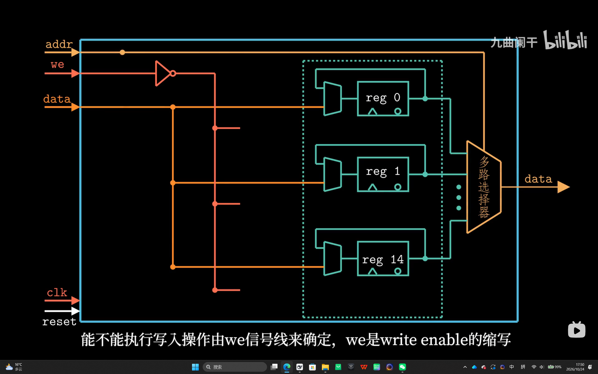

*▲ 图 4-2-11：第 2 步——**加上 we（write enable）**。we 经反相器后分送到每个寄存器的使能端，成为"允不允许写"的总开关。为什么需要它？因为 data 是共享的，若没有 we，每个时钟沿都会把所有单元一起改写。*

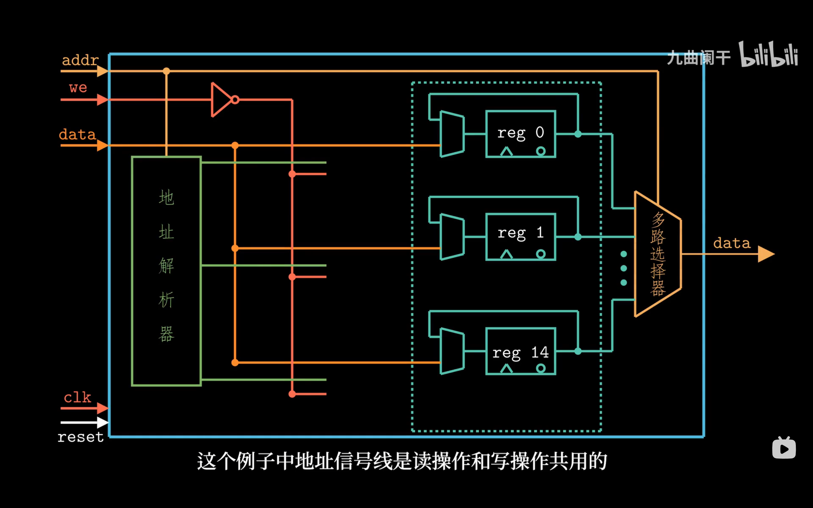

*▲ 图 4-2-12：第 3 步——**加上地址解析器（译码器）**。addr 不再直接当数据用，而是先被译码成"一路选中一个寄存器"的多根控制线。为什么需要它？因为 data 线和 we 只说明了"要写"，还没说明"写哪一个"——15 个单元必须由地址唯一指定。字幕特别指出：这个例子里**地址线是读、写共用的**——同一个 addr 既决定读哪个寄存器，也决定写哪个寄存器。*

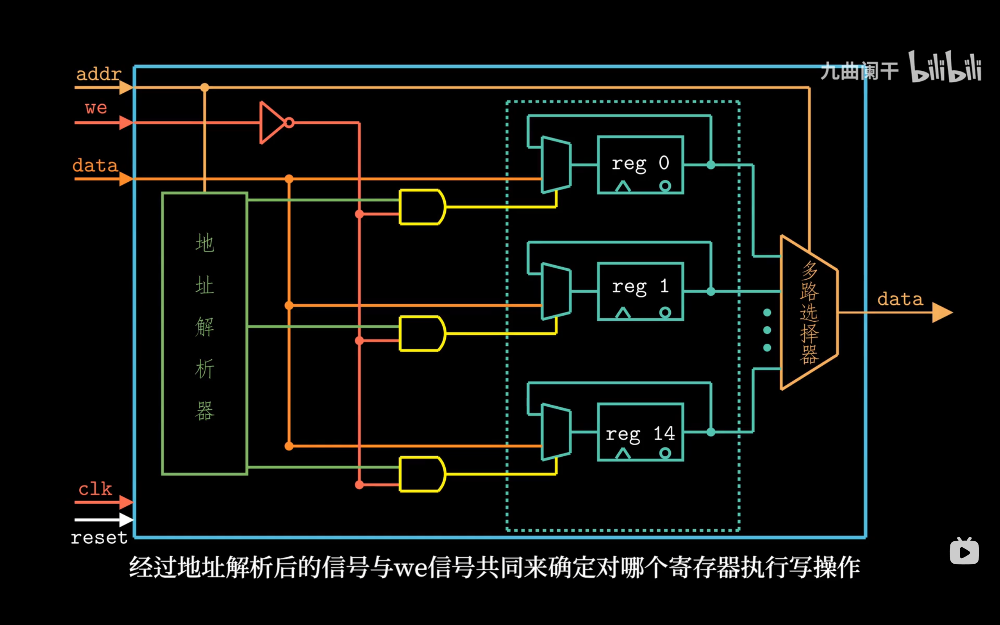

*▲ 图 4-2-13：第 4 步——**把译码输出与 we 相与**。地址解析器的每一路输出接一个与门，与门的另一输入是 we；只有"地址选中"与"we 有效"同时成立，对应寄存器的写使能才会被拉起。这样才真正做到"地址译码 + 写使能"共同选中**唯一**一个寄存器，其余寄存器保持原值。*

四步叠加完，就是一个完整的寄存器文件：内部 15 个触发器单元，**写**走"地址解析器 → 与门 → 写使能"这条链，**读**走右侧的"多路选择器"——按 addr 从 15 个单元里挑一个送到 data 输出。读路径是纯组合逻辑，不经过时钟；写路径只在时钟沿、且地址命中并 we 有效时才动作。课堂这张图为了讲清楚，只画了一个读端口和一个写端口；Y86-64 的寄存器文件把读端口复制成两个（`srcA`/`srcB`），写端口仍是一个（`dstE`/`dstM`）。

> [!IMPORTANT]
> **"读是组合的、写是时钟沿的"**——这条是整章最容易被忽略、也最容易在作业里出错的一点。它意味着：同一个周期内你先读到的总是**旧值**，写入要到周期**结束**才生效。

<details>
<summary>✅ 检查点 2：同一个周期里先写 `%rax` 再读 `%rax`，读到的是新值吗？</summary>

不是，读到的是**旧值**。读端口是组合的，它反映的是"这个沿到来之前寄存器里存着的东西"；写要等周期**结束的那个时钟沿**才落地。所以 4.3 里"这一拍读旧值、下一拍才看到新值"是常态，不是 bug——同一个寄存器在同一拍被读和被写，两者互不干扰。
</details>

### （3）时序约束

```text
   ┌────────── 一个时钟周期 ──────────┐
   │                                          │
   时钟沿                              下一个时钟沿
     │                                        │
     ▼                                    ▼
   ┌──────────────────────────────────────────┐
   │  信号在组合逻辑里传播、稳定（延迟 T_comb）│
   │                          ┌───────────┐   │
   │                          │ 建立时间   │  │
   └──────────────────────────┴───────────┴───┘
                                ▲
                          必须在下一个时钟沿前稳定
```

**时钟周期 ≥ 最长组合逻辑延迟 + 寄存器建立时间**

这条不等式在 4.3 的"时序分析"里会变成一句很具体的结论：**时钟周期由最慢的那条路径决定**（关键路径）。

---

## 4.2.6 ALU 与状态机

到这里零件齐了：组合逻辑负责"算"，时钟寄存器负责"记"。课堂最后用两个例子把它们拼起来——**ALU**（纯组合）和**累加器**（组合 + 时钟），后者就是最小的状态机。

### （1）ALU：四种运算，三个条件码

**算术/逻辑单元（ALU）** 是典型的组合逻辑部件：控制信号 `ALUfun` 选择做哪种运算，`X`、`Y` 一变，结果和条件码就跟着变，**全程没有时钟参与**。

```text
                    ┌───────────────┐
   X ──────────────▶│               │───▶ 结果 X op Y
                    │      ALU      │───▶ CF
   Y ──────────────▶│               │───▶ ZF
                    │               │───▶ OF
   ALUfun ─────────▶└───────────────┘
```

| `ALUfun` | 运算 | 典型用途 |
| :-: | :--- | :--- |
| 0 | `X + Y` | `addq`；地址计算（`leaq`、访存的 `valE`） |
| 1 | `X - Y` | `subq`；`cmpq` 比较；算差 |
| 2 | `X & Y` | `andq` |
| 3 | `X ^ Y` | `xorq`（也常用来清零：`xorq %rax, %rax`） |

四个控制值和 Y86-64 的 `ifun` 功能码一一对应（`addq`=0、`subq`=1、`andq`=2、`xorq`=3），所以 4.3 里 `ALUfun` 可以直接从指令的 `ifun` 接过来，再在非 `OPq` 的情况下强制成"加"。

除了结果，一次运算还要给出条件码所需的几个标志：

| 标志 | 含义 | 谁产生 |
| :--- | :--- | :--- |
| `ZF`（零标志） | 结果为 0 | ALU 输出 |
| `OF`（溢出标志） | 有符号溢出（最高位进位与次高位进位异或） | ALU 输出 |
| `CF`（进位标志） | 无符号进位 / 借位 | ALU 输出 |
| `SF`（符号标志） | 结果为负 | **不是 ALU 的输出脚**：直接取结果的最高位 |

> [!IMPORTANT]
> **ALU 输出的 `CF/ZF/OF` ≠ 程序员可见的条件码 `ZF/SF/OF`。** 差别有两处：
> 1. **`SF` 不占 ALU 的输出脚**，它是结果的最高位（符号位），单独接到条件码寄存器；
> 2. **`CF` 是 ALU 算出来的，但 Y86-64 的 CC 不存它**——Y86-64 没有无符号比较/分支指令（x86 的 `jb`/`ja` 才用 CF），所以 `set_cc` 只把 `ZF`/`SF`/`OF` 写进 CC。
>
> 教材说"ALU 也计算条件码"，指的是 `OF/ZF/CF` 这组**硬件信号**；而"程序员可见的三个条件码"是 `ZF/SF/OF` 这组**体系结构状态**。答题时把这两组名字分清楚，就不会把 `SF` 也算成 ALU 的三根输出之一。

### （2）寄存器：一组边沿触发锁存器

**寄存器（register）** 就是一组**边沿触发锁存器（edge-triggered latch）**并排——字有多少位，就有多少个 D-Q 单元，它们共用同一根 `clk`：

```text
       ┌─────┬─────┬─────┬─────┬───────┬─────┐
   i ─▶│ D Q │ D Q │ D Q │ D Q │  ...  │ D Q │─▶ o
       └─────┴─────┴─────┴─────┴───────┴─────┘
                         ▲
                        clk（所有锁存器共用同一根时钟）
```

因为共用时钟，**整个字在同一个上升沿一起换值**，不会出现"只更新了一半"的中间状态——这正是"字"能作为一个整体被读写的原因。

它的行为可以概括成一句：**大多数时候，它是输入和输出之间的一道栅栏（barrier）**。

```text
                 ┌──────────────┐
   输入 D = y ──▶│              │──▶ 输出 Q
                 │   Register   │
        clk ────▶│              │
                 └──────────────┘

   沿之前：Q = x（旧值，D 怎么变都被挡住）
   沿之后：Q = y（新值，一直保持到下一个沿）
```

| 阶段 | 输入 `D` | 输出 `Q` |
| :--- | :--- | :--- |
| 时钟沿之前 | 任意（可以正在变化） | 保持上一个沿采到的值 |
| 时钟上升沿 | 被采样 | 变成该值，并保持到下一个沿 |

这就是 4.2.5 里那个 D 触发器（图 4-2-7～4-2-9）的字级版本：`%rip`、条件码寄存器都是一个这样的寄存器。

### （3）累加器：组合逻辑 + 时钟 = 状态机

课堂的**累加器**只有一个寄存器，却已经是完整的**状态机**：每个时钟沿，要么把 `In` 装进来，要么把 `In` 加到当前和上。它的数据流通路可以画成这样：

```text
              Load
               │
   0 ───────┐  ▼
            ├──▶[ MUX ]──A──▶[ ALU ]──▶ 下一状态 ──▶[ Register ]──▶ Out
   Out ─────┘                    ▲                        ▲
                                 │                        │
                              In（B 端）              clk（上升沿）

   Out 从寄存器输出端绕回 MUX 的另一个输入——环路穿过寄存器，所以合法。
```

写成 HCL（`Out` 是寄存器当前输出，`Out_next` 是喂给寄存器输入的下一状态）：

```text
int Out_next = [
    Load : In;         # Load=1：装载，相当于重新开始累加
    1    : Out + In;   # Load=0：把 In 累加到当前和上
];
```

| `Load` | 时钟沿之后的 `Out` | 动作 |
| :-: | :--- | :--- |
| 1 | `In` | 装载新初值（覆盖当前和） |
| 0 | `Out + In` | 累加 |

课堂那组波形正好演示一遍（`Load` 在第 1、4 个周期拉高）：

| 周期 | 1 | 2 | 3 | 4 | 5 | 6 |
| :--- | :-: | :-: | :-: | :-: | :-: | :-: |
| `Load` | 1 | 0 | 0 | 1 | 0 | 0 |
| `In` | x0 | x1 | x2 | x3 | x4 | x5 |
| 沿之后的 `Out` | x0 | x0+x1 | x0+x1+x2 | x3 | x3+x4 | x3+x4+x5 |

注意第 4 个周期：`Load=1` 时 `Out` 被 `x3` **覆盖**，而不是把 `x3` 加到 `x0+x1+x2` 上——"装载"和"累加"是互斥的两条路。

把它拆成两半看，状态机的结构就清楚了：

- **组合逻辑（MUX + ALU）**：用"当前状态 `Out` + 输入 `In`/`Load`"算出**下一状态**；
- **寄存器**：存**当前状态**，只在时钟沿更新；
- **反馈环**：`Out` 绕回 MUX。这个环**穿过寄存器**，所以不是 4.2.2 里那种非法的组合环——寄存器把"上一拍"和"这一拍"隔开了。

> [!TIP]
> 读任何时序电路，先问两句话：**状态存在哪个寄存器里？下一状态由哪段组合逻辑算出来？** 把这两半分开，图就不乱了；再找时钟沿，就知道"翻页"发生在哪一刻。4.3 的 SEQ 不过是把这个模式放大：PC、CC、寄存器文件全挂在时钟沿上，中间夹着一大片组合逻辑。

### （4）收束：计算 vs 存储

课堂的总结只有两句话，但它们是整章的骨架：

```text
   计算（computation）
   ├─ 靠组合逻辑：输出是输入的布尔函数
   ├─ 连续响应：输入一变就开始算，但有延迟
   └─ 代价是延迟——它决定时钟周期的下限

   存储（storage）
   ├─ 时钟寄存器：只在时钟上升沿加载输入
   ├─ 随机访问存储器：写等时钟沿，读是组合的
   └─ 存的就是"状态"，让电路有记忆

   计算 + 存储 = 一个时钟周期推进一步
```

| 维度 | 计算 | 存储 |
| :--- | :--- | :--- |
| 靠什么实现 | 组合逻辑（无环门网络） | 时钟寄存器 / RAM |
| 何时更新 | 输入一变就响应（连续） | 时钟上升沿（RAM 的写也等沿） |
| 与历史的关系 | 无关 | 就是历史（状态） |
| 代价 | 延迟，决定时钟周期下限 | 需要时钟、需要满足建立/保持时间 |
| Y86-64 中的例子 | ALU、MUX、`A == B` 比较器 | `%rip`、CC、寄存器文件、DMEM |

一个时钟周期就是这两半的一次握手：**寄存器把当前状态交给组合逻辑 → 组合逻辑在周期内算出结果和下一状态 → 下一个时钟沿把结果写回寄存器**。4.3 的 SEQ 把这句话展开成了取指、译码、执行、访存、写回、更新 PC 六个阶段。

---

## 📌 重点速记

```text
三种门   : AND(&&)  OR(||)  NOT(!)
组合电路 : 无环、输出只依赖输入
HCL 记法 : bool expr        → 1 位
           int  expr        → 字级
           [ s : A; 1 : B; ] → 选择（先成立者胜）
           iexpr in { … }    → 集合判断

时钟寄存器 : 只在时钟沿更新   （PC、条件码、寄存器文件写口）
随机访问存储器 : 读是组合的，写是时钟沿

数字信号 : 电压阈值判 0/1，中间留保护带 → 抗噪、简单、快
门延迟   : 上升延迟 t_pLH / 下降延迟 t_pHL → 级联后就是组合逻辑延迟
ALU      : ALUfun 0=X+Y 1=X-Y 2=X&Y 3=X^Y；输出 CF/ZF/OF
           但 CC 只存 ZF/SF/OF（SF 取结果符号位，CF 不存）
状态机   : 组合逻辑（算下一状态）+ 寄存器（存当前状态）
           Out_next = [ Load : In; 1 : Out + In; ]

时钟周期 ≥ 组合逻辑最大延迟 + 建立时间
```

---

## ⚠️ 易错点

1. **在 HCL 里用 `&`/`|`/`~`。** 那是位运算，HCL 要写 `&&`/`||`/`!`。
2. **写出带环路的"组合电路"。** 例如 `bool x = !x;`——这在硬件里是振荡器，不是电路。
3. **以为 `A == B` 是"一条比较指令"。** 它是 64 个 1 位比较器 + 一棵与树。
4. **选择表达式写成 `if…else` 的思维。** HCL 是"条件同时求值、按顺序挑第一个成立的"，不存在"后面的条件不执行"。
5. **以为存储器读需要时钟。** 读是组合的；只有**写**在时钟沿发生。
6. **以为寄存器文件写入立即生效。** 同一周期内读到的仍是旧值。
7. **`in { }` 里塞变量。** 集合只能含常量。
8. **把 `CF` 当成 Y86-64 的条件码，或把 `SF` 当成 ALU 的输出脚。** ALU 输出的是 `CF/ZF/OF`；`SF` 取结果最高位，`CF` 不进 CC。
9. **把寄存器当导线。** 输入变了输出不会跟着变，只有时钟上升沿才采样；正因如此，穿过寄存器的反馈环才是合法的。
10. **在 HCL 里把"当前状态"和"下一状态"当成同一个信号。** 寄存器输出（当前状态）和寄存器输入（下一状态）之间隔着一个时钟沿，写累加器时要把两者分开命名。

---

## ❓ 常见困惑

**Q：为什么组合电路不能有环？**
A：环会让输出反过来决定自己的输入，形成正反馈，输出永远停不下来（振荡），"输出只由输入决定"这条前提就不成立了。但要注意**穿过寄存器的环是合法的**——4.2.6 的累加器就是，因为寄存器把"上一拍"和"这一拍"隔开，环里就有了时间上的断点。

**Q：HCL 的 `&&` 和 C 的 `&&` 一样吗？**
A：只有真值表一样，别的都不一样。C 的 `&&` 有求值顺序、会短路、结果是 `int`；HCL 的 `&&` 就是**一根与门**，两边同时算、没有"先算左边"这回事，结果是 1 位。同理 `!` 是一根非门，不是 C 里那个对整数取反的运算符。

**Q：寄存器和内存，到底谁需要在时钟沿更新？**
A：**写都在时钟沿，读都是组合的**——两者一样。差别只在读的实现：时钟寄存器的输出就是它存着的值，一直摆在那里；RAM 的读要经过地址译码和多路选择，但同样不需要等时钟。所以"读旧值、写新值"这句话对寄存器文件和内存同时成立。

**Q：情况表达式的顺序为什么重要？**
A：因为硬件只在输出端挑**第一个**成立的，条件本身允许重叠。`[s0 && s1 : A; s0 : B; …]` 里 `s0=1, s1=1` 同时满足前两行，结果永远是 A，**调换两行就换了功能**。它看起来像 `if / else if`，但 C 里没命中的分支根本不求值，HCL 里所有条件都同时算，只是没被选中的那路被丢掉。

## 🛠 动手试试

1. **把 `Min3` 补成能处理相等的版本，再用三组数检验。** 把两处 `<` 都改成 `<=`，然后代入 `(3,3,5)`、`(5,3,3)`、`(3,5,3)`：预期三次输出都是 **3**。若某一组给出 5，说明你只改了一处。
2. **手算一次 ALU 的四个标志。** 令 `X = Y = 0x8000_0000_0000_0000` 做加法：结果为 `0`（进位溢出了 64 位），于是 `ZF = 1`、`SF = 0`、`OF = 1`、`CF = 1`。接着问：Y86-64 的 CC 记住哪三个？预期是 `ZF/SF/OF`，`CF` 被丢掉——这正是它做不了无符号比较的原因。
3. **按周期推一遍累加器。** 取 `Load = 1,0,0,1,0,0`、`In = x0…x5`，在纸上写完六个周期后的 `Out`，再和 4.2.6 的波形表对照。第 4 个周期应当是"覆盖"而非"累加"：`Out` 从 `x0+x1+x2` 直接变成 `x3`。

---

## ✅ 自测

1. 用 HCL 写一个 2 选 1 的 1 位 MUX（选择信号 `s`，输入 `a`、`b`）。
2. `int Out = [s0 && s1 : A; s0 : B; 1 : C];` 在 `s0=1, s1=0` 时输出什么？
3. 为什么组合电路不能有环？
4. 寄存器文件的"读端口"和"写端口"在时序上有什么区别？
5. 把 `icode in { IIRMOVQ, IRMMOVQ }` 展开成只用 `&&`/`||` 的表达式。
6. 若某条组合路径延迟 300 ps、寄存器建立时间 50 ps，时钟周期至少要多少？
7. 写出 `Min3` 的 HCL，并说明最后一行为什么写 `1`。
8. 累加器在 `Load = 0` 时输出什么？`Load = 1` 呢？为什么说它是状态机？
9. ALU 控制值 `3` 执行什么运算？它输出哪三个条件码？Y86-64 的程序员能看到其中哪几个？

<details>
<summary>参考答案</summary>

1. `bool out = (s && a) || (!s && b);`
2. 第一个条件 `s0&&s1 = 0`，第二个 `s0 = 1` 成立 → 输出 **B**。
3. 环路会让输出反过来影响自己的输入，形成正反馈，输出无法稳定（振荡），违背"输出只由输入决定"的定义。
4. 读端口是**组合**的：给出编号立刻得到值；写端口是**时钟沿**触发的：只有 `clk` 上升沿才把 `valE/valM` 写进 `dstE/dstM` 指定的寄存器。
5. `(icode == IIRMOVQ) || (icode == IRMMOVQ)`
6. ≥ 300 + 50 = **350 ps**（还要加上时钟到寄存器输出的延迟，教材简化时忽略）。
7. `int Min3 = [ A < B && A < C : A; B < A && B < C : B; 1 : C; ];`。前两行只覆盖"最小者是 A"和"最小者是 B"，剩下的情况最小者只能是 C，所以最后一行用恒真的 `1` 兜底——情况表达式必须对每种输入组合都有匹配，组合电路不允许"没有输出"。（严格说，前两行用的是严格小于：三数互异时"只能是 C"才成立；若出现 `A == B < C` 会落到 C 上，这时要把 `<` 换成 `<=`。）
8. `Load = 0` 时，下一个时钟沿之后输出 `Out + In`（累加）；`Load = 1` 时输出 `In`（装载，覆盖旧值）。它之所以是状态机，是因为输出不只取决于当前输入，还取决于寄存器里保存的和：组合逻辑（MUX + ALU）算下一状态，寄存器只在时钟沿更新，两者缺一不可。
9. `X ^ Y`（按位异或）；输出 `CF`/`ZF`/`OF`。程序员能看到的只有 `ZF`/`SF`/`OF`——`SF` 是结果的符号位（不占 ALU 输出脚），`CF` 不写进 CC。

</details>

课件最后还建议练习教材 **4.10、4.11** 两题，都在本节范围内，可以拿来做上面自测的补充。

---

## 🔗 与其他章节的联系

| 本节内容 | 后续用在哪 |
| :--- | :--- |
| 三种逻辑门 | 4.3 数据通路的每个部件 |
| 选择表达式 | 4.3 中几乎所有的"信号选择"逻辑 |
| `in { }` 集合关系 | 4.3 的 `need_regids`、`need_valC`、`dstE`、`mem_addr` 等控制信号 |
| 时钟寄存器 vs RAM | 4.3 的时序分析、4.4 流水线寄存器 |
| 时序约束 | 4.4 流水线为什么能提高吞吐量 |
| ALU 的 `ALUfun` 与条件码 | 4.3 的 `ALUfun`、`set_cc`；第 3 章的 `cmpq` 与条件跳转 |
| 累加器（组合 + 寄存器） | 4.3 SEQ 的 PC/CC 更新流程，4.4 的流水线寄存器 |

---

[← 上一节：4.1 Y86-64 指令集体系结构](4.1%20Y86-64%20指令集体系结构.md)　｜　[下一节：4.3 Y86-64 的顺序实现（待整理） →](../README.md)

